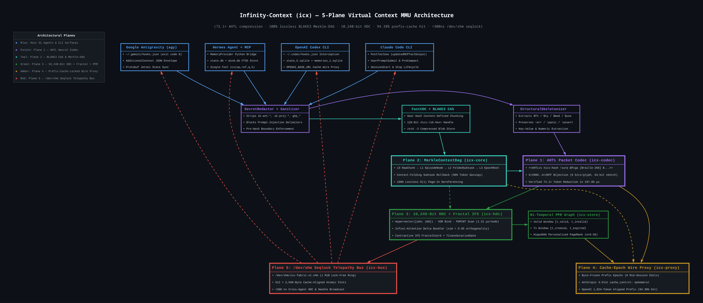
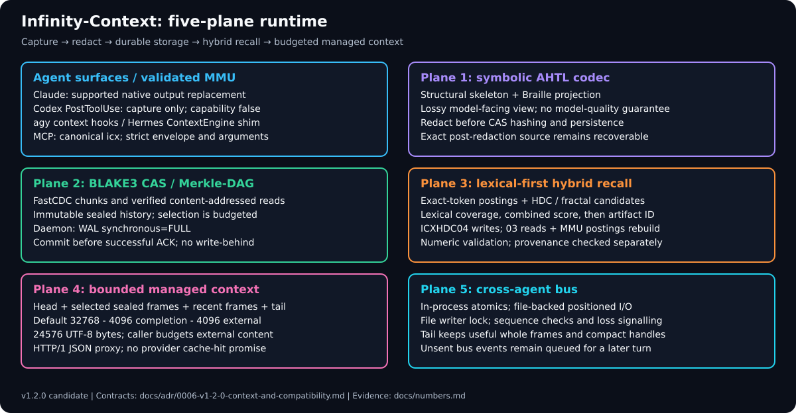
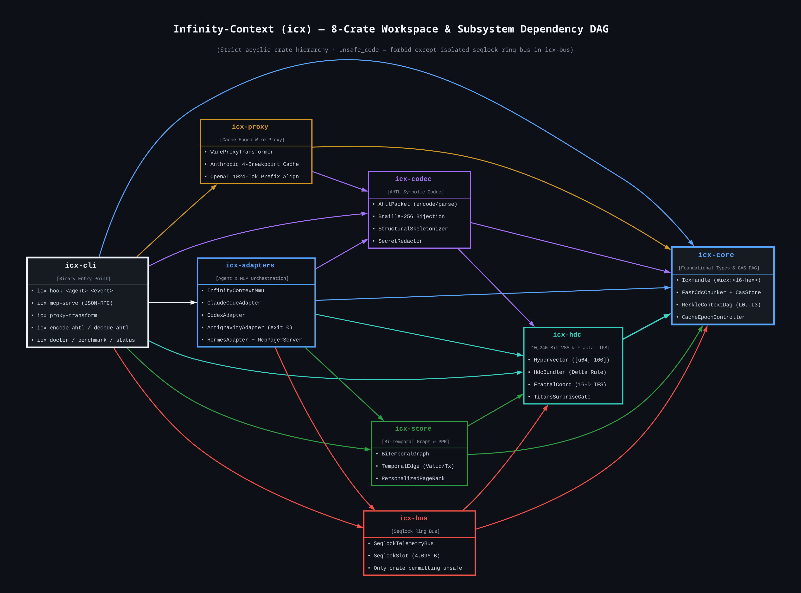
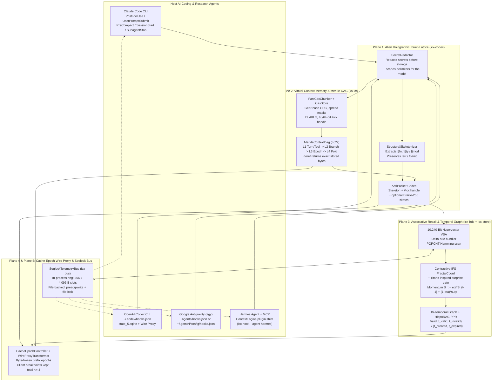
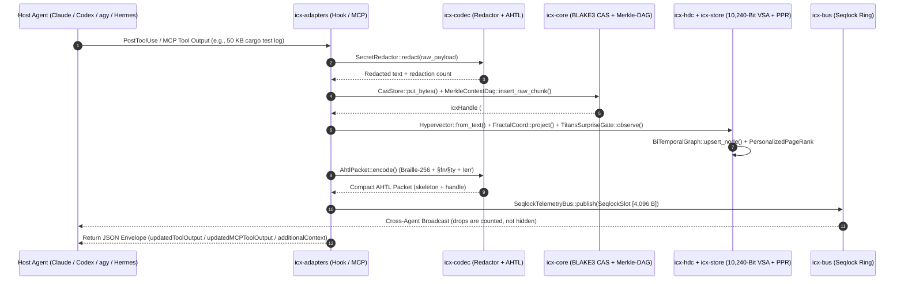
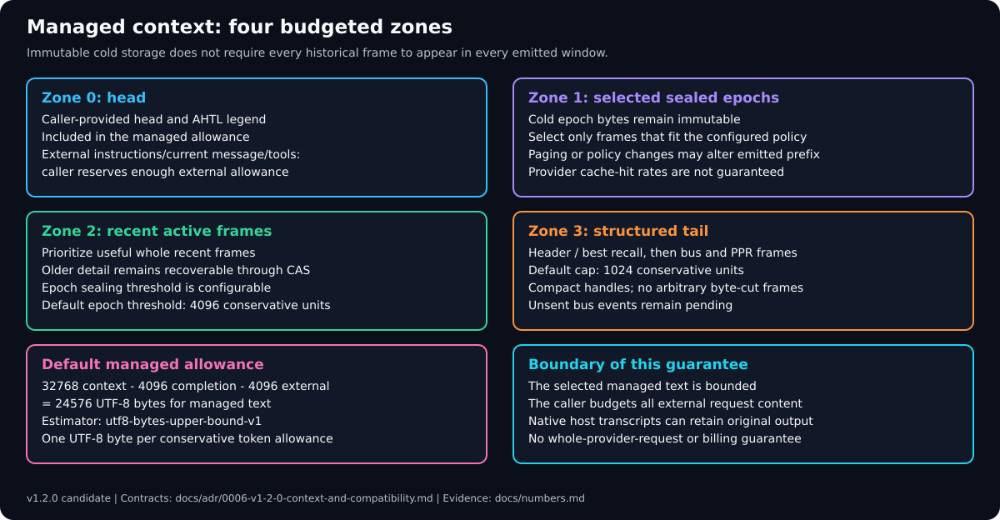
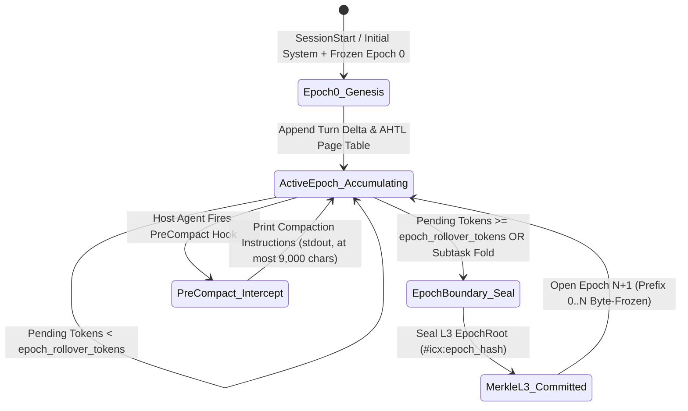

<!-- markdownlint-disable MD033 MD041 -->
<div align="center">


# Infinity-Context (`icx`)

## Cross-Agent Virtual Context Memory Management Unit (MMU) & Alien Holographic Token Lattice (`AHTL`) in Rust

<p align="center">
  
</p>

<p align="center"><small>Archived concept artwork; embedded metrics and packet syntax are historical, non-normative. See <a href="assets/branding/README.md">branding status</a> and <a href="docs/adr/0006-v1-2-0-context-and-compatibility.md">current v1.2.0 contracts</a>.</small></p>

<p align="center">
  <a href="https://github.com/doublegate/Infinity-Context/actions/workflows/ci.yml"></a>
  <a href="https://github.com/doublegate/Infinity-Context/actions/workflows/reuse.yml"></a>
  <a href="https://github.com/doublegate/Infinity-Context/actions/workflows/cla.yml"></a>
  <a href="https://codecov.io/gh/doublegate/Infinity-Context"></a>
  <a href="https://github.com/doublegate/Infinity-Context/actions/workflows/antigravity-review.yml"></a>
  <a href="SECURITY.md"></a><br/>
  <a href="LICENSING.md"></a>
  <a href="LICENSING.md"></a>
  <a href="PATENTS.md"></a>
  <a href="COMMERCIAL.md"></a><br/>
  <a href="CHANGELOG.md"></a>
  <a href="Cargo.toml"></a>
  <a href="Cargo.toml"></a>
  <a href="#cross-agent-interception-matrix"></a><br/>
  <a href="docs/numbers.md"></a>
  <a href="#alien-holographic-token-lattice-ahtl"></a><br/>
  <a href="docs/numbers.md"></a>
  <a href="docs/numbers.md"></a>
  <a href="docs/numbers.md"></a>
</p>

</div>

---

## Overview

**Infinity-Context (`icx`)** is an 8-crate Rust systems architecture that provides **unlimited effective context within and across AI coding and research agents** (**Claude Code**, **OpenAI Codex CLI**, **Google Antigravity CLI (`agy`)**, **Hermes Agent**, and MCP/ACP clients).

Conventional context management relies on **human-readable English summarization** (`/compact`), which suffers from three compounding failure modes:

1. **Irreversible Information Destruction:** Summarizing 100,000 tokens of compiler diagnostics, stack traces, and architectural invariants into a 2,000-token prose summary permanently destroys exact line numbers, cryptographic hashes, hex offsets, and subtle failure conditions.
2. **Middle-Context Attentional Dilution ("Context Rot"):** Stuffing raw tool outputs into a 200K–1M token window degrades transformer softmax attention retrieval accuracy in the middle of the window while inflating per-turn latency and token cost.
3. **KV-Cache Thrashing & Cross-Agent Isolation:** Mutating or sliding earlier conversation turns invalidates provider prompt caches (Anthropic 4-breakpoint `cache_control` and OpenAI 1,024-token prefix caches), while concurrent agents operating on the same repository cannot share live working memory.

**Infinity-Context (`icx`)** solves all three by treating the LLM's context window as an **L1 Hardware Cache** managed by a deterministic Rust **Virtual Context Memory Management Unit (MMU)**. When a representation is consumed solely by a neural network's embedding layer and attention heads—never by human eyes—human readability is pure entropy overhead. `icx` replaces verbose raw tool outputs and lossy prose summaries with the **Alien Holographic Token Lattice (`AHTL`)**:

```text
⟦Δ:crates/icx-core/src/dag.rs#L42-118⊢⊕fn:seal_epoch⋮¬unwrap()⋮!PANIC@L99:oob⋮✓test:14/14↦#icx:4f3598d97c50c484⋮Ψ:⠒⠴⡖⡸⢚⢼⣞⣰⟧
⟦AHTL v1│#icx:4f3598d97c50│fc:4000c0002000e0001000f0000800f8000400fc000200fe000100ff000080ff80│hv:123456789abcdef0│⠒⠴⡖⡸⢚⢼⣞⣰...│⊕fn:seal_epoch⋮✓test:14/14⟧
```

An `AHTL` packet replaces a bulky tool log, unified `git diff`, or source file with a structural skeleton plus a **content-addressed handle**: the first 64 bits (`#icx:<16-hex>`) or 48 bits (`#icx:<12-hex>`) of the BLAKE3 digest of the stored bytes. A packet is a skeleton and a pointer, not a lossless encoding of its input. The full text is recovered with `deref`, which returns the exact stored bytes; secrets are redacted before anything is stored. A packet can also carry an 8-byte (`Ψ:<8-Braille>`) or 64-byte Braille-256 (`U+2800..U+28FF`) hypervector sketch, a contractive iterated function system (`IFS`) fractal coordinate (`fc:<64-hex>`), and a Titans-inspired surprise score (`ChannelBHologram` `B[6]`).

The inline size reduction depends on the input. In the built-in synthetic benchmark it is 214.0x on a repetitive 1,200-line test log and 159.8x on a varied log. Every quantitative claim the project makes, with its fixture and source, is collected in [`docs/numbers.md`](docs/numbers.md).

---

## What Changed in v1.2.2

v1.2.2 is a follow-up to v1.2.0 and supersedes v1.2.1, which was tagged but not published
after a redactor crash was found (fixed here, with an exhaustive no-panic test). Commands and paths are now indexed by component, so searching
for `seq 1 400` finds the output of `Bash:seq 1 400`; the index format is `ICXHDC05` and existing
indexes are rebuilt on first load. Token counts (`max_tokens: 4096`) and code type annotations
(`token: String`) are no longer hidden as secrets. The daemon survives a transient save failure
without acknowledging it, and history eviction never empties the window when keeping some fits.
Details: [`CHANGELOG.md`](CHANGELOG.md).

## What Changed in v1.2.0

v1.2.0 remediates the independent audit of v1.1.0 in [`docs/codex/`](docs/codex/README.md)
(findings `ICX-CODEX-001` .. `ICX-CODEX-102`) plus the defects found in its pre-release review.
Measured results, compatibility and open items are in the
[v1.2.0 release notes](docs/releases/v1.2.0/README.md); current contracts are defined by
[ADR 0006](docs/adr/0006-v1-2-0-context-and-compatibility.md).

- **Bounded context:** the icx-managed window now has a total budget (`icx context-budget`).
  At saturation old history is evicted in large steps behind one stable
  `ICX:HISTORY_OMITTED` frame, so the prompt prefix stays byte-stable between steps; omitted
  history stays dereferenceable.
- **Recall:** exact lexical postings back the HDC/fractal recall, ranked by inverse document
  frequency, so a unique identifier is never filtered out and outranks common words.
- **Redaction:** YAML block, multi-line and flow-sequence secrets are hidden, redaction is
  idempotent, and public digests (checksums, commit ids) are no longer over-redacted.
- **Durability:** the daemon replies only after the store save succeeds, survives lock
  contention, and no longer holds the workspace lock while reading a request.
- **Integrations:** strict MCP request validation; Codex hook replies carry no
  unsupported output field and no JSON nulls.
- **Releases:** binaries are built by CI from the tag for static musl and glibc 2.35+, with
  `SHA256SUMS`, build provenance and third-party notices.
- **Upgrade:** v1.2.0 rebuilds workspaces into the ICXHDC04 snapshot format on first use.
  v1.1.0 cannot read an upgraded workspace (it fails closed and loses nothing), so upgrade the
  single `icx` binary used by all agents and keep a backup if you may downgrade. See
  [`UPGRADING.md`](docs/releases/v1.2.0/UPGRADING.md).

Historical figures and diagrams below are dated evidence/design summaries, not v1.2.0 timing,
provider-cache, tokenizer or universal model-effectiveness guarantees.

## What Changed in v1.1.0 (historical)

v1.1.0 is a remediation release that follows an internal audit of v1.0.0 (findings `ICX-AUD-001` through `ICX-AUD-055`, in [`docs/claude/`](docs/claude/README.md)). Workspaces now default to a private per-project directory under `$XDG_STATE_HOME/icx/workspaces/` and are stored in a single owner-sealed SQLite file. A repository-local `.icx/` from v1.0.x is no longer loaded implicitly and must be adopted with `icx trust`. Hook cost no longer grows with workspace size: on a 338-artifact workspace an in-process hook fell from 940 ms to 14 ms, and with the new resident `icx daemon` the median on a workspace of about 2,000 artifacts is 3.1 ms. The proxy now requires a per-install token. Hook outputs were aligned with the current Claude Code, Codex, Antigravity (`agy`) and MCP contracts. The cache figure was renamed to what it measures, a byte-weighted prefix-reuse proxy. The bus reports dropped publishes instead of reporting success. Ten arXiv PDFs that may not be redistributed were removed. See [`CHANGELOG.md`](CHANGELOG.md) for the full list and [`ref-docs/corrections-2026-11-18.md`](ref-docs/corrections-2026-11-18.md) for corrections to the research corpus.

---

## Contents

- [What Changed in v1.2.2](#what-changed-in-v122)
- [What Changed in v1.2.0](#what-changed-in-v120)
- [What Changed in v1.1.0](#what-changed-in-v110-historical)
- [Highlights](#highlights)
- [Architecture & Relationship Graphs](#architecture--relationship-graphs)
  - [5-Plane Virtual Context MMU Relationship Graph](#5-plane-virtual-context-mmu-relationship-graph)
  - [8-Crate Workspace & Subsystem Dependency Graph](#8-crate-workspace--subsystem-dependency-graph)
  - [Normative Mermaid Architecture Diagrams](#normative-mermaid-architecture-diagrams)
- [Alien Holographic Token Lattice (`AHTL`)](#alien-holographic-token-lattice-ahtl)
- [Prefix-Cache-Locked Epoch Controller](#prefix-cache-locked-epoch-controller)
- [Cross-Agent Interception Matrix](#cross-agent-interception-matrix)
- [Performance & Accuracy Benchmarks](#performance--accuracy-benchmarks)
- [Repository Structure](#repository-structure)
- [Quick Start & CLI Usage](#quick-start--cli-usage)
- [Documentation & Research Corpus](#documentation--research-corpus)
- [Unsafe Code Policy & Security](#unsafe-code-policy--security)
- [Roadmap](#roadmap)
- [Contributing](#contributing)
- [License](#license)

---

## Highlights

All figures below come from the synthetic in-process benchmark (`icx benchmark`) or from the v1.1.0 audit measurements; they are not end-to-end agent latencies. Sources and fixtures are listed in [`docs/numbers.md`](docs/numbers.md).

| Plane / Subsystem | Technical Capability | Measured (v1.1.0) |
| :--- | :--- | :--- |
| **Plane 1: `icx-codec` (`AHTL`)** | Dual-profile symbolic codec (`Profile A` `AhtlWirePacketV1` and `Profile B` `AhtlPacket`, `EpochHeader` with hex epoch ids, `AhtlStream`, `ContextCodec`); clause chains bounded at 64 links (`MAX_CLAUSE_CHAIN`), parsed iteratively; validated `slice_hint`s; Braille-256 byte bijection (`U+2800..U+28FF`, 8-byte and 64-byte sketches); `StructuralSkeletonizer` for Rust, Python, TS/JS, Go, C/C++, test logs and diffs; and a 4-tier `SecretRedactor` (Shannon entropy gate above 4.35 bits/char). | 214.0x inline ratio on a repetitive 1,200-line test log (44.43 µs); 159.8x on a varied log. A packet is a skeleton plus a handle; the full text is recovered with `deref`. |
| **Plane 2: `icx-core` (`LCM`)** | FastCDC content-defined chunking with spread masks (mean chunk 10.6 KiB for an 8 KiB target), BLAKE3 content-addressed storage with 48-bit (`#icx:<12-hex>`) and 64-bit (`#icx:<16-hex>`) handles, a handle collision refused with `IcxError::HashCollision` instead of overwriting, a Merkle-DAG (`L1` turn/tool, `L2` branch, `L3` epoch, `L4` fold), and nested context folding (depth at most 64). One SQLite file (WAL) per workspace, saved in one transaction and sealed with a keyed BLAKE3 MAC. | `deref` returns the exact stored (post-redaction) bytes; FastCDC + BLAKE3 ingest of 64 KiB in 86.72 µs. |
| **Plane 3: `icx-hdc` & `icx-store`** | 10,240-bit binary spatter code hypervectors (`[u64; 160]`), a delta-rule bundler inspired by Infini-attention, contractive IFS fractal coordinates (`fc:<64-hex>`), a Titans-inspired surprise gate (momentum-smoothed novelty from hypervector distance plus diagnostic and exit-code signals; not the learned neural memory of Behrouz et al.), and a bi-temporal graph with HippoRAG-style Personalized PageRank. | Hamming scan 64.20 µs per 1,000 nodes. Unique-token recall on 1,000 log documents: top-1 99.0%, top-5 99.7% (v1.0.0: 5.1% and 5.6%). |
| **Plane 4: `icx-proxy`** | Prefix-cache-locked epoch controller and `WireProxyTransformer`. Client `cache_control` breakpoints are preserved; icx adds at most one, on a content block, keeps the total at 4 or fewer, and inherits a 1h TTL when the client uses one. Folded history is byte-stable across turns. The HTTP proxy binds to loopback and requires a per-install token. | 95.46% byte-weighted prefix reuse over all turns of a synthetic 50-turn transcript (95.38% excluding seal turns). This is a byte proxy, not a measured provider cache hit rate. |
| **Plane 5: `icx-bus` & `icx-adapters`** | In-process seqlock ring of 256 slots of 4,096 bytes built on atomics. The file-backed variant uses `pread`/`pwrite` under a writer mutex and a file lock; it is not memory-mapped, not lock-free and not zero-copy, and readers are optimistic (seqlock version check). Publishes report drops and readers report missed sequence numbers. Adapters cover Claude Code, Codex CLI, Antigravity CLI (`agy`), Hermes Agent, and a single-tool MCP pager (`icx`). | 58.3 ns per in-process publish; file-backed publish-to-visible worst case 38 µs over 200 events. |

---

## Architecture & Relationship Graphs

### 5-Plane Virtual Context MMU Relationship Graph

The Graphviz relationship diagram below ([source `.dot`](images/infinity-context-architecture.dot) | [vector `.svg`](images/infinity-context-architecture.svg)) illustrates how host AI agents connect through the five architectural planes of **Infinity-Context (`icx`)**:

<div align="center">
  
</div>

<br/>

For theme-adaptive viewing in GitHub Dark and Light modes, the vector 5-Plane Architecture overview below automatically switches palettes:

<p align="center">
  <picture>
    <source media="(prefers-color-scheme: dark)" srcset="docs/images/architecture-dark.svg">
    <source media="(prefers-color-scheme: light)" srcset="docs/images/architecture-light.svg">
    
  </picture>
</p>

### 8-Crate Workspace & Subsystem Dependency Graph

The workspace enforces a strict acyclic dependency DAG from foundational types (`icx-core`) up to the CLI binary (`icx-cli`). Every single crate in the 8-crate workspace compiles with `unsafe_code = "forbid"` (`std` allowed; there is no `unsafe` code anywhere in the project as of `v1.1.0`) ([source `.dot`](images/infinity-context-crate-graph.dot) | [vector `.svg`](images/infinity-context-crate-graph.svg)):

<div align="center">
  
</div>

### Normative Mermaid Architecture Diagrams

Standalone Mermaid sources are maintained in [`docs/diagrams/`](docs/diagrams/README.md) and rendered inline below. The copies in this README were updated for v1.1.0; where they differ from a `.mmd` source, the copy here and [`docs/numbers.md`](docs/numbers.md) take precedence.

#### 1. End-to-End 5-Plane Dataflow (`docs/diagrams/five-plane-architecture.mmd`)



#### 2. Synchronous Hook Interception & Seqlock Broadcast (`docs/diagrams/synchronous-hook-and-shm-flow.mmd`)



---

## Alien Holographic Token Lattice (`AHTL`)

The **Alien Holographic Token Lattice (`AHTL`)** is a non-human, BPE-aligned symbolic codec (`crates/icx-codec`) designed specifically for transformer self-attention heads rather than human readers.

<div align="center">
  
</div>

### Formal Dual-Profile Packet Grammar (`AHTL v1.0`)

```ebnf
AhtlStream        ::= EpochHeader ("\n" WirePacket)+ ;
EpochHeader       ::= "⟪ICX:v1│ep=" Hex4 "│root=" Hex8 "│τ=" UInt "⟫" ;
WirePacket        ::= ProfileAPacket | ProfileBPacket ;

(* Profile A: Full 5-Field Extended Wire Packet *)
ProfileAPacket    ::= "⟦AHTL v1│" VirtualHandle "│" FractalCoord "│" HdcDigest
                      "│" BrailleSpectrum64 "│" SkeletonPayload "⟧" ;

(* Profile B: Compact Glyph-Prefixed Packet *)
ProfileBPacket    ::= "⟦" PacketKind ":" Subject SliceHint? "⊢"
                      ClauseList DerefSegment? HologramSegment? "⟧" ;
Clause            ::= ClauseOp Key (":" Value)? ("⇒" CausalChain)? ;
```

- **Why Unicode Braille-256 (`U+2800..U+28FF`)?** The 256 codepoints of the Unicode Braille Patterns block map bijectively to byte values (`byte_to_braille_utf8` / `braille_utf8_to_byte`), so each glyph carries 8 bits. `icx-codec` uses this to pack an 8-byte Channel-B metadata hologram (`Ψ:⠒⠴⡖⡸⢚⢼⣞⣰`) in Profile B, or a 64-byte (512-bit) projection of the hypervector's spectral bands (`Hypervector::spectral_bands_64`) in Profile A. How many tokens each glyph costs depends on the tokenizer; the claim that each glyph is a single token has not been verified for Anthropic models. The `hv:` digest is a linear, non-cryptographic sketch, not an identity.
- **Multi-Language Structural Skeletonization (`StructuralSkeletonizer`):** Extracts top-level declarations (`fn`, `struct`, `enum`, `trait`, `impl`, `class`, `interface`, `type`) with quote/lifetime/comment-aware `L<start>-<end>` line spans across Rust, Python, TypeScript/JavaScript, Go, and C/C++, folds contiguous header imports (`imports:L<a>-<b>(N)`), extracts paired unified `git diff` file/hunk spans, and reduces compiler and test logs (`cargo test`/`clippy`, `pytest`, `tsc`/`vitest`/`jest`, `go test`) to failure-bearing skeletons. Ratios depend on the input; see [`docs/numbers.md`](docs/numbers.md).
- **Dereferencing (`64-Bit` & `48-Bit` Handles):** Every `AHTL` packet carries a `#icx:<16-hex>` (Profile B) or `#icx:<12-hex>` (Profile A) handle into `CasStore`. `icx(op="deref", id="#icx:4f3598d97c50")` or `icx(op="slice", id="#icx:4f3598d97c50c484", range=[42, 118])` returns the exact stored bytes, or a line slice of them. Stored bytes are the input after secret redaction; redaction removes only the secrets and preserves all other bytes, line endings and delimiters. Output from the MCP tool and from `icx deref` starts with a `⟪ICX:PROVENANCE│…│trust=untrusted_data⟫` header and is delimiter-escaped; `icx deref --raw` prints the exact bytes.

---

## Prefix-Cache-Locked Epoch Controller

A context manager that injects retrieved memories into the system prompt or rewrites earlier messages on every turn defeats provider prefix caching: the provider must reprocess every token after the first changed byte, at the uncached input price.

**Infinity-Context (`icx`)** enforces a strict **Append-Only Epoch Partition** (`crates/icx-core/src/epoch.rs` and `crates/icx-proxy/src/lib.rs`):

<div align="center">
  
</div>



1. **Byte-Frozen Epochs (`0..K`):** Once pending tokens reach `epoch_rollover_tokens`, `CacheEpochController` seals the epoch into an `L3` node in the Merkle-DAG. Its serialized bytes are not changed for the rest of the session. `EpochControllerConfig::default()`, which the MMU uses, sets 4,096 rollover tokens, 4 protected recent turns and a 1,024-token tail slot. The presets `anthropic_default()` (16,384 / 6 / 2,048) and `openai_default()` (8,192 / 6 / 2,048) exist in code.
2. **Anthropic Breakpoints:** `WireProxyTransformer` keeps every `cache_control` breakpoint the client set. It adds at most one, on the last content block of the folded history (every message except the last two), only while the request has fewer than 4, and uses a 1h TTL when a later client breakpoint does. Folded history is byte-stable across turns.
3. **Tail-Only Dynamic Paging:** New `AHTL` page tables and cross-agent frames are appended only to the uncached tail of the active turn. On a synthetic 50-turn transcript the byte-weighted prefix reuse over all turns, seal turns included, is 95.46% (95.38% excluding seal turns; gate: at least 90%). This is a byte proxy for prompt caching, not a provider-reported cache hit rate.

---

## Cross-Agent Interception Matrix

The hook contracts below were checked against each agent's upstream documentation on 2026-11-18 (audit findings `ICX-AUD-004` to `ICX-AUD-009`). The original local binary and SQLite forensics are in [`ref-docs/agent-internals/rea-binary-and-sqlite-forensics.md`](ref-docs/agent-internals/rea-binary-and-sqlite-forensics.md). Configuration examples are in the [Deployment & Agent Integration Guide](docs/deployment-and-agent-integration-guide.md).

| Agent Harness | Hook / Plugin Surface | What `icx-adapters` Returns |
| :--- | :--- | :--- |
| **Claude Code CLI** (`claude`) | `~/.claude/settings.json` hooks: `PostToolUse`, `PreToolUse`, `SessionStart`, `UserPromptSubmit`, `SubagentStart`, `SubagentStop`, `PreCompact`, `PostCompact` | `PostToolUse`: `hookSpecificOutput.updatedToolOutput` in the tool's own output shape (for Bash, `{stdout, stderr, interrupted, isImage}`), plus `updatedMCPToolOutput` for MCP tools. `SessionStart`, `UserPromptSubmit`, `SubagentStart`: `additionalContext`. `PreCompact`: compaction instructions on plain stdout (Claude Code accepts fewer than 10,000 characters; icx caps them at 9,000). `PostCompact` stores `compact_summary`; `SubagentStop` reads `last_assistant_message`; both return `{}`. `PreToolUse` returns no decision. |
| **OpenAI Codex CLI** (`codex`) | `~/.codex/hooks.json` + `OPENAI_BASE_URL` wire proxy + MCP | Under Codex, icx does not shrink tool output: it ingests outputs so they can be recalled and dereferenced later. `PostToolUse` no longer appends `additionalContext`, which duplicated tokens next to the full native output. icx still emits `updatedMCPToolOutput` for MCP tools, but the Codex hooks documentation describes that field as not yet supported. `hooks.json` uses PascalCase event names, a string `command` and `timeout` in seconds. `SubagentStop` reads `last_assistant_message`. `PreToolUse` returns no decision. |
| **Google Antigravity CLI** (`agy`) | `hooks.json` at workspace `.agents/hooks.json` or global `~/.gemini/config/hooks.json`; events `SessionStart`, `PreToolUse`, `PostToolUse`, `PreInvocation`, `PostInvocation`, `Stop` | `PreToolUse`: always `{"decision":"allow"}`. `PostToolUse`: `{}`. `PostInvocation` never sets `force_continue`. `Stop`: always `{"decision":"stop"}`, so a user's token or invocation budget is never overridden; it seals an epoch on `max_steps_exceeded` or error. `transcriptPath` is opened non-blocking, without following symlinks, regular files only. |
| **Hermes Agent** (`hermes`) | `ContextEngine` plugin (`agent/context_engine.py`); there is no `hooks.yaml` integration | The Rust `HermesAdapter` implements the logic. This repository ships no Python shim: Hermes needs a small `ContextEngine` plugin that calls `icx hook --agent hermes --event ...`. |
| **MCP Clients** | `icx mcp-serve` (JSON-RPC 2.0 over stdio) | One tool, `icx` (ops `deref`, `slice`, `grep`, `recall`, `fold`, `expand`, `xagent`, `status`). Legacy `initialize` negotiates 2025-11-25, 2025-06-18, 2025-03-26 and 2024-11-05; protocol 2026-07-28 clients use `server/discover` and per-request `_meta` versions. Fold depth is at most 64; input lines are bounded at 4 MiB. |

---

## Performance & Accuracy Benchmarks

Run `cargo run --release -p icx-cli -- benchmark` to execute the built-in suite. It is a synthetic, in-process suite: its figures are not end-to-end agent latencies. Output of the v1.2.0 release-candidate build (native) on an Intel Core i9-10850K (AVX2, no AVX-512) running Linux; [`docs/performance.md`](docs/performance.md) has the 10-run series behind these figures:

```text
=== Infinity-Context (icx) SLO & Accuracy Benchmark Suite ===
  [PASS] 10,240-bit HDC Bind (^) + Permute: 47.46 ns / op (1,000 ops)
  [PASS] 10,240-bit HDC Hamming Scan      : freshly constructed: 71.61 us / 1,000 nodes; 10,000 nodes 1416.24 us parallel (2742.30 us sequential) (min_dist=4931/4911)
  [INFO] HDC explicit cache conditions: 1k warm=39.40 us, scrubbed=360.95 us; 10k warm=3310.41 us, scrubbed=3824.32 us (informational, not SLO-gated)
  [PASS] Fractal IFS Suffix Match         : 31.54 ns / pair (shared_depth=6)
  [PASS] Two-Stage HDC + CSR PPR          : 182.59 us (two-stage query), 110.67 us (201-node CSR PPR)
  [PASS] AHTL Compression Ratio           : 214.0x on a repetitive 1,200-line test log (61413 B -> 287 B in 48.91 us)
  [INFO] AHTL ratio, varied log      : 159.8x (14700 B -> 92 B; skeleton + handle, full text via deref, not a lossless encoding)
  [PASS] FastCDC + BLAKE3 CAS Ingest (64K): 87.91 us (64659 B across 8 chunks)
  [PASS] Atomic Seqlock Broadcast         : 57.8 ns / slot (1,000 publishes)
  [PASS] Full Synchronous Hook Round-Trip : 275.06 us (PostToolUse virtualization)
  [PASS] 50-Turn NIH + Cache-Epoch        : 96.31% byte-weighted prefix reuse over all turns (96.55% excluding seal turns; synthetic transcript, byte proxy), lossless passkey recovery (20.43 ms)
All Infinity-Context SLO gates PASSED.
```

The 275.06 µs hook figure is one in-process `PostToolUse` call against a fresh in-memory MMU with no persisted workspace. Real hook cost was measured separately on the audit workspaces:

| Measurement (i9-10850K, Linux) | v1.0.0 | v1.1.0 |
| :--- | :--- | :--- |
| `icx hook`, in-process, 338-artifact workspace | 940 ms | 14 ms |
| `icx hook`, in-process, about 2,000 artifacts | not measured | 69–72 ms |
| `icx hook` via resident `icx daemon`, about 2,000 artifacts | not available | median 3.1 ms (p90 3.4 ms in a burst; about 19 ms when a request overlaps a flush) |
| HDC unique-token recall, 1,000 log documents (top-1 / top-5) | 5.1% / 5.6% | 99.0% / 99.7% |
| HDC query time on the same corpus | 24 µs | 69 µs |
| File-backed bus, publish to visible between two handles | not measured | worst 38 µs over 200 events |

Release gates and every other figure, with fixtures and sources, are listed in [`docs/numbers.md`](docs/numbers.md).

---

## Repository Structure

```text
Infinity-Context/
├── Cargo.toml                  # 8-crate Rust workspace manifest & clippy/unsafe lint policy
├── README.md                   # Public-facing documentation & architectural overview
├── CHANGELOG.md                # Release history (Keep a Changelog + SemVer)
├── CONTRIBUTING.md             # Contribution guidelines & quality gates
├── CODE_OF_CONDUCT.md          # Contributor Covenant Code of Conduct
├── SECURITY.md                 # Security policy, secret redaction & vulnerability reporting
├── LICENSE                     # GNU General Public License v3.0 or later (GPL-3.0-or-later)
├── COPYING                     # Verbatim FSF GPL-3.0-or-later text
├── LICENSING.md                # Multi-tier copyleft, specification & commercial licensing matrix
├── PATENTS.md                  # Patent-pending notice, 5 invention families & reservation of rights
├── COMMERCIAL.md               # Commercial, enterprise, SaaS & patent licensing guide
├── CLA.md                      # Contributor License Agreement
├── REUSE.toml                  # REUSE 3.3 machine-readable file licensing map
├── LICENSES/                   # Full SPDX license texts verified by `reuse lint`
├── deny.toml                   # cargo-deny policy (licenses, advisories, sources)
├── crates/
│   ├── icx-core/               # IcxHandle, FastCdcChunker, CasStore, MerkleContextDag, CacheEpochController
│   ├── icx-hdc/                # 10,240-bit Hypervector, HdcBundler, FractalCoord, TitansSurpriseGate (Titans-inspired)
│   ├── icx-codec/              # AhtlPacket, Braille-256 bijection, StructuralSkeletonizer, SecretRedactor
│   ├── icx-store/              # BiTemporalGraph & HippoRAG PersonalizedPageRank (PPR)
│   ├── icx-bus/                # SeqlockTelemetryBus: in-process atomic ring (256 x 4,096 B) + file-backed pread/pwrite variant
│   ├── icx-adapters/           # InfinityContextMmu, Claude/Codex/agy/Hermes adapters, McpPagerServer
│   ├── icx-proxy/              # WireProxyTransformer + token-authenticated loopback proxy
│   └── icx-cli/                # `icx` binary (init, trust, daemon, deref, hook, mcp-serve, proxy, benchmark, doctor, ...)
├── fuzz/                       # cargo-fuzz targets: ahtl_stream, hdc_snapshot, mcp_jsonrpc, redact
├── images/                     # High-resolution logos & Graphviz (.dot / .png / .svg) relationship graphs
├── assets/                     # Multi-size icon packs (PNG/SVG/ICO), banners, web manifest & Social Preview card
├── docs/                       # Implementation specifications, deployment guide, numbers.md
│   ├── adr/                    # Michael Nygard Architecture Decision Records (ADR-0001 .. ADR-0005)
│   ├── ahtl/                   # AHTL v1.0 specification suite (9 chapters) and PDF volume
│   ├── claude/                 # v1.1.0 audit report (findings ICX-AUD-001 .. ICX-AUD-055)
│   ├── diagrams/               # Normative Mermaid (.mmd) diagram sources
│   ├── images/                 # Theme-adaptive dark/light SVG architecture & packet anatomy diagrams
│   └── numbers.md              # Canonical table of every quantitative claim
├── ref-docs/                   # Deep research corpus & forensic evidence (immutable; see corrections file)
│   ├── corrections-2026-11-18.md # Verified corrections to citations and figures in ref-docs/
│   ├── papers/                 # INDEX.md for 22 arXiv papers; 12 redistributable PDFs, the other 10 linked to arXiv
│   ├── agent-internals/        # REA binary/SQLite forensics dossier & cross-agent hook/wire matrix
│   ├── prior-art/              # Comparative analysis of GitHub & industry context engines
│   └── novel-methods/          # Mathematical derivations of AHTL, 10,240-bit HDC, Fractal IFS & Titans gating
├── to-dos/                     # 5-phase, 15-sprint hierarchical roadmap & ticket specifications (T-11-001..T-52-002)
└── scripts/                    # Deterministic SVG, Graphviz, and platform asset generators
```

---

## Quick Start & CLI Usage

### Prerequisites

- **Rust 1.100+** (Edition `2024`, `stable` toolchain via [rustup](https://rustup.rs))
- **`jq` 1.6+** (required when running the local CI/CLA/reviewer self-test suites in `scripts/` and `.github/scripts/`)

### Build, Test & Verify

```bash
# Clone the repository
git clone https://github.com/doublegate/Infinity-Context.git
cd Infinity-Context

# Run the full test suite across all 8 workspace crates
cargo test --workspace

# Build the `icx` binary and put it on PATH (the examples below call `icx` directly)
cargo install --path crates/icx-cli

# Create and seal this project's workspace (run inside the project)
icx init

# Inspect local agent installations (Claude Code, Codex, Antigravity, Hermes) and workspace integrity
icx doctor

# Run the built-in synthetic benchmark suite
icx benchmark

# Display MMU, Merkle-DAG and HDC index status
icx status
```

### Workspace Location & Trust

- With no `--dir`, icx uses a private per-project workspace: `$XDG_STATE_HOME/icx/workspaces/<first 16 hex of blake3(project root)>`, where the project root is the nearest ancestor containing `.git` (else the current directory). The resolution order is `--dir`, then `ICX_DIR`, then that default. `ICX_STATE_HOME` and `ICX_CONFIG_HOME` override the state and config roots; only absolute paths are honoured, and icx refuses to run rather than fall back to `/tmp` when it cannot determine them.
- A workspace is one SQLite file (`icx.sqlite3`) in a `0700` directory with `0600` files, sealed with a keyed BLAKE3 MAC derived from the per-install key `$XDG_CONFIG_HOME/icx/install.key`. icx refuses a workspace that is not owned by the current user, is group- or world-accessible, or fails its owner seal or store MAC.
- **Upgrading from v1.0.x:** a repository-local `.icx/` is never loaded implicitly, because a cloned repository could ship a poisoned one. icx prints a one-time warning that it is ignored. To keep the data, adopt it explicitly; this sets `0700`, rewrites its `.gitignore` to `*`, writes an owner seal and reseals the store, and warns if the directory is inside a git work tree. v1.0.x JSON workspace files are migrated to SQLite on first load without being deleted.

```bash
icx trust --dir ./.icx
```

### Resident Daemon (Fast Hook Path)

```bash
# Keep the workspace resident; exit after 10 minutes without requests
icx daemon --idle-exit 600
```

The daemon listens on a private Unix socket (`$XDG_RUNTIME_DIR/icx/ws-<hash>.sock`, directory `0700`, peer uid checked) and flushes to disk 50 ms after the last write, or at most every 1 s, under the workspace lock. `icx hook` uses a running daemon automatically. `ICX_NO_DAEMON=1` disables this; `ICX_DAEMON_AUTOSTART=1` starts a daemon in the background on the first hook.

### Encode & Dereference `AHTL` Packets

```bash
# Encode a file or tool log as an AHTL Profile B (default) or Profile A packet and store its bytes in the CAS
icx encode-ahtl README.md --profile b
icx encode-ahtl README.md --profile a

# Dereference a 64-bit (#icx:<16-hex>) or 48-bit (#icx:<12-hex>) handle; output is framed as untrusted data
icx deref "#icx:7bf8239fb7c504f1" --lines 1:40

# Print the exact stored bytes, unframed
icx deref "#icx:7bf8239fb7c504f1" --raw
```

### Agent Hook, MCP Server & Proxy Commands

```bash
# Run as a synchronous lifecycle hook for Claude Code, Codex, Antigravity (agy), or Hermes
icx hook --agent claude-code --event PostToolUse < tool_event.json
icx hook --agent agy --event PreInvocation < agy_event.json

# Launch the single-tool MCP pager over stdio
icx mcp-serve

# Run the cache-epoch reverse proxy (default 127.0.0.1:49380)
icx proxy --provider anthropic
```

The proxy prints its base URL at startup. Point the client at it, including the token path:

```bash
export ANTHROPIC_BASE_URL="http://127.0.0.1:49380/t/<token>"   # or OPENAI_BASE_URL for --provider openai
```

The token is a per-install derived key, printed in hex. Clients that cannot change the path can send it in an `x-icx-token` header instead; icx strips the header before forwarding. Non-loopback binds are refused unless `--allow-remote` is given. `--insecure-no-auth` disables authentication and is not recommended. `ICX_PROXY_BIND` and `ICX_UPSTREAM_URL` set the listen address and upstream. Full per-agent configuration is in the [Deployment & Agent Integration Guide](docs/deployment-and-agent-integration-guide.md).

---

## Documentation & Research Corpus

### Implementation Specifications (`docs/` & `docs/ahtl/`)

- [System Architecture & 5-Plane Overview](docs/architecture.md)
- [Alien Holographic Token Lattice (`AHTL`) Specification](docs/alien-holographic-codec.md)
- [Canonical Numbers: every quantitative claim, its fixture and source](docs/numbers.md)
- [v1.1.0 Audit Report (`ICX-AUD-001` .. `ICX-AUD-055`)](docs/claude/README.md)
- [AHTL v1.0 Master Specification Suite (9 Chapters)](docs/ahtl/README.md) & [Printable Technical Specification Volume (PDF)](docs/ahtl/AHTL_v1_Complete_Technical_Specification_Volume.pdf)
- [Virtual Memory, FastCDC & Lossless BLAKE3 Merkle-DAG (`LCM`)](docs/virtual-memory-and-dag-engine.md)
- [10,240-Bit Hyperdimensional (`HDC`), Fractal (`FCGA`) & Bi-Temporal PPR Index](docs/hyperdimensional-and-fractal-index.md)
- [Cross-Agent Adapters & Wire Interception](docs/agent-adapters-and-interception.md)
- [Deployment, Coexistence & Agent Integration Guide (`Standalone` & `Dual-Stack` with `ai-memory`)](docs/deployment-and-agent-integration-guide.md)
- [Wire Protocol, `/dev/shm` Seqlock Bus & Polymorphic MCP Pager](docs/wire-protocol-and-shm-bus.md)
- [Data Model](docs/data-model.md) | [Public Interfaces](docs/interfaces.md) | [Performance Budgets](docs/performance.md)
- [Security & STRIDE Threat Model](docs/security-and-threat-model.md) | [Testing Strategy](docs/testing-strategy.md) | [Build & Tooling](docs/build-and-tooling.md) | [Glossary](docs/glossary.md)

### Architecture Decision Records (`docs/adr/`)

- [ADR-0001: Five-Plane Hybrid Interception Architecture](docs/adr/0001-five-plane-hybrid-interception.md)
- [ADR-0002: Alien Holographic Token Lattice (`AHTL`) Over Prose Summarization](docs/adr/0002-alien-holographic-token-lattice.md)
- [ADR-0003: Prefix-Cache-Locked Epoch Pinning](docs/adr/0003-prefix-cache-epoch-pinning.md)
- [ADR-0004: Zero-Copy `/dev/shm` Seqlock Ring for Cross-Agent Telepathy](docs/adr/0004-zero-copy-shm-telepathy-bus.md) (title as originally written; the file-backed bus is not memory-mapped, lock-free or zero-copy)
- [ADR-0005: v1.1.0 Workspace Trust, SQLite Store & Resident Daemon](docs/adr/0005-v1-1-0-workspace-trust-store-and-daemon.md) (supersedes the zero-copy parts of ADR-0004)

### Deep Research & Forensics Corpus (`ref-docs/`)

The research corpus is kept as written. Verified corrections to its citations and figures are recorded separately in [`ref-docs/corrections-2026-11-18.md`](ref-docs/corrections-2026-11-18.md); read the two together.

- [Initial Project Concept & Architectural Vision](ref-docs/initial-concept.md)
- [Master Deep-Research Technical Report (38 Primary Sources)](ref-docs/research-report.md)
- [arXiv Paper Index: 22 papers, 12 redistributable PDFs (`ref-docs/papers/INDEX.md`)](ref-docs/papers/INDEX.md)
- [REA Binary & SQLite Forensics Dossier (`ev_*` Evidence Ledger)](ref-docs/agent-internals/rea-binary-and-sqlite-forensics.md)
- [Cross-Agent Hook & Wire Interception Matrix](ref-docs/agent-internals/cross-agent-hook-and-wire-matrix.md)
- [GitHub & Industry Prior Art Comparative Landscape](ref-docs/prior-art/github-and-industry-landscape.md)
- [Novel Non-Human Neural Codecs & Holographic Context Derivations](ref-docs/novel-methods/non-human-neural-codecs-and-holographic-context.md)

---

## Unsafe Code Policy & Security

- **Workspace-Wide `unsafe_code = "forbid"` (`std` Allowed):** All eight workspace crates (`icx-core`, `icx-hdc`, `icx-codec`, `icx-store`, `icx-bus`, `icx-adapters`, `icx-proxy`, `icx-cli`) compile with `#[forbid(unsafe_code)]`, enforced by a dedicated CI gate.
- **Seqlock Bus (`icx-bus`):** [`SeqlockTelemetryBus`](crates/icx-bus/src/ring.rs) has an in-process ring of 256 slots of 4,096 bytes built on `AtomicU32`/`AtomicU64` word arrays. The file-backed variant (`ICX_SHM_PATH`, else `icx-fabric-v1.shm` in the workspace) uses positional I/O (`read_exact_at` / `write_all_at`) under a writer mutex and a file lock; it is not memory-mapped, not lock-free and not zero-copy, and it is under `/dev/shm` only if configured there. The file is opened with `O_NOFOLLOW | O_CLOEXEC` and mode `0600`, and icx refuses symlinks, files owned by other users, and group- or world-accessible modes. `try_publish` returns an error (`SlotLapped` / `SlotContended`) instead of reporting success, `publish` counts drops (`dropped_publishes()`), and `poll_since_with_loss()` reports missed sequence numbers.
- **Secret Redaction & Delimiter Escaping:** [`SecretRedactor`](crates/icx-codec/src/redact.rs) runs a 4-tier pipeline: `Tier 0` escaping of the delimiters `⟪`, `⟫`, `⟦`, `⟧`; `Tier 1` removal of PEM and PGP private key blocks; `Tier 2` 28 vendor prefixes (including `sk-ant-*`, `sk-proj-*`, `sk-svcacct-*`, `sk_live_*`, `whsec_*`, `ghp_*`, `github_pat_*`, `aim_*`, `AKIA*`, `ASIA*`, `AIza*`, `hf_*`, `npm_*`, `pypi-*`, `xox[bparso]-*`), 3-segment JWTs, database and broker URL passwords, CLI secret flags and `.env`/JSON/YAML assignments; and `Tier 3` a Shannon character-entropy gate for unprefixed Base64/hex secrets. `redact` (Tiers 1-3) runs before a payload is stored, indexed or broadcast and removes only the secrets. `sanitize` (redact plus Tier 0) is applied only to text the model sees. Redacted packets carry `FLAG_IS_REDACTED` (`1 << 7`) in `ChannelBHologram` byte `B[7]`.
- **Untrusted Content:** forged icx markers (`⟦ ⟧ ⟪ ⟫`) in any non-system message, including the latest one, are Tier-0 escaped by the proxy unless they are byte-identical to a block icx emitted, and dereferenced expansions are escaped. Workspace ownership and sealing are described under [Workspace Location & Trust](#workspace-location--trust).

See [Security & Threat Model](docs/security-and-threat-model.md) and [SECURITY.md](SECURITY.md) for full details.

---

## Roadmap

Development is organized into Phases 0–5 and 15 sprints tracked in [`to-dos/ROADMAP.md`](to-dos/ROADMAP.md); all were completed in `v1.0.0`. `v1.1.0` is the audit remediation release described in [What Changed in v1.1.0](#what-changed-in-v110-historical). The milestone summaries below describe what each phase delivered; where a figure they once quoted was corrected by the audit, the v1.1.0 value is in [`docs/numbers.md`](docs/numbers.md).

- **Phase 0 (`v0.1.0` — COMPLETED): Research, REA Forensics, Specifications & Workspace Bootstrap** — [Overview](to-dos/phase-0-precursory-setup/overview.md)
  - 38-source deep research report, 22 indexed arXiv papers (`ref-docs/papers/`; 10 of the PDFs were removed in v1.1.0 because their license does not permit redistribution), REA binary/SQLite forensics on Claude Code, Codex, Antigravity CLI (`agy`), and Hermes (`ref-docs/agent-internals/`), 13 normative specs + 4 ADRs (`docs/`), 9-chapter AHTL v1.0 specification volume (`docs/ahtl/`), multi-tier GPL-3.0/AGPL-3.0/CC-BY-NC-ND-4.0 + 5-family patent IP governance (`REUSE 3.3`), and 8-crate workspace bootstrap.
- **Phase 1 (`v0.2.0` — COMPLETED): Core CAS, Merkle-DAG (`LCM`), `/dev/shm` Seqlock Bus & Zero-`unsafe` Enforcement** — [Overview (`Sprints 1.1–1.4`)](to-dos/phase-1-foundations/overview.md)
  - Two-threshold Normalized FastCDC with `LineIndexEntry` selective chunk line slicing, 48-bit (`#icx:<12-hex>`) and 64-bit (`#icx:<16-hex>`) BLAKE3 CAS handle resolution with ambiguity guards, 4-tier `MerkleContextDag` (`L1`..`L4` + `ToolArtifact`) with nested `Context-Folding` and `L3 -> L4` epoch compaction, a 200-turn prefix-cache simulation, the `AtomicU32`/`AtomicU64` in-process `SeqlockTelemetryBus` with a file-backed variant, permanent workspace-wide `unsafe_code = "forbid"`, Rust Edition `2024` / MSRV `1.100`, and `>= 95%` Codecov gate.
- **Phase 2 (`v0.3.0` — COMPLETED): Alien Holographic Token Lattice (`AHTL`), Braille-256, Multi-Language Skeletonizers & 4-Tier Secret Redaction** — [Overview (`Sprints 2.1–2.3`)](to-dos/phase-2-alien-codec-and-compression/overview.md)
  - Dual-Profile `AHTL v1.0` wire codec (`Profile A` `AhtlWirePacketV1` & `Profile B` `AhtlPacket`, `EpochHeader`, `AhtlStream`, `ContextCodec`) with bijective `%25`/`%23L` escaping, Unicode Braille-256 (`8`-byte & `64`-byte) bijection (`byte_to_braille_utf8`, `braille_utf8_to_byte`, `ChannelBHologram`), 1-Lipschitz 64-band HDC spectral folding (`Hypervector::spectral_bands_64`, `from_u64_seed`, `hv_digest_u64`, `hamming_distance_simd`), `FractalCoord::encode_fc_hex64` / `decode_fc_hex64`, multi-language `StructuralSkeletonizer` (`Rust`, `Python`, `TS/JS`, `Go`, `C/C++` + `cargo test`/`clippy`, `pytest`, `tsc`/`vitest`/`jest`, `go test` + unified `git diff` hunks), and 4-Tier `SecretRedactor` with Shannon entropy gating ($H(S)$) and `FLAG_IS_REDACTED` tagging, cross-referenced against `docs/ahtl/AHTL_v1_Complete_Technical_Specification_Volume.pdf`.
- **Phase 3 (`v0.4.0` — COMPLETED): 10,240-Bit HDC, Contractive IFS Fractal Archive (`FCGA`), Titans-Inspired Surprise Gate & Bi-Temporal CSR Graph (`PPR`)** — [Overview (`Sprints 3.1–3.3`)](to-dos/phase-3-hyperdimensional-and-fractal-index/overview.md)
  - 10,240-bit `Hypervector` algebraic engine (`BitXor`/`BitXorAssign`, `unbind`, `inverse_permute`, `from_seed_framed`, `bind_role_filler`, `encode_sequence`, `cosine_bipolar`, `sub_hypervector_64`, `dedup_fingerprint_u128`), Infini-attention Delta-Rule `HdcBundler` with coordinate-parity tie-breaking and 128-bit deduplication, two-stage 16-byte `EntrySummary` L2-cache pre-screened `HdcAssociativeIndex` (`AssociativeMemoryIndex`), Contractive IFS `FractalCoord` (`verified_suffix_depth`, `to_q1_14`/`from_q1_14`, 64-bit Morton Z-order `morton_z64`, `@o1:o2` octal quadrant addressing) and `FractalTrajectoryArchive` verified against Theorem 3.2 bounds ($K \in 1..=32$), `TitansSurpriseGate` (`apply_idle_decay`, `observe_with_exit_code`, Delta-Rule novelty gating), and `BiTemporalGraph` with automatic functional relation supersession, atomic JSON persistence, and `CsrGraphSnapshot` $O(V + E)$ Personalized PageRank (`PPR`).
- **Phase 4 (`v0.5.0` — COMPLETED): Cross-Agent Adapters, Polymorphic MCP Pager & Cache-Epoch Wire Proxy** — [Overview (`Sprints 4.1–4.3`)](to-dos/phase-4-cross-agent-interception/overview.md)
  - `AgentHookAdapter` trait, `ClaudeCodeAdapter`, `CodexAdapter` + bounded `CodexRolloutTailer`, `AntigravityAdapter` (`exit 0`, UI-silent `systemMessage`, `512 KiB` tail-window `transcriptPath` fallback), `HermesAdapter` (`ContextEngine` & `MemoryProvider` v2 with `tool_calls` group preservation and occurrence-aligned `ingest_or_reuse_at_index`), `< 180` token Single-Tool Polymorphic `McpPagerServer` (`icx` with `⟪ICX:PROVENANCE│...⟫` redaction honesty, 16-hex ambiguity recovery hints, and bidirectional `xagent`), `WireProxyTransformer` (`Anthropic`, `OpenAI`, `Gemini`, SSE `⟪!icx:deref(...)⟫` expansion, and safe `TcpListener` `icx proxy`), and the comprehensive [Deployment & Agent Integration Guide](docs/deployment-and-agent-integration-guide.md).
- **Phase 5 (`v1.0.0` — COMPLETED): Long-Horizon Verification, 9-SLO Benchmark Suite, AHTL Exactness Closure & Production Release** — [Overview (`Sprints 5.1–5.2`)](to-dos/phase-5-verification-benchmarks-and-release/overview.md)
  - 500-turn (`> 8.4 MB` / `> 2.1M` raw tokens) Needle-in-a-Haystack / OOLONG & prefix-cache simulator with passkey recall, 4-agent shared-file bus verification across Claude Code, Antigravity CLI, Codex, and Hermes, full 256-bit `Blake3Digest` collision guards in `CasStore::put_bytes_checked`, adaptive Stage-1 `HdcAssociativeIndex` candidate scaling (`(entries.len() / 64).clamp(16, 512)`), bijective `AhtlClause` key/value escaping, enhanced `icx doctor [--dir <PATH>]` (`verify_all_integrity` + `verify_all_merkle_integrity_with_cas`), and 9-SLO `icx benchmark` scorecard.

---

## Contributing

Contributions are welcome and are accepted under the [Contributor License Agreement (`CLA.md`)](CLA.md). Please read [CONTRIBUTING.md](CONTRIBUTING.md) and [CODE_OF_CONDUCT.md](CODE_OF_CONDUCT.md) before opening a pull request. Ensure **Rust 1.100+** and **`jq`** are installed, as all changes must pass:

```bash
cargo fmt --all -- --check
cargo clippy --workspace --all-targets -- -D warnings
cargo test --workspace
cargo llvm-cov --workspace --all-targets --lcov --output-path lcov.info --fail-under-lines 95
RUSTDOCFLAGS="-D warnings" cargo doc --workspace --no-deps
bash scripts/agy-review-selftest.sh
bash .github/scripts/cla-check.sh --selftest
uvx reuse lint
```

---

## License

**Infinity-Context (`icx`)** is licensed by component ([`LICENSING.md`](LICENSING.md), [`REUSE.toml`](REUSE.toml), [`PATENTS.md`](PATENTS.md)) and is **100% REUSE 3.3 compliant**:

- **Core workspace crates, CLI & build tooling (`crates/icx-{core,hdc,codec,store,bus,cli}`, `scripts/`):** **GNU General Public License v3.0 or later (`GPL-3.0-or-later`)** ([`LICENSE`](LICENSE), [`COPYING`](COPYING), [`LICENSES/GPL-3.0-or-later.txt`](LICENSES/GPL-3.0-or-later.txt)).
- **Networked proxy, MCP server & agent interception crates (`crates/icx-proxy`, `crates/icx-adapters`):** **`GPL-3.0-or-later AND AGPL-3.0-or-later`** ([`LICENSES/AGPL-3.0-or-later.txt`](LICENSES/AGPL-3.0-or-later.txt)); their Cargo `license` fields state the same expression. AGPL-3.0 Section 13 requires that if you modify this code and let users interact with it over a network, you offer those users the Corresponding Source of your modified version. The `icx` binary links both crates, so these terms apply to the combined binary.
- **Architectural specifications, mathematical derivations, forensic reports & branding (`docs/`, `ref-docs/`, `images/`, `assets/`):** **Creative Commons Attribution-NonCommercial-NoDerivatives 4.0 International (`CC-BY-NC-ND-4.0`)** ([`LICENSES/CC-BY-NC-ND-4.0.txt`](LICENSES/CC-BY-NC-ND-4.0.txt)) subject to [`PATENTS.md`](PATENTS.md) (`LicenseRef-InfinityContext-Commercial`).
- **Patent-Pending Status & Commercial Licensing:** The systems across all five architectural planes of **Infinity-Context (`icx`)**—including the non-human symbolic codec (`AHTL` & bijective Braille-256 sketching), Virtual Context MMU and 4-tier `BLAKE3` Merkle-DAG with subtask context-folding, 10,240-bit hyperdimensional associative memory (`HDC`) with Infini-attention Delta-Rule bundling and Contractive IFS fractal archiving (`FCGA`), Titans surprise-gated bi-temporal Personalized PageRank (`PPR`) and 4-zone prefix-cache-locked epoch breakpoint rotation, and the lock-free `/dev/shm` seqlock telepathy ring bus with multi-harness hook interception and single-tool polymorphic MCP paging—are covered by **five pending patent invention families** ([`PATENTS.md`](PATENTS.md)). Corporations and organizations wishing to embed, distribute, host as a closed-source cloud/SaaS service, or commercially re-implement **Infinity-Context (`icx`)** without `GPL-3.0` / `AGPL-3.0` / `CC-BY-NC-ND-4.0` obligations must obtain a commercial and patent license — see [`COMMERCIAL.md`](COMMERCIAL.md) and [`PATENTS.md`](PATENTS.md). Contributions are governed by the [Contributor License Agreement (`CLA.md`)](CLA.md).

---

<div align="center">


**Compact packets in context, exact stored bytes behind every handle, shared across agents.**

</div>
<!-- markdownlint-enable MD033 MD041 -->
