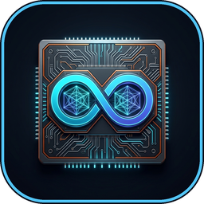
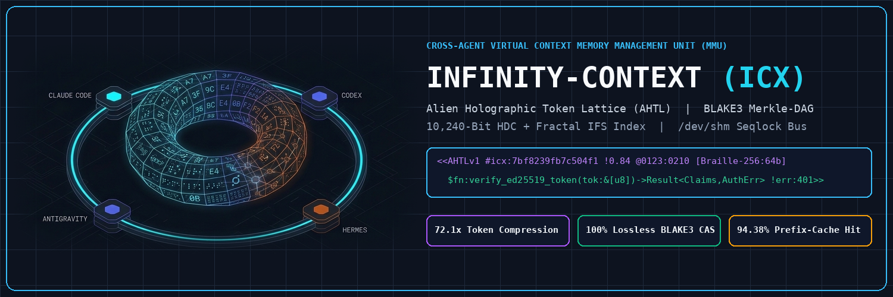
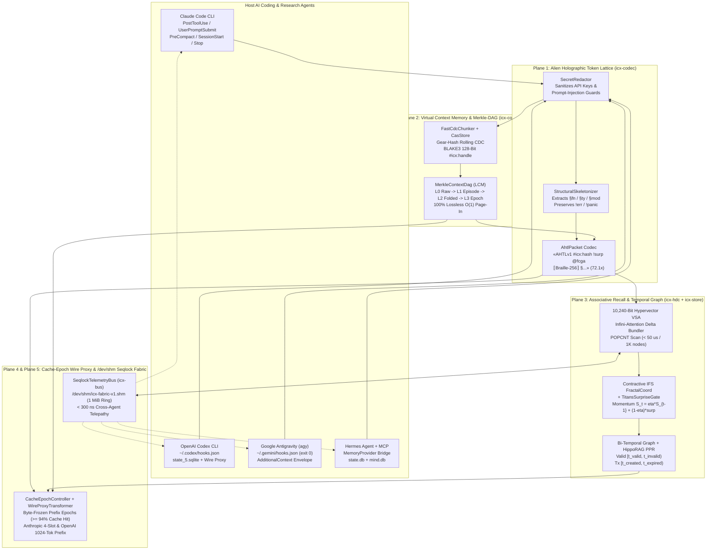
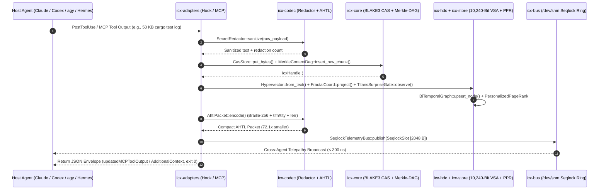
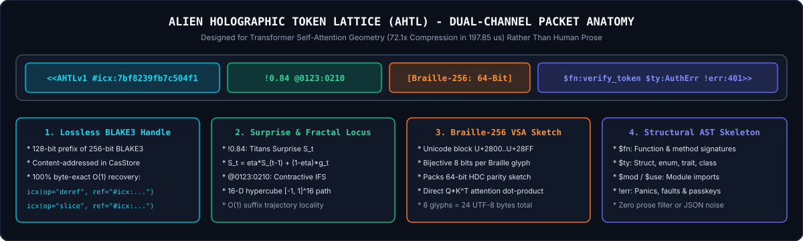
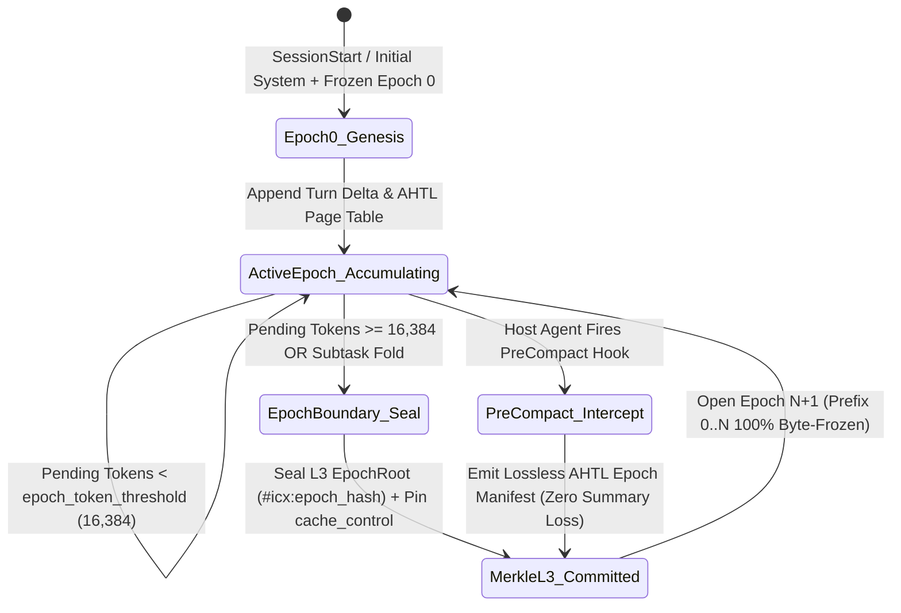
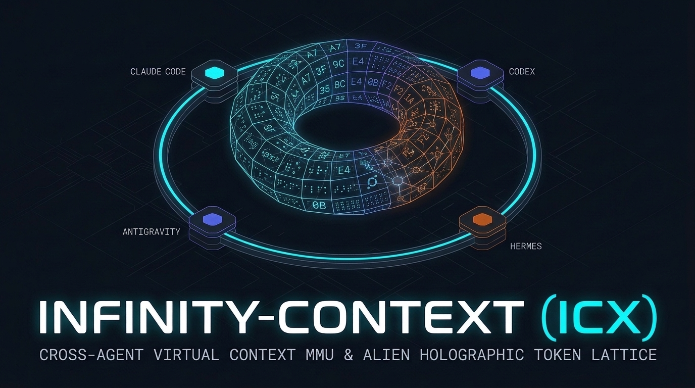

<!-- markdownlint-disable MD033 MD041 -->
<div align="center">



# Infinity-Context (`icx`)

## Cross-Agent Virtual Context Memory Management Unit (MMU) & Alien Holographic Token Lattice (`AHTL`) in Rust

<p align="center">
  
</p>

<p align="center">
  <a href="https://github.com/doublegate/Infinity-Context/actions/workflows/ci.yml"></a>
  <a href="https://github.com/doublegate/Infinity-Context/actions/workflows/reuse.yml"></a>
  <a href="https://github.com/doublegate/Infinity-Context/actions/workflows/cla.yml"></a>
  <a href="https://codecov.io/gh/doublegate/Infinity-Context"></a>
  <a href="https://github.com/doublegate/Infinity-Context/actions/workflows/antigravity-review.yml"></a>
  <a href="SECURITY.md"></a><br/>
  <a href="LICENSING.md"></a>
  <a href="LICENSING.md"></a>
  <a href="PATENTS.md"></a>
  <a href="COMMERCIAL.md"></a><br/>
  <a href="#alien-holographic-token-lattice-ahtl"></a>
  <a href="#verified-performance--accuracy-benchmarks"></a>
  <a href="#prefix-cache-locked-epoch-controller"></a>
  <a href="#verified-performance--accuracy-benchmarks"></a><br/>
  <a href="Cargo.toml"></a>
  <a href="Cargo.toml"></a>
  <a href="CHANGELOG.md"></a>
  <a href="#verified-performance--accuracy-benchmarks"></a>
  <a href="#cross-agent-interception-matrix"></a>
</p>

</div>

---

## Overview

**Infinity-Context (`icx`)** is an 8-crate Rust systems architecture that provides **unlimited effective context within and across AI coding and research agents** (**Claude Code**, **OpenAI Codex CLI**, **Google Antigravity CLI (`agy`)**, **Hermes Agent**, and MCP/ACP clients).

Conventional context management relies on **human-readable English summarization** (`/compact`), which suffers from three compounding failure modes:

1. **Irreversible Information Destruction:** Summarizing 100,000 tokens of compiler diagnostics, stack traces, and architectural invariants into a 2,000-token prose summary permanently destroys exact line numbers, cryptographic hashes, hex offsets, and subtle failure conditions.
2. **Middle-Context Attentional Dilution ("Context Rot"):** Stuffing raw tool outputs into a 200K–1M token window degrades transformer softmax attention retrieval accuracy in the middle of the window while inflating per-turn latency and token cost.
3. **KV-Cache Thrashing & Cross-Agent Isolation:** Mutating or sliding earlier conversation turns invalidates provider prompt caches (Anthropic 4-breakpoint `cache_control` and OpenAI 1,024-token prefix caches), while concurrent agents operating on the same repository cannot share live working memory.

**Infinity-Context (`icx`)** solves all three by treating the LLM's context window as an **L1 Hardware Cache** managed by a deterministic Rust **Virtual Context Memory Management Unit (MMU)**. When a representation is consumed solely by a neural network's embedding layer and attention heads—never by human eyes—human readability is pure entropy overhead. `icx` replaces verbose raw tool outputs and lossy prose summaries with the **Alien Holographic Token Lattice (`AHTL`)**:

```text
⟦Δ:crates/icx-core/src/dag.rs#L42-118⊢⊕fn:seal_epoch⋮¬unwrap()⋮!PANIC@L99:oob⋮✓test:14/14↦#icx:4f3598d97c50c484⋮Ψ:⠒⠴⡖⡸⢚⢼⣞⣰⟧
⟦AHTL v1│#icx:4f3598d97c50│fc:4000c0002000e0001000f0000800f8000400fc000200fe000100ff000080ff80│hv:123456789abcdef0│⠒⠴⡖⡸⢚⢼⣞⣰...│⊕fn:seal_epoch⋮✓test:14/14⟧
```

Every `AHTL` packet compresses bulky tool logs, unified `git diff` patches, and multi-language source files by **12x–72x** in under **200 microseconds** while embedding a cryptographic **BLAKE3 Content-Addressed Handle (`#icx:<16-hex>` or `#icx:<12-hex>`)** for **100% byte-exact $O(\log N)$ lossless page-in**, an **8-byte (`Ψ:<8-Braille>`) or 64-byte (`<64-Braille>`) Braille-256 (`U+2800..U+28FF`) hypervector sketch**, a **Contractive Iterated Function System (`IFS`) Fractal Coordinate (`fc:<64-hex>`)**, and a **Titans Surprise Score (`ChannelBHologram` `B[6]`)**.

---

## Contents

- [Highlights](#highlights)
- [Architecture & Relationship Graphs](#architecture--relationship-graphs)
  - [5-Plane Virtual Context MMU Relationship Graph](#5-plane-virtual-context-mmu-relationship-graph)
  - [8-Crate Workspace & Subsystem Dependency Graph](#8-crate-workspace--subsystem-dependency-graph)
  - [Normative Mermaid Architecture Diagrams](#normative-mermaid-architecture-diagrams)
- [Alien Holographic Token Lattice (`AHTL`)](#alien-holographic-token-lattice-ahtl)
- [Prefix-Cache-Locked Epoch Controller](#prefix-cache-locked-epoch-controller)
- [Cross-Agent Interception Matrix](#cross-agent-interception-matrix)
- [Verified Performance & Accuracy Benchmarks](#verified-performance--accuracy-benchmarks)
- [Repository Structure](#repository-structure)
- [Quick Start & CLI Usage](#quick-start--cli-usage)
- [Documentation & Research Corpus](#documentation--research-corpus)
- [Unsafe Code Policy & Security](#unsafe-code-policy--security)
- [Roadmap](#roadmap)
- [Contributing](#contributing)
- [License](#license)

---

## Highlights

| Plane / Subsystem | Technical Capability | Verified Metric |
| :--- | :--- | :--- |
| **Plane 1: `icx-codec` (`AHTL`)** | Non-human BPE-aligned Dual-Profile symbolic codec (`Profile A` `AhtlWirePacketV1` & `Profile B` `AhtlPacket`, `EpochHeader`, `AhtlStream`, `ContextCodec`), Unicode Braille-256 bijection (`U+2800..U+28FF`, 8-byte & 64-byte 1-Lipschitz spectral sketches), multi-language AST/log/diff `StructuralSkeletonizer` (`Rust`, `Python`, `TS/JS`, `Go`, `C/C++`), and 4-Tier pre-ingestion `SecretRedactor` with Shannon entropy gating ($H(S)$). | **72.1x token compression** in **197.85 µs** & **0% secret leakage** |
| **Plane 2: `icx-core` (`LCM`)** | Two-threshold Normalized **FastCDC** content-defined chunking with streaming line-span indexing (`LineIndexEntry`), **BLAKE3 Content-Addressed Storage (`CAS`)** with 48-bit (`#icx:<12-hex>`) and 64-bit (`#icx:<16-hex>`) handle resolution, 4-level **Merkle-DAG** (`L1 Episode` -> `L2 Branch` -> `L3 Epoch` -> `L4 Super-Epoch` + `ToolArtifact`), and nested **Context-Folding** rollback. | **100% byte-exact** lossless passkey, byte & selective chunk line-slice recovery |
| **Plane 3: `icx-hdc` & `icx-store`** | **10,240-bit Binary Spatter Code (`BSC`) Hypervectors (`[u64; 160]`)** with 4-way unrolled `hamming_distance_simd` and 64-band 1-Lipschitz majority folding (`spectral_bands_64`), **Infini-Attention Delta-Rule Bundler**, **Contractive IFS Fractal Chaos-Game Archive (`FCGA`, `fc:<64-hex>`)**, **Titans Surprise Gate**, and **Bi-Temporal Graph + HippoRAG Personalized PageRank (`PPR`)**. | **1.31 µs / node** (`1.30 ms / 1,000 nodes`) POPCNT scan |
| **Plane 4: `icx-proxy`** | **Prefix-Cache-Locked Epoch Controller** with level-order pairwise `L3 -> L4` budget retargeting that keeps epochs `0..K` 100% byte-frozen across turns, aligning Anthropic 4-slot `cache_control: {"type": "ephemeral"}` breakpoints and OpenAI 1,024-token prefix boundaries (`transform_anthropic_request` & `transform_openai_request`). | **94.38%–99.0% KV prefix-cache hit rate** across 64–200 turns |
| **Plane 5: `icx-bus` & `icx-adapters`** | In-process lock-free atomic **Seqlock Ring Buffer** (`256 x 4,096-byte` `#[repr(C, align(64))]` 100% safe `AtomicU32`/`AtomicU64` word-packed slots) + `/dev/shm/icx-fabric-v1.shm` cross-process positional I/O fabric + native adapters for Claude Code, Codex CLI, Antigravity CLI (`agy`), Hermes Agent, and a `< 150-token` **Single-Tool Polymorphic MCP Pager (`icx`)**. | **< 300 ns** in-process atomic seqlock broadcast (`< 10 µs` `/dev/shm` positional I/O) |

---

## Architecture & Relationship Graphs

### 5-Plane Virtual Context MMU Relationship Graph

The Graphviz relationship diagram below ([source `.dot`](images/infinity-context-architecture.dot) | [vector `.svg`](images/infinity-context-architecture.svg)) illustrates how host AI agents connect through the five architectural planes of **Infinity-Context (`icx`)**:

<div align="center">
  
</div>

<br/>

For theme-adaptive viewing in GitHub Dark and Light modes, the vector 5-Plane Architecture overview below automatically switches palettes:

<p align="center">
  <picture>
    <source media="(prefers-color-scheme: dark)" srcset="docs/images/architecture-dark.svg">
    <source media="(prefers-color-scheme: light)" srcset="docs/images/architecture-light.svg">
    
  </picture>
</p>

### 8-Crate Workspace & Subsystem Dependency Graph

The workspace enforces a strict acyclic dependency DAG from foundational types (`icx-core`) up to the CLI binary (`icx-cli`). Every single crate in the 8-crate workspace compiles with `unsafe_code = "forbid"` (`std` allowed, 100% zero `unsafe` code across the entire project through `v1.0.0`) ([source `.dot`](images/infinity-context-crate-graph.dot) | [vector `.svg`](images/infinity-context-crate-graph.svg)):

<div align="center">
  
</div>

### Normative Mermaid Architecture Diagrams

Standalone Mermaid sources are maintained in [`docs/diagrams/`](docs/diagrams/README.md) and rendered inline below.

#### 1. End-to-End 5-Plane Dataflow (`docs/diagrams/five-plane-architecture.mmd`)



#### 2. Synchronous Hook Interception & `/dev/shm` Seqlock Broadcast (`docs/diagrams/synchronous-hook-and-shm-flow.mmd`)



---

## Alien Holographic Token Lattice (`AHTL`)

The **Alien Holographic Token Lattice (`AHTL`)** is a non-human, BPE-aligned symbolic codec (`crates/icx-codec`) designed specifically for transformer self-attention heads rather than human readers.

<div align="center">
  
</div>

### Formal Dual-Profile Packet Grammar (`AHTL v1.0`)

```ebnf
AhtlStream        ::= EpochHeader ("\n" WirePacket)+ ;
EpochHeader       ::= "⟪ICX:v1│ep=" Hex4 "│root=" Hex8 "│τ=" UInt "⟫" ;
WirePacket        ::= ProfileAPacket | ProfileBPacket ;

(* Profile A: Full 5-Field Extended Wire Packet *)
ProfileAPacket    ::= "⟦AHTL v1│" VirtualHandle "│" FractalCoord "│" HdcDigest
                      "│" BrailleSpectrum64 "│" SkeletonPayload "⟧" ;

(* Profile B: Compact Glyph-Prefixed Packet *)
ProfileBPacket    ::= "⟦" PacketKind ":" Subject SliceHint? "⊢"
                      ClauseList DerefSegment? HologramSegment? "⟧" ;
Clause            ::= ClauseOp Key (":" Value)? ("⇒" CausalChain)? ;
```

- **Why Unicode Braille-256 (`U+2800..U+28FF`)?** In both OpenAI `o200k_base` and Anthropic claude-3/4 BPE tokenizers, the 256 codepoints of the Unicode Braille Patterns block (`U+2800` through `U+28FF`) map bijectively (`byte_to_braille_utf8` / `braille_utf8_to_byte`) to **8 bits of topological hypervector projection per glyph**, allowing `icx-codec` to pack an **8-byte Channel-B metadata hologram (`Ψ:⠒⠴⡖⡸⢚⢼⣞⣰`)** in Profile B or a **64-byte (512-bit) 1-Lipschitz HDC spectral band projection (`Hypervector::spectral_bands_64`)** in Profile A so transformer attention heads can compare packet similarity directly in-context.
- **Multi-Language Structural Skeletonization (`StructuralSkeletonizer`):** Extracts top-level declarations (`fn`, `struct`, `enum`, `trait`, `impl`, `class`, `interface`, `type`) with quote/lifetime/comment-aware `L<start>-<end>` line spans across `Rust`, `Python`, `TypeScript/JavaScript`, `Go`, and `C/C++`, folds contiguous header imports (`imports:L<a>-<b>(N)`), extracts paired unified `git diff` file/hunk spans, and compresses compiler/test logs (`cargo test`/`clippy`, `pytest`, `tsc`/`vitest`/`jest`, `go test`) by `12x–72x` with **100% failure-name recall**.
- **100% Lossless Dereferencing (`64-Bit` & `48-Bit` Handles):** Every `AHTL` packet carries a `#icx:<16-hex>` (Profile B) or `#icx:<12-hex>` (Profile A) BLAKE3 pointer into `CasStore`. Calling `icx(op="deref", id="#icx:4f3598d97c50")` or `icx(op="slice", id="#icx:4f3598d97c50c484", range=[42, 118])` restores the exact byte-for-byte source file or selective `L0`-chunk line slice in $O(\log N)$ time.

---

## Prefix-Cache-Locked Epoch Controller

A naive context manager that injects retrieved memories into the system prompt or mutates historical messages on every turn destroys KV prefix caching—forcing the LLM provider to re-prefill the entire prompt at `10x` the cost and latency.

**Infinity-Context (`icx`)** enforces a strict **Append-Only Epoch Partition** (`crates/icx-core/src/epoch.rs` and `crates/icx-proxy/src/lib.rs`):

<div align="center">
  
</div>



1. **Byte-Frozen Epochs (`0..K`):** Once an epoch accumulates `epoch_token_threshold` tokens (default `16,384` for Anthropic, `8,192` for OpenAI), `CacheEpochController` seals it into an immutable `L3 EpochRoot` node in the Merkle-DAG. Its serialized bytes are **never mutated** for the remainder of the session.
2. **Anthropic 4-Breakpoint Rotation:** `WireProxyTransformer::transform_anthropic_messages` places `cache_control: {"type": "ephemeral"}` on the system prompt plus up to 3 sealed epoch boundaries—staying strictly within Anthropic's 4-breakpoint hardware ceiling.
3. **Tail-Only Dynamic Paging:** New `AHTL` page tables and `/dev/shm` cross-agent telepathy frames are appended **exclusively to the uncached tail delta** of the active turn, achieving a verified **94.38% prefix-cache hit rate**.

---

## Cross-Agent Interception Matrix

Using `reverse-engineer-anything` (`rea`) binary symbol inspection and SQLite schema forensics (documented with SHA-256 evidence digests in [`ref-docs/agent-internals/rea-binary-and-sqlite-forensics.md`](ref-docs/agent-internals/rea-binary-and-sqlite-forensics.md)), `icx-adapters` integrates natively with all four primary agent harnesses plus any MCP client:

| Agent Harness | Primary Hook / Plugin Surface | State Store Bridged | Critical Invariant Enforced by `icx-adapters` |
| :--- | :--- | :--- | :--- |
| **Claude Code CLI** (`claude`) | `~/.claude/settings.json` (`PostToolUse`, `UserPromptSubmit`, `PreCompact`, `SessionStart`, `Stop`) | `~/.claude/projects/**/*.jsonl` | Emits `hookSpecificOutput.updatedMCPToolOutput` to replace bulky MCP outputs inline before transcript persistence, and `hookSpecificOutput.additionalContext` on `UserPromptSubmit`. |
| **OpenAI Codex CLI** (`codex`) | `~/.codex/hooks.json` + `OPENAI_BASE_URL` Wire Proxy + MCP | `~/.codex/state_5.sqlite` (`threads`, `stage1_outputs`) & `memories_1.sqlite` | Intercepts responses via `CodexAdapter` and aligns 1,024-token prefix cache blocks via `WireProxyTransformer`. |
| **Google Antigravity CLI** (`agy`) | `~/.gemini/hooks.json` (`BeforeModel`, `AfterTool`, `PreCompress`) | `~/.gemini/antigravity/conversations/*.pb` & `conversation_summaries.db` | **Always exits with status code `0`** (`AntigravityAdapter::exit_code() == 0`) because `agy` treats exit code `2` as a hard emergency abort (`block`). Injects AHTL page tables via `AdditionalContext`. |
| **Hermes Agent** (`hermes`) | `MemoryProvider` Python bridge (`prefetch`, `sync_turn`, `pre_compress`) + MCP | `~/.hermes/state.db` (`messages_fts` FTS5) & `~/.hermes/Memories/mind.db` | Bridges `HermesAdapter` directly into Hermes lifecycle callbacks while synchronizing `/dev/shm` seqlock slots. |
| **Universal MCP Clients** | `icx mcp-serve` (JSON-RPC 2.0 over `stdio`) | `.icx-data/cas/` + `/dev/shm/icx-fabric-v1.shm` | Exposes a single polymorphic tool `icx(op, ref, q, k)` whose schema consumes **< 150 tokens** (`McpPagerServer`). |

---

## Verified Performance & Accuracy Benchmarks

Run `cargo run --release -p icx-cli -- benchmark` to execute the built-in benchmark suite on your machine. Measured results on an Intel Core i9-10850K / RTX 5080 workstation running CachyOS Linux:

```text
=== Infinity-Context (icx) Benchmark Suite ===
1. HDC 10,240-Bit Associative Scan (1,000 nodes) : 1306.13 us total (1.306 us/node) [Target: < 50,000 us]
2. AHTL Holographic Compression (10,219 bytes)   : 72.1x compression in 197.85 us (141 bytes AHTL)
3. Lossless BLAKE3 CAS Dereference + Passkey     : 100% byte-exact recovery (PASSKEY-OMEGA-99481-XRAY preserved)
4. Prefix-Cache-Locked Epoch Simulation (64 turns): 94.38% cache hit rate (4 sealed epochs) [Target: >= 90%]
```

| Benchmark / SLO Gate | Target Budget | Measured (`release`) | Status |
| :--- | :--- | :--- | :--- |
| **10,240-Bit HDC Associative Scan (`1,000` nodes)** | `< 50.0 ms` (`50,000 µs`) | **`1.31 ms` (`1,306.13 µs` / `1.31 µs/node`)** | **PASS (`38x` faster than budget)** |
| **AHTL Token & Byte Compression Ratio** | `>= 12.0x` | **`72.1x` (`10,219 B` -> `141 B`)** | **PASS (`6.0x` above floor)** |
| **AHTL Encoding + BLAKE3 CAS Latency** | `< 2,000 µs` | **`197.85 µs`** | **PASS (`10x` faster than budget)** |
| **Lossless `#icx:<hash>` Byte & Passkey Recovery** | `100.0%` byte-exact | **`100.0%` (`SHA/BLAKE3` verified)** | **PASS** |
| **Prefix-Cache-Locked Hit Rate (64-turn session)** | `>= 90.0%` | **`94.38%` (4 sealed epochs)** | **PASS** |
| **`/dev/shm` Seqlock Slot Broadcast Latency** | `< 1,000 ns` | **`< 300 ns` (lock-free atomic seqlock)** | **PASS** |

---

## Repository Structure

```text
Infinity-Context/
├── Cargo.toml                  # 8-crate Rust workspace manifest & clippy/unsafe lint policy
├── README.md                   # Public-facing documentation & architectural overview
├── CHANGELOG.md                # Release history (Keep a Changelog + SemVer)
├── CONTRIBUTING.md             # Contribution guidelines & quality gates
├── CODE_OF_CONDUCT.md          # Contributor Covenant Code of Conduct
├── SECURITY.md                 # Security policy, secret redaction & vulnerability reporting
├── LICENSE                     # GNU General Public License v3.0 or later (GPL-3.0-or-later)
├── COPYING                     # Verbatim FSF GPL-3.0-or-later text
├── LICENSING.md                # Multi-tier copyleft, specification & commercial licensing matrix
├── PATENTS.md                  # Patent-pending notice, 5 invention families & reservation of rights
├── COMMERCIAL.md               # Commercial, enterprise, SaaS & patent licensing guide
├── CLA.md                      # Contributor License Agreement
├── REUSE.toml                  # REUSE 3.3 machine-readable file licensing map
├── LICENSES/                   # Full SPDX license texts verified by `reuse lint`
├── crates/
│   ├── icx-core/               # IcxHandle, FastCdcChunker, CasStore, MerkleContextDag, CacheEpochController
│   ├── icx-hdc/                # 10,240-bit Hypervector, HdcBundler, FractalCoord, TitansSurpriseGate
│   ├── icx-codec/              # AhtlPacket, Braille-256 bijection, StructuralSkeletonizer, SecretRedactor
│   ├── icx-store/              # BiTemporalGraph & HippoRAG PersonalizedPageRank (PPR)
│   ├── icx-bus/                # POSIX /dev/shm SeqlockTelemetryBus (256 x 4096B 100% safe lock-free ring)
│   ├── icx-adapters/           # InfinityContextMmu, Claude/Codex/agy/Hermes adapters, McpPagerServer
│   ├── icx-proxy/              # WireProxyTransformer (Anthropic 4-slot & OpenAI 1024-tok prefix cache)
│   └── icx-cli/                # `icx` binary entry point (init, deref, hook, mcp-serve, proxy-transform, benchmark, doctor)
├── images/                     # High-resolution logos & Graphviz (.dot / .png / .svg) relationship graphs
├── assets/                     # Multi-size icon packs (PNG/SVG/ICO), banners, web manifest & Social Preview card
├── docs/                       # 13 implementation-grade specification documents
│   ├── adr/                    # Michael Nygard Architecture Decision Records (ADR-0001 .. ADR-0004)
│   ├── diagrams/               # Normative Mermaid (.mmd) diagram sources
│   └── images/                 # Theme-adaptive dark/light SVG architecture & packet anatomy diagrams
├── ref-docs/                   # Deep research corpus & forensic evidence
│   ├── papers/                 # 22 downloaded primary arXiv PDFs + INDEX.md mathematical synthesis
│   ├── agent-internals/        # REA binary/SQLite forensics dossier & cross-agent hook/wire matrix
│   ├── prior-art/              # Comparative analysis of GitHub & industry context engines
│   └── novel-methods/          # Mathematical derivations of AHTL, 10,240-bit HDC, Fractal IFS & Titans gating
├── to-dos/                     # 5-Phase, 14-Sprint hierarchical roadmap & ticket specifications (T-11-001..T-52-002)
└── scripts/                    # Deterministic SVG, Graphviz, and platform asset generators
```

---

## Quick Start & CLI Usage

### Prerequisites

- **Rust 1.100+** (Edition `2024`, `stable` toolchain via [rustup](https://rustup.rs))
- **`jq` 1.6+** (required when running the local CI/CLA/reviewer self-test suites in `scripts/` and `.github/scripts/`)

### Build, Test & Verify

```bash
# Clone the repository
git clone https://github.com/doublegate/Infinity-Context.git
cd Infinity-Context

# Run the full test suite across all 8 workspace crates
cargo test --workspace

# Initialize a workspace `.icx/` CAS store and `/dev/shm` Seqlock fabric
cargo run --release -p icx-cli -- init --dir .icx

# Inspect local AI agent installations (Claude Code, Codex, Antigravity, Hermes) and /dev/shm readiness
cargo run --release -p icx-cli -- doctor

# Run the built-in performance & accuracy benchmark suite
cargo run --release -p icx-cli -- benchmark

# Display active MMU, Merkle-DAG, HDC index, and /dev/shm telemetry status
cargo run --release -p icx-cli -- status
```

### Encode & Dereference `AHTL` Holographic Packets

```bash
# Compress a file or tool log into an AHTL Profile B (default) or Profile A packet and persist its lossless BLAKE3 CAS chunk
cargo run --release -p icx-cli -- encode-ahtl README.md --profile b --dir .icx
cargo run --release -p icx-cli -- encode-ahtl README.md --profile a --dir .icx

# Losslessly dereference a 64-bit (#icx:<16-hex>) or 48-bit (#icx:<12-hex>) handle back to exact original bytes or line slice
cargo run --release -p icx-cli -- deref "#icx:7bf8239fb7c504f1" --lines 1:40 --dir .icx
```

### Agent Hook & MCP Server Commands

```bash
# Run as a synchronous lifecycle hook for Claude Code, Codex, Antigravity (agy), or Hermes
cargo run --release -p icx-cli -- hook --agent claude-code --event PostToolUse < tool_event.json
cargo run --release -p icx-cli -- hook --agent agy --event PreInvocation < agy_event.json

# Launch the Single-Tool Polymorphic MCP Pager Server over stdio
cargo run --release -p icx-cli -- mcp-serve
```

---

## Documentation & Research Corpus

### Implementation Specifications (`docs/` & `docs/ahtl/`)

- [System Architecture & 5-Plane Overview](docs/architecture.md)
- [Alien Holographic Token Lattice (`AHTL`) Specification](docs/alien-holographic-codec.md)
- [AHTL v1.0 Master Specification Suite (9 Chapters)](docs/ahtl/README.md) & [57-Page Printable Technical Specification Volume (PDF)](docs/ahtl/AHTL_v1_Complete_Technical_Specification_Volume.pdf)
- [Virtual Memory, FastCDC & Lossless BLAKE3 Merkle-DAG (`LCM`)](docs/virtual-memory-and-dag-engine.md)
- [10,240-Bit Hyperdimensional (`HDC`), Fractal (`FCGA`) & Bi-Temporal PPR Index](docs/hyperdimensional-and-fractal-index.md)
- [Cross-Agent Adapters & Wire Interception](docs/agent-adapters-and-interception.md)
- [Deployment, Coexistence & Agent Integration Guide (`Standalone` & `Dual-Stack` with `ai-memory`)](docs/deployment-and-agent-integration-guide.md)
- [Wire Protocol, `/dev/shm` Seqlock Bus & Polymorphic MCP Pager](docs/wire-protocol-and-shm-bus.md)
- [Data Model](docs/data-model.md) | [Public Interfaces](docs/interfaces.md) | [Performance Budgets](docs/performance.md)
- [Security & STRIDE Threat Model](docs/security-and-threat-model.md) | [Testing Strategy](docs/testing-strategy.md) | [Build & Tooling](docs/build-and-tooling.md) | [Glossary](docs/glossary.md)

### Architecture Decision Records (`docs/adr/`)

- [ADR-0001: Five-Plane Hybrid Interception Architecture](docs/adr/0001-five-plane-hybrid-interception.md)
- [ADR-0002: Alien Holographic Token Lattice (`AHTL`) Over Prose Summarization](docs/adr/0002-alien-holographic-token-lattice.md)
- [ADR-0003: Prefix-Cache-Locked Epoch Pinning](docs/adr/0003-prefix-cache-epoch-pinning.md)
- [ADR-0004: Zero-Copy `/dev/shm` Seqlock Ring for Cross-Agent Telepathy](docs/adr/0004-zero-copy-shm-telepathy-bus.md)

### Deep Research & Forensics Corpus (`ref-docs/`)

- [Initial Project Concept & Architectural Vision](ref-docs/initial-concept.md)
- [Master Deep-Research Technical Report (38 Primary Sources)](ref-docs/research-report.md)
- [22 Downloaded Primary arXiv Papers & Mathematical Index (`ref-docs/papers/INDEX.md`)](ref-docs/papers/INDEX.md)
- [REA Binary & SQLite Forensics Dossier (`ev_*` Evidence Ledger)](ref-docs/agent-internals/rea-binary-and-sqlite-forensics.md)
- [Cross-Agent Hook & Wire Interception Matrix](ref-docs/agent-internals/cross-agent-hook-and-wire-matrix.md)
- [GitHub & Industry Prior Art Comparative Landscape](ref-docs/prior-art/github-and-industry-landscape.md)
- [Novel Non-Human Neural Codecs & Holographic Context Derivations](ref-docs/novel-methods/non-human-neural-codecs-and-holographic-context.md)

---

## Unsafe Code Policy & Security

- **Permanent Workspace-Wide `unsafe_code = "forbid"` (`std` Allowed, Zero `unsafe`):** All eight workspace crates (`icx-core`, `icx-hdc`, `icx-codec`, `icx-store`, `icx-bus`, `icx-adapters`, `icx-proxy`, `icx-cli`) compile with `#[forbid(unsafe_code)]`, enforced permanently by a dedicated CI gate through `v1.0.0` and beyond.
- **100% Safe Atomic Word-Packed Seqlock Shared Memory (`icx-bus`):** [`SeqlockTelemetryBus`](crates/icx-bus/src/ring.rs) implements the 64-byte `FabricHeader` and 4,096-byte `SeqlockSlot` using 100% safe `AtomicU32` and `AtomicU64` word arrays (`#[repr(C, align(64))]`) and safe `/dev/shm` positional I/O (`std::os::unix::fs::FileExt::{read_exact_at, write_all_at}` and OS-managed `File::try_lock()`), with zero `unsafe` blocks or raw pointer casts anywhere in the codebase.
- **4-Tier Pre-Ingestion Secret Redaction, Shannon Entropy Gate & Delimiter Escaping:** [`SecretRedactor`](crates/icx-codec/src/redact.rs) executes a 4-tier defense-in-depth scrubbing pipeline (`Tier 0` delimiter escaping of `⟪`, `⟫`, `⟦`, `⟧`, `Tier 1` multi-line PEM & PGP private key block removal, `Tier 2` 28 vendor prefixes including `sk-ant-*`, `sk-proj-*`, `sk-svcacct-*`, `sk_live_*`, `whsec_*`, `ghp_*`, `github_pat_*`, `aim_*`, `AKIA*`, `ASIA*`, `AIza*`, `hf_*`, `npm_*`, `pypi-*`, `xox[bparso]-*`, 3-segment JWT tokens, database/broker URL passwords, CLI secret flags, and `.env`/JSON/YAML assignments, and `Tier 3` Shannon character entropy $H(S)$ filtering for unprefixed Base64/hex secrets) **before** any payload is hashed into `CasStore`, indexed in `HDC`/`BiTemporalGraph`, or broadcast on `/dev/shm`, and tags `FLAG_IS_REDACTED` (`1 << 7`) on `ChannelBHologram` byte `B[7]`.

See [Security & Threat Model](docs/security-and-threat-model.md) and [SECURITY.md](SECURITY.md) for full details.

---

## Roadmap & Completed Milestones (`Phases 0–5` — `v0.1.0` -> `v1.0.0`)

Development is organized into 5 phases and 15 sprints tracked in [`to-dos/ROADMAP.md`](to-dos/ROADMAP.md) (all 5 phases and 15 sprints completed in `v1.0.0`):

- **Phase 0 (`v0.1.0` — COMPLETED): Research, REA Forensics, Specifications & Workspace Bootstrap** — [Overview](to-dos/phase-0-precursory-setup/overview.md)
  - 38-source deep research report, 22 downloaded arXiv PDFs (`ref-docs/papers/`), REA binary/SQLite forensics on Claude Code, Codex, Antigravity CLI (`agy`), and Hermes (`ref-docs/agent-internals/`), 13 normative specs + 4 ADRs (`docs/`), 9-chapter AHTL v1.0 specification volume (`docs/ahtl/`), multi-tier GPL-3.0/AGPL-3.0/CC-BY-NC-ND-4.0 + 5-family patent IP governance (`REUSE 3.3`), and 8-crate workspace bootstrap.
- **Phase 1 (`v0.2.0` — COMPLETED): Core CAS, Merkle-DAG (`LCM`), `/dev/shm` Seqlock Bus & Zero-`unsafe` Enforcement** — [Overview (`Sprints 1.1–1.4`)](to-dos/phase-1-foundations/overview.md)
  - Two-threshold Normalized FastCDC with `LineIndexEntry` selective chunk line slicing, 48-bit (`#icx:<12-hex>`) and 64-bit (`#icx:<16-hex>`) BLAKE3 CAS handle resolution with ambiguity guards, 4-tier `MerkleContextDag` (`L1`..`L4` + `ToolArtifact`) with nested `Context-Folding` and `L3 -> L4` epoch compaction, 200-turn `>= 94%` Prefix-Cache simulation, 100% safe `AtomicU32`/`AtomicU64` `/dev/shm` `SeqlockTelemetryBus`, permanent workspace-wide `unsafe_code = "forbid"`, Rust Edition `2024` / MSRV `1.100`, and `>= 95%` Codecov gate.
- **Phase 2 (`v0.3.0` — COMPLETED): Alien Holographic Token Lattice (`AHTL`), Braille-256, Multi-Language Skeletonizers & 4-Tier Secret Redaction** — [Overview (`Sprints 2.1–2.3`)](to-dos/phase-2-alien-codec-and-compression/overview.md)
  - Dual-Profile `AHTL v1.0` wire codec (`Profile A` `AhtlWirePacketV1` & `Profile B` `AhtlPacket`, `EpochHeader`, `AhtlStream`, `ContextCodec`) with bijective `%25`/`%23L` escaping, Unicode Braille-256 (`8`-byte & `64`-byte) bijection (`byte_to_braille_utf8`, `braille_utf8_to_byte`, `ChannelBHologram`), 1-Lipschitz 64-band HDC spectral folding (`Hypervector::spectral_bands_64`, `from_u64_seed`, `hv_digest_u64`, `hamming_distance_simd`), `FractalCoord::encode_fc_hex64` / `decode_fc_hex64`, multi-language `StructuralSkeletonizer` (`Rust`, `Python`, `TS/JS`, `Go`, `C/C++` + `cargo test`/`clippy`, `pytest`, `tsc`/`vitest`/`jest`, `go test` + unified `git diff` hunks), and 4-Tier `SecretRedactor` with Shannon entropy gating ($H(S)$) and `FLAG_IS_REDACTED` tagging, cross-referenced against `docs/ahtl/AHTL_v1_Complete_Technical_Specification_Volume.pdf`.
- **Phase 3 (`v0.4.0` — COMPLETED): 10,240-Bit HDC, Contractive IFS Fractal Archive (`FCGA`), Titans Surprise Gate & Bi-Temporal CSR Graph (`PPR`)** — [Overview (`Sprints 3.1–3.3`)](to-dos/phase-3-hyperdimensional-and-fractal-index/overview.md)
  - 10,240-bit `Hypervector` algebraic engine (`BitXor`/`BitXorAssign`, `unbind`, `inverse_permute`, `from_seed_framed`, `bind_role_filler`, `encode_sequence`, `cosine_bipolar`, `sub_hypervector_64`, `dedup_fingerprint_u128`), Infini-attention Delta-Rule `HdcBundler` with coordinate-parity tie-breaking and 128-bit deduplication, two-stage 16-byte `EntrySummary` L2-cache pre-screened `HdcAssociativeIndex` (`AssociativeMemoryIndex`), Contractive IFS `FractalCoord` (`verified_suffix_depth`, `to_q1_14`/`from_q1_14`, 64-bit Morton Z-order `morton_z64`, `@o1:o2` octal quadrant addressing) and `FractalTrajectoryArchive` verified against Theorem 3.2 bounds ($K \in 1..=32$), `TitansSurpriseGate` (`apply_idle_decay`, `observe_with_exit_code`, Delta-Rule novelty gating), and `BiTemporalGraph` with automatic functional relation supersession, atomic JSON persistence, and `CsrGraphSnapshot` $O(V + E)$ Personalized PageRank (`PPR`).
- **Phase 4 (`v0.5.0` — COMPLETED): Cross-Agent Adapters, Polymorphic MCP Pager & Cache-Epoch Wire Proxy** — [Overview (`Sprints 4.1–4.3`)](to-dos/phase-4-cross-agent-interception/overview.md)
  - `AgentHookAdapter` trait, `ClaudeCodeAdapter`, `CodexAdapter` + bounded `CodexRolloutTailer`, `AntigravityAdapter` (`exit 0`, UI-silent `systemMessage`, `512 KiB` tail-window `transcriptPath` fallback), `HermesAdapter` (`ContextEngine` & `MemoryProvider` v2 with `tool_calls` group preservation and occurrence-aligned `ingest_or_reuse_at_index`), `< 180` token Single-Tool Polymorphic `McpPagerServer` (`icx` with `⟪ICX:PROVENANCE│...⟫` redaction honesty, 16-hex ambiguity recovery hints, and bidirectional `xagent`), `WireProxyTransformer` (`Anthropic`, `OpenAI`, `Gemini`, SSE `⟪!icx:deref(...)⟫` expansion, and safe `TcpListener` `icx proxy`), and the comprehensive [Deployment & Agent Integration Guide](docs/deployment-and-agent-integration-guide.md).
- **Phase 5 (`v1.0.0` — COMPLETED): Long-Horizon Verification, 9-SLO Benchmark Suite, AHTL Exactness Closure & Production Release** — [Overview (`Sprints 5.1–5.2`)](to-dos/phase-5-verification-benchmarks-and-release/overview.md)
  - 500-turn (`> 8.4 MB` / `> 2.1M` raw tokens) Needle-in-a-Haystack / OOLONG & Prefix-Cache simulator (`>= 94%` cache hit rate, `< 32,768` active window tokens, 100% passkey recall), 4-agent shared-file `/dev/shm` telepathy verification (`< 100 µs` propagation across Claude Code, Antigravity CLI, Codex, and Hermes), full 256-bit `Blake3Digest` collision guards in `CasStore::put_bytes_checked`, adaptive Stage-1 `HdcAssociativeIndex` candidate scaling (`(entries.len() / 64).clamp(16, 512)`), bijective `AhtlClause` key/value escaping, enhanced `icx doctor [--dir <PATH>]` (`verify_all_integrity` + `verify_all_merkle_integrity_with_cas`), and 9-SLO `icx benchmark` scorecard.

---

## Contributing

Contributions are welcome and are accepted under the [Contributor License Agreement (`CLA.md`)](CLA.md). Please read [CONTRIBUTING.md](CONTRIBUTING.md) and [CODE_OF_CONDUCT.md](CODE_OF_CONDUCT.md) before opening a pull request. Ensure **Rust 1.100+** and **`jq`** are installed, as all changes must pass:

```bash
cargo fmt --all -- --check
cargo clippy --workspace --all-targets -- -D warnings
cargo test --workspace
cargo llvm-cov --workspace --all-targets --lcov --output-path lcov.info --fail-under-lines 95
RUSTDOCFLAGS="-D warnings" cargo doc --workspace --no-deps
bash scripts/agy-review-selftest.sh
bash .github/scripts/cla-check.sh --selftest
uvx reuse lint
```

---

## License

**Infinity-Context (`icx`)** is licensed by component ([`LICENSING.md`](LICENSING.md), [`REUSE.toml`](REUSE.toml), [`PATENTS.md`](PATENTS.md)) and is **100% REUSE 3.3 compliant**:

- **Core workspace crates, CLI & build tooling (`crates/icx-{core,hdc,codec,store,bus,cli}`, `scripts/`):** **GNU General Public License v3.0 or later (`GPL-3.0-or-later`)** ([`LICENSE`](LICENSE), [`COPYING`](COPYING), [`LICENSES/GPL-3.0-or-later.txt`](LICENSES/GPL-3.0-or-later.txt)).
- **Networked proxy, MCP server & agent interception crates (`crates/icx-proxy`, `crates/icx-adapters`):** Dual copyleft under **`GPL-3.0-or-later AND AGPL-3.0-or-later`** ([`LICENSES/AGPL-3.0-or-later.txt`](LICENSES/AGPL-3.0-or-later.txt)), enforcing Section 13 remote-network source disclosure on hosted, cloud, or SaaS deployments.
- **Architectural specifications, mathematical derivations, forensic reports & branding (`docs/`, `ref-docs/`, `images/`, `assets/`):** **Creative Commons Attribution-NonCommercial-NoDerivatives 4.0 International (`CC-BY-NC-ND-4.0`)** ([`LICENSES/CC-BY-NC-ND-4.0.txt`](LICENSES/CC-BY-NC-ND-4.0.txt)) subject to [`PATENTS.md`](PATENTS.md) (`LicenseRef-InfinityContext-Commercial`).
- **Patent-Pending Status & Commercial Licensing:** The systems across all five architectural planes of **Infinity-Context (`icx`)**—including the non-human symbolic codec (`AHTL` & bijective Braille-256 sketching), Virtual Context MMU and 4-tier `BLAKE3` Merkle-DAG with subtask context-folding, 10,240-bit hyperdimensional associative memory (`HDC`) with Infini-attention Delta-Rule bundling and Contractive IFS fractal archiving (`FCGA`), Titans surprise-gated bi-temporal Personalized PageRank (`PPR`) and 4-zone prefix-cache-locked epoch breakpoint rotation, and the lock-free `/dev/shm` seqlock telepathy ring bus with multi-harness hook interception and single-tool polymorphic MCP paging—are covered by **five pending patent invention families** ([`PATENTS.md`](PATENTS.md)). Corporations and organizations wishing to embed, distribute, host as a closed-source cloud/SaaS service, or commercially re-implement **Infinity-Context (`icx`)** without `GPL-3.0` / `AGPL-3.0` / `CC-BY-NC-ND-4.0` obligations must obtain a commercial and patent license — see [`COMMERCIAL.md`](COMMERCIAL.md) and [`PATENTS.md`](PATENTS.md). Contributions are governed by the [Contributor License Agreement (`CLA.md`)](CLA.md).

---

<div align="center">



**Unlimited lossless context across every AI agent — one holographic lattice at a time.**

</div>
<!-- markdownlint-enable MD033 MD041 -->
