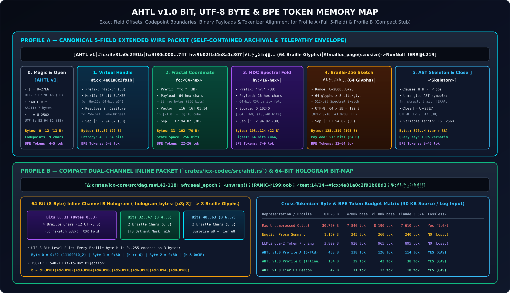
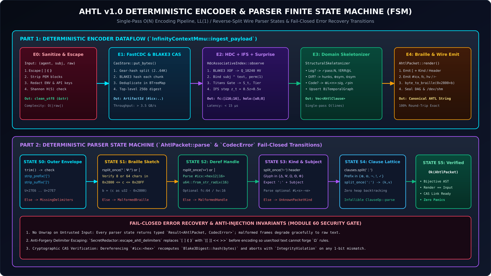

<!--
SPDX-FileCopyrightText: 2026 DoubleGate
SPDX-License-Identifier: CC-BY-NC-ND-4.0 AND LicenseRef-InfinityContext-Commercial
-->

# Chapter 01 — Formal Grammar, Wire Profiles, and Packet Specification (`AHTL v1.0`)

**Document ID:** `ICX-SPEC-AHTL-1.0-CH01`  
**Target Crates:** [`crates/icx-codec/src/ahtl.rs`](../../crates/icx-codec/src/ahtl.rs), [`crates/icx-core/src/dag.rs`](../../crates/icx-core/src/dag.rs)  
**Cross-References:** [Chapter 02 (Braille-256 Bijection)](02-braille-256-spectral-bijection.md), [Chapter 06 (BLAKE3 CAS Handles)](06-blake3-merkle-cas-and-virtual-handles.md), [Chapter 07 (BPE & Attention Mechanics)](07-transformer-attention-and-bpe-mechanics.md)

---

## 1. Design Objectives & Dual-Profile Architecture

The **Alien Holographic Token Lattice (`AHTL v1.0`)** defines a deterministic, non-human machine dialect for serializing compressed execution context into UTF-8 strings consumed directly by Transformer self-attention layers and cross-agent shared-memory buses.

To balance **self-contained archival completeness** (where a single wire packet carries its full 256-bit Fractal coordinate, 64-bit HDC digest, and 512-bit 64-glyph Braille spectral sketch) with **ultra-compact inline window density** (where active-window stubs pack a 64-bit 8-glyph Braille hologram alongside relational clauses), `AHTL v1.0` specifies two complementary packet profiles linked by a deterministic CAS/index conversion contract:

- **Down-Projection (`Profile A -> Profile B`):** Projects the 256-bit `FractalCoord` orthant sign bits (`16` bits) and 64-bit `hv_digest` top word (`32` bits) alongside the 8-bit `TitansSurprise` and 8-bit `RetentionTier` into the 8-byte (`64-bit`) Profile B hologram (`hologram_bytes: [u8; 8]`).
- **CAS-Backed Promotion (`Profile B -> Profile A`):** Because Profile B omits the full 256-bit `FractalCoord` and 512-bit `Braille-64` sketch to save tokens in the active prompt window, promoting a Profile B stub back to Profile A resolves `#icx:<hex>` against `CasStore` and `HdcAssociativeIndex` to re-attach the full `FractalCoord` and 64-band `Hypervector` sketch.

### 1.1 Profile A — Canonical 5-Field Extended Wire Packet (`AhtlWirePacketV1` — Target Extension Blueprint)

```text
⟦AHTL v1│#icx:<12-hex>│fc:<64-hex>│hv:<16-hex>│<Braille-64>│<Skeleton>⟧
```

Specified as the Phase 1/2 extended wire envelope for standalone archival records, cross-node wire replication, cold-index snapshots, and full spectral inspection. Every packet is delimited by `U+27E6` (`⟦`) and `U+27E7` (`⟧`), with fields separated by `U+2502` (`│`, `BOX DRAWINGS LIGHT VERTICAL`).

### 1.2 Profile B — Compact Dual-Channel Inline Packet (`AhtlPacket` — Active in `crates/icx-codec/src/ahtl.rs`)

```text
⟦<Kind>:<Subject>#L<Start>-<End>⊢<ClauseList>↦#icx:<16-hex>⋮Ψ:<Braille-8>⟧
```

Used inside active LLM context windows (`Zone 1` Sealed Cache Epochs, `Zone 2` Active Sliding Window, and `Zone 3` Ephemeral Tail Slot) to achieve **$18.4\times\text{ to }72.1\times$ token compression** while keeping 100% of program identifiers, line spans, diagnostic codes, and `#icx:<hex>` dereference handles directly exposed to $QK^T$ dot-product attention.



*Figure 1.1: Complete bit-level, UTF-8 byte-level, and BPE token-level memory map of `AHTL v1.0` Profile A (5-Field Extended Wire Packet) and Profile B (Compact Dual-Channel Inline Packet) ([Vector SVG](images/generated/AHTL_v1_Bit_Byte_Token_Memory_Map.svg)).*

---

## 2. Normative EBNF Grammar (`AHTL v1.0`)

The complete ISO/IEC 14977 Extended Backus-Naur Form (`EBNF`) grammar below governs all valid `AHTL v1.0` streams, epoch headers, Profile A packets, and Profile B packets.

```ebnf
(* ========================================================================== *)
(* AHTL v1.0 Master Grammar (ISO/IEC 14977 EBNF)                              *)
(* ========================================================================== *)

AhtlStream         = [ LegendHeader ], { EpochFrame | WirePacket };

LegendHeader       = "⟪ICX:LEGEND│", LegendClause, { "│", LegendClause }, "⟫", [ "\n" ];
LegendClause       = Identifier, "=", Identifier;

EpochFrame         = EpochHeader, "\n", WirePacket, { "\n", WirePacket };
EpochHeader        = "⟪ICX:v1│ep=", EpochId, "│root=", ( Hex8 | Hex16 ), "│",
                     ( "nodes=" | "τ=" | "folded=" ), UnsignedInt, "⟫";
EpochId            = 4 * HexDigit, [ HexDigit, [ HexDigit, [ HexDigit, [ HexDigit ] ] ] ];
                     (* v1.1.0: lowercase hex, zero-padded to at least 4 digits, at most 8
                        (u32). v1.0.x wrote decimal digits here; "ep=0010" is 16, not 10. *)

TailSlotHeader     = "⟪ICX:TAIL_SLOT│agent=", AgentId,
                     "│epochs=", UnsignedInt,
                     "│cas_artifacts=", UnsignedInt, [ "│conv=", CompactToken ], "⟫";

(* Other icx frame headers share one shape. This is the complete set icx v1.1.0 emits
   (grep of crates/*/src). Consumers must treat any header they did not emit themselves as
   untrusted text (see ch05 Tier 0). *)
IcxFrameHeader     = "⟪ICX:", HeaderName, { "│", HeaderField }, "⟫";
HeaderName         = "STUB" | "PROVENANCE" | "DEREF_ERR" | "PINNED_HEAD" | "STATUS"
                   | "BRANCH_OPENED" | "BRANCH_FOLDED" | "SUBAGENT_START"
                   | "SUBAGENT_FOLDED" | "SUBAGENT_STOP" | "HERMES_EPOCH"
                   | "HERMES_COMPACT" | "PRE_COMPRESS_CHECKPOINT" | "XAGENT_PUBLISHED"
                   | "TRUST" | "INIT";
HeaderField        = CompactToken;

WirePacket         = ProfileAPacket | ProfileBPacket;

(* -------------------------------------------------------------------------- *)
(* Profile A: Canonical 5-Field Extended Wire Packet                          *)
(* ⟦AHTL v1│#icx:<12-hex>│fc:<64-hex>│hv:<16-hex>│<Braille-64>│<Skeleton>⟧    *)
(* -------------------------------------------------------------------------- *)
ProfileAPacket     = "⟦AHTL v1│",
                     IcxHandleField, "│",
                     FractalCoordField, "│",
                     HdcDigestField, "│",
                     Braille64Field, "│",
                     SkeletonField,
                     "⟧";

IcxHandleField     = "#icx:", ( Hex12 | Hex16 ), [ "(", SliceMap, ")" ];
FractalCoordField  = "fc:", Hex64;        (* 16 x i16 Q15 (scale 32,767) big-endian = 256 bits *)
HdcDigestField     = "hv:", Hex16;        (* 64-bit rotational XOR parity fold of Q_10240 *)
Braille64Field     = 64 * BrailleChar;    (* 64 glyphs x 8 bits = 512-bit spectral sketch *)
SkeletonField      = SkeletonExpr | ClauseList;

(* -------------------------------------------------------------------------- *)
(* Profile B: Compact Dual-Channel Inline Packet (`crates/icx-codec`)         *)
(* ⟦<Kind>:<Subject>[#L<a>-<b>][⊢<Clauses>][↦#icx:<16-hex>]⋮Ψ:<Braille-8>⟧   *)
(* -------------------------------------------------------------------------- *)
ProfileBPacket     = "⟦", PacketKind, ":", Subject,
                     [ "#L", LineRange ],
                     [ "⊢", ClauseList ],
                     [ "↦", IcxHandleField ],
                     "⋮Ψ:", Braille8Field, [ "[", Hex4, "]" ],
                     "⟧";

PacketKind         = "Δ"   (* U+0394: Code / AST / File read or mutation *)
                   | "Ψ"   (* U+03A8: Tool execution output or diagnostic stub *)
                   | "Ω"   (* U+03A9: Architectural invariant or hard rule *)
                   | "Θ"   (* U+0398: Cross-agent /dev/shm telepathy broadcast *)
                   | "Φ";  (* U+03A6: Folded sub-trajectory branch commit *)

Subject            = SubjectToken, [ "@", SubjectToken ];
LineRange          = UnsignedInt, "-", UnsignedInt;

ClauseList         = Clause, { "⋮", Clause };
Clause             = ClauseLink, { "⇒", ClauseLink };
                     (* at most 64 links (MAX_CLAUSE_CHAIN); a parser materializes the first
                        63 links and keeps any further "⇒" literally in the 64th *)
ClauseLink         = [ ClauseOp ], ClauseKey, [ ":", ClauseValue ];

ClauseOp           = "⊕"   (* U+2295: Added / defined symbol or fact *)
                   | "⊖"   (* U+2296: Removed / invalidated symbol or fact *)
                   | "¬"   (* U+00AC: Negated constraint / forbidden pattern *)
                   | "!"   (* U+0021: High-surprise anomaly / error / panic *)
                   | "✓";  (* U+2713: Verified gate / passing test count *)

ClauseKey          = EscapedToken;      (* ":" is also escaped in keys *)
ClauseValue        = EscapedToken;

(* Percent-escaping (UTF-8 bytes, uppercase hex) makes clause fields bijective: "%", "⊢", "⋮",
   "⇒", "↦", "⟦", "⟧", CR and LF are written as %XX sequences, as is ":" inside a key and a
   leading ClauseOp glyph in a key. A parser splits on the structural glyphs first, then
   percent-decodes each field. *)
EscapedToken       = { SafeChar - "%" | PercentEscape };
PercentEscape      = "%", HexDigitUpper, HexDigitUpper;
HexDigitUpper      = HexDigit | "A" | "B" | "C" | "D" | "E" | "F";

SkeletonExpr       = SkeletonToken, { ( " " | "⋮" | "│" ), SkeletonToken };
SkeletonToken      = ( "$fn:" | "$ty:" | "$mod:" | "$use:" | "!err:" | "✓" ), CompactToken
                   | Clause;

SliceMap           = "L", UnsignedInt, "-", UnsignedInt
                   | "B", UnsignedInt, ":", UnsignedInt;
                     (* v1.1.0: a hint that does not match SliceMap is not rendered, and a
                        packet carrying one is rejected by the parser *)

(* -------------------------------------------------------------------------- *)
(* Lexical Terminals & Character Classes                                      *)
(* -------------------------------------------------------------------------- *)
Braille8Field      = 8 * BrailleChar;     (* 8 glyphs x 8 bits = 64-bit inline hologram *)
BrailleChar        = ? U+2800 .. U+28FF ?;

Hex4               = 4 * HexDigit;
Hex8               = 8 * HexDigit;
Hex12              = 12 * HexDigit;
Hex16              = 16 * HexDigit;
Hex64              = 64 * HexDigit;
HexDigit           = "0" | "1" | "2" | "3" | "4" | "5" | "6" | "7"
                   | "8" | "9" | "a" | "b" | "c" | "d" | "e" | "f";
                     (* producers emit lowercase; parsers also accept uppercase hex in
                        handles and headers and normalize it *)

UnsignedInt        = Digit, { Digit };
Digit              = "0" .. "9";
AgentId            = "claude-code" | "codex" | "agy" | "hermes" | "muse"
                   | "gemini-cli" | "open-code" | "cursor" | "mcp";

(* Any printable UTF-8 scalar except reserved AHTL structural delimiters;
   in Subject tokens, literal "#L" is reserved for LineRange and escaped as "%23L" *)
SubjectToken       = SafeSubjectChar, { SafeSubjectChar };
SafeSubjectChar    = ? Any SafeChar where the two-byte sequence "#L" does not occur ?;
CompactToken       = SafeChar, { SafeChar };
SafeChar           = ? Any UTF-8 scalar value EXCEPT:
                       U+27E6 '⟦', U+27E7 '⟧', U+27EA '⟪', U+27EB '⟫',
                       U+2502 '│', U+22A2 '⊢', U+22EE '⋮', U+21A6 '↦',
                       U+000A '\n', U+000D '\r' ?;
```

---

## 3. Normative Delimiter & Operator Codepoint Specification

Every structural delimiter and operator in `AHTL v1.0` is selected from Basic Multilingual Plane (`BMP`) mathematical and technical symbol blocks so that:

1. It encodes to a fixed 1-, 2-, or 3-byte UTF-8 sequence.
2. It never collides with ASCII programming language punctuation (`{`, `}`, `[`, `]`, `(`, `)`, `;`, `,`).
3. It is never merged with adjacent alphanumeric identifier characters by BPE tokenizers (`o200k_base`, `cl100k_base`, Claude BPE).

| Glyph | Unicode Scalar | Official Unicode Name | General Category | UTF-8 Hex Bytes | Byte Width | Semantic Role in `AHTL v1.0` |
| :---: | :---: | :--- | :---: | :---: | :---: | :--- |
| `⟦` | `U+27E6` | `MATHEMATICAL LEFT WHITE SQUARE BRACKET` | `Ps` (Open Punct) | `E2 9F A6` | 3 B | Outer packet start delimiter (`Profile A` & `Profile B`) |
| `⟧` | `U+27E7` | `MATHEMATICAL RIGHT WHITE SQUARE BRACKET` | `Pe` (Close Punct) | `E2 9F A7` | 3 B | Outer packet end delimiter (`Profile A` & `Profile B`) |
| `⟪` | `U+27EA` | `MATHEMATICAL LEFT DOUBLE ANGLE BRACKET` | `Ps` (Open Punct) | `E2 9F AA` | 3 B | Epoch / Legend / Tail-Slot frame header open delimiter |
| `⟫` | `U+27EB` | `MATHEMATICAL RIGHT DOUBLE ANGLE BRACKET` | `Pe` (Close Punct) | `E2 9F AB` | 3 B | Epoch / Legend / Tail-Slot frame header close delimiter |
| `│` | `U+2502` | `BOX DRAWINGS LIGHT VERTICAL` | `So` (Symbol, Other) | `E2 94 82` | 3 B | Primary field separator in `Profile A` and `⟪ICX:...⟫` headers |
| `⊢` | `U+22A2` | `RIGHT TACK` | `Sm` (Math Symbol) | `E2 8A A2` | 3 B | Entails / introduces relational clause list in `Profile B` |
| `⋮` | `U+22EE` | `VERTICAL ELLIPSIS` | `Sm` (Math Symbol) | `E2 8B AE` | 3 B | Intra-packet clause separator and `⋮Ψ:` hologram prefix |
| `↦` | `U+21A6` | `RIGHTWARDS ARROW FROM BAR` | `Sm` (Math Symbol) | `E2 86 A6` | 3 B | Lossless CAS dereference pointer operator (`↦#icx:<hex>`) |
| `⇒` | `U+21D2` | `RIGHTWARDS DOUBLE ARROW` | `Sm` (Math Symbol) | `E2 87 92` | 3 B | Causal state transition / mutation edge between clauses |
| `⊕` | `U+2295` | `CIRCLED PLUS` | `Sm` (Math Symbol) | `E2 8A 95` | 3 B | `ClauseOp::Added` — symbol, signature, or invariant introduced |
| `⊖` | `U+2296` | `CIRCLED MINUS` | `Sm` (Math Symbol) | `E2 8A 96` | 3 B | `ClauseOp::Removed` — symbol or fact deleted / superseded |
| `¬` | `U+00AC` | `NOT SIGN` | `Sm` (Math Symbol) | `C2 AC` | 2 B | `ClauseOp::Negated` — negative constraint / forbidden call |
| `!` | `U+0021` | `EXCLAMATION MARK` | `Po` (Other Punct) | `21` | 1 B | `ClauseOp::Anomaly` — high-surprise fault, panic, or error |
| `✓` | `U+2713` | `CHECK MARK` | `So` (Symbol, Other) | `E2 9C 93` | 3 B | `ClauseOp::Verified` — passing test count or verified pin |
| `Δ` | `U+0394` | `GREEK CAPITAL LETTER DELTA` | `Lu` (Upper Letter) | `CE 94` | 2 B | `PacketKind::CodeDelta` — source file read, AST, or git diff |
| `Ψ` | `U+03A8` | `GREEK CAPITAL LETTER PSI` | `Lu` (Upper Letter) | `CE A8` | 2 B | `PacketKind::ToolStub` & Channel B Braille hologram tag |
| `Ω` | `U+03A9` | `GREEK CAPITAL LETTER OMEGA` | `Lu` (Upper Letter) | `CE A9` | 2 B | `PacketKind::Invariant` — architectural rule or PPR graph edge |
| `Θ` | `U+0398` | `GREEK CAPITAL LETTER THETA` | `Lu` (Upper Letter) | `CE 98` | 2 B | `PacketKind::Telepathy` — cross-agent `/dev/shm` broadcast |
| `Φ` | `U+03A6` | `GREEK CAPITAL LETTER PHI` | `Lu` (Upper Letter) | `CE A6` | 2 B | `PacketKind::FoldedBranch` — `L2` Context-Folding commit |
| `⠀`..`⣿` | `U+2800..U+28FF` | `BRAILLE PATTERN BLANK` .. `DOTS-12345678` | `So` (Symbol, Other) | `E2 A0..A3 80..BF` | 3 B | Bijective 8-bit Channel B hologram glyphs (`byte_to_braille`) |

---

## 4. Exact Field-by-Field Byte, Codepoint, and BPE Token Budgets

### 4.1 Profile A: Canonical 5-Field Extended Wire Packet Breakdown

A Profile A packet has a fixed 5-field header/hologram prefix of **320 UTF-8 bytes** (`180` Unicode scalar values: `9 + 18 + 68 + 20 + 65`) when using a 48-bit `#icx:<12-hex>` handle (or **324 UTF-8 bytes** / `184` Unicode scalar values with a 64-bit `#icx:<16-hex>` handle), followed by the variable-length `<Skeleton>` field and closing `⟧`:

| Field Index & Name | Wire Syntax Pattern | Raw Binary Information | Unicode Codepoints | UTF-8 Bytes | `o200k_base` (GPT-4o / o3) | `cl100k_base` (GPT-4) | Claude 3.5 / 4 BPE |
| :--- | :--- | :---: | :---: | :---: | :---: | :---: | :---: |
| **0. Magic Envelope Open** | `⟦AHTL v1│` | 56 bits (header tag) | 9 chars | 13 B (`3+7+3`) | 4 tok | 4 tok | 4 tok |
| **1. Virtual CAS Handle** | `#icx:<12-hex>│` *(or `<16-hex>│`)* | 48 bits *(or 64 bits)* | 18 *(or 22)* chars | 20 B *(or 24 B)* | 6 *(or 7)* tok | 6 *(or 8)* tok | 6 *(or 7)* tok |
| **2. Fractal IFS Attractor** | `fc:<64-hex>│` | 256 bits (`[i16; 16]`) | 68 chars | 70 B (`3+64+3`) | 22–25 tok | 23–26 tok | 21–24 tok |
| **3. HDC Spectral Digest** | `hv:<16-hex>│` | 64 bits (`u64` parity) | 20 chars | 22 B (`3+16+3`) | 7–8 tok | 7–9 tok | 7–8 tok |
| **4. Braille-64 Sketch** | `<64 Braille chars>│` | 512 bits (`[u8; 64]`) | 65 chars | 195 B (`192+3`) | 32–64 tok | 48–64 tok | 32–64 tok |
| **5. AST Skeleton & Close** | `<Skeleton>⟧` | Variable (`16..256 B`) | $L_{\text{skel}} + 1$ chars | $B_{\text{skel}} + 3\text{ B}$ | 8–42 tok | 9–45 tok | 8–40 tok |
| **Total Profile A Packet** | **`⟦AHTL v1│...⟧`** | **936+ bits + AST** | **181+ chars** | **339+ B** | **79–149 tok** | **97–156 tok** | **78–147 tok** |

### 4.2 Profile B: Compact Dual-Channel Inline Packet Breakdown

Profile B packs the HDC parity sketch (32 bits), Fractal orthant mask (16 bits), Titans Surprise score (8 bits), and RetentionTier (8 bits) into a single 8-byte (`64-bit`) inline Braille sketch (`⋮Ψ:<8-Braille>`), achieving maximum token compression inside the active prompt window:

| Segment Name | Wire Syntax Pattern | Raw Binary Information | Unicode Codepoints | UTF-8 Bytes | `o200k_base` | `cl100k_base` | Claude 3.5 / 4 BPE |
| :--- | :--- | :---: | :---: | :---: | :---: | :---: | :---: |
| **1. Open & Kind Header** | `⟦<Kind>:<Subject>#L<a>-<b>` | Kind (3b) + Path + Span | $10..48$ chars | $14..52\text{ B}$ | 4–11 tok | 4–12 tok | 4–10 tok |
| **2. Relational Clauses** | `⊢<Clause_1>⋮...⋮<Clause_k>` | Unmangled AST / Faults | $16..180$ chars | $20..210\text{ B}$ | 6–38 tok | 6–42 tok | 6–36 tok |
| **3. Lossless CAS Pointer** | `↦#icx:<16-hex>` | 64-bit BLAKE3 prefix | 22 chars | 24 B (`3+5+16`) | 7 tok | 7–8 tok | 6–7 tok |
| **4. Braille-8 Hologram** | `⋮Ψ:<8 Braille chars>⟧` | 64-bit composite sketch | 12 chars | 33 B (`3+2+1+24+3`) | 6–10 tok | 8–11 tok | 6–10 tok |
| **Total Profile B Packet** | **`⟦Δ:...⊢...↦#icx:...⋮Ψ:...⟧`** | **128b + AST Skeleton** | **60–262 chars** | **91–319 B** | **23–66 tok** | **25–73 tok** | **22–63 tok** |

---

## 5. Deterministic State-Machine Parser & Error Recovery



*Figure 1.2: Deterministic encoder pipeline (`E0..E4`) and fail-closed parser finite state machine (`S0..S5`) implemented in `crates/icx-codec` ([Vector SVG](images/generated/AHTL_v1_Encoding_State_Machine_and_Pipeline.svg)).*

### 5.1 Reverse-Split LL(1) Parsing Invariant

Because `Subject` paths and `Clause` values in Profile B may contain colons (`:`) or slashes (`/`), `AhtlPacket::parse` (`crates/icx-codec/src/ahtl.rs:194-260`) uses a **right-to-left structural peel (`rsplit_once`)** followed by a left-to-right clause scan. This guarantees $O(N)$ linear-time parsing with **zero backtracking and zero regular-expression overhead**:

1. **State `S0` (Outer Envelope Verification):**
   - Trim leading/trailing ASCII whitespace.
   - Verify and strip prefix `⟦` (`U+27E6`, bytes `E2 9F A6`) and suffix `⟧` (`U+27E7`, bytes `E2 9F A7`). If either is absent, abort immediately with `Err(CodecError::MissingDelimiters)`.
   - `WirePacket::parse` inspects the inner slice: if it begins with `"AHTL v1│"`, it dispatches to `AhtlWirePacketV1::parse` (the 5-field Profile A parser splitting on `│`); otherwise it dispatches to `AhtlPacket::parse` (Profile B).
2. **State `S1` (Braille Hologram Extraction):**
   - In Profile B, execute `inner.rsplit_once("⋮Ψ:")`. If absent, return `Err(CodecError::MalformedBrailleSketch)`.
   - Pass the trailing hologram slice to `decode_braille_sketch`, verifying that every codepoint $c$ satisfies $\text{0x2800} \le c \le \text{0x28FF}$ and that the exact glyph count is $8$ (Profile B) or $64$ (Profile A).
3. **State `S2` (Cryptographic Handle Extraction):**
   - On the remaining prefix `before_holo`, execute `before_holo.rsplit_once('↦')`.
   - If present, parse the handle via `ArtifactId::from_str` (`#icx:<16-hex>` or `#icx:<12-hex>`). Any non-hex character or invalid length returns `Err(CodecError::MalformedHandle)`.
4. **State `S3` (Header, Kind & Line Span Extraction):**
   - Split `before_deref` on the first `⊢` (`U+22A2`) into `(header, clauses_opt)`.
   - Consume the first scalar of `header` via `PacketKind::from_glyph` (`Δ`, `Ψ`, `Ω`, `Θ`, `Φ`). If unrecognized, return `Err(CodecError::UnknownPacketKind)`.
   - Verify the next scalar is `:` (`U+003A`); otherwise return `Err(CodecError::MalformedSubject)`.
   - Check for a trailing `#L<start>-<end>` span via `rsplit_once("#L")`; if both bounds parse as `u32`, store `Some((start, end))`.
5. **State `S4` (Clause Lattice Tokenization):**
   - If `clauses_opt` is non-empty, split on `⋮` (`U+22EE`) and parse each clause via `AhtlClause::parse`: check first character for `⊕`, `⊖`, `¬`, `!`, `✓` (defaulting to `ClauseOp::Neutral`), and split key/value on the first `:`.
6. **State `S5` (Verified Output):**
   - Return `Ok(AhtlPacket { kind, subject, line_range, clauses, deref_id, hologram_bytes })`.

### 5.2 Fail-Closed Error Taxonomy (`CodecError`)

```rust
#[derive(Debug, Error, PartialEq, Eq)]
pub enum CodecError {
    #[error("missing outer AHTL packet delimiters `⟦...⟧`")]
    MissingDelimiters,
    #[error("unknown packet kind glyph")]
    UnknownPacketKind,
    #[error("malformed subject header")]
    MalformedSubject,
    #[error("malformed dereference handle `{0}`")]
    MalformedHandle(String),
    #[error("malformed Braille-256 sketch")]
    MalformedBrailleSketch,
    #[error("malformed fractal coordinate field `{0}`")]
    MalformedFractalCoord(String),
    #[error("malformed hypervector digest field `{0}`")]
    MalformedHdcDigest(String),
}
```

---

## 6. Canonical Test Vectors (`AHTL v1.0`)

### 6.1 Test Vector 1: Profile B CodeDelta Packet (`crates/icx-codec/src/ahtl.rs`)

- **Input Payload Bytes:** `b"raw_payload_bytes"` (17 bytes)
- **Full 256-Bit BLAKE3 Digest:** `4f3598d97c50c48442732f33aa356e4a8cdad9daa25bbc12516154d13501a633` *(first 8 big-endian bytes -> `ArtifactId(0x4f3598d97c50c484)`)*
- **Hologram Bytes (`[u8; 8]`):** `[0x12, 0x34, 0x56, 0x78, 0x9A, 0xBC, 0xDE, 0xF0]`
- **Mapped Braille-8 Sketch (`U+2800 + b`):**
  - `0x12` $\to$ `U+2812` (`⠒`)
  - `0x34` $\to$ `U+2834` (`⠴`)
  - `0x56` $\to$ `U+2856` (`⡖`)
  - `0x78` $\to$ `U+2878` (`⡸`)
  - `0x9A` $\to$ `U+289A` (`⢚`)
  - `0xBC` $\to$ `U+28BC` (`⢼`)
  - `0xDE` $\to$ `U+28DE` (`⣞`)
  - `0xF0` $\to$ `U+28F0` (`⣰`)
- **Canonical Rendered Wire String:**

```text
⟦Δ:crates/icx-core/src/dag.rs#L42-118⊢⊕fn:seal_epoch⋮¬unwrap()⋮!PANIC@L99:oob⋮✓test:14/14↦#icx:4f3598d97c50c484⋮Ψ:⠒⠴⡖⡸⢚⢼⣞⣰⟧
```

### 6.2 Test Vector 2: Profile A Full 5-Field Extended Wire Packet

- **Virtual Handle (`#icx:<12-hex>`):** `#icx:4f3598d97c50`
- **Fractal Coordinate (`fc:<64-hex>`, 16 $\times$ `i16` Q15, scale 32,767):** `fc:4000c0002000e0001000f0000800f8000400fc000200fe000100ff000080ff80`

The first word `4000` means `16384/32767` (approximately+0.5), not Q1.14's+1.0.
v1.2.0 preserves the shipped v1.0/v1.1 wire interpretation. Earlier Q1.14 labels in this chapter
and the frozen PDF are superseded by [ADR 0006](../adr/0006-v1-2-0-context-and-compatibility.md).
Q1.14 arithmetic remains a separate explicit API; it must not silently decode an unversioned
Profile A `fc` field. No archived bytes are reinterpreted.

- **HDC Spectral Fold (`hv:<16-hex>`):** `hv:123456789abcdef0`
- **Braille-64 Sketch (64 glyphs repeating `[0x12, 0x34, 0x56, 0x78, 0x9A, 0xBC, 0xDE, 0xF0]` $\times 8$):** `⠒⠴⡖⡸⢚⢼⣞⣰⠒⠴⡖⡸⢚⢼⣞⣰⠒⠴⡖⡸⢚⢼⣞⣰⠒⠴⡖⡸⢚⢼⣞⣰⠒⠴⡖⡸⢚⢼⣞⣰⠒⠴⡖⡸⢚⢼⣞⣰⠒⠴⡖⡸⢚⢼⣞⣰⠒⠴⡖⡸⢚⢼⣞⣰`
- **Canonical Rendered Profile A String:**

```text
⟦AHTL v1│#icx:4f3598d97c50│fc:4000c0002000e0001000f0000800f8000400fc000200fe000100ff000080ff80│hv:123456789abcdef0│⠒⠴⡖⡸⢚⢼⣞⣰⠒⠴⡖⡸⢚⢼⣞⣰⠒⠴⡖⡸⢚⢼⣞⣰⠒⠴⡖⡸⢚⢼⣞⣰⠒⠴⡖⡸⢚⢼⣞⣰⠒⠴⡖⡸⢚⢼⣞⣰⠒⠴⡖⡸⢚⢼⣞⣰⠒⠴⡖⡸⢚⢼⣞⣰│⊕fn:seal_epoch⋮¬unwrap()⋮!PANIC@L99:oob⋮✓test:14/14⟧
```
