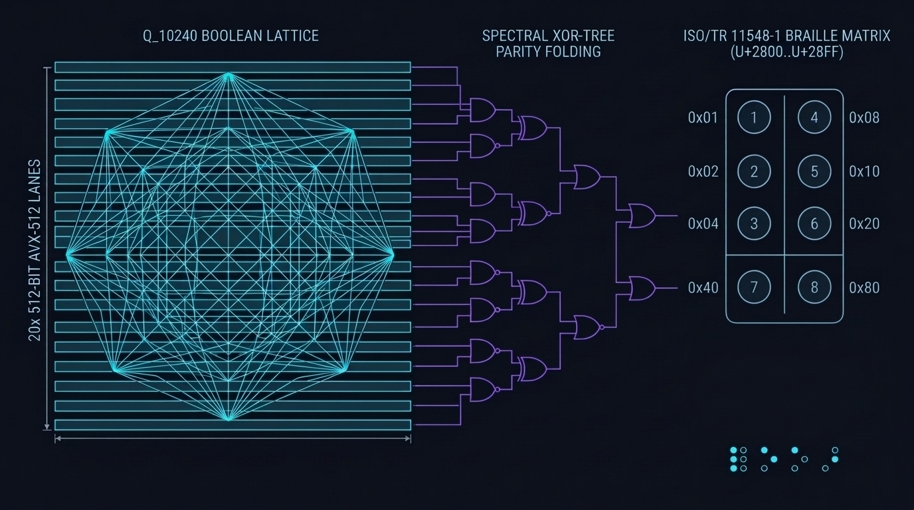
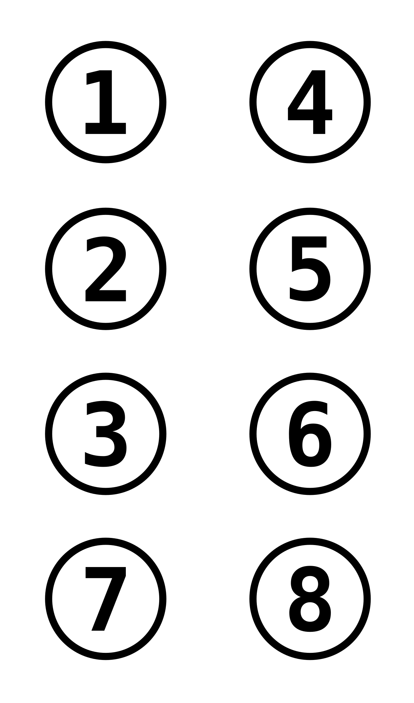
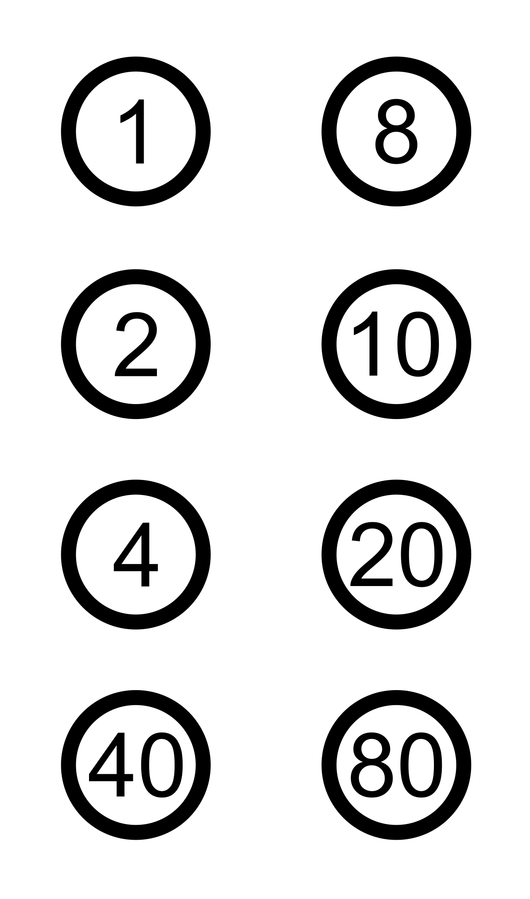
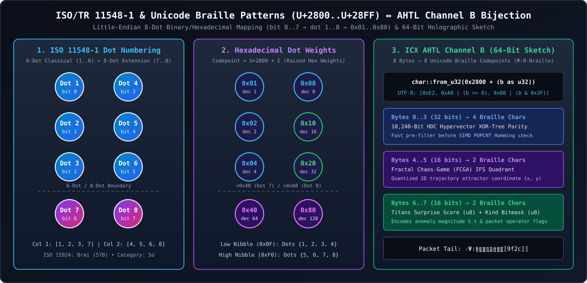

<!--
SPDX-FileCopyrightText: 2026 DoubleGate
SPDX-License-Identifier: CC-BY-NC-ND-4.0 AND LicenseRef-InfinityContext-Commercial
-->

# Chapter 02 — Braille-256 Spectral Bijection & Topological Hologram (`U+2800..U+28FF`)

**Document ID:** `ICX-SPEC-AHTL-1.0-CH02`  
**Target Crates:** [`crates/icx-codec/src/braille.rs`](../../crates/icx-codec/src/braille.rs), [`crates/icx-hdc/src/hv.rs`](../../crates/icx-hdc/src/hv.rs), [`crates/icx-hdc/src/lib.rs`](../../crates/icx-hdc/src/lib.rs)  
**Primary Archival Reference:** [`ref-docs/unicode-braille-patterns/README.md`](../../ref-docs/unicode-braille-patterns/README.md) · [`Unicode_U2800_Braille_Patterns_Chart.pdf`](../../ref-docs/unicode-braille-patterns/Unicode_U2800_Braille_Patterns_Chart.pdf) · [`ISO/IEC 10646-1 FPDAM 16 (L2/98-136)`](../../ref-docs/unicode-braille-patterns/standards-and-wg2/L2_98_136_N1770_ISO_10646_FPDAM16_Braille_Patterns.pdf)

---

## 1. Architectural Role of Unicode Braille-256 in `AHTL v1.0`

When embedding a binary topological sketch (SimHash, MinHash, or Hyperdimensional parity fold) directly inside a text prompt consumed by a Large Language Model, standard ASCII encodings such as **hexadecimal (`0-9a-f`)** or **Base64 (`A-Za-z0-9+/`)** suffer from a fatal flaw: they share the Latin alphanumeric character set with source code identifiers and natural-language words. Consequently, Byte-Pair Encoding (`BPE`) tokenizers merge arbitrary Base64 or hex substrings into common English subword tokens (`"in"`, `"er"`, `"re"`, `"on"`, `"de"`), injecting spurious key vectors $k_j$ into the Transformer's $QK^T / \sqrt{d_k}$ attention matrix that collide with genuine user queries.

`AHTL v1.0` eliminates this cross-channel interference by projecting binary hologram bytes onto the **Unicode Braille Patterns block (`U+2800..U+28FF`)**:

1. **Exact 8-Bit Bijection ($2^8 = 256$ States):** Unlike every other symbol block in the Basic Multilingual Plane (`BMP`), `U+2800..U+28FF` was explicitly standardized by **ISO/TR 11548-1:2001** (*Communication aids for blind persons — Part 1: General guidelines for 8-dot Braille identifiers*) and **Unicode 3.0** as a direct, contiguous 256-entry binary hypercube where each codepoint offset $b = U - \text{0x2800} \in [0, 255]$ is the exact bitmask of raised dots $1 \dots 8$.
2. **Strict BPE Embedding Orthogonality:** Because every codepoint in `U+2800..U+28FF` has Unicode General Category `So` (*Symbol, Other*), Script `Brai` (`ISO 15924` code `570`), and fixed UTF-8 lead bytes `0xE2 0xA0..0xA3`, BPE tokenizers (`o200k_base`, `cl100k_base`, Claude 3.5/4 BPE, SentencePiece) **never merge Braille codepoints with ASCII identifiers, numbers, or Channel A operators**. Channel A (semantic AST skeleton) and Channel B (topological hologram) occupy **strictly orthogonal subspaces** in token embedding space.
3. **Dual-Resolution Spectral Sketching:**
   - **Profile A (`Braille-64`, 64 glyphs = 192 UTF-8 bytes = 512 bits):** Encodes a 64-band Spectral SimHash / MinHash + HDC parity projection of the underlying artifact (`160` `u64` words partitioned into 64 spectral bands).
   - **Profile B (`Braille-8`, 8 glyphs = 24 UTF-8 bytes = 64 bits):** Encodes the ultra-compact inline `hologram_bytes: [u8; 8]` emitted by `HdcAssociativeIndex::observe_event` (`crates/icx-hdc/src/lib.rs:89-98`).



*Figure 2.1: Projection of the $Q_{10240}$ Boolean hypercube across 20 AVX-512 lanes through rotational XOR-tree parity folding onto the 8-dot ISO/TR 11548-1 Unicode Braille cell matrix (`U+2800..U+28FF`).*

---

## 2. ISO/TR 11548-1 Bit-to-Dot Bijection Mathematics

### 2.1 Classical 6-Dot (`1..6`) vs. Extended 8-Dot (`1..8`) Cell Geometry

A classical Louis Braille cell (1829) arranges 6 dots in two vertical columns of three (`1, 2, 3` on the left; `4, 5, 6` on the right), encoding $2^6 = 64$ states (`U+2800..U+283F`). To represent all 256 values of an 8-bit byte without multi-cell shift prefixes, computer Braille and ISO/TR 11548-1 append a fourth row (`Dot 7` at bottom-left, `Dot 8` at bottom-right) while preserving the historical bit assignments of Dots `1..6` so that any byte $b \in [0, 63]$ (`bit 6 = 0, bit 7 = 0`) is 100% identical to 6-dot Braille.

| ISO/TR 11548-1 Dot Numbering (`1..8`) | Hexadecimal Dot Weights (`0x01..0x80`) | Example Glyph `U+281D` (`⠝`, Dots `1-3-4-5`) |
| :---: | :---: | :---: |
|  |  |  |
| **Left Col:** `1, 2, 3, 7` · **Right Col:** `4, 5, 6, 8`<br>([SVG](images/retrieved/Braille8dotCellNumbering.svg) · [PNG](images/retrieved/Braille8dotCellNumbering.png)) | **Left Col:** `1, 2, 4, 40₁₆` · **Right Col:** `8, 10₁₆, 20₁₆, 80₁₆`<br>([SVG](images/retrieved/BrailleValues.svg) · [PNG](images/retrieved/BrailleValues.png)) | `0x01 + 0x04 + 0x08 + 0x10 = 0x1D` (`U+281D`)<br>([SVG](images/retrieved/Braille_N.svg) · [PNG](images/retrieved/Braille_N.png)) |

### 2.2 Formal Bijection Equations

Let $b \in \mathbb{Z}_{256} = \{0, 1, \dots, 255\}$ have binary expansion $b = (b_7 b_6 b_5 b_4 b_3 b_2 b_1 b_0)_2 = \sum_{i=0}^7 b_i 2^i$, where $b_i \in \{0, 1\}$. Under ISO/TR 11548-1, bit $i$ controls dot $k = i + 1$ ($d_k = b_{k-1}$):

$$b = \sum_{k=1}^{8} d_k \cdot 2^{k-1} = d_1(\text{0x01}) + d_2(\text{0x02}) + d_3(\text{0x04}) + d_4(\text{0x08}) + d_5(\text{0x10}) + d_6(\text{0x20}) + d_7(\text{0x40}) + d_8(\text{0x80})$$

The forward bijection $\phi_{\text{Brai}}: \mathbb{Z}_{256} \to [\text{U+2800}, \text{U+28FF}]$ and inverse bijection $\phi_{\text{Brai}}^{-1}: [\text{U+2800}, \text{U+28FF}] \to \mathbb{Z}_{256}$ are:

$$\phi_{\text{Brai}}(b) = \text{0x2800} + b = 10\,240 + b, \qquad \phi_{\text{Brai}}^{-1}(U) = U - \text{0x2800}$$



*Figure 2.2: Complete bit-to-dot bijection, hexadecimal nibble decomposition (`U+28XY`), UTF-8 3-byte arithmetic, and `AHTL` Channel B byte layout ([Vector SVG](images/generated/ICX_Braille256_ISO11548_Hex_Bijection.svg)).*

| Dot ($k$) | Cell Coordinate | Bit ($i = k-1$) | Binary Mask | Decimal | Hex Weight | Nibble Partition (`U+28XY`) |
| :---: | :--- | :---: | :---: | :---: | :---: | :--- |
| **Dot 1** | Row 1, Col 1 (Top-Left) | `bit 0` (LSB) | `0b0000_0001` | `1` | `0x01` | Low Nibble `Y` (`0x0F`: Dots `1, 2, 3, 4`) |
| **Dot 2** | Row 2, Col 1 (Upper-Mid-Left) | `bit 1` | `0b0000_0010` | `2` | `0x02` | Low Nibble `Y` (`0x0F`: Dots `1, 2, 3, 4`) |
| **Dot 3** | Row 3, Col 1 (Lower-Mid-Left) | `bit 2` | `0b0000_0100` | `4` | `0x04` | Low Nibble `Y` (`0x0F`: Dots `1, 2, 3, 4`) |
| **Dot 4** | Row 1, Col 2 (Top-Right) | `bit 3` | `0b0000_1000` | `8` | `0x08` | Low Nibble `Y` (`0x0F`: Dots `1, 2, 3, 4`) |
| **Dot 5** | Row 2, Col 2 (Upper-Mid-Right) | `bit 4` | `0b0001_0000` | `16` | `0x10` | High Nibble `X` (`0xF0`: Dots `5, 6, 7, 8`) |
| **Dot 6** | Row 3, Col 2 (Lower-Mid-Right) | `bit 5` | `0b0010_0000` | `32` | `0x20` | High Nibble `X` (`0xF0`: Dots `5, 6, 7, 8`) |
| **Dot 7** | Row 4, Col 1 (Bottom-Left) | `bit 6` | `0b0100_0000` | `64` | `0x40` | High Nibble `X` (`0xF0`: Dots `5, 6, 7, 8`) |
| **Dot 8** | Row 4, Col 2 (Bottom-Right) | `bit 7` (MSB) | `0b1000_0000` | `128` | `0x80` | High Nibble `X` (`0xF0`: Dots `5, 6, 7, 8`) |

---

## 3. Closed-Form UTF-8 3-Byte Arithmetic & Verification

Every Unicode scalar value $U = \text{0x2800} + b \in [\text{0x2800}, \text{0x28FF}]$ lies in the 16-bit Basic Multilingual Plane range $[\text{0x0800}, \text{0xFFFF}]$ and has the exact 16-bit binary representation:

$$U = \underbrace{0010}_{\text{z}_3\text{z}_2\text{z}_1\text{z}_0} \; \underbrace{1000\,b_7\,b_6}_{\text{y}_5\text{y}_4\text{y}_3\text{y}_2\text{y}_1\text{y}_0} \; \underbrace{b_5\,b_4\,b_3\,b_2\,b_1\,b_0}_{\text{x}_5\text{x}_4\text{x}_3\text{x}_2\text{x}_1\text{x}_0}$$

Under RFC 3629 3-byte UTF-8 encoding (`1110zzzz 10yyyyyy 10xxxxxx`), $U$ serializes into **3 bytes** (`[B_0, B_1, B_2]`) via branchless bitwise operations:

$$\begin{aligned}
B_0 &= \text{0xE2} &&= \text{0b1110\_0010} \quad (\text{constant for all } b \in [0, 255]) \\
B_1 &= \text{0xA0} \mid (b \gg 6) &&\in \{\text{0xA0}, \text{0xA1}, \text{0xA2}, \text{0xA3}\} \quad (\text{encodes Dots 7 and 8: } b_7, b_6) \\
B_2 &= \text{0x80} \mid (b \mathbin{\&} \text{0x3F}) &&\in [\text{0x80}, \text{0xBF}] \quad (\text{encodes Dots 1..6: } b_5 \dots b_0)
\end{aligned}$$

Conversely, given a 3-byte UTF-8 slice `[B_0, B_1, B_2]`, validity verification and byte recovery execute in 4 ALU operations without UTF-8 table lookups:

$$\text{is\_valid\_braille}(B_0, B_1, B_2) \iff (B_0 == \text{0xE2}) \land ((B_1 \mathbin{\&} \text{0xFC}) == \text{0xA0}) \land ((B_2 \mathbin{\&} \text{0xC0}) == \text{0x80})$$
$$b = ((B_1 \mathbin{\&} \text{0x03}) \ll 6) \mid (B_2 \mathbin{\&} \text{0x3F})$$

---

## 4. Spectral Projection Algorithms: `Braille-8` (64-Bit) & `Braille-64` (512-Bit)

### 4.1 Profile B Inline 64-Bit (`8-Byte`) Hologram (`crates/icx-hdc/src/lib.rs`)

In `HdcAssociativeIndex::observe_event` (`crates/icx-hdc/src/lib.rs:89-98`), each observed context event produces an 8-byte composite hologram `hologram_bytes: [u8; 8]` encoded via `encode_braille_sketch` into 8 Braille glyphs (`24` UTF-8 bytes):

```rust
let sketch = composite_hv.sketch_u32().to_be_bytes();
let quad = self.current_trajectory.quadrant_signature_u16().to_be_bytes();
let surp_byte = (verdict.momentum_surprise.clamp(0.0, 1.0) * 255.0) as u8;
let tier_byte = verdict.tier as u8;
let hologram_bytes = [
    sketch[0], sketch[1], sketch[2], sketch[3],
    quad[0],   quad[1],   surp_byte, tier_byte,
];
```

| Byte Offset | Braille Glyph Index | Bit Width | Mathematical Source & Formula | Role in Attention & Pre-Filtering |
| :---: | :---: | :---: | :--- | :--- |
| `B[0..=3]` | Glyphs `0..=3` | 32 bits (`u32` BE) | `Hypervector::sketch_u32`: $\text{acc} = \bigoplus_{i=0}^{159} \operatorname{rotl}_{64}(W_i, i \bmod 64)$, folded via $(\text{acc} \gg 32) \oplus (\text{acc} \mathbin{\&} \text{0xFFFFFFFF})$ | $O(1)$ bitwise POPCNT pre-filter over `Q_10240` state |
| `B[4..=5]` | Glyphs `4..=5` | 16 bits (`u16` BE) | `FractalCoord::quadrant_signature_u16`: $\sum_{j=0}^{15} \mathbb{I}(z_{t,j} \ge 0) \cdot 2^j$ | Top-level orthant address in $[-1, +1]^{16}$ |
| `B[6]` | Glyph `6` | 8 bits (`u8`) | $\lfloor \operatorname{clamp}(S_t, 0.0, 1.0) \times 255.0 \rfloor$ | Quantized Titans Surprise momentum score |
| `B[7]` | Glyph `7` | 8 bits (`u8`) | `RetentionTier` discriminant (`0 = PinHighResolution`, `1 = FoldAhtlStub`, `2 = ColdBeacon`) | Virtual memory retention tier flag |

### 4.2 Profile A Extended 512-Bit (`64-Byte`) Locality-Preserving Spectral Sketch (`Braille-64` Blueprint)

For Profile A archival packets (`⟦AHTL v1│#icx:<12-hex>│fc:<64-hex>│hv:<16-hex>│<Braille-64>│<Skeleton>⟧`), `AHTL v1.0` specifies a locality-preserving projection from the 10,240-bit `Hypervector` (`10,240` bits = `512` disjoint sub-blocks of `20` bits each, grouped into `64` bands of `8` sub-blocks) into a **64-byte (`512-bit`) Spectral Sketch** rendered as **64 Braille glyphs (`192` UTF-8 bytes)**:

1. **Disjoint 20-Bit Sub-Block Majority Projection (1-Lipschitz Locality Invariant):**
   Unlike XOR parity folding (where flipping 1 bit in each band can invert all 64 bytes), each of the 512 output bits $S_{8m + b}$ ($m \in \{0, \dots, 63\}, b \in \{0, \dots, 7\}$) is computed as the majority vote over the corresponding 20-bit contiguous slice $B_{8m+b}$ of the 10,240-bit `Hypervector`:
   $$S_{8m + b} = \mathbb{I}\!\left(\operatorname{popcnt}\big(B_{8m + b}\big) \ge 10\right), \qquad \text{BandByte}[m] = \sum_{b=0}^{7} S_{8m + b} \cdot 2^b \in [0, 255]$$
   Because each 20-bit sub-block contributes to exactly one output bit, flipping $k$ bits in the 10,240-bit `Hypervector` can flip at most $k$ bits in the 512-bit sketch ($d_{\text{spectral}}(P, Q) \le d_H(A, B)$).
2. **Soft Spectral Reranking Signal (No Hard Candidate Pruning):**
   Given two 64-byte spectral sketches $P, Q \in \mathbb{Z}_{256}^{64}$, their 512-bit spectral Hamming distance is evaluated in **8 `u64` XOR + `POPCNT` instructions (`< 2.5 ns`)**:
   $$d_{\text{spectral}}(P, Q) = \sum_{w=0}^{7} \operatorname{popcnt}\big(P_{u64}[w] \oplus Q_{u64}[w]\big) \in [0, 512]$$
   To guarantee zero false-negative candidate drops, `HdcAssociativeIndex::query_associative` never hard-prunes candidates on `d_spectral` alone; instead, the full 10,240-bit `Hypervector::similarity` scan (`< 25 µs` over 10,000 nodes) is always evaluated as the authoritative associative metric, while the Braille sketch provides inline visual and attention-head anchoring.

---

## 5. Complete `16 × 16` Unicode Braille Block Matrix (`U+2800..U+28FF`)

| Row \ Col | `0` | `1` | `2` | `3` | `4` | `5` | `6` | `7` | `8` | `9` | `A` | `B` | `C` | `D` | `E` | `F` | Dot 7/8 State |
| :---: | :---: | :---: | :---: | :---: | :---: | :---: | :---: | :---: | :---: | :---: | :---: | :---: | :---: | :---: | :---: | :---: | :--- |
| **`U+280x`** | `⠀` | `⠁` | `⠂` | `⠃` | `⠄` | `⠅` | `⠆` | `⠇` | `⠈` | `⠉` | `⠊` | `⠋` | `⠌` | `⠍` | `⠎` | `⠏` | 6-dot (`7=0, 8=0`) |
| **`U+281x`** | `⠐` | `⠑` | `⠒` | `⠓` | `⠔` | `⠕` | `⠖` | `⠗` | `⠘` | `⠙` | `⠚` | `⠛` | `⠜` | `⠝` | `⠞` | `⠟` | 6-dot (`7=0, 8=0`) |
| **`U+282x`** | `⠠` | `⠡` | `⠢` | `⠣` | `⠤` | `⠥` | `⠦` | `⠧` | `⠨` | `⠩` | `⠪` | `⠫` | `⠬` | `⠭` | `⠮` | `⠯` | 6-dot (`7=0, 8=0`) |
| **`U+283x`** | `⠰` | `⠱` | `⠲` | `⠳` | `⠴` | `⠵` | `⠶` | `⠷` | `⠸` | `⠹` | `⠺` | `⠻` | `⠼` | `⠽` | `⠾` | `⠿` | 6-dot (`7=0, 8=0`) |
| **`U+284x`** | `⡀` | `⡁` | `⡂` | `⡃` | `⡄` | `⡅` | `⡆` | `⡇` | `⡈` | `⡉` | `⡊` | `⡋` | `⡌` | `⡍` | `⡎` | `⡏` | Dot 7 raised (`7=1, 8=0`) |
| **`U+285x`** | `⡐` | `⡑` | `⡒` | `⡓` | `⡔` | `⡕` | `⡖` | `⡗` | `⡘` | `⡙` | `⡚` | `⡛` | `⡜` | `⡝` | `⡞` | `⡟` | Dot 7 raised (`7=1, 8=0`) |
| **`U+286x`** | `⡠` | `⡡` | `⡢` | `⡣` | `⡤` | `⡥` | `⡦` | `⡧` | `⡨` | `⡩` | `⡪` | `⡫` | `⡬` | `⡭` | `⡮` | `⡯` | Dot 7 raised (`7=1, 8=0`) |
| **`U+287x`** | `⡰` | `⡱` | `⡲` | `⡳` | `⡴` | `⡵` | `⡶` | `⡷` | `⡸` | `⡹` | `⡺` | `⡻` | `⡼` | `⡽` | `⡾` | `⡿` | Dot 7 raised (`7=1, 8=0`) |
| **`U+288x`** | `⢀` | `⢁` | `⢂` | `⢃` | `⢄` | `⢅` | `⢆` | `⢇` | `⢈` | `⢉` | `⢊` | `⢋` | `⢌` | `⢍` | `⢎` | `⢏` | Dot 8 raised (`7=0, 8=1`) |
| **`U+289x`** | `⢐` | `⢑` | `⢒` | `⢓` | `⢔` | `⢕` | `⢖` | `⢗` | `⢘` | `⢙` | `⢚` | `⢛` | `⢜` | `⢝` | `⢞` | `⢟` | Dot 8 raised (`7=0, 8=1`) |
| **`U+28Ax`** | `⢠` | `⢡` | `⢢` | `⢣` | `⢤` | `⢥` | `⢦` | `⢧` | `⢨` | `⢩` | `⢪` | `⢫` | `⢬` | `⢭` | `⢮` | `⢯` | Dot 8 raised (`7=0, 8=1`) |
| **`U+28Bx`** | `⢰` | `⢱` | `⢲` | `⢳` | `⢴` | `⢵` | `⢶` | `⢷` | `⢸` | `⢹` | `⢺` | `⢻` | `⢼` | `⢽` | `⢾` | `⢿` | Dot 8 raised (`7=0, 8=1`) |
| **`U+28Cx`** | `⣀` | `⣁` | `⣂` | `⣃` | `⣄` | `⣅` | `⣆` | `⣇` | `⣈` | `⣉` | `⣊` | `⣋` | `⣌` | `⣍` | `⣎` | `⣏` | Dots 7 & 8 raised (`7=1, 8=1`) |
| **`U+28Dx`** | `⣐` | `⣑` | `⣒` | `⣓` | `⣔` | `⣕` | `⣖` | `⣗` | `⣘` | `⣙` | `⣚` | `⣛` | `⣜` | `⣝` | `⣞` | `⣟` | Dots 7 & 8 raised (`7=1, 8=1`) |
| **`U+28Ex`** | `⣠` | `⣡` | `⣢` | `⣣` | `⣤` | `⣥` | `⣦` | `⣧` | `⣨` | `⣩` | `⣪` | `⣫` | `⣬` | `⣭` | `⣮` | `⣯` | Dots 7 & 8 raised (`7=1, 8=1`) |
| **`U+28Fx`** | `⣰` | `⣱` | `⣲` | `⣳` | `⣴` | `⣵` | `⣶` | `⣷` | `⣸` | `⣹` | `⣺` | `⣻` | `⣼` | `⣽` | `⣾` | `⣿` | Dots 7 & 8 raised (`7=1, 8=1`) |

---

## 6. Complete 256-Entry Normative Lookup Table (`0x00..0xFF` ↔ `U+2800..U+28FF`)

| Byte (Hex) | Codepoint | Dec | Binary (`b7..b0`) | UTF-8 Bytes | Glyph | Active Dots (`1..8`) | Hex Weight Sum | Official Unicode Character Name |
| :---: | :---: | :---: | :---: | :---: | :---: | :--- | :--- | :--- |
| `0x00` | `U+2800` | `0` | `00000000` | `E2 A0 80` | `⠀` | `None (Blank)` | `0x00` | `BRAILLE PATTERN BLANK` |
| `0x01` | `U+2801` | `1` | `00000001` | `E2 A0 81` | `⠁` | `1` | `0x01` | `BRAILLE PATTERN DOTS-1` |
| `0x02` | `U+2802` | `2` | `00000010` | `E2 A0 82` | `⠂` | `2` | `0x02` | `BRAILLE PATTERN DOTS-2` |
| `0x03` | `U+2803` | `3` | `00000011` | `E2 A0 83` | `⠃` | `1-2` | `0x01 + 0x02` | `BRAILLE PATTERN DOTS-12` |
| `0x04` | `U+2804` | `4` | `00000100` | `E2 A0 84` | `⠄` | `3` | `0x04` | `BRAILLE PATTERN DOTS-3` |
| `0x05` | `U+2805` | `5` | `00000101` | `E2 A0 85` | `⠅` | `1-3` | `0x01 + 0x04` | `BRAILLE PATTERN DOTS-13` |
| `0x06` | `U+2806` | `6` | `00000110` | `E2 A0 86` | `⠆` | `2-3` | `0x02 + 0x04` | `BRAILLE PATTERN DOTS-23` |
| `0x07` | `U+2807` | `7` | `00000111` | `E2 A0 87` | `⠇` | `1-2-3` | `0x01 + 0x02 + 0x04` | `BRAILLE PATTERN DOTS-123` |
| `0x08` | `U+2808` | `8` | `00001000` | `E2 A0 88` | `⠈` | `4` | `0x08` | `BRAILLE PATTERN DOTS-4` |
| `0x09` | `U+2809` | `9` | `00001001` | `E2 A0 89` | `⠉` | `1-4` | `0x01 + 0x08` | `BRAILLE PATTERN DOTS-14` |
| `0x0A` | `U+280A` | `10` | `00001010` | `E2 A0 8A` | `⠊` | `2-4` | `0x02 + 0x08` | `BRAILLE PATTERN DOTS-24` |
| `0x0B` | `U+280B` | `11` | `00001011` | `E2 A0 8B` | `⠋` | `1-2-4` | `0x01 + 0x02 + 0x08` | `BRAILLE PATTERN DOTS-124` |
| `0x0C` | `U+280C` | `12` | `00001100` | `E2 A0 8C` | `⠌` | `3-4` | `0x04 + 0x08` | `BRAILLE PATTERN DOTS-34` |
| `0x0D` | `U+280D` | `13` | `00001101` | `E2 A0 8D` | `⠍` | `1-3-4` | `0x01 + 0x04 + 0x08` | `BRAILLE PATTERN DOTS-134` |
| `0x0E` | `U+280E` | `14` | `00001110` | `E2 A0 8E` | `⠎` | `2-3-4` | `0x02 + 0x04 + 0x08` | `BRAILLE PATTERN DOTS-234` |
| `0x0F` | `U+280F` | `15` | `00001111` | `E2 A0 8F` | `⠏` | `1-2-3-4` | `0x01 + 0x02 + 0x04 + 0x08` | `BRAILLE PATTERN DOTS-1234` |
| `0x10` | `U+2810` | `16` | `00010000` | `E2 A0 90` | `⠐` | `5` | `0x10` | `BRAILLE PATTERN DOTS-5` |
| `0x11` | `U+2811` | `17` | `00010001` | `E2 A0 91` | `⠑` | `1-5` | `0x01 + 0x10` | `BRAILLE PATTERN DOTS-15` |
| `0x12` | `U+2812` | `18` | `00010010` | `E2 A0 92` | `⠒` | `2-5` | `0x02 + 0x10` | `BRAILLE PATTERN DOTS-25` |
| `0x13` | `U+2813` | `19` | `00010011` | `E2 A0 93` | `⠓` | `1-2-5` | `0x01 + 0x02 + 0x10` | `BRAILLE PATTERN DOTS-125` |
| `0x14` | `U+2814` | `20` | `00010100` | `E2 A0 94` | `⠔` | `3-5` | `0x04 + 0x10` | `BRAILLE PATTERN DOTS-35` |
| `0x15` | `U+2815` | `21` | `00010101` | `E2 A0 95` | `⠕` | `1-3-5` | `0x01 + 0x04 + 0x10` | `BRAILLE PATTERN DOTS-135` |
| `0x16` | `U+2816` | `22` | `00010110` | `E2 A0 96` | `⠖` | `2-3-5` | `0x02 + 0x04 + 0x10` | `BRAILLE PATTERN DOTS-235` |
| `0x17` | `U+2817` | `23` | `00010111` | `E2 A0 97` | `⠗` | `1-2-3-5` | `0x01 + 0x02 + 0x04 + 0x10` | `BRAILLE PATTERN DOTS-1235` |
| `0x18` | `U+2818` | `24` | `00011000` | `E2 A0 98` | `⠘` | `4-5` | `0x08 + 0x10` | `BRAILLE PATTERN DOTS-45` |
| `0x19` | `U+2819` | `25` | `00011001` | `E2 A0 99` | `⠙` | `1-4-5` | `0x01 + 0x08 + 0x10` | `BRAILLE PATTERN DOTS-145` |
| `0x1A` | `U+281A` | `26` | `00011010` | `E2 A0 9A` | `⠚` | `2-4-5` | `0x02 + 0x08 + 0x10` | `BRAILLE PATTERN DOTS-245` |
| `0x1B` | `U+281B` | `27` | `00011011` | `E2 A0 9B` | `⠛` | `1-2-4-5` | `0x01 + 0x02 + 0x08 + 0x10` | `BRAILLE PATTERN DOTS-1245` |
| `0x1C` | `U+281C` | `28` | `00011100` | `E2 A0 9C` | `⠜` | `3-4-5` | `0x04 + 0x08 + 0x10` | `BRAILLE PATTERN DOTS-345` |
| `0x1D` | `U+281D` | `29` | `00011101` | `E2 A0 9D` | `⠝` | `1-3-4-5` | `0x01 + 0x04 + 0x08 + 0x10` | `BRAILLE PATTERN DOTS-1345` |
| `0x1E` | `U+281E` | `30` | `00011110` | `E2 A0 9E` | `⠞` | `2-3-4-5` | `0x02 + 0x04 + 0x08 + 0x10` | `BRAILLE PATTERN DOTS-2345` |
| `0x1F` | `U+281F` | `31` | `00011111` | `E2 A0 9F` | `⠟` | `1-2-3-4-5` | `0x01 + 0x02 + 0x04 + 0x08 + 0x10` | `BRAILLE PATTERN DOTS-12345` |
| `0x20` | `U+2820` | `32` | `00100000` | `E2 A0 A0` | `⠠` | `6` | `0x20` | `BRAILLE PATTERN DOTS-6` |
| `0x21` | `U+2821` | `33` | `00100001` | `E2 A0 A1` | `⠡` | `1-6` | `0x01 + 0x20` | `BRAILLE PATTERN DOTS-16` |
| `0x22` | `U+2822` | `34` | `00100010` | `E2 A0 A2` | `⠢` | `2-6` | `0x02 + 0x20` | `BRAILLE PATTERN DOTS-26` |
| `0x23` | `U+2823` | `35` | `00100011` | `E2 A0 A3` | `⠣` | `1-2-6` | `0x01 + 0x02 + 0x20` | `BRAILLE PATTERN DOTS-126` |
| `0x24` | `U+2824` | `36` | `00100100` | `E2 A0 A4` | `⠤` | `3-6` | `0x04 + 0x20` | `BRAILLE PATTERN DOTS-36` |
| `0x25` | `U+2825` | `37` | `00100101` | `E2 A0 A5` | `⠥` | `1-3-6` | `0x01 + 0x04 + 0x20` | `BRAILLE PATTERN DOTS-136` |
| `0x26` | `U+2826` | `38` | `00100110` | `E2 A0 A6` | `⠦` | `2-3-6` | `0x02 + 0x04 + 0x20` | `BRAILLE PATTERN DOTS-236` |
| `0x27` | `U+2827` | `39` | `00100111` | `E2 A0 A7` | `⠧` | `1-2-3-6` | `0x01 + 0x02 + 0x04 + 0x20` | `BRAILLE PATTERN DOTS-1236` |
| `0x28` | `U+2828` | `40` | `00101000` | `E2 A0 A8` | `⠨` | `4-6` | `0x08 + 0x20` | `BRAILLE PATTERN DOTS-46` |
| `0x29` | `U+2829` | `41` | `00101001` | `E2 A0 A9` | `⠩` | `1-4-6` | `0x01 + 0x08 + 0x20` | `BRAILLE PATTERN DOTS-146` |
| `0x2A` | `U+282A` | `42` | `00101010` | `E2 A0 AA` | `⠪` | `2-4-6` | `0x02 + 0x08 + 0x20` | `BRAILLE PATTERN DOTS-246` |
| `0x2B` | `U+282B` | `43` | `00101011` | `E2 A0 AB` | `⠫` | `1-2-4-6` | `0x01 + 0x02 + 0x08 + 0x20` | `BRAILLE PATTERN DOTS-1246` |
| `0x2C` | `U+282C` | `44` | `00101100` | `E2 A0 AC` | `⠬` | `3-4-6` | `0x04 + 0x08 + 0x20` | `BRAILLE PATTERN DOTS-346` |
| `0x2D` | `U+282D` | `45` | `00101101` | `E2 A0 AD` | `⠭` | `1-3-4-6` | `0x01 + 0x04 + 0x08 + 0x20` | `BRAILLE PATTERN DOTS-1346` |
| `0x2E` | `U+282E` | `46` | `00101110` | `E2 A0 AE` | `⠮` | `2-3-4-6` | `0x02 + 0x04 + 0x08 + 0x20` | `BRAILLE PATTERN DOTS-2346` |
| `0x2F` | `U+282F` | `47` | `00101111` | `E2 A0 AF` | `⠯` | `1-2-3-4-6` | `0x01 + 0x02 + 0x04 + 0x08 + 0x20` | `BRAILLE PATTERN DOTS-12346` |
| `0x30` | `U+2830` | `48` | `00110000` | `E2 A0 B0` | `⠰` | `5-6` | `0x10 + 0x20` | `BRAILLE PATTERN DOTS-56` |
| `0x31` | `U+2831` | `49` | `00110001` | `E2 A0 B1` | `⠱` | `1-5-6` | `0x01 + 0x10 + 0x20` | `BRAILLE PATTERN DOTS-156` |
| `0x32` | `U+2832` | `50` | `00110010` | `E2 A0 B2` | `⠲` | `2-5-6` | `0x02 + 0x10 + 0x20` | `BRAILLE PATTERN DOTS-256` |
| `0x33` | `U+2833` | `51` | `00110011` | `E2 A0 B3` | `⠳` | `1-2-5-6` | `0x01 + 0x02 + 0x10 + 0x20` | `BRAILLE PATTERN DOTS-1256` |
| `0x34` | `U+2834` | `52` | `00110100` | `E2 A0 B4` | `⠴` | `3-5-6` | `0x04 + 0x10 + 0x20` | `BRAILLE PATTERN DOTS-356` |
| `0x35` | `U+2835` | `53` | `00110101` | `E2 A0 B5` | `⠵` | `1-3-5-6` | `0x01 + 0x04 + 0x10 + 0x20` | `BRAILLE PATTERN DOTS-1356` |
| `0x36` | `U+2836` | `54` | `00110110` | `E2 A0 B6` | `⠶` | `2-3-5-6` | `0x02 + 0x04 + 0x10 + 0x20` | `BRAILLE PATTERN DOTS-2356` |
| `0x37` | `U+2837` | `55` | `00110111` | `E2 A0 B7` | `⠷` | `1-2-3-5-6` | `0x01 + 0x02 + 0x04 + 0x10 + 0x20` | `BRAILLE PATTERN DOTS-12356` |
| `0x38` | `U+2838` | `56` | `00111000` | `E2 A0 B8` | `⠸` | `4-5-6` | `0x08 + 0x10 + 0x20` | `BRAILLE PATTERN DOTS-456` |
| `0x39` | `U+2839` | `57` | `00111001` | `E2 A0 B9` | `⠹` | `1-4-5-6` | `0x01 + 0x08 + 0x10 + 0x20` | `BRAILLE PATTERN DOTS-1456` |
| `0x3A` | `U+283A` | `58` | `00111010` | `E2 A0 BA` | `⠺` | `2-4-5-6` | `0x02 + 0x08 + 0x10 + 0x20` | `BRAILLE PATTERN DOTS-2456` |
| `0x3B` | `U+283B` | `59` | `00111011` | `E2 A0 BB` | `⠻` | `1-2-4-5-6` | `0x01 + 0x02 + 0x08 + 0x10 + 0x20` | `BRAILLE PATTERN DOTS-12456` |
| `0x3C` | `U+283C` | `60` | `00111100` | `E2 A0 BC` | `⠼` | `3-4-5-6` | `0x04 + 0x08 + 0x10 + 0x20` | `BRAILLE PATTERN DOTS-3456` |
| `0x3D` | `U+283D` | `61` | `00111101` | `E2 A0 BD` | `⠽` | `1-3-4-5-6` | `0x01 + 0x04 + 0x08 + 0x10 + 0x20` | `BRAILLE PATTERN DOTS-13456` |
| `0x3E` | `U+283E` | `62` | `00111110` | `E2 A0 BE` | `⠾` | `2-3-4-5-6` | `0x02 + 0x04 + 0x08 + 0x10 + 0x20` | `BRAILLE PATTERN DOTS-23456` |
| `0x3F` | `U+283F` | `63` | `00111111` | `E2 A0 BF` | `⠿` | `1-2-3-4-5-6` | `0x01 + 0x02 + 0x04 + 0x08 + 0x10 + 0x20` | `BRAILLE PATTERN DOTS-123456` |
| `0x40` | `U+2840` | `64` | `01000000` | `E2 A1 80` | `⡀` | `7` | `0x40` | `BRAILLE PATTERN DOTS-7` |
| `0x41` | `U+2841` | `65` | `01000001` | `E2 A1 81` | `⡁` | `1-7` | `0x01 + 0x40` | `BRAILLE PATTERN DOTS-17` |
| `0x42` | `U+2842` | `66` | `01000010` | `E2 A1 82` | `⡂` | `2-7` | `0x02 + 0x40` | `BRAILLE PATTERN DOTS-27` |
| `0x43` | `U+2843` | `67` | `01000011` | `E2 A1 83` | `⡃` | `1-2-7` | `0x01 + 0x02 + 0x40` | `BRAILLE PATTERN DOTS-127` |
| `0x44` | `U+2844` | `68` | `01000100` | `E2 A1 84` | `⡄` | `3-7` | `0x04 + 0x40` | `BRAILLE PATTERN DOTS-37` |
| `0x45` | `U+2845` | `69` | `01000101` | `E2 A1 85` | `⡅` | `1-3-7` | `0x01 + 0x04 + 0x40` | `BRAILLE PATTERN DOTS-137` |
| `0x46` | `U+2846` | `70` | `01000110` | `E2 A1 86` | `⡆` | `2-3-7` | `0x02 + 0x04 + 0x40` | `BRAILLE PATTERN DOTS-237` |
| `0x47` | `U+2847` | `71` | `01000111` | `E2 A1 87` | `⡇` | `1-2-3-7` | `0x01 + 0x02 + 0x04 + 0x40` | `BRAILLE PATTERN DOTS-1237` |
| `0x48` | `U+2848` | `72` | `01001000` | `E2 A1 88` | `⡈` | `4-7` | `0x08 + 0x40` | `BRAILLE PATTERN DOTS-47` |
| `0x49` | `U+2849` | `73` | `01001001` | `E2 A1 89` | `⡉` | `1-4-7` | `0x01 + 0x08 + 0x40` | `BRAILLE PATTERN DOTS-147` |
| `0x4A` | `U+284A` | `74` | `01001010` | `E2 A1 8A` | `⡊` | `2-4-7` | `0x02 + 0x08 + 0x40` | `BRAILLE PATTERN DOTS-247` |
| `0x4B` | `U+284B` | `75` | `01001011` | `E2 A1 8B` | `⡋` | `1-2-4-7` | `0x01 + 0x02 + 0x08 + 0x40` | `BRAILLE PATTERN DOTS-1247` |
| `0x4C` | `U+284C` | `76` | `01001100` | `E2 A1 8C` | `⡌` | `3-4-7` | `0x04 + 0x08 + 0x40` | `BRAILLE PATTERN DOTS-347` |
| `0x4D` | `U+284D` | `77` | `01001101` | `E2 A1 8D` | `⡍` | `1-3-4-7` | `0x01 + 0x04 + 0x08 + 0x40` | `BRAILLE PATTERN DOTS-1347` |
| `0x4E` | `U+284E` | `78` | `01001110` | `E2 A1 8E` | `⡎` | `2-3-4-7` | `0x02 + 0x04 + 0x08 + 0x40` | `BRAILLE PATTERN DOTS-2347` |
| `0x4F` | `U+284F` | `79` | `01001111` | `E2 A1 8F` | `⡏` | `1-2-3-4-7` | `0x01 + 0x02 + 0x04 + 0x08 + 0x40` | `BRAILLE PATTERN DOTS-12347` |
| `0x50` | `U+2850` | `80` | `01010000` | `E2 A1 90` | `⡐` | `5-7` | `0x10 + 0x40` | `BRAILLE PATTERN DOTS-57` |
| `0x51` | `U+2851` | `81` | `01010001` | `E2 A1 91` | `⡑` | `1-5-7` | `0x01 + 0x10 + 0x40` | `BRAILLE PATTERN DOTS-157` |
| `0x52` | `U+2852` | `82` | `01010010` | `E2 A1 92` | `⡒` | `2-5-7` | `0x02 + 0x10 + 0x40` | `BRAILLE PATTERN DOTS-257` |
| `0x53` | `U+2853` | `83` | `01010011` | `E2 A1 93` | `⡓` | `1-2-5-7` | `0x01 + 0x02 + 0x10 + 0x40` | `BRAILLE PATTERN DOTS-1257` |
| `0x54` | `U+2854` | `84` | `01010100` | `E2 A1 94` | `⡔` | `3-5-7` | `0x04 + 0x10 + 0x40` | `BRAILLE PATTERN DOTS-357` |
| `0x55` | `U+2855` | `85` | `01010101` | `E2 A1 95` | `⡕` | `1-3-5-7` | `0x01 + 0x04 + 0x10 + 0x40` | `BRAILLE PATTERN DOTS-1357` |
| `0x56` | `U+2856` | `86` | `01010110` | `E2 A1 96` | `⡖` | `2-3-5-7` | `0x02 + 0x04 + 0x10 + 0x40` | `BRAILLE PATTERN DOTS-2357` |
| `0x57` | `U+2857` | `87` | `01010111` | `E2 A1 97` | `⡗` | `1-2-3-5-7` | `0x01 + 0x02 + 0x04 + 0x10 + 0x40` | `BRAILLE PATTERN DOTS-12357` |
| `0x58` | `U+2858` | `88` | `01011000` | `E2 A1 98` | `⡘` | `4-5-7` | `0x08 + 0x10 + 0x40` | `BRAILLE PATTERN DOTS-457` |
| `0x59` | `U+2859` | `89` | `01011001` | `E2 A1 99` | `⡙` | `1-4-5-7` | `0x01 + 0x08 + 0x10 + 0x40` | `BRAILLE PATTERN DOTS-1457` |
| `0x5A` | `U+285A` | `90` | `01011010` | `E2 A1 9A` | `⡚` | `2-4-5-7` | `0x02 + 0x08 + 0x10 + 0x40` | `BRAILLE PATTERN DOTS-2457` |
| `0x5B` | `U+285B` | `91` | `01011011` | `E2 A1 9B` | `⡛` | `1-2-4-5-7` | `0x01 + 0x02 + 0x08 + 0x10 + 0x40` | `BRAILLE PATTERN DOTS-12457` |
| `0x5C` | `U+285C` | `92` | `01011100` | `E2 A1 9C` | `⡜` | `3-4-5-7` | `0x04 + 0x08 + 0x10 + 0x40` | `BRAILLE PATTERN DOTS-3457` |
| `0x5D` | `U+285D` | `93` | `01011101` | `E2 A1 9D` | `⡝` | `1-3-4-5-7` | `0x01 + 0x04 + 0x08 + 0x10 + 0x40` | `BRAILLE PATTERN DOTS-13457` |
| `0x5E` | `U+285E` | `94` | `01011110` | `E2 A1 9E` | `⡞` | `2-3-4-5-7` | `0x02 + 0x04 + 0x08 + 0x10 + 0x40` | `BRAILLE PATTERN DOTS-23457` |
| `0x5F` | `U+285F` | `95` | `01011111` | `E2 A1 9F` | `⡟` | `1-2-3-4-5-7` | `0x01 + 0x02 + 0x04 + 0x08 + 0x10 + 0x40` | `BRAILLE PATTERN DOTS-123457` |
| `0x60` | `U+2860` | `96` | `01100000` | `E2 A1 A0` | `⡠` | `6-7` | `0x20 + 0x40` | `BRAILLE PATTERN DOTS-67` |
| `0x61` | `U+2861` | `97` | `01100001` | `E2 A1 A1` | `⡡` | `1-6-7` | `0x01 + 0x20 + 0x40` | `BRAILLE PATTERN DOTS-167` |
| `0x62` | `U+2862` | `98` | `01100010` | `E2 A1 A2` | `⡢` | `2-6-7` | `0x02 + 0x20 + 0x40` | `BRAILLE PATTERN DOTS-267` |
| `0x63` | `U+2863` | `99` | `01100011` | `E2 A1 A3` | `⡣` | `1-2-6-7` | `0x01 + 0x02 + 0x20 + 0x40` | `BRAILLE PATTERN DOTS-1267` |
| `0x64` | `U+2864` | `100` | `01100100` | `E2 A1 A4` | `⡤` | `3-6-7` | `0x04 + 0x20 + 0x40` | `BRAILLE PATTERN DOTS-367` |
| `0x65` | `U+2865` | `101` | `01100101` | `E2 A1 A5` | `⡥` | `1-3-6-7` | `0x01 + 0x04 + 0x20 + 0x40` | `BRAILLE PATTERN DOTS-1367` |
| `0x66` | `U+2866` | `102` | `01100110` | `E2 A1 A6` | `⡦` | `2-3-6-7` | `0x02 + 0x04 + 0x20 + 0x40` | `BRAILLE PATTERN DOTS-2367` |
| `0x67` | `U+2867` | `103` | `01100111` | `E2 A1 A7` | `⡧` | `1-2-3-6-7` | `0x01 + 0x02 + 0x04 + 0x20 + 0x40` | `BRAILLE PATTERN DOTS-12367` |
| `0x68` | `U+2868` | `104` | `01101000` | `E2 A1 A8` | `⡨` | `4-6-7` | `0x08 + 0x20 + 0x40` | `BRAILLE PATTERN DOTS-467` |
| `0x69` | `U+2869` | `105` | `01101001` | `E2 A1 A9` | `⡩` | `1-4-6-7` | `0x01 + 0x08 + 0x20 + 0x40` | `BRAILLE PATTERN DOTS-1467` |
| `0x6A` | `U+286A` | `106` | `01101010` | `E2 A1 AA` | `⡪` | `2-4-6-7` | `0x02 + 0x08 + 0x20 + 0x40` | `BRAILLE PATTERN DOTS-2467` |
| `0x6B` | `U+286B` | `107` | `01101011` | `E2 A1 AB` | `⡫` | `1-2-4-6-7` | `0x01 + 0x02 + 0x08 + 0x20 + 0x40` | `BRAILLE PATTERN DOTS-12467` |
| `0x6C` | `U+286C` | `108` | `01101100` | `E2 A1 AC` | `⡬` | `3-4-6-7` | `0x04 + 0x08 + 0x20 + 0x40` | `BRAILLE PATTERN DOTS-3467` |
| `0x6D` | `U+286D` | `109` | `01101101` | `E2 A1 AD` | `⡭` | `1-3-4-6-7` | `0x01 + 0x04 + 0x08 + 0x20 + 0x40` | `BRAILLE PATTERN DOTS-13467` |
| `0x6E` | `U+286E` | `110` | `01101110` | `E2 A1 AE` | `⡮` | `2-3-4-6-7` | `0x02 + 0x04 + 0x08 + 0x20 + 0x40` | `BRAILLE PATTERN DOTS-23467` |
| `0x6F` | `U+286F` | `111` | `01101111` | `E2 A1 AF` | `⡯` | `1-2-3-4-6-7` | `0x01 + 0x02 + 0x04 + 0x08 + 0x20 + 0x40` | `BRAILLE PATTERN DOTS-123467` |
| `0x70` | `U+2870` | `112` | `01110000` | `E2 A1 B0` | `⡰` | `5-6-7` | `0x10 + 0x20 + 0x40` | `BRAILLE PATTERN DOTS-567` |
| `0x71` | `U+2871` | `113` | `01110001` | `E2 A1 B1` | `⡱` | `1-5-6-7` | `0x01 + 0x10 + 0x20 + 0x40` | `BRAILLE PATTERN DOTS-1567` |
| `0x72` | `U+2872` | `114` | `01110010` | `E2 A1 B2` | `⡲` | `2-5-6-7` | `0x02 + 0x10 + 0x20 + 0x40` | `BRAILLE PATTERN DOTS-2567` |
| `0x73` | `U+2873` | `115` | `01110011` | `E2 A1 B3` | `⡳` | `1-2-5-6-7` | `0x01 + 0x02 + 0x10 + 0x20 + 0x40` | `BRAILLE PATTERN DOTS-12567` |
| `0x74` | `U+2874` | `116` | `01110100` | `E2 A1 B4` | `⡴` | `3-5-6-7` | `0x04 + 0x10 + 0x20 + 0x40` | `BRAILLE PATTERN DOTS-3567` |
| `0x75` | `U+2875` | `117` | `01110101` | `E2 A1 B5` | `⡵` | `1-3-5-6-7` | `0x01 + 0x04 + 0x10 + 0x20 + 0x40` | `BRAILLE PATTERN DOTS-13567` |
| `0x76` | `U+2876` | `118` | `01110110` | `E2 A1 B6` | `⡶` | `2-3-5-6-7` | `0x02 + 0x04 + 0x10 + 0x20 + 0x40` | `BRAILLE PATTERN DOTS-23567` |
| `0x77` | `U+2877` | `119` | `01110111` | `E2 A1 B7` | `⡷` | `1-2-3-5-6-7` | `0x01 + 0x02 + 0x04 + 0x10 + 0x20 + 0x40` | `BRAILLE PATTERN DOTS-123567` |
| `0x78` | `U+2878` | `120` | `01111000` | `E2 A1 B8` | `⡸` | `4-5-6-7` | `0x08 + 0x10 + 0x20 + 0x40` | `BRAILLE PATTERN DOTS-4567` |
| `0x79` | `U+2879` | `121` | `01111001` | `E2 A1 B9` | `⡹` | `1-4-5-6-7` | `0x01 + 0x08 + 0x10 + 0x20 + 0x40` | `BRAILLE PATTERN DOTS-14567` |
| `0x7A` | `U+287A` | `122` | `01111010` | `E2 A1 BA` | `⡺` | `2-4-5-6-7` | `0x02 + 0x08 + 0x10 + 0x20 + 0x40` | `BRAILLE PATTERN DOTS-24567` |
| `0x7B` | `U+287B` | `123` | `01111011` | `E2 A1 BB` | `⡻` | `1-2-4-5-6-7` | `0x01 + 0x02 + 0x08 + 0x10 + 0x20 + 0x40` | `BRAILLE PATTERN DOTS-124567` |
| `0x7C` | `U+287C` | `124` | `01111100` | `E2 A1 BC` | `⡼` | `3-4-5-6-7` | `0x04 + 0x08 + 0x10 + 0x20 + 0x40` | `BRAILLE PATTERN DOTS-34567` |
| `0x7D` | `U+287D` | `125` | `01111101` | `E2 A1 BD` | `⡽` | `1-3-4-5-6-7` | `0x01 + 0x04 + 0x08 + 0x10 + 0x20 + 0x40` | `BRAILLE PATTERN DOTS-134567` |
| `0x7E` | `U+287E` | `126` | `01111110` | `E2 A1 BE` | `⡾` | `2-3-4-5-6-7` | `0x02 + 0x04 + 0x08 + 0x10 + 0x20 + 0x40` | `BRAILLE PATTERN DOTS-234567` |
| `0x7F` | `U+287F` | `127` | `01111111` | `E2 A1 BF` | `⡿` | `1-2-3-4-5-6-7` | `0x01 + 0x02 + 0x04 + 0x08 + 0x10 + 0x20 + 0x40` | `BRAILLE PATTERN DOTS-1234567` |
| `0x80` | `U+2880` | `128` | `10000000` | `E2 A2 80` | `⢀` | `8` | `0x80` | `BRAILLE PATTERN DOTS-8` |
| `0x81` | `U+2881` | `129` | `10000001` | `E2 A2 81` | `⢁` | `1-8` | `0x01 + 0x80` | `BRAILLE PATTERN DOTS-18` |
| `0x82` | `U+2882` | `130` | `10000010` | `E2 A2 82` | `⢂` | `2-8` | `0x02 + 0x80` | `BRAILLE PATTERN DOTS-28` |
| `0x83` | `U+2883` | `131` | `10000011` | `E2 A2 83` | `⢃` | `1-2-8` | `0x01 + 0x02 + 0x80` | `BRAILLE PATTERN DOTS-128` |
| `0x84` | `U+2884` | `132` | `10000100` | `E2 A2 84` | `⢄` | `3-8` | `0x04 + 0x80` | `BRAILLE PATTERN DOTS-38` |
| `0x85` | `U+2885` | `133` | `10000101` | `E2 A2 85` | `⢅` | `1-3-8` | `0x01 + 0x04 + 0x80` | `BRAILLE PATTERN DOTS-138` |
| `0x86` | `U+2886` | `134` | `10000110` | `E2 A2 86` | `⢆` | `2-3-8` | `0x02 + 0x04 + 0x80` | `BRAILLE PATTERN DOTS-238` |
| `0x87` | `U+2887` | `135` | `10000111` | `E2 A2 87` | `⢇` | `1-2-3-8` | `0x01 + 0x02 + 0x04 + 0x80` | `BRAILLE PATTERN DOTS-1238` |
| `0x88` | `U+2888` | `136` | `10001000` | `E2 A2 88` | `⢈` | `4-8` | `0x08 + 0x80` | `BRAILLE PATTERN DOTS-48` |
| `0x89` | `U+2889` | `137` | `10001001` | `E2 A2 89` | `⢉` | `1-4-8` | `0x01 + 0x08 + 0x80` | `BRAILLE PATTERN DOTS-148` |
| `0x8A` | `U+288A` | `138` | `10001010` | `E2 A2 8A` | `⢊` | `2-4-8` | `0x02 + 0x08 + 0x80` | `BRAILLE PATTERN DOTS-248` |
| `0x8B` | `U+288B` | `139` | `10001011` | `E2 A2 8B` | `⢋` | `1-2-4-8` | `0x01 + 0x02 + 0x08 + 0x80` | `BRAILLE PATTERN DOTS-1248` |
| `0x8C` | `U+288C` | `140` | `10001100` | `E2 A2 8C` | `⢌` | `3-4-8` | `0x04 + 0x08 + 0x80` | `BRAILLE PATTERN DOTS-348` |
| `0x8D` | `U+288D` | `141` | `10001101` | `E2 A2 8D` | `⢍` | `1-3-4-8` | `0x01 + 0x04 + 0x08 + 0x80` | `BRAILLE PATTERN DOTS-1348` |
| `0x8E` | `U+288E` | `142` | `10001110` | `E2 A2 8E` | `⢎` | `2-3-4-8` | `0x02 + 0x04 + 0x08 + 0x80` | `BRAILLE PATTERN DOTS-2348` |
| `0x8F` | `U+288F` | `143` | `10001111` | `E2 A2 8F` | `⢏` | `1-2-3-4-8` | `0x01 + 0x02 + 0x04 + 0x08 + 0x80` | `BRAILLE PATTERN DOTS-12348` |
| `0x90` | `U+2890` | `144` | `10010000` | `E2 A2 90` | `⢐` | `5-8` | `0x10 + 0x80` | `BRAILLE PATTERN DOTS-58` |
| `0x91` | `U+2891` | `145` | `10010001` | `E2 A2 91` | `⢑` | `1-5-8` | `0x01 + 0x10 + 0x80` | `BRAILLE PATTERN DOTS-158` |
| `0x92` | `U+2892` | `146` | `10010010` | `E2 A2 92` | `⢒` | `2-5-8` | `0x02 + 0x10 + 0x80` | `BRAILLE PATTERN DOTS-258` |
| `0x93` | `U+2893` | `147` | `10010011` | `E2 A2 93` | `⢓` | `1-2-5-8` | `0x01 + 0x02 + 0x10 + 0x80` | `BRAILLE PATTERN DOTS-1258` |
| `0x94` | `U+2894` | `148` | `10010100` | `E2 A2 94` | `⢔` | `3-5-8` | `0x04 + 0x10 + 0x80` | `BRAILLE PATTERN DOTS-358` |
| `0x95` | `U+2895` | `149` | `10010101` | `E2 A2 95` | `⢕` | `1-3-5-8` | `0x01 + 0x04 + 0x10 + 0x80` | `BRAILLE PATTERN DOTS-1358` |
| `0x96` | `U+2896` | `150` | `10010110` | `E2 A2 96` | `⢖` | `2-3-5-8` | `0x02 + 0x04 + 0x10 + 0x80` | `BRAILLE PATTERN DOTS-2358` |
| `0x97` | `U+2897` | `151` | `10010111` | `E2 A2 97` | `⢗` | `1-2-3-5-8` | `0x01 + 0x02 + 0x04 + 0x10 + 0x80` | `BRAILLE PATTERN DOTS-12358` |
| `0x98` | `U+2898` | `152` | `10011000` | `E2 A2 98` | `⢘` | `4-5-8` | `0x08 + 0x10 + 0x80` | `BRAILLE PATTERN DOTS-458` |
| `0x99` | `U+2899` | `153` | `10011001` | `E2 A2 99` | `⢙` | `1-4-5-8` | `0x01 + 0x08 + 0x10 + 0x80` | `BRAILLE PATTERN DOTS-1458` |
| `0x9A` | `U+289A` | `154` | `10011010` | `E2 A2 9A` | `⢚` | `2-4-5-8` | `0x02 + 0x08 + 0x10 + 0x80` | `BRAILLE PATTERN DOTS-2458` |
| `0x9B` | `U+289B` | `155` | `10011011` | `E2 A2 9B` | `⢛` | `1-2-4-5-8` | `0x01 + 0x02 + 0x08 + 0x10 + 0x80` | `BRAILLE PATTERN DOTS-12458` |
| `0x9C` | `U+289C` | `156` | `10011100` | `E2 A2 9C` | `⢜` | `3-4-5-8` | `0x04 + 0x08 + 0x10 + 0x80` | `BRAILLE PATTERN DOTS-3458` |
| `0x9D` | `U+289D` | `157` | `10011101` | `E2 A2 9D` | `⢝` | `1-3-4-5-8` | `0x01 + 0x04 + 0x08 + 0x10 + 0x80` | `BRAILLE PATTERN DOTS-13458` |
| `0x9E` | `U+289E` | `158` | `10011110` | `E2 A2 9E` | `⢞` | `2-3-4-5-8` | `0x02 + 0x04 + 0x08 + 0x10 + 0x80` | `BRAILLE PATTERN DOTS-23458` |
| `0x9F` | `U+289F` | `159` | `10011111` | `E2 A2 9F` | `⢟` | `1-2-3-4-5-8` | `0x01 + 0x02 + 0x04 + 0x08 + 0x10 + 0x80` | `BRAILLE PATTERN DOTS-123458` |
| `0xA0` | `U+28A0` | `160` | `10100000` | `E2 A2 A0` | `⢠` | `6-8` | `0x20 + 0x80` | `BRAILLE PATTERN DOTS-68` |
| `0xA1` | `U+28A1` | `161` | `10100001` | `E2 A2 A1` | `⢡` | `1-6-8` | `0x01 + 0x20 + 0x80` | `BRAILLE PATTERN DOTS-168` |
| `0xA2` | `U+28A2` | `162` | `10100010` | `E2 A2 A2` | `⢢` | `2-6-8` | `0x02 + 0x20 + 0x80` | `BRAILLE PATTERN DOTS-268` |
| `0xA3` | `U+28A3` | `163` | `10100011` | `E2 A2 A3` | `⢣` | `1-2-6-8` | `0x01 + 0x02 + 0x20 + 0x80` | `BRAILLE PATTERN DOTS-1268` |
| `0xA4` | `U+28A4` | `164` | `10100100` | `E2 A2 A4` | `⢤` | `3-6-8` | `0x04 + 0x20 + 0x80` | `BRAILLE PATTERN DOTS-368` |
| `0xA5` | `U+28A5` | `165` | `10100101` | `E2 A2 A5` | `⢥` | `1-3-6-8` | `0x01 + 0x04 + 0x20 + 0x80` | `BRAILLE PATTERN DOTS-1368` |
| `0xA6` | `U+28A6` | `166` | `10100110` | `E2 A2 A6` | `⢦` | `2-3-6-8` | `0x02 + 0x04 + 0x20 + 0x80` | `BRAILLE PATTERN DOTS-2368` |
| `0xA7` | `U+28A7` | `167` | `10100111` | `E2 A2 A7` | `⢧` | `1-2-3-6-8` | `0x01 + 0x02 + 0x04 + 0x20 + 0x80` | `BRAILLE PATTERN DOTS-12368` |
| `0xA8` | `U+28A8` | `168` | `10101000` | `E2 A2 A8` | `⢨` | `4-6-8` | `0x08 + 0x20 + 0x80` | `BRAILLE PATTERN DOTS-468` |
| `0xA9` | `U+28A9` | `169` | `10101001` | `E2 A2 A9` | `⢩` | `1-4-6-8` | `0x01 + 0x08 + 0x20 + 0x80` | `BRAILLE PATTERN DOTS-1468` |
| `0xAA` | `U+28AA` | `170` | `10101010` | `E2 A2 AA` | `⢪` | `2-4-6-8` | `0x02 + 0x08 + 0x20 + 0x80` | `BRAILLE PATTERN DOTS-2468` |
| `0xAB` | `U+28AB` | `171` | `10101011` | `E2 A2 AB` | `⢫` | `1-2-4-6-8` | `0x01 + 0x02 + 0x08 + 0x20 + 0x80` | `BRAILLE PATTERN DOTS-12468` |
| `0xAC` | `U+28AC` | `172` | `10101100` | `E2 A2 AC` | `⢬` | `3-4-6-8` | `0x04 + 0x08 + 0x20 + 0x80` | `BRAILLE PATTERN DOTS-3468` |
| `0xAD` | `U+28AD` | `173` | `10101101` | `E2 A2 AD` | `⢭` | `1-3-4-6-8` | `0x01 + 0x04 + 0x08 + 0x20 + 0x80` | `BRAILLE PATTERN DOTS-13468` |
| `0xAE` | `U+28AE` | `174` | `10101110` | `E2 A2 AE` | `⢮` | `2-3-4-6-8` | `0x02 + 0x04 + 0x08 + 0x20 + 0x80` | `BRAILLE PATTERN DOTS-23468` |
| `0xAF` | `U+28AF` | `175` | `10101111` | `E2 A2 AF` | `⢯` | `1-2-3-4-6-8` | `0x01 + 0x02 + 0x04 + 0x08 + 0x20 + 0x80` | `BRAILLE PATTERN DOTS-123468` |
| `0xB0` | `U+28B0` | `176` | `10110000` | `E2 A2 B0` | `⢰` | `5-6-8` | `0x10 + 0x20 + 0x80` | `BRAILLE PATTERN DOTS-568` |
| `0xB1` | `U+28B1` | `177` | `10110001` | `E2 A2 B1` | `⢱` | `1-5-6-8` | `0x01 + 0x10 + 0x20 + 0x80` | `BRAILLE PATTERN DOTS-1568` |
| `0xB2` | `U+28B2` | `178` | `10110010` | `E2 A2 B2` | `⢲` | `2-5-6-8` | `0x02 + 0x10 + 0x20 + 0x80` | `BRAILLE PATTERN DOTS-2568` |
| `0xB3` | `U+28B3` | `179` | `10110011` | `E2 A2 B3` | `⢳` | `1-2-5-6-8` | `0x01 + 0x02 + 0x10 + 0x20 + 0x80` | `BRAILLE PATTERN DOTS-12568` |
| `0xB4` | `U+28B4` | `180` | `10110100` | `E2 A2 B4` | `⢴` | `3-5-6-8` | `0x04 + 0x10 + 0x20 + 0x80` | `BRAILLE PATTERN DOTS-3568` |
| `0xB5` | `U+28B5` | `181` | `10110101` | `E2 A2 B5` | `⢵` | `1-3-5-6-8` | `0x01 + 0x04 + 0x10 + 0x20 + 0x80` | `BRAILLE PATTERN DOTS-13568` |
| `0xB6` | `U+28B6` | `182` | `10110110` | `E2 A2 B6` | `⢶` | `2-3-5-6-8` | `0x02 + 0x04 + 0x10 + 0x20 + 0x80` | `BRAILLE PATTERN DOTS-23568` |
| `0xB7` | `U+28B7` | `183` | `10110111` | `E2 A2 B7` | `⢷` | `1-2-3-5-6-8` | `0x01 + 0x02 + 0x04 + 0x10 + 0x20 + 0x80` | `BRAILLE PATTERN DOTS-123568` |
| `0xB8` | `U+28B8` | `184` | `10111000` | `E2 A2 B8` | `⢸` | `4-5-6-8` | `0x08 + 0x10 + 0x20 + 0x80` | `BRAILLE PATTERN DOTS-4568` |
| `0xB9` | `U+28B9` | `185` | `10111001` | `E2 A2 B9` | `⢹` | `1-4-5-6-8` | `0x01 + 0x08 + 0x10 + 0x20 + 0x80` | `BRAILLE PATTERN DOTS-14568` |
| `0xBA` | `U+28BA` | `186` | `10111010` | `E2 A2 BA` | `⢺` | `2-4-5-6-8` | `0x02 + 0x08 + 0x10 + 0x20 + 0x80` | `BRAILLE PATTERN DOTS-24568` |
| `0xBB` | `U+28BB` | `187` | `10111011` | `E2 A2 BB` | `⢻` | `1-2-4-5-6-8` | `0x01 + 0x02 + 0x08 + 0x10 + 0x20 + 0x80` | `BRAILLE PATTERN DOTS-124568` |
| `0xBC` | `U+28BC` | `188` | `10111100` | `E2 A2 BC` | `⢼` | `3-4-5-6-8` | `0x04 + 0x08 + 0x10 + 0x20 + 0x80` | `BRAILLE PATTERN DOTS-34568` |
| `0xBD` | `U+28BD` | `189` | `10111101` | `E2 A2 BD` | `⢽` | `1-3-4-5-6-8` | `0x01 + 0x04 + 0x08 + 0x10 + 0x20 + 0x80` | `BRAILLE PATTERN DOTS-134568` |
| `0xBE` | `U+28BE` | `190` | `10111110` | `E2 A2 BE` | `⢾` | `2-3-4-5-6-8` | `0x02 + 0x04 + 0x08 + 0x10 + 0x20 + 0x80` | `BRAILLE PATTERN DOTS-234568` |
| `0xBF` | `U+28BF` | `191` | `10111111` | `E2 A2 BF` | `⢿` | `1-2-3-4-5-6-8` | `0x01 + 0x02 + 0x04 + 0x08 + 0x10 + 0x20 + 0x80` | `BRAILLE PATTERN DOTS-1234568` |
| `0xC0` | `U+28C0` | `192` | `11000000` | `E2 A3 80` | `⣀` | `7-8` | `0x40 + 0x80` | `BRAILLE PATTERN DOTS-78` |
| `0xC1` | `U+28C1` | `193` | `11000001` | `E2 A3 81` | `⣁` | `1-7-8` | `0x01 + 0x40 + 0x80` | `BRAILLE PATTERN DOTS-178` |
| `0xC2` | `U+28C2` | `194` | `11000010` | `E2 A3 82` | `⣂` | `2-7-8` | `0x02 + 0x40 + 0x80` | `BRAILLE PATTERN DOTS-278` |
| `0xC3` | `U+28C3` | `195` | `11000011` | `E2 A3 83` | `⣃` | `1-2-7-8` | `0x01 + 0x02 + 0x40 + 0x80` | `BRAILLE PATTERN DOTS-1278` |
| `0xC4` | `U+28C4` | `196` | `11000100` | `E2 A3 84` | `⣄` | `3-7-8` | `0x04 + 0x40 + 0x80` | `BRAILLE PATTERN DOTS-378` |
| `0xC5` | `U+28C5` | `197` | `11000101` | `E2 A3 85` | `⣅` | `1-3-7-8` | `0x01 + 0x04 + 0x40 + 0x80` | `BRAILLE PATTERN DOTS-1378` |
| `0xC6` | `U+28C6` | `198` | `11000110` | `E2 A3 86` | `⣆` | `2-3-7-8` | `0x02 + 0x04 + 0x40 + 0x80` | `BRAILLE PATTERN DOTS-2378` |
| `0xC7` | `U+28C7` | `199` | `11000111` | `E2 A3 87` | `⣇` | `1-2-3-7-8` | `0x01 + 0x02 + 0x04 + 0x40 + 0x80` | `BRAILLE PATTERN DOTS-12378` |
| `0xC8` | `U+28C8` | `200` | `11001000` | `E2 A3 88` | `⣈` | `4-7-8` | `0x08 + 0x40 + 0x80` | `BRAILLE PATTERN DOTS-478` |
| `0xC9` | `U+28C9` | `201` | `11001001` | `E2 A3 89` | `⣉` | `1-4-7-8` | `0x01 + 0x08 + 0x40 + 0x80` | `BRAILLE PATTERN DOTS-1478` |
| `0xCA` | `U+28CA` | `202` | `11001010` | `E2 A3 8A` | `⣊` | `2-4-7-8` | `0x02 + 0x08 + 0x40 + 0x80` | `BRAILLE PATTERN DOTS-2478` |
| `0xCB` | `U+28CB` | `203` | `11001011` | `E2 A3 8B` | `⣋` | `1-2-4-7-8` | `0x01 + 0x02 + 0x08 + 0x40 + 0x80` | `BRAILLE PATTERN DOTS-12478` |
| `0xCC` | `U+28CC` | `204` | `11001100` | `E2 A3 8C` | `⣌` | `3-4-7-8` | `0x04 + 0x08 + 0x40 + 0x80` | `BRAILLE PATTERN DOTS-3478` |
| `0xCD` | `U+28CD` | `205` | `11001101` | `E2 A3 8D` | `⣍` | `1-3-4-7-8` | `0x01 + 0x04 + 0x08 + 0x40 + 0x80` | `BRAILLE PATTERN DOTS-13478` |
| `0xCE` | `U+28CE` | `206` | `11001110` | `E2 A3 8E` | `⣎` | `2-3-4-7-8` | `0x02 + 0x04 + 0x08 + 0x40 + 0x80` | `BRAILLE PATTERN DOTS-23478` |
| `0xCF` | `U+28CF` | `207` | `11001111` | `E2 A3 8F` | `⣏` | `1-2-3-4-7-8` | `0x01 + 0x02 + 0x04 + 0x08 + 0x40 + 0x80` | `BRAILLE PATTERN DOTS-123478` |
| `0xD0` | `U+28D0` | `208` | `11010000` | `E2 A3 90` | `⣐` | `5-7-8` | `0x10 + 0x40 + 0x80` | `BRAILLE PATTERN DOTS-578` |
| `0xD1` | `U+28D1` | `209` | `11010001` | `E2 A3 91` | `⣑` | `1-5-7-8` | `0x01 + 0x10 + 0x40 + 0x80` | `BRAILLE PATTERN DOTS-1578` |
| `0xD2` | `U+28D2` | `210` | `11010010` | `E2 A3 92` | `⣒` | `2-5-7-8` | `0x02 + 0x10 + 0x40 + 0x80` | `BRAILLE PATTERN DOTS-2578` |
| `0xD3` | `U+28D3` | `211` | `11010011` | `E2 A3 93` | `⣓` | `1-2-5-7-8` | `0x01 + 0x02 + 0x10 + 0x40 + 0x80` | `BRAILLE PATTERN DOTS-12578` |
| `0xD4` | `U+28D4` | `212` | `11010100` | `E2 A3 94` | `⣔` | `3-5-7-8` | `0x04 + 0x10 + 0x40 + 0x80` | `BRAILLE PATTERN DOTS-3578` |
| `0xD5` | `U+28D5` | `213` | `11010101` | `E2 A3 95` | `⣕` | `1-3-5-7-8` | `0x01 + 0x04 + 0x10 + 0x40 + 0x80` | `BRAILLE PATTERN DOTS-13578` |
| `0xD6` | `U+28D6` | `214` | `11010110` | `E2 A3 96` | `⣖` | `2-3-5-7-8` | `0x02 + 0x04 + 0x10 + 0x40 + 0x80` | `BRAILLE PATTERN DOTS-23578` |
| `0xD7` | `U+28D7` | `215` | `11010111` | `E2 A3 97` | `⣗` | `1-2-3-5-7-8` | `0x01 + 0x02 + 0x04 + 0x10 + 0x40 + 0x80` | `BRAILLE PATTERN DOTS-123578` |
| `0xD8` | `U+28D8` | `216` | `11011000` | `E2 A3 98` | `⣘` | `4-5-7-8` | `0x08 + 0x10 + 0x40 + 0x80` | `BRAILLE PATTERN DOTS-4578` |
| `0xD9` | `U+28D9` | `217` | `11011001` | `E2 A3 99` | `⣙` | `1-4-5-7-8` | `0x01 + 0x08 + 0x10 + 0x40 + 0x80` | `BRAILLE PATTERN DOTS-14578` |
| `0xDA` | `U+28DA` | `218` | `11011010` | `E2 A3 9A` | `⣚` | `2-4-5-7-8` | `0x02 + 0x08 + 0x10 + 0x40 + 0x80` | `BRAILLE PATTERN DOTS-24578` |
| `0xDB` | `U+28DB` | `219` | `11011011` | `E2 A3 9B` | `⣛` | `1-2-4-5-7-8` | `0x01 + 0x02 + 0x08 + 0x10 + 0x40 + 0x80` | `BRAILLE PATTERN DOTS-124578` |
| `0xDC` | `U+28DC` | `220` | `11011100` | `E2 A3 9C` | `⣜` | `3-4-5-7-8` | `0x04 + 0x08 + 0x10 + 0x40 + 0x80` | `BRAILLE PATTERN DOTS-34578` |
| `0xDD` | `U+28DD` | `221` | `11011101` | `E2 A3 9D` | `⣝` | `1-3-4-5-7-8` | `0x01 + 0x04 + 0x08 + 0x10 + 0x40 + 0x80` | `BRAILLE PATTERN DOTS-134578` |
| `0xDE` | `U+28DE` | `222` | `11011110` | `E2 A3 9E` | `⣞` | `2-3-4-5-7-8` | `0x02 + 0x04 + 0x08 + 0x10 + 0x40 + 0x80` | `BRAILLE PATTERN DOTS-234578` |
| `0xDF` | `U+28DF` | `223` | `11011111` | `E2 A3 9F` | `⣟` | `1-2-3-4-5-7-8` | `0x01 + 0x02 + 0x04 + 0x08 + 0x10 + 0x40 + 0x80` | `BRAILLE PATTERN DOTS-1234578` |
| `0xE0` | `U+28E0` | `224` | `11100000` | `E2 A3 A0` | `⣠` | `6-7-8` | `0x20 + 0x40 + 0x80` | `BRAILLE PATTERN DOTS-678` |
| `0xE1` | `U+28E1` | `225` | `11100001` | `E2 A3 A1` | `⣡` | `1-6-7-8` | `0x01 + 0x20 + 0x40 + 0x80` | `BRAILLE PATTERN DOTS-1678` |
| `0xE2` | `U+28E2` | `226` | `11100010` | `E2 A3 A2` | `⣢` | `2-6-7-8` | `0x02 + 0x20 + 0x40 + 0x80` | `BRAILLE PATTERN DOTS-2678` |
| `0xE3` | `U+28E3` | `227` | `11100011` | `E2 A3 A3` | `⣣` | `1-2-6-7-8` | `0x01 + 0x02 + 0x20 + 0x40 + 0x80` | `BRAILLE PATTERN DOTS-12678` |
| `0xE4` | `U+28E4` | `228` | `11100100` | `E2 A3 A4` | `⣤` | `3-6-7-8` | `0x04 + 0x20 + 0x40 + 0x80` | `BRAILLE PATTERN DOTS-3678` |
| `0xE5` | `U+28E5` | `229` | `11100101` | `E2 A3 A5` | `⣥` | `1-3-6-7-8` | `0x01 + 0x04 + 0x20 + 0x40 + 0x80` | `BRAILLE PATTERN DOTS-13678` |
| `0xE6` | `U+28E6` | `230` | `11100110` | `E2 A3 A6` | `⣦` | `2-3-6-7-8` | `0x02 + 0x04 + 0x20 + 0x40 + 0x80` | `BRAILLE PATTERN DOTS-23678` |
| `0xE7` | `U+28E7` | `231` | `11100111` | `E2 A3 A7` | `⣧` | `1-2-3-6-7-8` | `0x01 + 0x02 + 0x04 + 0x20 + 0x40 + 0x80` | `BRAILLE PATTERN DOTS-123678` |
| `0xE8` | `U+28E8` | `232` | `11101000` | `E2 A3 A8` | `⣨` | `4-6-7-8` | `0x08 + 0x20 + 0x40 + 0x80` | `BRAILLE PATTERN DOTS-4678` |
| `0xE9` | `U+28E9` | `233` | `11101001` | `E2 A3 A9` | `⣩` | `1-4-6-7-8` | `0x01 + 0x08 + 0x20 + 0x40 + 0x80` | `BRAILLE PATTERN DOTS-14678` |
| `0xEA` | `U+28EA` | `234` | `11101010` | `E2 A3 AA` | `⣪` | `2-4-6-7-8` | `0x02 + 0x08 + 0x20 + 0x40 + 0x80` | `BRAILLE PATTERN DOTS-24678` |
| `0xEB` | `U+28EB` | `235` | `11101011` | `E2 A3 AB` | `⣫` | `1-2-4-6-7-8` | `0x01 + 0x02 + 0x08 + 0x20 + 0x40 + 0x80` | `BRAILLE PATTERN DOTS-124678` |
| `0xEC` | `U+28EC` | `236` | `11101100` | `E2 A3 AC` | `⣬` | `3-4-6-7-8` | `0x04 + 0x08 + 0x20 + 0x40 + 0x80` | `BRAILLE PATTERN DOTS-34678` |
| `0xED` | `U+28ED` | `237` | `11101101` | `E2 A3 AD` | `⣭` | `1-3-4-6-7-8` | `0x01 + 0x04 + 0x08 + 0x20 + 0x40 + 0x80` | `BRAILLE PATTERN DOTS-134678` |
| `0xEE` | `U+28EE` | `238` | `11101110` | `E2 A3 AE` | `⣮` | `2-3-4-6-7-8` | `0x02 + 0x04 + 0x08 + 0x20 + 0x40 + 0x80` | `BRAILLE PATTERN DOTS-234678` |
| `0xEF` | `U+28EF` | `239` | `11101111` | `E2 A3 AF` | `⣯` | `1-2-3-4-6-7-8` | `0x01 + 0x02 + 0x04 + 0x08 + 0x20 + 0x40 + 0x80` | `BRAILLE PATTERN DOTS-1234678` |
| `0xF0` | `U+28F0` | `240` | `11110000` | `E2 A3 B0` | `⣰` | `5-6-7-8` | `0x10 + 0x20 + 0x40 + 0x80` | `BRAILLE PATTERN DOTS-5678` |
| `0xF1` | `U+28F1` | `241` | `11110001` | `E2 A3 B1` | `⣱` | `1-5-6-7-8` | `0x01 + 0x10 + 0x20 + 0x40 + 0x80` | `BRAILLE PATTERN DOTS-15678` |
| `0xF2` | `U+28F2` | `242` | `11110010` | `E2 A3 B2` | `⣲` | `2-5-6-7-8` | `0x02 + 0x10 + 0x20 + 0x40 + 0x80` | `BRAILLE PATTERN DOTS-25678` |
| `0xF3` | `U+28F3` | `243` | `11110011` | `E2 A3 B3` | `⣳` | `1-2-5-6-7-8` | `0x01 + 0x02 + 0x10 + 0x20 + 0x40 + 0x80` | `BRAILLE PATTERN DOTS-125678` |
| `0xF4` | `U+28F4` | `244` | `11110100` | `E2 A3 B4` | `⣴` | `3-5-6-7-8` | `0x04 + 0x10 + 0x20 + 0x40 + 0x80` | `BRAILLE PATTERN DOTS-35678` |
| `0xF5` | `U+28F5` | `245` | `11110101` | `E2 A3 B5` | `⣵` | `1-3-5-6-7-8` | `0x01 + 0x04 + 0x10 + 0x20 + 0x40 + 0x80` | `BRAILLE PATTERN DOTS-135678` |
| `0xF6` | `U+28F6` | `246` | `11110110` | `E2 A3 B6` | `⣶` | `2-3-5-6-7-8` | `0x02 + 0x04 + 0x10 + 0x20 + 0x40 + 0x80` | `BRAILLE PATTERN DOTS-235678` |
| `0xF7` | `U+28F7` | `247` | `11110111` | `E2 A3 B7` | `⣷` | `1-2-3-5-6-7-8` | `0x01 + 0x02 + 0x04 + 0x10 + 0x20 + 0x40 + 0x80` | `BRAILLE PATTERN DOTS-1235678` |
| `0xF8` | `U+28F8` | `248` | `11111000` | `E2 A3 B8` | `⣸` | `4-5-6-7-8` | `0x08 + 0x10 + 0x20 + 0x40 + 0x80` | `BRAILLE PATTERN DOTS-45678` |
| `0xF9` | `U+28F9` | `249` | `11111001` | `E2 A3 B9` | `⣹` | `1-4-5-6-7-8` | `0x01 + 0x08 + 0x10 + 0x20 + 0x40 + 0x80` | `BRAILLE PATTERN DOTS-145678` |
| `0xFA` | `U+28FA` | `250` | `11111010` | `E2 A3 BA` | `⣺` | `2-4-5-6-7-8` | `0x02 + 0x08 + 0x10 + 0x20 + 0x40 + 0x80` | `BRAILLE PATTERN DOTS-245678` |
| `0xFB` | `U+28FB` | `251` | `11111011` | `E2 A3 BB` | `⣻` | `1-2-4-5-6-7-8` | `0x01 + 0x02 + 0x08 + 0x10 + 0x20 + 0x40 + 0x80` | `BRAILLE PATTERN DOTS-1245678` |
| `0xFC` | `U+28FC` | `252` | `11111100` | `E2 A3 BC` | `⣼` | `3-4-5-6-7-8` | `0x04 + 0x08 + 0x10 + 0x20 + 0x40 + 0x80` | `BRAILLE PATTERN DOTS-345678` |
| `0xFD` | `U+28FD` | `253` | `11111101` | `E2 A3 BD` | `⣽` | `1-3-4-5-6-7-8` | `0x01 + 0x04 + 0x08 + 0x10 + 0x20 + 0x40 + 0x80` | `BRAILLE PATTERN DOTS-1345678` |
| `0xFE` | `U+28FE` | `254` | `11111110` | `E2 A3 BE` | `⣾` | `2-3-4-5-6-7-8` | `0x02 + 0x04 + 0x08 + 0x10 + 0x20 + 0x40 + 0x80` | `BRAILLE PATTERN DOTS-2345678` |
| `0xFF` | `U+28FF` | `255` | `11111111` | `E2 A3 BF` | `⣿` | `1-2-3-4-5-6-7-8` | `0x01 + 0x02 + 0x04 + 0x08 + 0x10 + 0x20 + 0x40 + 0x80` | `BRAILLE PATTERN DOTS-12345678` |
