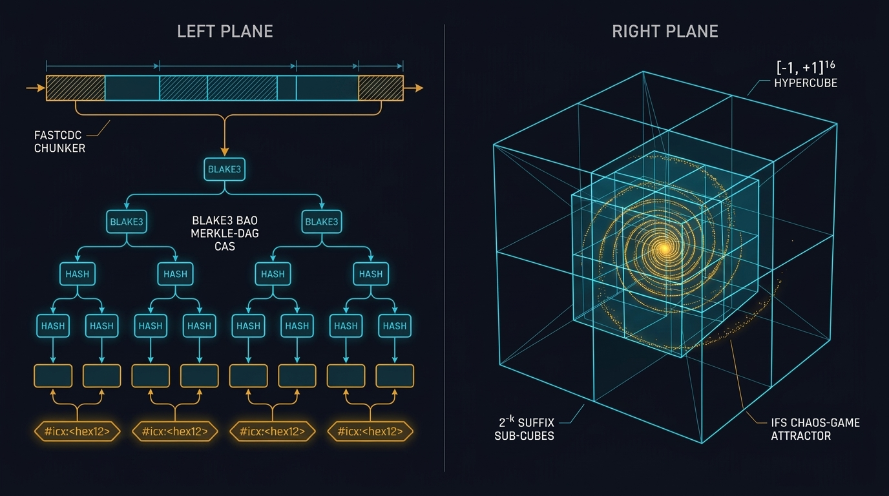
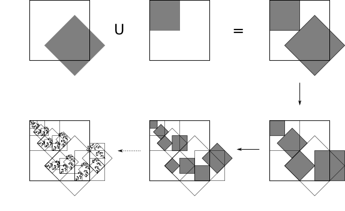
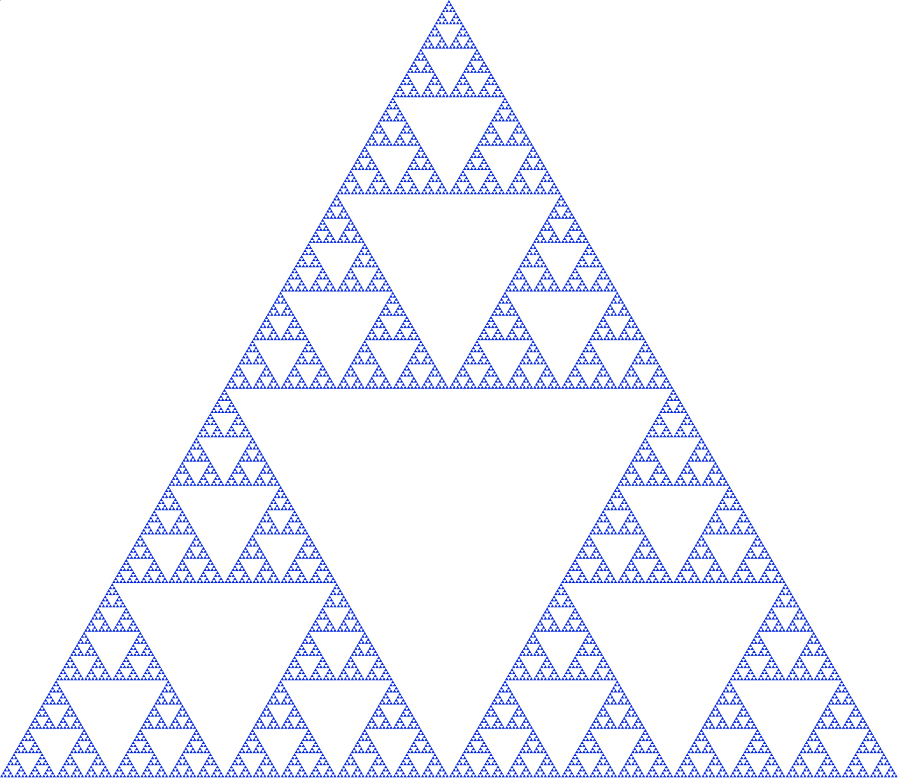
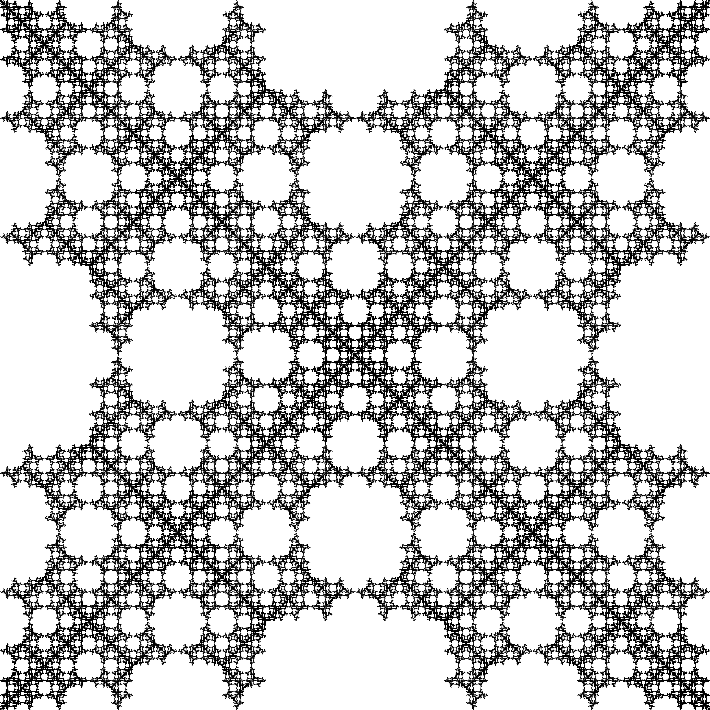
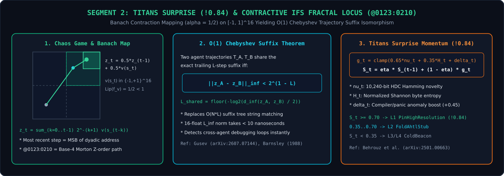

<!--
SPDX-FileCopyrightText: 2026 DoubleGate
SPDX-License-Identifier: CC-BY-NC-ND-4.0 AND LicenseRef-InfinityContext-Commercial
-->

# Chapter 03 — Contractive IFS & Fractal Chaos-Game Trajectory Coordinates (`fc:<64-hex>`)

**Document ID:** `ICX-SPEC-AHTL-1.0-CH03`  
**Target Crates:** [`crates/icx-hdc/src/fractal.rs`](../../crates/icx-hdc/src/fractal.rs), [`crates/icx-hdc/src/lib.rs`](../../crates/icx-hdc/src/lib.rs), [`crates/icx-bus/src/lib.rs`](../../crates/icx-bus/src/lib.rs)  
**Primary Archival References:** [`ref-docs/ahtl-foundations/README.md`](../../ref-docs/ahtl-foundations/README.md) §3.2 · [`ref-docs/hypercube-and-hamming-geometry/README.md`](../../ref-docs/hypercube-and-hamming-geometry/README.md) §3.2 · Gusev (*Fractal KV-Cache Archives*, [`arXiv:2607.07144`](../../ref-docs/papers/INDEX.md)) · Hutchinson (1981) · Barnsley (1988) · Jeffrey (1990)

---

## 1. Motivation: From $O(N \cdot L)$ Suffix Trees to $O(1)$ Hypercube Coordinates

During autonomous software engineering, AI coding agents frequently enter multi-step **state transition loops**—for example, editing an allocator module $\to$ running `cargo test` $\to$ hitting an alignment panic $\to$ adjusting a constant $\to$ re-running `cargo test`. Detecting whether the current agent trajectory shares a trailing $L$-step state sequence with a historical episode (or with another agent's trajectory on the `/dev/shm` bus) naively requires $O(N \cdot L)$ string/tree suffix comparisons across $N$ archived episodes.

Extending Gusev (*Fractal KV-Cache Archives*, `arXiv:2607.07144`) and Jeffrey's Chaos Game Representation (`CGR`, 1990), `AHTL v1.0` maps every discrete state transition sequence $(s_1, s_2, \dots, s_t)$ into a single continuous point $\vec{z}_t \in [-1, +1]^{16}$ inside the **16-dimensional origin-centered hypercube** via a contractive Iterated Function System (`IFS`) with contraction factor $L = \frac{1}{2} < 1$.



*Figure 3.1: Dual-plane view of `Infinity-Context`: FastCDC + BLAKE3 Merkle-DAG Content-Addressed Storage (left) paired with the $[-1, +1]^{16}$ Contractive IFS Chaos-Game Attractor trajectory space with $2^{-k}$ dyadic suffix sub-cubes (right).*

---

## 2. Formal Mathematical Construction on $([-1, +1]^{16}, d_\infty)$

### 2.1 The Ambient Complete Metric Space

Let $\mathcal{X} = [-1, +1]^{16} \subset \mathbb{R}^{16}$ denote the 16-dimensional origin-centered continuous hypercube (hexadekeract $\gamma_{16}$, having $2^{16} = 65,536$ extreme corner vertices $V(\gamma_{16}) = \{-1, +1\}^{16}$), equipped with the **Chebyshev ($L_\infty$) metric**:

$$d_\infty(\vec{x}, \vec{y}) = \|\vec{x} - \vec{y}\|_\infty = \max_{j \in \{0, \dots, 15\}} |x_j - y_j|$$

- **Completeness:** Because $\mathcal{X} = [-1, +1]^{16}$ is a closed and bounded subset of $\mathbb{R}^{16}$, $(\mathcal{X}, d_\infty)$ is a **complete metric space** of diameter $\operatorname{diam}_\infty(\mathcal{X}) = \max_{\vec{x},\vec{y} \in \mathcal{X}} \|\vec{x} - \vec{y}\|_\infty = 2.0$.
- **Geometric Duality:** Crucially, the closed ball of radius $r$ around $\vec{c}$ in the Chebyshev metric, $B_\infty(\vec{c}, r) = \{\vec{z} \in \mathbb{R}^{16} : \|\vec{z} - \vec{c}\|_\infty \le r\}$, **is itself a 16-dimensional axis-aligned sub-hypercube of side length $2r$**.

| Banach Fixed-Point Contraction (`Banach_Fixed_Point_Contraction.png`) | Sierpiński Chaos Game Attractor (`Sierpinski_Chaos_Game.png`) | Square Chaos Game Quadrant Subdivision (`Chaos_Game_square-EH-1.png`) |
| :---: | :---: | :---: |
|  |  |  |
| Iterated contractive maps $W(A) = \bigcup_i w_i(A)$ converging to the unique attractor | Contractive ratio $L = 1/2$ toward vertices of a simplex | Contractive ratio $L = 1/2$ toward vertices $\{-1, +1\}^d$ of a hypercube (`CGR`) |

### 2.2 Block-Majority Corner Vertex Projection ($\pi_{10240 \to 16}: Q_{10240} \to \{-1, +1\}^{16}$)

Given the 10,240-bit composite `Hypervector` $H(s_t) \in \{0, 1\}^{10240}$ (`words: [u64; 160]`) of event $s_t$, `FractalCoord::corner_vertex` (`crates/icx-hdc/src/fractal.rs:29-41`) partitions the 160 `u64` words into **16 contiguous blocks of 10 words (`640` bits per block)** and extracts a 16-dimensional bipolar corner vertex $\vec{v}(s_t) \in \{-1.0, +1.0\}^{16}$ by majority popcount:

$$v_j(s_t) = \begin{cases} +1.0 & \text{if } \sum_{w = 10j}^{10j + 9} \operatorname{popcnt}\big(H(s_t).\text{words}[w]\big) \ge 320 \\ -1.0 & \text{otherwise} \end{cases} \qquad \forall j \in \{0, 1, \dots, 15\}$$

```rust
#[inline]
pub fn corner_vertex(hv: &Hypervector) -> [f64; 16] {
    let mut v = [1.0f64; 16];
    for dim in 0..16 {
        let start = dim * 10;
        let mut ones = 0u32;
        for w in &hv.words[start..start + 10] {
            ones += w.count_ones();
        }
        // 10 words = 640 bits; threshold at 320
        v[dim] = if ones >= 320 { 1.0 } else { -1.0 };
    }
    v
}
```

### 2.3 Token-Driven Affine Contractive Maps & Banach Fixed-Point Proof

For each corner vertex $\vec{v} \in \{-1, +1\}^{16}$, define the affine similarity map $w_{\vec{v}}: \mathcal{X} \to \mathcal{X}$:

$$w_{\vec{v}}(\vec{z}) = \frac{1}{2}\vec{z} + \frac{1}{2}\vec{v}$$

**Theorem 3.1 (Strict Contractivity & Forward Invariance on $[-1, +1]^{16}$):**  
1. *Forward Invariance:* For any $\vec{z} \in [-1, +1]^{16}$ and $\vec{v} \in \{-1, +1\}^{16}$, every coordinate $j \in \{0, \dots, 15\}$ satisfies:
   $$|w_{\vec{v}}(\vec{z})_j| = \left|\frac{1}{2} z_j + \frac{1}{2} v_j\right| \le \frac{1}{2}|z_j| + \frac{1}{2}|v_j| \le \frac{1}{2}(1) + \frac{1}{2}(1) = 1 \implies w_{\vec{v}}(\mathcal{X}) \subseteq \mathcal{X}$$
2. *Lipschitz Contraction Factor $L = 0.5 < 1$:* For any two points $\vec{x}, \vec{y} \in \mathcal{X}$ and any fixed $\vec{v} \in \{-1, +1\}^{16}$:
   $$d_\infty\big(w_{\vec{v}}(\vec{x}), w_{\vec{v}}(\vec{y})\big) = \left\| \left(\frac{1}{2}\vec{x} + \frac{1}{2}\vec{v}\right) - \left(\frac{1}{2}\vec{y} + \frac{1}{2}\vec{v}\right) \right\|_\infty = \frac{1}{2}\|\vec{x} - \vec{y}\|_\infty = \frac{1}{2} d_\infty(\vec{x}, \vec{y})$$
   Similarly, in the Euclidean ($L_2$) metric:
   $$d_2\big(w_{\vec{v}}(\vec{x}), w_{\vec{v}}(\vec{y})\big) = \left\| \frac{1}{2}(\vec{x} - \vec{y}) \right\|_2 = \frac{1}{2} d_2(\vec{x}, \vec{y})$$
3. *Banach Fixed-Point Guarantee:* By the **Banach Contraction Mapping Theorem** (Banach, 1922) and Hutchinson's Theorem (1981), each individual map $w_{\vec{v}}$ has the unique fixed point $\vec{z}^* = \vec{v}$ ($\lim_{k \to \infty} w_{\vec{v}}^{\circ k}(\vec{z}_0) = \vec{v}$), and the family $\mathcal{F} = \{\mathcal{X}; w_{\vec{v}} : \vec{v} \in \{-1, +1\}^{16}\}$ defines a hyperbolic Iterated Function System whose Hutchinson operator $\mathcal{W}(A) = \bigcup_{\vec{v}} w_{\vec{v}}(A)$ is a contraction of ratio $L = \frac{1}{2}$ on the compact Hausdorff hyperspace $(\mathcal{H}(\mathcal{X}), d_{\text{Hausdorff}})$. $\blacksquare$

---

## 3. Trajectory Convergence & Proof of the $O(1)$ Chebyshev Suffix Theorem



*Figure 3.2: Contractive IFS trajectory recurrence, $O(1)$ Chebyshev Suffix Theorem, and Titans Surprise momentum coupling ([Vector SVG](images/generated/ahtl_ifs_chaos_game_suffix_tree.svg)).*

### 3.1 Unrolled Dyadic Series Expansion

Starting from the origin $\vec{z}_0 = \vec{0} \in [-1, +1]^{16}$, a sequence of $t$ agent state transitions $(s_1, s_2, \dots, s_t)$ updates the trajectory coordinate via `FractalCoord::step` (`crates/icx-hdc/src/fractal.rs:46-56`):

$$\vec{z}_t = w_{\vec{v}(s_t)}\big(\vec{z}_{t-1}\big) = \frac{1}{2}\vec{z}_{t-1} + \frac{1}{2}\vec{v}(s_t) = \sum_{k=0}^{t-1} 2^{-(k+1)} \vec{v}(s_{t-k})$$

Observe the dyadic positional hierarchy of this expansion:
- The **most recent transition** $s_t$ ($k = 0$) is weighted by $2^{-1} = \frac{1}{2}$ and determines the **sign (orthant)** of every coordinate $z_{t,j}$.
- The **$k$-th most recent transition** $s_{t-k+1}$ determines the **$k$-th most significant fractional bit** of the signed dyadic expansion of $z_{t,j}$!

### 3.2 Theorem 3.2 (The $O(1)$ Contractive Hypercube Suffix Theorem)

**Statement:** Let $\vec{z}^{(A)} \in [-1, +1]^{16}$ (at depth $t_A$) and $\vec{z}^{(B)} \in [-1, +1]^{16}$ (at depth $t_B$) be two `FractalCoord` trajectory states that share the exact same trailing $K$ state corner vertices:

$$\vec{v}\big(s^{(A)}_{t_A - k}\big) = \vec{v}\big(s^{(B)}_{t_B - k}\big) \qquad \forall k \in \{0, 1, \dots, K - 1\}$$

Then their Chebyshev ($L_\infty$) and Euclidean ($L_2$) distances satisfy the tight upper bounds:

$$d_\infty\big(\vec{z}^{(A)}, \vec{z}^{(B)}\big) = \big\|\vec{z}^{(A)} - \vec{z}^{(B)}\big\|_\infty \le 2^{1 - K}, \qquad d_2\big(\vec{z}^{(A)}, \vec{z}^{(B)}\big) = \big\|\vec{z}^{(A)} - \vec{z}^{(B)}\big\|_2 \le 4 \cdot 2^{1 - K} = 2^{3 - K}$$

**Proof:**
Subtracting the unrolled series expansions of $\vec{z}^{(A)}$ and $\vec{z}^{(B)}$, the first $K$ terms ($k = 0, \dots, K-1$) cancel identically:

$$\vec{z}^{(A)} - \vec{z}^{(B)} = \sum_{k=K}^{\max(t_A, t_B)-1} 2^{-(k+1)} \Big(\vec{v}\big(s^{(A)}_{t_A - k}\big) - \vec{v}\big(s^{(B)}_{t_B - k}\big)\Big)$$

For every coordinate $j \in \{0, \dots, 15\}$ and every step $k \ge K$ (where we define $\vec{v} = \vec{0}$ for $k \ge t$), since $v_j \in \{-1, 0, +1\}$, the coordinate difference is bounded by $|v^{(A)}_j - v^{(B)}_j| \le 2$. By the triangle inequality:

$$\big|z^{(A)}_j - z^{(B)}_j\big| \le \sum_{k=K}^{\infty} 2^{-(k+1)} \cdot 2 = \sum_{k=K}^{\infty} 2^{-k} = 2^{1 - K}$$

Taking the maximum over $j \in \{0, \dots, 15\}$ yields $d_\infty(\vec{z}^{(A)}, \vec{z}^{(B)}) \le 2^{1 - K}$. And since $\|\vec{u}\|_2 \le \sqrt{16}\,\|\vec{u}\|_\infty = 4\,\|\vec{u}\|_\infty$ on $\mathbb{R}^{16}$, we immediately obtain $d_2(\vec{z}^{(A)}, \vec{z}^{(B)}) \le 4 \cdot 2^{1 - K} = 2^{3 - K}$. $\blacksquare$

### 3.3 $O(1)$ Upper-Bound Shared Suffix Heuristic (`shared_suffix_depth`)

Normalizing $d_\infty(\vec{z}^{(A)}, \vec{z}^{(B)})$ by the hypercube radius ($\frac{1}{2}\operatorname{diam}_\infty(\mathcal{X}) = 1.0$) gives $d_{\text{norm}} = \frac{1}{2} d_\infty(\vec{z}^{(A)}, \vec{z}^{(B)}) \le 2^{-K}$. Because Theorem 3.2 establishes an upper bound on $d_\infty$ (whereas distinct alternating trajectories such as $[-1, +1]$ vs. $[+1, -1]$ can yield $|0.25 - (-0.25)| = 0.5 = 2^{-1}$ without sharing their final vertex), inverting via $-\log_2(\cdot)$ provides a fast **$O(1)$ upper-bound suffix-depth estimator / proximity heuristic** (`crates/icx-hdc/src/fractal.rs:75-85`). When exact suffix identity is required, callers pair `shared_suffix_depth` with `quadrant_signature_u16()` orthant equality or trailing state-ID verification:

$$L_{\text{shared}}\big(\vec{z}^{(A)}, \vec{z}^{(B)}\big) = \min\!\left(\left\lfloor -\log_2\big(\max(d_{\text{norm}}, 2^{-32})\big) \right\rfloor, \; \text{depth}_A, \; \text{depth}_B, \; 32\right)$$

```rust
#[inline]
pub fn shared_suffix_depth(&self, other: &Self) -> u32 {
    let d_norm = self.chebyshev_distance(other) * 0.5;
    if d_norm <= 0.0 {
        return self.depth.min(other.depth).min(32);
    }
    if d_norm >= 1.0 {
        return 0;
    }
    let k = (-d_norm.log2()).floor() as u32;
    k.min(self.depth).min(other.depth).min(32)
}
```

---

## 4. Fixed-Point Wire Serialization (`fc:<64-hex>`, `[i16; 16]`) & Quadrant Signatures

To serialize a 16-dimensional `FractalCoord` into the compact 256-bit `fc:<64-hex>` wire field (and the 32-byte `frac_q15: [i16; 16]` slot in the `/dev/shm` Seqlock ring buffer), `AHTL v1.0` supports two fixed-point quantizations alongside `f64` internal accumulators:

| Representation | Rust Type | Scale Factor | Dynamic Range | Resolution ($\Delta z$) | Max Suffix Depth | Usage in `icx` |
| :--- | :--- | :---: | :---: | :---: | :---: | :--- |
| **IEEE-754 Double** | `[f64; 16]` (128 B) | $1.0$ | $[-1.0, +1.0]$ | $2^{-53} \approx 1.11 \times 10^{-16}$ | $32$ steps (capped) | In-memory `FractalCoord` in `icx-hdc` |
| **Signed `Q15`** | `[i16; 16]` (32 B) | $32\,767 = 2^{15}-1$ | $[-1.0, +1.0]$ | $2^{-15} \approx 3.05 \times 10^{-5}$ | $15$ steps | `FractalCoord::to_q15()` for `/dev/shm` & `fc:<64-hex>` |
| **Signed `Q1.14`** | `[i16; 16]` (32 B) | $16\,384 = 2^{14}$ | $[-2.0, +1.99994]$ | $2^{-14} \approx 6.10 \times 10^{-5}$ | $14$ steps (exact shift) | Bit-exact right-shift `(z >> 1) + (v << 13)` arithmetic |
| **Orthant Mask** | `u16` (2 B) | Sign bit $\mathbb{I}(z_j \ge 0)$ | $\{0, 1\}^{16}$ | $1.0$ (Top orthant) | $1$ step ($65,536$ bins) | `quadrant_signature_u16()` in Braille Channel B (`B[4..5]`) |

### 4.1 `fc:<64-hex>` Wire Encoding & Decoding

Each of the 16 signed 16-bit coordinates $q_j \in \text{i16}$ (`j = 0..16`) is formatted as 4 lowercase big-endian hexadecimal digits (`{:04x}` on `q_j as u16`), producing a deterministic 64-character hexadecimal string:

```rust
pub fn encode_fc_hex64(coord: &FractalCoord) -> String {
    let q15 = coord.to_q15();
    let mut out = String::with_capacity(67);
    out.push_str("fc:");
    for &val in &q15 {
        use core::fmt::Write;
        let _ = write!(out, "{:04x}", val as u16);
    }
    out
}
```
