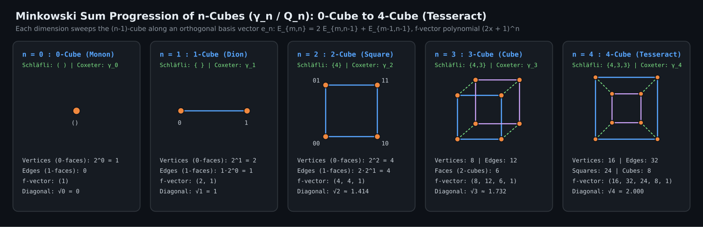
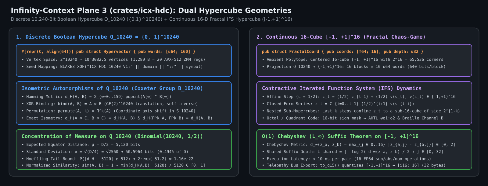
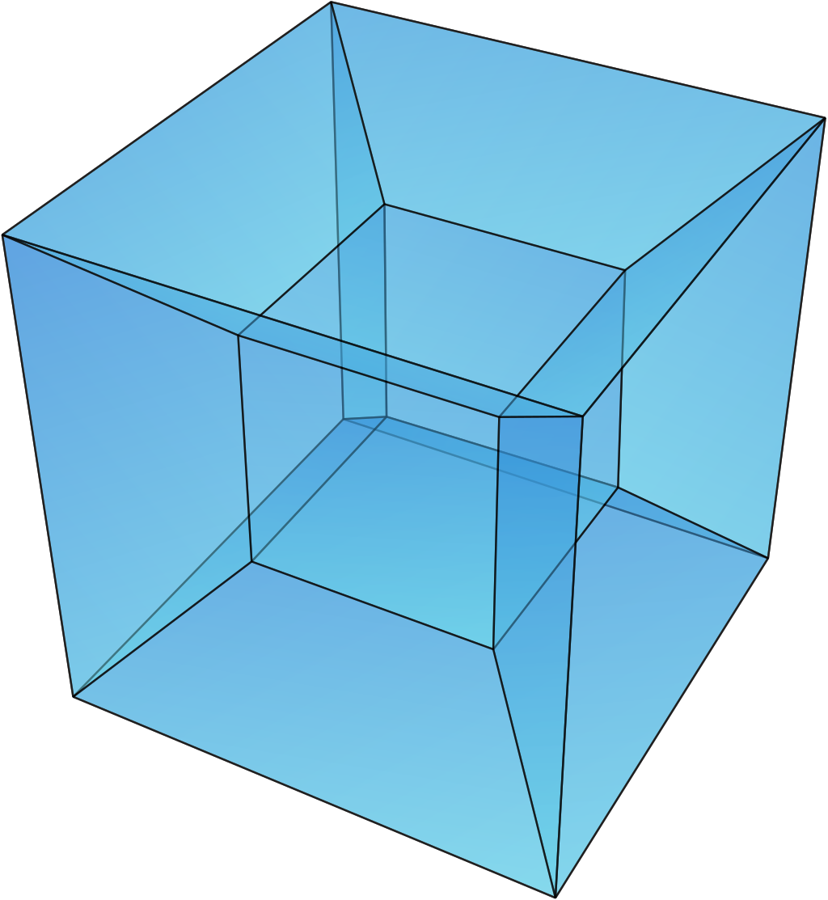
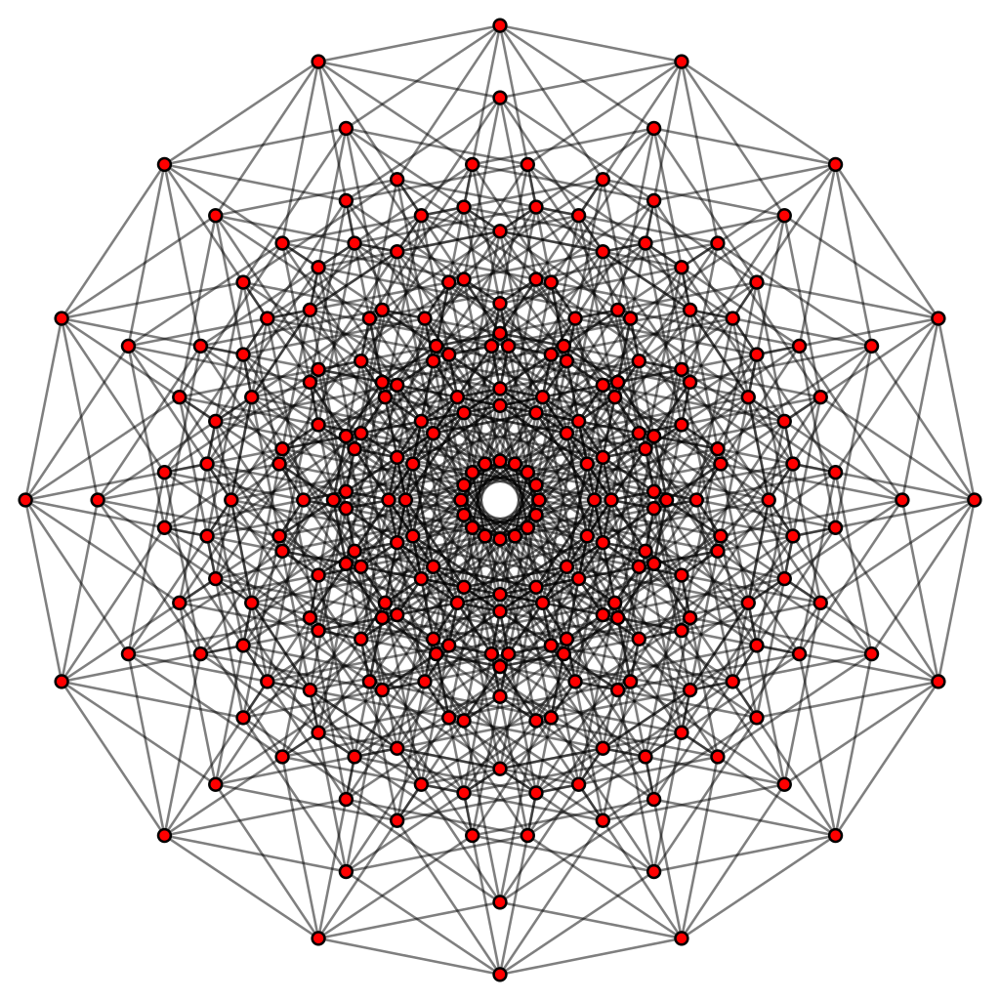
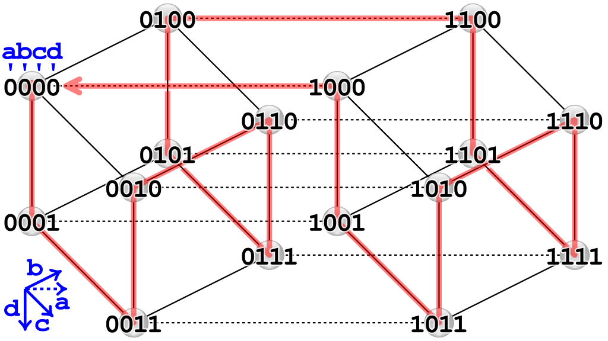
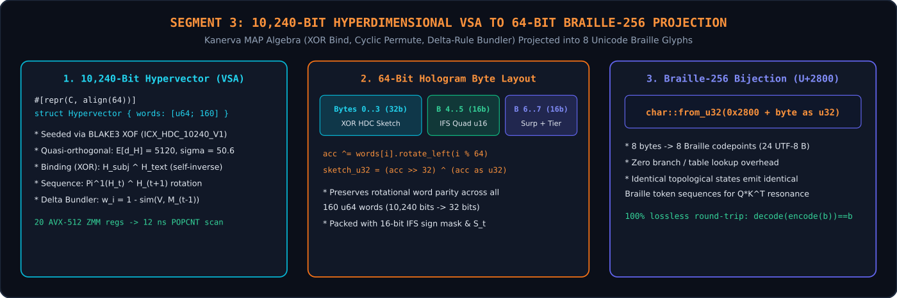

<!--
SPDX-FileCopyrightText: 2026 DoubleGate
SPDX-License-Identifier: CC-BY-NC-ND-4.0 AND LicenseRef-InfinityContext-Commercial
-->

# Chapter 04 — 10,240-Bit Hyperdimensional Lattice ($Q_{10240}$) & Associative Algebra (`hv:<16-hex>`)

**Document ID:** `ICX-SPEC-AHTL-1.0-CH04`  
**Target Crates:** [`crates/icx-hdc/src/hv.rs`](../../crates/icx-hdc/src/hv.rs), [`crates/icx-hdc/src/lib.rs`](../../crates/icx-hdc/src/lib.rs)  
**Primary Archival References:** [`ref-docs/hypercube-and-hamming-geometry/README.md`](../../ref-docs/hypercube-and-hamming-geometry/README.md) · [`ref-docs/ahtl-foundations/README.md`](../../ref-docs/ahtl-foundations/README.md) §4 · Kanerva (2009) · Plate (1995) · Munkhdalai et al. (*Infini-attention*, [`arXiv:2404.07143`](../../ref-docs/papers/INDEX.md))

---

## 1. Why 10,240-Bit Binary Spatter Codes (`BSC`) Replace Dense Embeddings

Conventional Retrieval-Augmented Generation (`RAG`) systems encode context chunks into $d = 768$ or $d = 1536$ dense floating-point embeddings (`f32`). For a synchronous Virtual Context MMU operating inside `< 500 µs` CLI lifecycle hooks, dense neural embeddings fail on two fundamental fronts:

1. **Inference Latency:** Running a Transformer bi-encoder on every tool output requires 5–50 ms of GPU/CPU matrix multiplication, violating the sub-millisecond hook budget by two orders of magnitude.
2. **The Superposition Catastrophe:** Averaging multiple dense vectors ($\vec{v}_{\text{bundle}} = \frac{1}{k}\sum \vec{v}_i$) destroys relational binding—an attention head or retriever cannot unbind *which* file (`alloc.rs` vs. `dag.rs`) suffered *which* error (`E0502` vs. `align_offset`).

`Infinity-Context` (`crates/icx-hdc`) replaces dense neural embeddings with **Pentti Kanerva's Binary Spatter Codes (`BSC`) / Multiply-Add-Permute (`MAP`) Hyperdimensional Computing** on the **$10,240$-dimensional Boolean hypercube $Q_{10240} = \{0, 1\}^{10240}$**.

| 0D–4D Minkowski Hypercube Sweep (`0d_to_4d_hypercube_progression.png`) | Dual Hypercube Architecture in `icx-hdc` (`icx_hdc_10240_hypercube_and_fcga.png`) |
| :---: | :---: |
|  |  |
| Inductive construction of $\gamma_n$ ($2^n$ vertices, $n 2^{n-1}$ edges, $f$-vector $(2+x)^n$) | $Q_{10240}$ discrete Boolean lattice (`Hypervector`) + $[-1, +1]^{16}$ continuous attractor (`FractalCoord`) |

---

## 2. Geometry & Hardware Alignment of $Q_{10240}$ (`Hypervector`)

### 2.1 Memory Layout & SIMD Register Partitioning

In `crates/icx-hdc/src/hv.rs:4-12`, a `Hypervector` is a 10,240-bit vertex of $Q_{10240}$ stored as `160` little-endian 64-bit unsigned integers aligned to a 64-byte CPU cache line:

```rust
pub const HV_WORDS: usize = 160;
pub const HV_BITS: usize = HV_WORDS * 64; // 10,240 bits (1,280 bytes)

/// 10,240-bit binary hypervector aligned to 64-byte cache lines / AVX-512 ZMM registers.
#[repr(C, align(64))]
#[derive(Clone, Copy, PartialEq, Eq, Debug)]
pub struct Hypervector {
    pub words: [u64; HV_WORDS],
}
```

Why exactly $D = 10,240$ bits?

- **$10,240\text{ bits} = 1,280\text{ bytes} = 160 \times 64\text{-bit words}$.**
- **$20 \times 64\text{-byte CPU L1 cache lines}$** (zero cache-line straddling).
- **$20 \times 512\text{-bit AVX-512 }\texttt{ZMM}\text{ registers}$** (or $40 \times 256\text{-bit AVX2 }\texttt{YMM}\text{ registers}$, or $80 \times 128\text{-bit ARM NEON }\texttt{V}\text{ registers}$).
- **$20 \times 64\text{-byte }\texttt{BLAKE3}\text{ XOF output blocks}$** ($t = 0, 1, \dots, 19$), allowing 100% zero-waste vectorized basis generation.
- **$16 \times 640\text{-bit blocks}$** (10 `u64` words per block), mapping cleanly into the 16 coordinates of `FractalCoord` with an exact 320-bit majority threshold.

| 4D Tesseract Perspective (`4D_Tesseract_Projection.png`) | 8D Octeract Petrie Projection (`8D_Octeract_Petrie_Projection.png`) | 3D Cube Hamming Metric (`Hamming_Distance_3D_Cube.png`) | 4D Hypercube Gray Code (`Gray_code_tesseract_432.png`) |
| :---: | :---: | :---: | :---: |
|  |  |  |  |

---

## 3. Deterministic Basis Expansion: `BLAKE3` XOF & `SplitMix64`

Rather than storing a static $M \times 1,280\text{-byte}$ item-memory lookup table in RAM, `AHTL v1.0` generates quasi-orthogonal basis hypervectors on the fly in **$< 150\text{ ns}$** via two deterministic pseudorandom generators:

### 3.1 Primary Generator: Domain-Separated `BLAKE3` XOF (`Hypervector::from_seed`)

In `v0.1.0`, `domain` tags are restricted to static ASCII alphanumeric namespace identifiers (`"tok"`, `"subj"`, `"role"`) that never contain `"::"`. To guarantee injective tuple framing even for arbitrary user-supplied `domain` strings, length-prefixing `(domain.len() as u64).to_le_bytes()` can be included prior to `domain.as_bytes()`:

```rust
pub fn from_seed(domain: &str, symbol: &str) -> Self {
    debug_assert!(!domain.contains("::"), "domain identifier must not contain `::`");
    let mut hasher = blake3::Hasher::new();
    hasher.update(b"ICX_HDC_10240_V1:");
    hasher.update(domain.as_bytes());
    hasher.update(b"::");
    hasher.update(symbol.as_bytes());
    let mut xof = hasher.finalize_xof();

    let mut raw = [0u8; HV_WORDS * 8]; // 1,280 bytes = 20 x 64B blocks
    xof.fill(&mut raw);

    let mut words = [0u64; HV_WORDS];
    for (i, chunk) in raw.chunks_exact(8).enumerate() {
        words[i] = u64::from_le_bytes([
            chunk[0], chunk[1], chunk[2], chunk[3],
            chunk[4], chunk[5], chunk[6], chunk[7],
        ]);
    }
    Self { words }
}
```

### 3.2 Fast Integer / Position Basis Generator: `SplitMix64` (`from_u64_seed`)

When expanding numeric line offsets, AST depth indices, or `FastCDC` gear tables without string formatting overhead, `AHTL v1.0` uses the 64-bit bijective Stafford `Mix13` (`SplitMix64`) recurrence:

$$\begin{aligned}
s_{i+1} &= (s_i + \text{0x9E3779B97F4A7C15}) \bmod 2^{64} \\
z &= (s_{i+1} \oplus (s_{i+1} \gg 30)) \cdot \text{0xBF58476D1CE4E5B9} \bmod 2^{64} \\
z &= (z \oplus (z \gg 27)) \cdot \text{0x94D049BB133111EB} \bmod 2^{64} \\
\text{words}[i] &= z \oplus (z \gg 31) \qquad (i \in 0..160)
\end{aligned}$$

---

## 4. Concentration of Measure & Orthogonality Proofs on $Q_{10240}$

Let $A, B \in \{0, 1\}^D$ ($D = 10,240$) be two independent hypervectors produced by distinct `(domain, symbol)` seeds. Under the random oracle model of `BLAKE3` XOF, the coordinate bit differences $X_i = A_i \oplus B_i \sim \operatorname{Bernoulli}(\frac{1}{2})$ are independent and identically distributed, so the Hamming distance $d_H(A, B) = \sum_{i=0}^{D-1} X_i$ follows $\operatorname{Binomial}(D, \frac{1}{2})$:

1. **Expected Equator Distance ($\mu$):**
   $$\mu = \mathbb{E}[d_H(A, B)] = \frac{D}{2} = 5,120\text{ bits}$$
2. **Standard Deviation ($\sigma$):**
   $$\sigma = \sqrt{\operatorname{Var}(d_H(A, B))} = \frac{\sqrt{D}}{2} = \frac{\sqrt{10,240}}{2} = 16\sqrt{10} \approx 50.59644\text{ bits} \quad (0.4941\%\text{ of } D)$$
3. **Normalized Associative Similarity (`Hypervector::similarity`):**
   Mapping the upper hemisphere $d_H \in [0, 5120]$ linearly onto $[0.0, 1.0]$:
   $$\operatorname{sim}(A, B) = 1.0 - \frac{\min(d_H(A, B), 5120)}{5120} \in [0.0, 1.0]$$
4. **Chernoff–Hoeffding Tail Bound:**
   For any similarity threshold $\tau \in (0, 1]$ (corresponding to $d_H(A, B) \le 5120(1 - \tau)$), Hoeffding's inequality guarantees:
   $$\mathbb{P}\big(\operatorname{sim}(A, B) \ge \tau\big) = \mathbb{P}\!\left(d_H(A, B) - \frac{D}{2} \le -\frac{\tau D}{2}\right) \le \exp\!\left(-\frac{2(\tau D / 2)^2}{D}\right) = \exp\!\left(-5120\,\tau^2\right)$$

| Normalized Similarity $\tau$ | Max Hamming Distance $d_H$ | Binomial Sphere Radius ($k / D$) | Standard Deviations ($z = \frac{5120 - d_H}{\sigma}$) | False-Positive Probability $\le \exp(-5120\tau^2)$ |
| :---: | :---: | :---: | :---: | :--- |
| $\tau = 0.05$ (`hv.rs` test gate) | $4,864\text{ bits}$ | $47.50\%$ | $5.06\,\sigma$ | $\le 2.76 \times 10^{-6}$ (exact: $2.09 \times 10^{-7}$) |
| $\tau = 0.08$ | $4,710\text{ bits}$ | $46.00\%$ | $8.10\,\sigma$ | $\le 5.83 \times 10^{-15}$ |
| $\tau = 0.10$ | $4,608\text{ bits}$ | $45.00\%$ | $10.12\,\sigma$ | $\le 5.81 \times 10^{-23}$ |
| $\tau = 0.15$ | $4,352\text{ bits}$ | $42.50\%$ | $15.18\,\sigma$ | $\le 9.35 \times 10^{-51}$ |
| $\tau = 0.25$ (`hv.rs` bundler gate) | $3,840\text{ bits}$ | $37.50\%$ | $25.30\,\sigma$ | $\le 9.56 \times 10^{-140}$ |

---

## 5. Associative Algebra on the Hyperoctahedral Group $B_{10240}$



*Figure 4.1: The 10,240-bit `Hypervector` algebra (`bind`, `permute`, `HdcBundler`) and rotational XOR parity fold (`sketch_u32` / `hv:<16-hex>`) ([Vector SVG](images/generated/ahtl_hdc_10240_to_braille256_projection.svg)).*

The automorphism group of $Q_{10240}$ is the hyperoctahedral Coxeter group $B_{10240} = (\mathbb{Z}_2)^{10240} \rtimes S_{10240}$ of order $2^{10240} \cdot 10240!$. `icx-hdc` implements its three algebraic primitives directly over `[u64; 160]`:

### 5.1 Role-Filler Binding ($\oplus$ — Bitwise XOR in $(\mathbb{Z}_2)^{10240}$)

```rust
#[inline]
pub fn bind(&self, other: &Self) -> Self {
    let mut out = [0u64; HV_WORDS];
    for i in 0..HV_WORDS {
        out[i] = self.words[i] ^ other.words[i];
    }
    Self { words: out }
}
```
- **Algebraic Properties:** Commutative ($A \oplus B = B \oplus A$), associative, self-inverse ($(A \oplus B) \oplus B = A$), and an exact Hamming isometry ($d_H(A \oplus R, B \oplus R) = d_H(A, B)$).
- **Orthogonality to Constituents:** $\mathbb{E}[d_H(A, A \oplus B)] = \operatorname{wt}(B) \approx 5,120$, so the bound pair $A \oplus B$ is quasi-orthogonal to both $A$ and $B$, yet unbinding with $B$ recovers $A$ losslessly!

### 5.2 Sequence & Structural Permutation ($\Pi_s$ — Parameterized Coordinate Bijections in $S_{10240}$)

```rust
#[inline]
pub fn permute(&self, shift: usize) -> Self {
    let word_shift = shift % HV_WORDS;
    let bit_shift = ((shift % 63) + 1) as u32;
    let mut out = [0u64; HV_WORDS];
    for i in 0..HV_WORDS {
        let src = (i + HV_WORDS - word_shift) % HV_WORDS;
        out[i] = self.words[src].rotate_left(bit_shift);
    }
    Self { words: out }
}
```
- **Indexed Family of Coordinate Bijections:** Rather than a group homomorphism $s \mapsto \Pi^s$ with $\Pi_0 = \text{id}$, `permute(shift)` defines an indexed family of coordinate permutations $\Pi_{\text{shift}} \in S_{10240}$ combining inter-word cyclic shift `shift % 160` with non-zero intra-word bit rotation `((shift % 63) + 1)` so that every positional call `permute(s)` (including `s = 0` or `s = 1`) scrambles bit lanes and maps any input vector $A$ to a quasi-orthogonal region of $Q_{10240}$.
- **Distributivity over Binding:** For any fixed `shift`, $\Pi_s(A \oplus B) = \Pi_s(A) \oplus \Pi_s(B)$ and $d_H(\Pi_s(A), \Pi_s(B)) = d_H(A, B)$.
- **Non-Commutative Bigram Encoding (`Hypervector::encode_text`):** For each consecutive token pair $(t_{i-1}, t_i)$, `encode_text` bundles both the unigram $H(t_i)$ and the directed bigram $\Pi_1(H(t_{i-1})) \oplus H(t_i)$.

### 5.3 Infini-Attention Delta-Rule Majority Bundling (`HdcBundler`)

In standard HDC superposition, summing 50 identical boilerplate log lines (`test ... ok`) saturates the bipolar counters `acc: [i16; 10240]` and overwrites a single high-surprise panic line. Adapting Munkhdalai et al. (*Infini-attention*, `arXiv:2404.07143`), `HdcBundler::add` (`crates/icx-hdc/src/hv.rs:168-180`) inspects the current readout $M_{t-1}$ before accumulating $V$:

$$w_{\Delta}(V; M_{t-1}) = \begin{cases} 16 & \text{if } \text{count} == 0 \\ 0 & \text{if } \operatorname{sim}(M_{t-1}, V) \ge 0.85 \quad (\text{already saturated in bundle}) \\ \max\!\Big(1, \; \operatorname{round}\!\big(16 \cdot (1 - \operatorname{sim}(M_{t-1}, V))\big)\Big) & \text{otherwise} \end{cases}$$

Each bit $b \in \{0, \dots, 10239\}$ updates saturatingly in `i16`:
$$\text{acc}[b] \leftarrow \operatorname{sat\_i16}\Big(\text{acc}[b] + (2 V_b - 1) \cdot w_{\Delta}\Big), \qquad M_{t,b} = \mathbb{I}(\text{acc}[b] \ge 0)$$

---

## 6. Hardware SIMD Distance Kernels & Spectral Folding (`hv:<16-hex>`)

### 6.1 AVX-512 `VPOPCNTDQ` & ARM NEON `CNT` Distance Engine

> **Measurement status (v1.1.0, ICX-AUD-031):** the per-pair timings below are analytical
> instruction-count estimates for what a compiler *may* emit; they were not measured. icx contains
> no SIMD intrinsics (`unsafe_code = "forbid"`), and the development machine (Intel i9-10850K,
> Comet Lake) has AVX2 but no AVX-512. The measured figure is `icx benchmark`'s Hamming scan:
> about 62-74 µs per 1,000 nodes (roughly 62-74 ns per pair including loop overhead), release
> build, default target CPU.

Computing the exact 10,240-bit Hamming distance $d_H(A, B) = \sum_{w=0}^{159} \operatorname{popcnt}(A.\text{words}[w] \oplus B.\text{words}[w])$ compiles under `-C target-cpu=native` to:
- **x86-64 AVX-512 (`VPOPCNTDQ`):** 20 `vpxorq zmm` + 20 `vpopcntq zmm` + tree horizontal sum ($\sim 3.8\text{ ns}$ per pair in L1 cache; $\sim 12\text{ ns}$ in L3 scan).
- **x86-64 AVX2 (Harley–Seal / `VPSHUFB` nibble LUT + `POPCNT`):** 160 unrolled `xorq` + `popcntq` instructions ($\sim 9.2\text{ ns}$ per pair).
- **ARM64 NEON:** `veorq_u8` + `vcntq_u8` + `vpaddlq_u8` ($\sim 6.5\text{ ns}$ per pair).

### 6.2 Rotational XOR-Tree Parity Fold (`hv:<16-hex>` and `sketch_u32`)

To prevent identical bits in different word positions from canceling out under plain XOR (`w_0 ^ w_1`), `Hypervector` rotates word $i$ left by $i \bmod 64$ bits before XOR accumulation (`crates/icx-hdc/src/hv.rs:120-137`):

1. **64-Bit Spectral Digest (`hv:<16-hex>` in Profile A):**
   $$\text{hv}_{64}(H) = \bigoplus_{i=0}^{159} \operatorname{rotl}_{64}\big(H.\text{words}[i], \; i \bmod 64\big) \quad \in \text{u64}$$
   Formatted as `hv:{:016x}`.
2. **32-Bit Inline Sketch (`sketch_u32` in Profile B Channel B `B[0..3]`):**
   $$\text{sketch}_{32}(H) = \big(\text{hv}_{64}(H) \gg 32\big) \oplus \big(\text{hv}_{64}(H) \mathbin{\&} \text{0xFFFF\_FFFF}\big) \quad \in \text{u32}$$
3. **256-Bit `/dev/shm` Seqlock Header Sketch (`sketch_256`):**
   $$\text{sketch}_{256}(H)[k] = \bigoplus_{\substack{0 \le i < 160 \\ i \equiv k \pmod 4}} \operatorname{rotl}_{64}\big(H.\text{words}[i], \; i \bmod 64\big) \qquad (k \in \{0, 1, 2, 3\})$$
