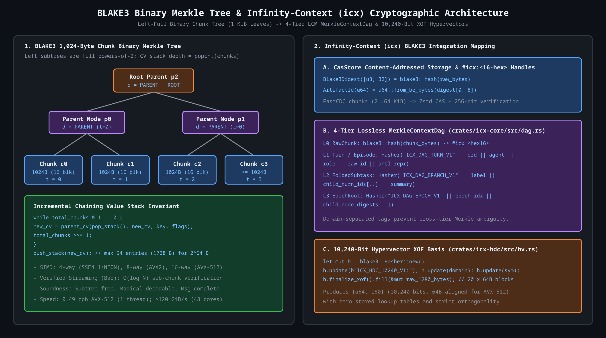
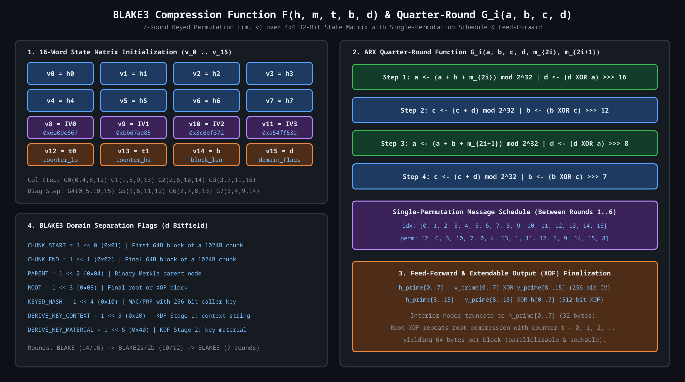
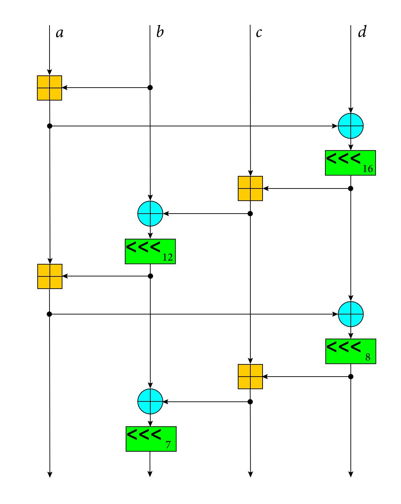
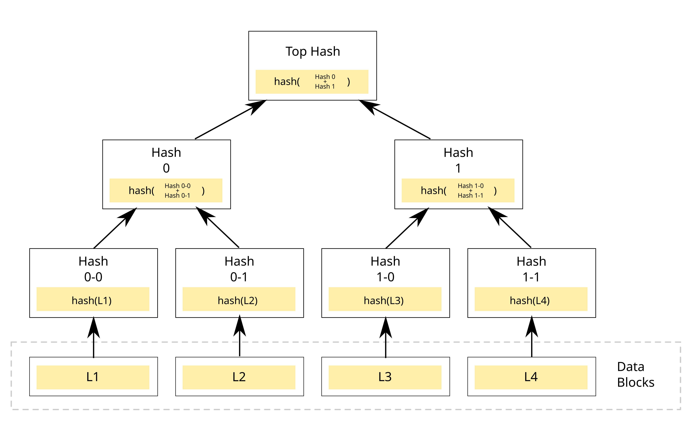

<!--
SPDX-FileCopyrightText: 2026 DoubleGate
SPDX-License-Identifier: CC-BY-NC-ND-4.0 AND LicenseRef-InfinityContext-Commercial
-->

# Chapter 06 — BLAKE3 Merkle-DAG Content-Addressed Storage & `#icx:<hex>` Virtual Handles

**Document ID:** `ICX-SPEC-AHTL-1.0-CH06`  
**Target Crates:** [`crates/icx-core/src/lib.rs`](../../crates/icx-core/src/lib.rs), [`crates/icx-core/src/chunker.rs`](../../crates/icx-core/src/chunker.rs), [`crates/icx-core/src/cas.rs`](../../crates/icx-core/src/cas.rs), [`crates/icx-core/src/dag.rs`](../../crates/icx-core/src/dag.rs), [`crates/icx-adapters/src/mcp.rs`](../../crates/icx-adapters/src/mcp.rs)  
**Primary Archival References:** [`ref-docs/blake3-cryptographic-hash/README.md`](../../ref-docs/blake3-cryptographic-hash/README.md) · [`BLAKE3_Official_Specification.pdf`](../../ref-docs/blake3-cryptographic-hash/BLAKE3_Official_Specification.pdf) · [`docs/virtual-memory-and-dag-engine.md`](../../docs/virtual-memory-and-dag-engine.md)

---

## 1. Overview: Lossless Virtual Memory via Content-Addressed Merkle Trees

The foundational guarantee of **Infinity-Context (`icx`)** is **100% Lossless Context Management (`LCM`, `arXiv:2605.04050`) over sanitized artifacts**: compressing a 30 KB compiler log or source file into a 39-token `AHTL v1.0` stub never discards a single byte of the post-redaction (`SecretRedactor::sanitize`) artifact. Every `AHTL` packet embeds a cryptographic virtual memory pointer (`#icx:<16-hex>`, or `#icx:<12-hex>` in the Phase 1 Sprint 1.1 extension) that resolves deterministically in `CasStore` to the exact sanitized byte stream or 1-based line slice in **$< 50\,\mu\text{s}$**.

To achieve multi-gigabyte-per-second ingestion throughput with sub-file deduplication and fail-closed tamper detection, `icx-core` combines:
1. **Gear-Hash Content-Defined Chunking (`FastCDC`)** to split large artifacts along content-determined boundaries (`2 KiB..64 KiB`).
2. **The `BLAKE3` Cryptographic Hash Function** (7-round ChaCha ARX permutation over a 1,024-byte Left-Full binary Merkle tree) to seal every chunk, artifact, turn, folded branch, and cache epoch.
3. **The Single-Tool Polymorphic MCP Pager (`McpPagerServer`)** to expose `deref`, `slice`, `grep`, `recall`, `fold`, `xagent`, and `status` behind a single `< 180 token` tool schema.



*Figure 6.1: BLAKE3 1,024-byte Left-Full binary Merkle tree topology (`CV` stack) and its architectural mapping onto `icx-core` (`CasStore`, 4-tier `MerkleContextDag`, and 10,240-bit XOF `Hypervector`) ([Vector SVG](images/generated/blake3_merkle_tree_and_icx_dag.svg)).*

---

## 2. Gear-Hash Content-Defined Chunking (`FastCDC` in `crates/icx-core/src/chunker.rs`)

When an agent repeatedly reads or edits a large file across turns, fixed-offset block chunking (e.g., splitting every $8,192$ bytes) suffers from the **boundary-shift problem**: inserting 17 bytes at the top of a file shifts every subsequent block boundary, invalidating 100% of cached chunk hashes.

`icx-core` solves this via **Gear-Hash Content-Defined Chunking (`FastCDC`)** (`crates/icx-core/src/chunker.rs:21-79`):

### 2.1 Deterministic `SplitMix64` Gear Table Generation

At compile time (`const fn build_gear_table`), a 256-entry table `GEAR_TABLE: [u64; 256]` is synthesized from the 64-bit ASCII seed `0x4943_585F_4641_5354` (`"ICX_FAST"`):

$$\begin{aligned}
s_{i+1} &= (s_i + \text{0x9E37\_79B9\_7F4A\_7C15}) \bmod 2^{64} \\
z_1 &= (s_{i+1} \oplus (s_{i+1} \gg 30)) \cdot \text{0xBF58\_476D\_1CE4\_E5B9} \bmod 2^{64} \\
z_2 &= (z_1 \oplus (z_1 \gg 27)) \cdot \text{0x94D0\_49BB\_1331\_11EB} \bmod 2^{64} \\
\text{GEAR\_TABLE}[i] &= z_2 \oplus (z_2 \gg 31) \qquad \forall i \in \{0, \dots, 255\}
\end{aligned}$$

### 2.2 Rolling Gear Fingerprint & Cut-Point Condition

Given `ChunkerConfig { min_size: 2048, avg_size: 8192, max_size: 65536 }`, let $k = \lfloor \log_2(\text{avg\_size}) \rfloor = 13$, with Normalized FastCDC stricter mask $\text{mask}_S = 2^{k+1} - 1 = \text{0x3FFF}$ before `avg_size` and relaxed mask $\text{mask}_L = 2^{k-1} - 1 = \text{0x0FFF}$ from `avg_size` to `max_size`. Starting from chunk start offset $p_0$, the scanner skips the minimum window $[p_0, p_0 + \text{min\_size})$ and then updates the 64-bit rolling fingerprint `fp` at each byte $B[p]$ in $[p_0 + \text{min\_size}, \min(N, p_0 + \text{max\_size}))$:

$$\text{fp}_p = \big((\text{fp}_{p-1} \ll 1) + \text{GEAR\_TABLE}[B[p]]\big) \bmod 2^{64}$$

A chunk boundary is declared immediately after index $p$ when:

$$\big(p < p_0 + \text{avg\_size} \land (\text{fp}_p \mathbin{\&} \text{mask}_S) == 0\big) \quad \lor \quad \big(p \ge p_0 + \text{avg\_size} \land (\text{fp}_p \mathbin{\&} \text{mask}_L) == 0\big) \quad \lor \quad (p - p_0 + 1) == \text{max\_size}$$

Because the 1-bit left shift $\text{fp} \ll 1$ ages out bytes older than 64 positions ($2^{64} \equiv 0 \pmod{2^{64}}$), any insertion or edit in a file perturbs at most 1–2 local chunks, after which `FastCDC` re-synchronizes to the exact same cut points!

---

## 3. BLAKE3 Cryptographic Engine: ARX Quarter-Round, Bao Merkle Tree & Domain Flags



*Figure 6.2: The 7-round BLAKE3 compression function $F(h, m, t, b, d)$, $G_i(a,b,c,d)$ ChaCha ARX quarter-round, single-permutation schedule, and domain flags ([Vector SVG](images/generated/blake3_quarter_round_and_compression.svg)).*

| ChaCha / BLAKE3 ARX Quarter-Round (`ChaCha20_Quarter_Round.png`) | Binary Merkle Hash Tree Topology (`BLAKE3_Merkle_Tree_Bao.png`) |
| :---: | :---: |
|  |  |

### 3.1 The 7-Round Compression Function $F(h, m, t, b, d)$

Every 64-byte block in `BLAKE3` initializes a $4 \times 4$ matrix of 32-bit little-endian words $v_0 \dots v_{15}$ from the 8-word chaining value $h_0 \dots h_7$, the first four SHA-256/BLAKE2s IV words ($\text{IV}_{0..3} = \text{0x6a09e667}, \text{0xbb67ae85}, \text{0x3c6ef372}, \text{0xa54ff53a}$), the 64-bit chunk/XOF counter $(t_0, t_1)$, the block byte length $b \in [0, 64]$, and the domain bitmask $d$:

$$\begin{pmatrix}
v_0 & v_1 & v_2 & v_3 \\
v_4 & v_5 & v_6 & v_7 \\
v_8 & v_9 & v_{10} & v_{11} \\
v_{12} & v_{13} & v_{14} & v_{15}
\end{pmatrix} = \begin{pmatrix}
h_0 & h_1 & h_2 & h_3 \\
h_4 & h_5 & h_6 & h_7 \\
\text{0x6a09e667} & \text{0xbb67ae85} & \text{0x3c6ef372} & \text{0xa54ff53a} \\
t_0 & t_1 & b & d
\end{pmatrix}$$

Each of the **7 rounds** executes 4 parallel column quarter-rounds $G_0 \dots G_3$ followed by 4 parallel diagonal quarter-rounds $G_4 \dots G_7$ with right-rotation constants $(16, 12, 8, 7)$, permuting the 16 message words $m_0 \dots m_{15}$ between rounds via the fixed permutation $\pi = [2, 6, 3, 10, 7, 0, 4, 13, 1, 11, 12, 5, 9, 14, 15, 8]$.

### 3.2 Domain Separation Flags (`d`) & 4-Tier `MerkleContextDag` Tags

In addition to BLAKE3's internal hardware flags (`CHUNK_START = 0x01`, `CHUNK_END = 0x02`, `PARENT = 0x04`, `ROOT = 0x08`, `KEYED_HASH = 0x10`, `DERIVE_KEY_CONTEXT = 0x20`, `DERIVE_KEY_MATERIAL = 0x40`), `icx` enforces explicit **application-level domain separation prefixes** across all four tiers of `MerkleContextDag` (`crates/icx-core/src/dag.rs`) and `Hypervector` generation so that no two tiers can ever produce a cross-type Merkle collision:

| Subsystem / Tier | Domain Prefix String | Hashed Fields | Output Type |
| :--- | :--- | :--- | :--- |
| **`L0` Raw Chunk & Artifact (`CasStore`)** | *(Raw byte stream)* | `blake3::hash(raw_bytes)` | `(ArtifactId, Blake3Digest)` |
| **`L1` Turn / Episode (`DagNode::Turn`)** | `b"ICX_DAG_TURN_V1"` | `ordinal_be8 \|\| [agent_u8] \|\| role \|\| raw_id_be8 \|\| ahtl_repr` | `DagNode::Turn` (`ArtifactId`) |
| **`L2` Folded Branch (`SubTrajectoryBranch`)** | `b"ICX_DAG_BRANCH_V1"` | `label \|\| child_turn_ids_be8[..] \|\| outcome_summary` | `DagNode::SubTrajectoryBranch` |
| **`L3` Sealed Cache Epoch (`CacheEpoch`)** | `b"ICX_DAG_EPOCH_V1"` | `epoch_index_be4 \|\| child_node_digests_32B[..]` | `DagNode::CacheEpoch` |
| **`Q_10240` HDC Basis (`Hypervector`)** | `b"ICX_HDC_10240_V1:"` | `domain \|\| b"::" \|\| symbol` $\to$ `finalize_xof()` (1,280 B) | `Hypervector([u64; 160])` |

---

## 4. Virtual Memory Handle Resolution (`#icx:<hex12>` & `#icx:<hex16>`) & Collision Analysis

### 4.1 Handle Formats & Prefix Resolution

An `ArtifactId` (`crates/icx-core/src/lib.rs`) extracts the leading big-endian bits of a 256-bit `Blake3Digest`:
- **Profile B & Active Interoperable `u64` Key (`#icx:<16-hex>`, 64 bits):** `u64::from_be_bytes(digest[0..8])`, formatted as `#icx:{:016x}` (21 ASCII characters). This is the active handle format implemented in `v0.1.0` across `crates/icx-core/src/lib.rs` and `crates/icx-adapters/src/mcp.rs`.
- **Profile A Compact Handle (`#icx:<12-hex>`, 48 bits — Implemented via `CasStore::resolve_handle`):** The top 48 bits (`digest[0..6]`, formatted as `#icx:{:012x}`, 17 ASCII characters), parsed via `ArtifactId::parse_prefix_range` and resolved in $O(\log N)$ time by `CasStore::resolve_handle` (and `McpPagerServer`) using `BTreeMap::range(prefix_min..=prefix_max)` over `CasStore::artifacts`.
- **Normative Prefix-Collision & Ambiguity Rule:** When resolving a 48-bit `#icx:<12-hex>` prefix over `BTreeMap::range(prefix_min..=prefix_max)`, if more than one stored `ArtifactId` falls within `[prefix_min, prefix_max]`, lookup **must fail closed with `Err(IcxError::AmbiguousHandlePrefix)`** rather than selecting an arbitrary match, requiring the caller to disambiguate with the full 64-bit `#icx:<16-hex>` handle.

### 4.2 Birthday-Bound Collision Analysis & Full-256-Bit Verification Gate

For a $B$-bit handle space across $N$ distinct artifacts in a session or workspace, the birthday-bound collision probability is:

$$P_{\text{coll}}(N, B) \le \frac{N(N - 1)}{2^{B+1}}$$

| Handle Width ($B$) | Wire Format | $N = 10^4$ Artifacts | $N = 10^5$ Artifacts | $N = 10^6$ Artifacts | Verification Gate on Dereference |
| :---: | :--- | :---: | :---: | :---: | :--- |
| **$B = 48\text{ bits}$** | `#icx:<12-hex>` (Profile A) | $1.78 \times 10^{-7}$ | $1.78 \times 10^{-5}$ | $1.78 \times 10^{-3}$ | Prefix range check + **Full 256-bit `Blake3Digest` verification** |
| **$B = 64\text{ bits}$** | `#icx:<16-hex>` (`ArtifactId`) | $2.71 \times 10^{-12}$ | $2.71 \times 10^{-10}$ | $2.71 \times 10^{-8}$ | Direct `u64` key + **Full 256-bit `Blake3Digest` verification** |
| **$B = 128\text{ bits}$** | `IcxHandle` (Cluster Wire) | $1.47 \times 10^{-31}$ | $1.47 \times 10^{-29}$ | $1.47 \times 10^{-27}$ | **Full 256-bit `Blake3Digest` verification** |
| **$B = 256\text{ bits}$** | `Blake3Digest([u8; 32])` | $< 10^{-69}$ | $< 10^{-67}$ | $< 10^{-65}$ | Cryptographic root of trust (`IcxError::IntegrityViolation`) |

Crucially, `CasStore::deref_bytes` (`crates/icx-core/src/cas.rs`) **never trusts the short handle alone**—it verifies the full 256-bit `Blake3Digest` on every single `FastCDC` chunk and on the reassembled top-level artifact before returning a single byte:

```rust
pub fn deref_bytes(&self, id: ArtifactId) -> Result<Vec<u8>, IcxError> {
    let meta = self.artifacts.get(&id).ok_or(IcxError::ArtifactNotFound(id))?;
    let mut out = Vec::with_capacity(meta.total_bytes);

    for &cid in &meta.chunk_ids {
        let (cdigest, bytes) = self.chunks.get(&cid).ok_or(IcxError::ArtifactNotFound(id))?;
        if Blake3Digest::hash(bytes) != *cdigest {
            return Err(IcxError::IntegrityViolation(cid));
        }
        out.extend_from_slice(bytes);
    }

    if Blake3Digest::hash(&out) != meta.full_digest {
        return Err(IcxError::IntegrityViolation(id));
    }
    Ok(out)
}
```

---

## 5. Single-Tool Polymorphic MCP Pager (`McpPagerServer`)

To prevent MCP tool-schema bloat from consuming thousands of tokens in Zone 0, `crates/icx-adapters/src/mcp.rs` exposes the entire Virtual Context MMU behind **one polymorphic JSON-RPC 2.0 tool named `icx`** (`< 180 tokens` total schema footprint):

| `op` Discriminant | Arguments (`id`, `q`, `range`) | Underlying MMU Operation | Return Payload |
| :--- | :--- | :--- | :--- |
| **`"deref"`** | `id: "#icx:<hex>"` | `mmu.deref_text(aid)` | 100% byte-exact reconstructed UTF-8 artifact |
| **`"slice"`** | `id: "#icx:<hex>"`, `range: [start, end]` | `mmu.deref_lines(aid, s, e)` | Exact 1-based inclusive line slice `[start..=end]` |
| **`"grep"`** | `q: "<pattern>"`, optional `id: "#icx:<hex>"` | `mmu.grep_cold(aid, q, 25)` | Up to 25 matching cold lines formatted as `#icx:<hex>#L<n>: <line>` |
| **`"recall"`** | `q: "<natural or symbol query>"` | `mmu.build_ephemeral_tail_slot` | Top-$K$ `Q_10240` HDC + Fractal + HippoRAG PPR + `/dev/shm` hits |
| **`"fold"`** | `q: "<outcome_summary>"` | `mmu.dag.fold_branch(summary)` | Collapses open `L1` debug loop into `⟦Φ:label⊢steps=N⋮✓...⟧` |
| **`"xagent"`** | *(none)* | `mmu.bus.poll_since(0)` | Latest 10 cross-agent `/dev/shm` `⟦Θ:agent@subj⊢...⟧` broadcasts |
| **`"status"`** | *(none)* | MMU telemetry readout | `⟪ICX:STATUS│cas_artifacts=...│unique_chunks=...│sealed_epochs=...⟫` |
