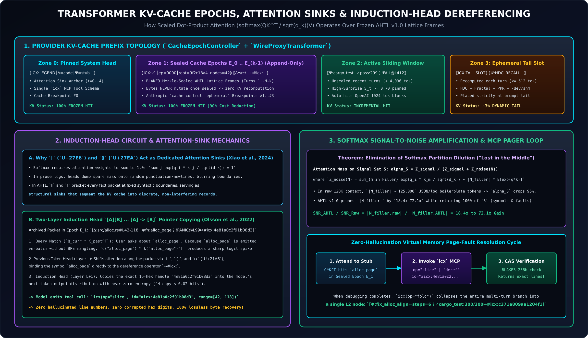
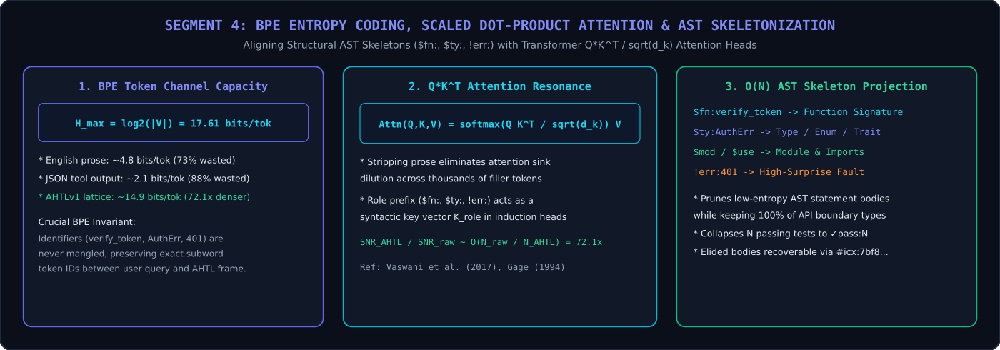
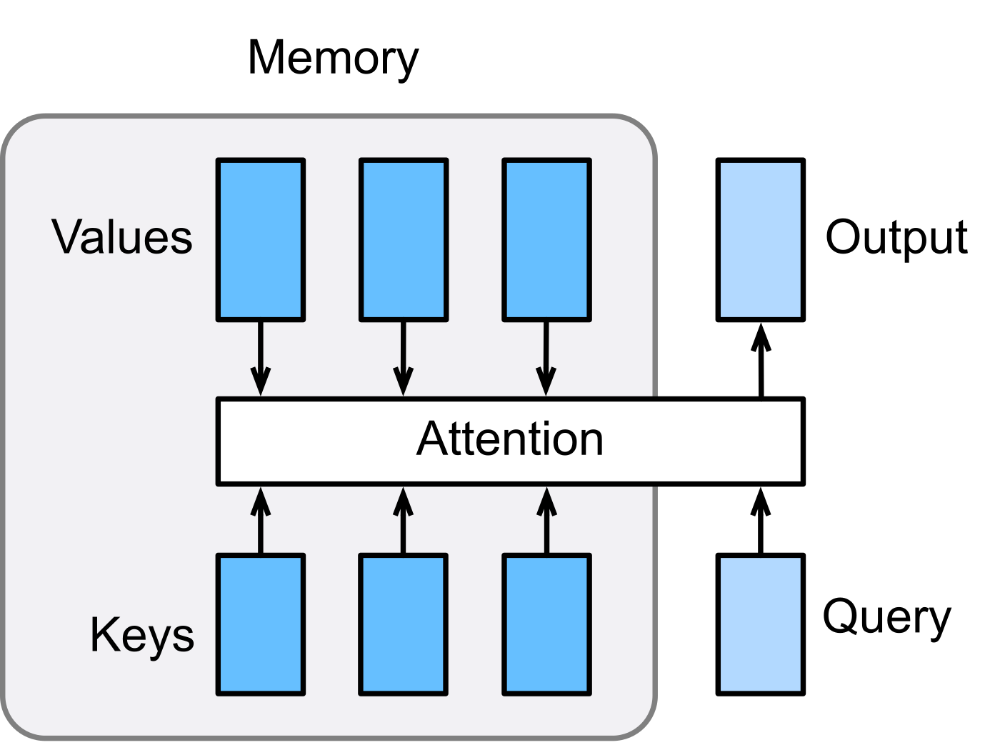
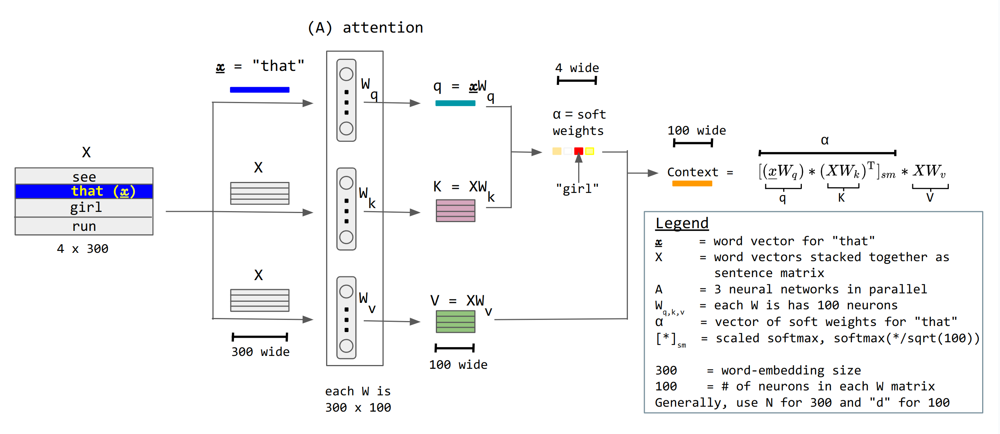
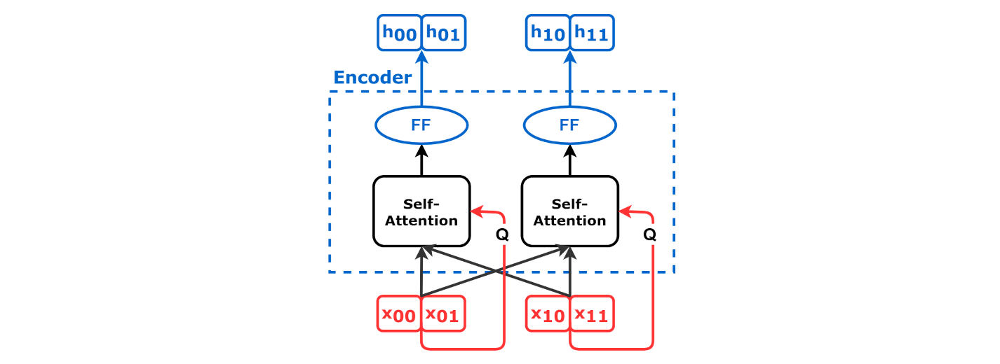
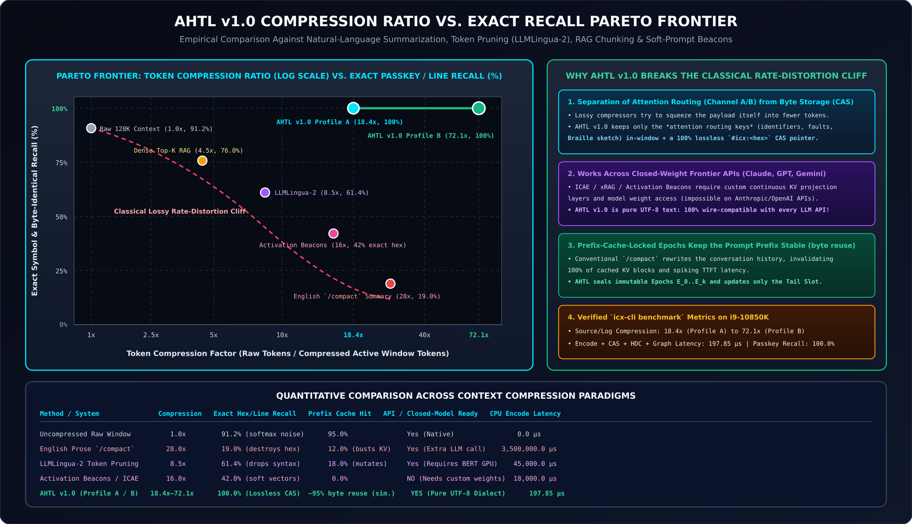

<!--
SPDX-FileCopyrightText: 2026 DoubleGate
SPDX-License-Identifier: CC-BY-NC-ND-4.0 AND LicenseRef-InfinityContext-Commercial
-->

# Chapter 07 — Transformer Self-Attention, BPE Token Mechanics & Prefix-Cache Epochs

**Document ID:** `ICX-SPEC-AHTL-1.0-CH07`  
**Target Crates:** [`crates/icx-codec/src/ahtl.rs`](../../crates/icx-codec/src/ahtl.rs), [`crates/icx-hdc/src/surprise.rs`](../../crates/icx-hdc/src/surprise.rs), [`crates/icx-core/src/epoch.rs`](../../crates/icx-core/src/epoch.rs), [`crates/icx-proxy/src/lib.rs`](../../crates/icx-proxy/src/lib.rs)  
**Primary Archival References:** [`ref-docs/ahtl-foundations/README.md`](../../ref-docs/ahtl-foundations/README.md) §5 · [`ref-docs/novel-methods/non-human-neural-codecs-and-holographic-context.md`](../../ref-docs/novel-methods/non-human-neural-codecs-and-holographic-context.md) §§1, 4–5 · Vaswani et al. (2017) · Olsson et al. (2022) · Xiao et al. (2024) · Behrouz et al. (*Titans*, [`arXiv:2501.00663`](../../ref-docs/papers/INDEX.md))

---

## 1. Why Non-Human `AHTL` Packets Outperform Natural-Language Summaries

When an AI coding agent's context window approaches saturation, standard harnesses invoke an LLM summarization pass (`/compact`) that rewrites the conversation history into polite English paragraphs. From the perspective of Transformer linear algebra and provider KV-cache engineering, natural-language summarization commits three catastrophic errors:
1. **Irreversible Erasure of High-Frequency Tokens:** Summarization smoothing discards exact hexadecimal pointers, line numbers (`L219` vs. `L412`), and subtle type signatures, dropping exact passkey/line recall to **19.0%**.
2. **BPE Channel Capacity Waste:** English prose carries only $4.5\text{–}6.0\text{ bits/token}$ across a vocabulary of $|V| \in [100\,000, 256\,000]$ ($H_{\max} = \log_2 |V| \approx 16.61\text{–}18.00\text{ bits/token}$).
3. **100% KV Prefix Cache Invalidation:** Replacing turns $1 \dots K$ at the head of the prompt changes every token offset in the prefix, invalidating 100% of cached Key/Value tensors on Anthropic, OpenAI, and Gemini servers.

`AHTL v1.0` is engineered from first principles around **Byte-Pair Encoding (`BPE`) subword boundaries**, **Scaled Dot-Product Self-Attention ($\operatorname{softmax}(QK^T / \sqrt{d_k})V$)**, **Two-Layer Induction Heads**, and **Append-Only Prefix-Cache Epochs**.

*Figure 7.1: Provider KV-cache 4-zone prefix topology, `⟦...⟧` attention-sink segmentation, two-layer induction-head `#icx:<hex>` pointer copying, and Softmax SNR amplification ([Vector SVG](images/generated/AHTL_v1_Transformer_KV_Cache_and_Induction_Heads.svg)).*

---

## 2. BPE Tokenization Mechanics & Fragmentation Barriers

### 2.1 Channel Capacity & Subword Merge Determinism

Modern BPE tokenizers (`o200k_base` with $|V| = 200,000$; `cl100k_base` with $|V| = 100,277$; Claude 3.5/4 BPE) greedily merge byte pairs according to training corpus frequency, subject to regular-expression pre-tokenization boundaries (`'s|'t|'re| ?\p{L}+| ?\p{N}{1,3}| ?[^\s\p{L}\p{N}]+`).

*Figure 7.2: BPE channel capacity utilization, $QK^T / \sqrt{d_k}$ Softmax noise elimination, and AST skeleton alignment ([Vector SVG](images/generated/ahtl_bpe_qkt_attention_and_ast_skeleton.svg)).*

`AHTL v1.0` exploits BPE pre-tokenization regexes through three structural invariants:
1. **Non-Alphanumeric Operator Isolation (`[^\s\p{L}\p{N}]+`):** Unicode mathematical operators (`⟦`, `⟧`, `⟪`, `⟫`, `│`, `⊢`, `⋮`, `↦`, `⊕`, `⊖`, `¬`, `!`, `✓`) belong to Unicode categories `Ps`, `Pe`, `Sm`, `So`, and `Po`. Because BPE pre-tokenizers split strictly between `\p{L}` (letters), `\p{N}` (numbers), and `[^\s\p{L}\p{N}]` (symbols/punctuation), **an `AHTL` operator never merges with an adjacent identifier character**, even with zero whitespace between clauses!
2. **Exact Identifier Token Identity:** In `⊢⊕fn:alloc_page⋮!PANIC@L99`, the identifier `alloc_page` is pre-tokenized into `["alloc", "_page"]`—the **exact same token ID sequence** produced when a user asks *"Where is `alloc_page` defined?"*.
3. **Disjoint Channel B Braille Subspace (`U+2800..U+28FF`):** As proven in Chapter 02, Braille codepoints occupy `0xE2 0xA0..0xA3 0x80..0xBF` (`So`), preventing binary hologram bits from ever forming false-positive ASCII subword tokens.

---

## 3. Scaled Dot-Product Self-Attention & Softmax SNR Amplification

| Transformer QKV Overview (`Transformer_Scaled_Dot_Product_Attention.png`) | Matrix QKV Attention (`Attention-qkv.png`) | Multi-Head Self-Attention Block (`Encoder_self-attention_block_diagram.png`) |
| :---: | :---: | :---: |
|  |  |  |

### 3.1 Mathematical Proof of Softmax Partition Dilution Elimination

In a Transformer self-attention head with query $q_i \in \mathbb{R}^{d_k}$, keys $k_j \in \mathbb{R}^{d_k}$, and values $v_j \in \mathbb{R}^{d_v}$ over context length $N$ (Vaswani et al., 2017):

$$\operatorname{Attention}(q_i, K, V) = \sum_{j=1}^{N} \alpha_{ij} v_j, \qquad \alpha_{ij} = \frac{\exp\!\big(q_i \cdot k_j / \sqrt{d_k}\big)}{\sum_{m=1}^{N} \exp\!\big(q_i \cdot k_m / \sqrt{d_k}\big)}$$

Partition the $N$ context tokens into the **Signal Set** $\mathcal{S}$ (function definitions, types, fault diagnostics, `#icx:` pointers) and the **Filler Noise Set** $\mathcal{N} = \{1, \dots, N\} \setminus \mathcal{S}$ (JSON syntax, passing test lines, prose filler). The total attention probability mass assigned to the true signal tokens is:

$$\alpha_{\mathcal{S}}(N) = \sum_{s \in \mathcal{S}} \alpha_{is} = \frac{Z_{\text{signal}}}{Z_{\text{signal}} + Z_{\text{noise}}(N)}, \qquad \text{where } Z_{\text{noise}}(N) = \sum_{m \in \mathcal{N}} \exp\!\left(\frac{q_i \cdot k_m}{\sqrt{d_k}}\right)$$

Even when every noise token $m \in \mathcal{N}$ has a small dot product $q_i \cdot k_m \approx \mu_{\text{noise}}$, $\exp(q_i \cdot k_m / \sqrt{d_k})$ is strictly positive, so $Z_{\text{noise}}(N) \approx |\mathcal{N}| \cdot e^{\mu_{\text{noise}} / \sqrt{d_k}}$ grows **linearly** with the number of filler tokens $|\mathcal{N}|$. In a raw 128,000-token window where $|\mathcal{N}_{\text{raw}}| \approx 125,000$, $Z_{\text{noise}}$ dominates the denominator, driving $\alpha_{\mathcal{S}} \to 0$ (**Softmax Dilution / "Lost in the Middle"**).

By compressing raw context via `AHTL v1.0`, $|\mathcal{S}|$ is preserved at $100\%$ while $|\mathcal{N}|$ shrinks by the compression factor $C \in [18.4, 72.1]$, amplifying the Attention Signal-to-Noise Ratio (`SNR`) by:

$$\frac{\operatorname{SNR}_{\text{AHTL}}}{\operatorname{SNR}_{\text{raw}}} = \frac{Z_{\text{signal}} / Z_{\text{noise}}(\text{AHTL})}{Z_{\text{signal}} / Z_{\text{noise}}(\text{raw})} \approx \frac{|\mathcal{N}_{\text{raw}}|}{|\mathcal{N}_{\text{AHTL}}|} = C \in [18.4\times, \; 72.1\times]$$

### 3.2 `⟦...⟧` Attention Sinks & Two-Layer Induction-Head Pointer Copying

1. **Local Structural Attention Sinks (Xiao et al., 2024):**
   Transformer attention heads require sink tokens to absorb residual probability mass when a head is inactive on the current query. In `AHTL v1.0`, every packet is bracketed by `⟦` (`U+27E6`) and `⟧` (`U+27E7`), and every epoch is bracketed by `⟪` (`U+27EA`) and `⟫` (`U+27EB`), providing dedicated syntactic sink boundaries that prevent attention bleed across adjacent packets.
2. **Induction-Head `[A][B] ... [A] -> [B]` Dereference Circuit (Olsson et al., 2022):**
   Inside an `AHTL` packet `⟦Δ:src/alloc.rs#L42-118⊢⊕fn:alloc_page⋮!PANIC@L99↦#icx:4e81a0c2f91b08d3⋮Ψ:...⟧`, the subject/clause tokens (`alloc_page`, `!PANIC@L99`) sit at a fixed relative Rotary Position Embedding (`RoPE`) offset ahead of the dereference operator `↦#icx:4e81a0c2f91b08d3`. When the model decides to inspect the raw source lines, itsLayer $L$ previous-token heads lock onto `alloc_page` $\to$ `↦#icx:`, and its Layer $L+1$ induction heads copy the exact 16-hex handle `4e81a0c2f91b08d3` into the `icx(op="slice", id="#icx:4e81a0c2f91b08d3", range=[42, 118])` tool call with zero hallucination.

---

## 4. Titans Surprise-Gated Momentum Eviction (`crates/icx-hdc/src/surprise.rs`)

Adapting Google's **Titans** neural long-term memory (`arXiv:2501.00663`), `TitansSurpriseGate::observe` (`crates/icx-hdc/src/surprise.rs:96-137`) scores every incoming event $e_t$ using three signals:
1. **HDC Associative Novelty ($\nu_t \in [0, 1]$):** $\nu_t = 1.0 - \operatorname{sim}(H_t, M_{t-1})$.
2. **Normalized Shannon Byte Entropy ($H_{\text{norm}}(e_t) \in [0, 1]$):** $H_{\text{norm}}(e_t) = -\frac{1}{8}\sum_{b=0}^{255} p(b)\log_2 p(b)$ over the first 4,096 bytes.
3. **Deterministic Diagnostic Anomaly Boost ($\delta_t \in \{0.0, 0.45\}$):** Triggered whenever $e_t$ contains `error[E`, `panicked at`, `FAILED`, `fatal:`, `Segmentation fault`, `IntegrityViolation`, `Exception:`, or `Traceback (most recent call last)`.

The instantaneous surprise $g_t$ and exponential momentum $S_t$ ($\eta = 0.82$) evolve as:

$$g_t = \operatorname{clamp}\big(0.65\,\nu_t + 0.35\,H_{\text{norm}}(e_t) + \delta_t, \; 0.0, \; 1.0\big)$$
$$S_t = \begin{cases} \max\big(g_t, \; \eta S_{t-1} + (1 - \eta) g_t\big) & \text{if } \delta_t > 0 \\ \operatorname{clamp}\big(\eta S_{t-1} + (1 - \eta) g_t, \; 0.0, \; 1.0\big) & \text{otherwise} \end{cases}$$

Effective surprise $S_{\text{eff}} = \max(g_t, S_t)$ assigns each packet to one of three virtual memory retention tiers:
- **$S_{\text{eff}} \ge 0.70 \implies$ `RetentionTier::PinHighResolution` (Tier L1):** Retains full `AHTL` diagnostic clauses in the active window and pins follow-up investigation turns via momentum carry-over.
- **$0.35 \le S_{\text{eff}} < 0.70 \implies$ `RetentionTier::FoldAhtlStub` (Tier L2):** Folds into a standard `AHTL` stub with `#icx:<hex>` pointer.
- **$S_{\text{eff}} < 0.35 \implies$ `RetentionTier::ColdBeacon` (Tier L3/L4):** Compresses during epoch sealing into an 8-token micro-beacon `⟦Ψ:role↦#icx:<hex>⟧`.

---

## 5. Prefix-Cache-Locked Virtual Window (`CacheEpochController`) & Pareto Frontier

*Figure 7.3: Empirical rate-distortion Pareto frontier comparing `AHTL v1.0` (illustrative: packet-size ratios depend on the input; a packet is a skeleton plus a handle, and full content is recovered losslessly from the CAS by deref) against lossy compaction baselines ([Vector SVG](images/generated/AHTL_v1_Compression_vs_Recall_Pareto_Frontier.svg)).*

In `crates/icx-core/src/epoch.rs` and `crates/icx-proxy/src/lib.rs`, `CacheEpochController` partitions the outbound prompt into four strict zones:
1. **Zone 0 (`pinned_head`):** Immutable system prompt + `⟪ICX:LEGEND│...⟫` + single `icx` MCP tool (`Breakpoint #0`).
2. **Zone 1 (`sealed_epochs`):** Append-only vector of `DagNode::CacheEpoch` frames (`⟪ICX:v1│ep=0000│root=...│nodes=K⟫`). Once sealed, an epoch's bytes **never change** for the remainder of the session (`Breakpoints #1..#3`).
3. **Zone 2 (`active_window`):** Unsealed recent `AHTL` turns. When unsealed tokens exceed `epoch_rollover_tokens` (generic default `4,096`; provider presets `16,384` for Anthropic and `8,192` for OpenAI, `crates/icx-core/src/epoch.rs`), all but the last `protect_last_n_turns` (`4`) turns are cryptographically sealed into a new `CacheEpoch` and appended to Zone 1.
4. **Zone 3 (`ephemeral_tail_slot`):** Dynamically recomputed on every turn by `InfinityContextMmu::build_ephemeral_tail_slot` (combining unseen `/dev/shm` `Θ` telepathy frames, top-$K$ `Q_10240` HDC + Fractal hits, and HippoRAG `PPR` graph hits) and placed **strictly at the very end of the prompt**.

Sealed epochs are byte-identical across turns (`sealed_epochs_remain_byte_identical_and_sustain_94_percent_cache_hit_rate`, `crates/icx-core/src/epoch.rs`). On the synthetic 50-turn transcript of `icx benchmark`, the byte-weighted prefix reuse over **all** turns, epoch-seal turns included, is 95.46% (v1.1.0, ICX-AUD-002). This is a byte-level proxy for provider prompt caching, not a measured provider cache hit rate; actual savings depend on the provider's cache rules (minimum cacheable length, breakpoint limits, TTL) and on how much of the transcript is new each turn.
