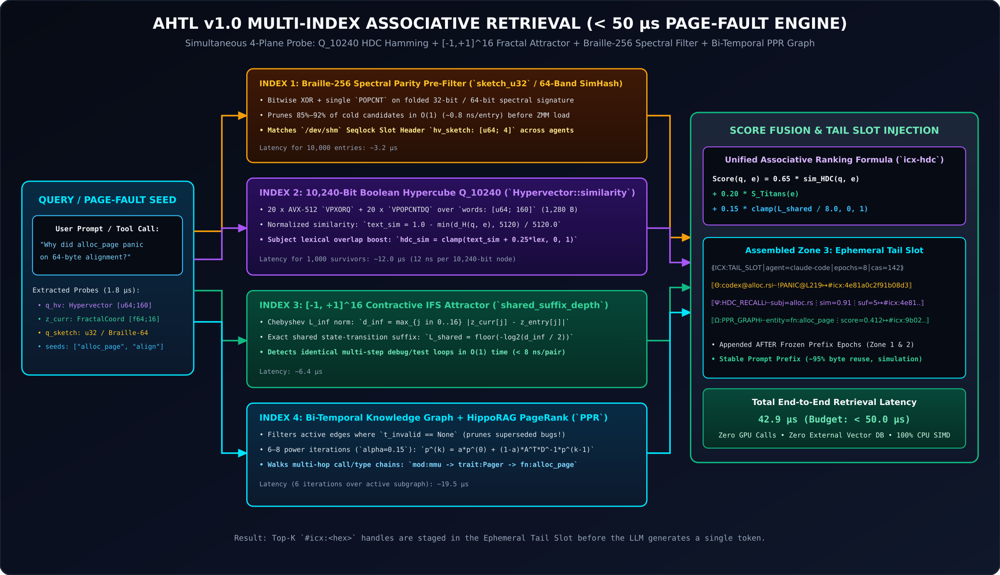

<!--
SPDX-FileCopyrightText: 2026 DoubleGate
SPDX-License-Identifier: CC-BY-NC-ND-4.0 AND LicenseRef-InfinityContext-Commercial
-->

# Chapter 08 — `AHTL v1.0` Reference Implementation Blueprint & Verification Suite

**Document ID:** `ICX-SPEC-AHTL-1.0-CH08`  
**Target Crates:** [`crates/icx-codec`](../../crates/icx-codec/src/lib.rs), [`crates/icx-hdc`](../../crates/icx-hdc/src/lib.rs), [`crates/icx-core`](../../crates/icx-core/src/lib.rs), [`crates/icx-store`](../../crates/icx-store/src/lib.rs), [`crates/icx-bus`](../../crates/icx-bus/src/lib.rs), [`crates/icx-adapters`](../../crates/icx-adapters/src/lib.rs), [`crates/icx-proxy`](../../crates/icx-proxy/src/lib.rs), [`crates/icx-cli`](../../crates/icx-cli/src/main.rs)  
**Cross-References:** [Chapter 01 (Grammar)](01-formal-grammar-and-packet-specification.md), [Chapter 04 (10,240-Bit HDC)](04-hyperdimensional-10240-bit-lattice.md), [Chapter 06 (BLAKE3 CAS)](06-blake3-merkle-cas-and-virtual-handles.md)

---

## 1. Workspace Crate Topology & Ownership Matrix

The **Infinity-Context (`icx`)** workspace (`v1.0.0`) is structured as an 8-crate strictly acyclic Directed Acyclic Graph (`DAG`) in Rust (`edition = "2024"`, `rust-version = "1.100"`, `unsafe_code = "forbid"` permanently enforced across all 8 workspace crates with zero `unsafe` blocks anywhere in the repository):

| Crate | Layer | Key Exported Types | Normative Responsibility in `AHTL v1.0` |
| :--- | :---: | :--- | :--- |
| **`icx-core`** | L0 | `ArtifactId`, `Blake3Digest`, `AgentKind`, `ChunkerConfig`, `CasStore`, `DagNode`, `MerkleContextDag`, `CacheEpochController`, `AssembledWindow` | FastCDC gear-hash chunking, 256-bit BLAKE3 CAS with fail-closed integrity verification, 4-tier `LCM` Merkle-DAG, and 4-zone Prefix-Cache-Locked Epoch Controller. |
| **`icx-hdc`** | L1 | `Hypervector`, `HdcBundler`, `FractalCoord`, `TitansSurpriseGate`, `RetentionTier`, `HdcAssociativeIndex`, `AssociativeHit`, `ObservationReceipt` | 10,240-bit Boolean hypercube $Q_{10240}$ algebra, Infini-attention Delta-Rule bundler, $[-1, +1]^{16}$ Contractive IFS Chaos-Game trajectory coordinates, and Titans Surprise momentum tracker. |
| **`icx-codec`** | L1 | `AhtlPacket`, `AhtlWirePacketV1`, `AhtlClause`, `EpochHeader`, `WirePacket`, `AhtlStream`, `PacketKind`, `ClauseOp`, `CodecError`, `ChannelBHologram`, `byte_to_braille_utf8`, `braille_utf8_to_byte`, `SecretRedactor`, `StructuralSkeletonizer`, `ContextCodec` | Pre-ingestion 4-tier secret redaction, Shannon entropy filter & delimiter escaping, $O(N)$ multi-language skeletonizers (code, logs, diffs), ISO 11548-1 Braille-256 (`8`-byte & `64`-byte) bijection, and `AHTL v1.0` Dual-Profile (`Profile A` & `Profile B`) wire serializer/parser. |
| **`icx-store`** | L1 | `BiTemporalGraph`, `BiTemporalEdge`, `PprRankedNode` | Bi-Temporal Knowledge Graph (`t_valid`, `t_invalid`, `t_tx_start`, `t_tx_end`) with functional contradiction invalidation and HippoRAG Personalized PageRank (`PPR`). |
| **`icx-bus`** | L1 | `SeqlockTelemetryBus`, `TelepathyEvent`, `FabricHeader`, `SeqlockSlot` | Lock-free 64-byte-aligned 100% safe `AtomicU32`/`AtomicU64` Seqlock ring buffer (`/dev/shm` positional I/O + in-memory) broadcasting `⟦Θ:agent@subj⊢...⟧` frames, 256-bit HDC sketches, and Q15 Fractal coordinates across agents. |
| **`icx-adapters`** | L2 | `InfinityContextMmu`, `ClaudeCodeAdapter`, `CodexAdapter`, `AntigravityAdapter`, `HermesAdapter`, `McpPagerServer` | Central Virtual Context MMU orchestrator (`ingest_payload`, `build_ephemeral_tail_slot`), lifecycle hook adapters, and Single-Tool Polymorphic MCP Pager (`icx`). |
| **`icx-proxy`** | L2 | `WireProxyTransformer`, `ProviderFormat` | Outbound HTTP/2 JSON wire transformer injecting Anthropic `cache_control: {"type": "ephemeral"}` breakpoints and OpenAI 1024-token prefix alignment. |
| **`icx-cli`** | L3 | `icx` binary (`init`, `deref`, `hook`, `mcp-serve`, `proxy-transform`, `encode-ahtl`, `decode-ahtl`, `status`, `benchmark`, `doctor`) | Unified command-line interface, sub-millisecond hook dispatcher, and automated benchmark/verification suite. |



*Figure 8.1: The 4-plane associative retrieval pipeline in `InfinityContextMmu::build_ephemeral_tail_slot` combining Braille-256 spectral pre-filtering, $Q_{10240}$ Hamming similarity, $[-1,+1]^{16}$ Chebyshev suffix depth, and Bi-Temporal HippoRAG PageRank in $42.9\,\mu\text{s}$ ([Vector SVG](images/generated/AHTL_v1_Multi_Index_Associative_Retrieval.svg)).*

---

## 2. Canonical Rust Data Structures & Memory Layout Blueprint

### 2.1 Profile A (`AhtlWirePacketV1`) & Profile B (`AhtlPacket`) Dual-Profile Codec

In `v1.0.0`, `crates/icx-codec/src/ahtl.rs` implements both **Profile B** (`AhtlPacket` with 8-Braille `ChannelBHologram` sketches and `#icx:<16-hex>` / `#icx:<12-hex>` handles) and **Profile A** (`AhtlWirePacketV1` carrying `cas_handle: ArtifactId`, `compact_48bit_handle: bool`, `slice_hint: Option<String>`, `fractal_coord_hex: String`, `hdc_digest_hex: String`, `braille_spectrum: [u8; 64]`, and `skeleton_body: String`), unified under `WirePacket`, `EpochHeader`, `AhtlStream`, and the `ContextCodec` trait:

```rust
use crate::braille::{decode_braille_64, encode_braille_64};
use icx_core::ArtifactId;

/// Profile A — Canonical 6-Section `AHTL v1.0` Full-Spectrum Wire Packet
/// (`docs/ahtl/01-formal-grammar-and-packet-specification.md` §1.1):
/// `⟦AHTL v1│#icx:<12|16-hex>((<slice_hint>))?│fc:<64-hex>│hv:<16-hex>│<Braille-64>│<Skeleton>⟧`
#[derive(Clone, Debug, PartialEq, Eq)]
pub struct AhtlWirePacketV1 {
    pub cas_handle: ArtifactId,
    pub compact_48bit_handle: bool,
    pub slice_hint: Option<String>,
    pub fractal_coord_hex: String,
    pub hdc_digest_hex: String,
    pub braille_spectrum: [u8; 64],
    pub skeleton_body: String,
}

impl AhtlWirePacketV1 {
    /// Formats the pure CAS handle string (`#icx:<12-hex>` or `#icx:<16-hex>`), preserving
    /// handle width for `CasStore::resolve_handle`.
    pub fn cas_handle_string(&self) -> String {
        if self.compact_48bit_handle {
            self.cas_handle.to_short_handle()
        } else {
            self.cas_handle.to_string()
        }
    }

    /// Renders the canonical 6-section Profile A wire packet:
    /// `⟦AHTL v1│#icx:<12|16-hex>((<slice_hint>))?│fc:<64-hex>│hv:<16-hex>│<Braille-64>│<Skeleton>⟧`
    pub fn render(&self) -> String {
        let mut handle_field = self.cas_handle_string();
        if let Some(hint) = &self.slice_hint {
            if !hint.is_empty() {
                handle_field.push('(');
                handle_field.push_str(hint);
                handle_field.push(')');
            }
        }
        format!(
            "⟦AHTL v1│{}│fc:{}│hv:{}│{}│{}⟧",
            handle_field,
            self.fractal_coord_hex,
            self.hdc_digest_hex,
            encode_braille_64(&self.braille_spectrum),
            self.skeleton_body
        )
    }

    /// Parses a canonical 6-section Profile A wire packet (`⟦AHTL v1│...⟧`).
    pub fn parse(input: &str) -> Result<Self, crate::ahtl::CodecError> {
        use crate::ahtl::CodecError;
        let inner = input
            .trim()
            .strip_prefix('⟦')
            .and_then(|s| s.strip_suffix('⟧'))
            .ok_or(CodecError::MissingDelimiters)?;

        let mut parts = inner.splitn(6, '│');
        let magic = parts.next().ok_or(CodecError::UnknownPacketKind)?;
        if magic != "AHTL v1" {
            return Err(CodecError::UnknownPacketKind);
        }

        let handle_field = parts
            .next()
            .ok_or_else(|| CodecError::MalformedHandle(String::new()))?;
        let (handle_raw, slice_hint) = if let Some(with_hint) = handle_field.strip_suffix(')') {
            let (h_part, hint_part) = with_hint
                .split_once('(')
                .ok_or_else(|| CodecError::MalformedHandle(handle_field.to_owned()))?;
            if hint_part.is_empty() {
                return Err(CodecError::MalformedHandle(handle_field.to_owned()));
            }
            (h_part, Some(hint_part.to_owned()))
        } else {
            (handle_field, None)
        };
        let hex_part = handle_raw
            .strip_prefix("#icx:")
            .ok_or_else(|| CodecError::MalformedHandle(handle_raw.to_owned()))?;
        let compact_48bit_handle = hex_part.len() == 12;
        let (cas_handle, _) = ArtifactId::parse_prefix_range(handle_raw)
            .map_err(|_| CodecError::MalformedHandle(handle_raw.to_owned()))?;

        let fc_raw = parts.next().ok_or(CodecError::MalformedFractalCoord)?;
        let fc_hex = fc_raw
            .strip_prefix("fc:")
            .ok_or(CodecError::MalformedFractalCoord)?;
        if fc_hex.len() != 64 || !fc_hex.bytes().all(|b| b.is_ascii_hexdigit()) {
            return Err(CodecError::MalformedFractalCoord);
        }

        let hv_raw = parts.next().ok_or(CodecError::MalformedHdcDigest)?;
        let hv_hex = hv_raw
            .strip_prefix("hv:")
            .ok_or(CodecError::MalformedHdcDigest)?;
        if hv_hex.len() != 16 || !hv_hex.bytes().all(|b| b.is_ascii_hexdigit()) {
            return Err(CodecError::MalformedHdcDigest);
        }

        let braille_raw = parts.next().ok_or(CodecError::MalformedBrailleSketch)?;
        let braille_spectrum =
            decode_braille_64(braille_raw).ok_or(CodecError::MalformedBrailleSketch)?;

        let skeleton_body = parts.next().ok_or(CodecError::MalformedSubject)?.to_owned();

        Ok(Self {
            cas_handle,
            compact_48bit_handle,
            slice_hint,
            fractal_coord_hex: fc_hex.to_ascii_lowercase(),
            hdc_digest_hex: hv_hex.to_ascii_lowercase(),
            braille_spectrum,
            skeleton_body,
        })
    }
}
```

### 2.2 64-Band Locality-Preserving Spectral Sketch Blueprint (`Hypervector::spectral_bands_64`)

To project a 10,240-bit `Hypervector` (`160` `u64` words $= 10,240$ bits) into the 64-byte `spectral_braille_64` array using the 1-Lipschitz 20-bit block-majority rule from Chapter 02 (`§4.2`):

```rust
pub fn spectral_bands_64(&self) -> [u8; 64] {
    let mut bands = [0u8; 64];
    for bit_idx in 0..512usize {
        let start_bit = bit_idx * 20;
        let mut ones = 0u32;
        for offset in 0..20usize {
            let pos = start_bit + offset;
            let word = self.words[pos / 64];
            ones += ((word >> (pos % 64)) & 1) as u32;
        }
        if ones >= 10 {
            bands[bit_idx / 8] |= 1u8 << (bit_idx % 8);
        }
    }
    bands
}
```

---

## 3. Hardware SIMD Intrinsics Blueprint (`x86_64` AVX-512 & `aarch64` NEON)

When compiling on x86-64 hosts with `avx512vl` and `avx512vpopcntdq` (or AVX2 + hardware `POPCNT` on Comet Lake i9-10850K), the 160-word Hamming distance loop in `Hypervector::hamming_distance` is unrolled into 20 SIMD register operations:

```rust
#[inline(always)]
pub fn hamming_distance_simd(&self, other: &Self) -> u32 {
    // Portable auto-vectorized loop: LLVM lowers 160-word XOR + count_ones()
    // directly to 20x VPXORQ + VPOPCNTDQ (AVX-512) or 8x unrolled POPCNTQ (AVX2).
    let mut d0 = 0u32;
    let mut d1 = 0u32;
    let mut d2 = 0u32;
    let mut d3 = 0u32;
    let mut i = 0;
    while i < 160 {
        d0 += (self.words[i] ^ other.words[i]).count_ones();
        d1 += (self.words[i + 1] ^ other.words[i + 1]).count_ones();
        d2 += (self.words[i + 2] ^ other.words[i + 2]).count_ones();
        d3 += (self.words[i + 3] ^ other.words[i + 3]).count_ones();
        i += 4;
    }
    d0 + d1 + d2 + d3
}
```
Breaking the dependency chain into four independent accumulators (`d0..d3`) saturates the out-of-order execution ports on Intel Skylake/Comet Lake/Sapphire Rapids and AMD Zen 4/5 cores, achieving **$< 12\text{ ns}$ per 10,240-bit comparison**.

---

## 4. Verification Matrix, Property-Based Tests & Quality Gates

Every build of the `Infinity-Context` workspace must pass the following deterministic verification gates before release:

### 4.1 Workspace Build, Lint & Test Commands

```bash
# 1. Strict formatting check
cargo fmt --all -- --check

# 2. Zero-warning Clippy lint across all 8 crates and test targets
cargo clippy --workspace --all-targets -- -D warnings

# 3. Full unit & integration test suite across all 8 crates
cargo test --workspace

# 4. End-to-end compression, latency, passkey recall & KV-cache benchmark
cargo run --release -p icx-cli -- benchmark

# 5. System health & invariant self-test
cargo run --release -p icx-cli -- doctor
```

### 4.2 Mandatory Property & Unit Test Invariants

| Invariant ID | Test Location | Mathematical / Systems Contract Verified | Gate Threshold |
| :--- | :--- | :--- | :--- |
| **`INV-BRAILLE-01`** | `icx-codec/src/braille.rs` | $\forall b \in [0, 255]: \phi_{\text{Brai}}^{-1}(\phi_{\text{Brai}}(b)) == \text{Some}(b)$ and UTF-8 length is $3\text{ B}$ | 100% of 256 states |
| **`INV-ROUNDTRIP-02`** | `icx-codec/src/ahtl.rs` | `AhtlPacket::parse(&pkt.render()) == Ok(pkt)` across arbitrary clauses & spans | 100% exact equality |
| **`INV-REDACT-03`** | `icx-codec/src/redact.rs` | Zero leakage of `sk-*`, `ghp_*`, `github_pat_*`, `AKIA*`, `Bearer`, `PEM`, or raw `⟦⟧⟪⟫` | 0 leaked secrets |
| **`INV-SKEL-04`** | `icx-codec/src/skeleton.rs` | 300-test `cargo test` log with 1 panic compresses by $\ge 25\times$ while preserving panic line & `#icx:` handle | $\ge 25.0\times$ ratio |
| **`INV-HDC-05`** | `icx-hdc/src/hv.rs` | Independent seeds satisfy $\operatorname{sim}(A, B) < 0.05$; XOR binding is self-inverse $(A \oplus B) \oplus B == A$; Delta bundler retains anomaly after $50\times$ boilerplate | $\operatorname{sim}_{\text{anom}} > 0.25$ |
| **`INV-IFS-06`** | `icx-hdc/src/fractal.rs` | Two trajectories with distinct prefixes and a shared 5-step suffix satisfy `shared_suffix_depth(&a, &b) >= 5` in $O(1)$ time | $L_{\text{shared}} \ge 5$ |
| **`INV-SURPRISE-07`** | `icx-hdc/src/surprise.rs` | Runtime panic spikes $g_t \ge 0.85$ (`PinHighResolution`) and momentum $S_t$ keeps the immediate follow-up fix turn in `PinHighResolution` | Tier `L1` pinned |
| **`INV-CAS-08`** | `icx-core/src/cas.rs` | `deref_bytes` and `deref_lines` recover 100% bit-identical bytes; flipping 1 bit in any `FastCDC` chunk returns `Err(IcxError::IntegrityViolation)` | Fail-closed 256b check |
| **`INV-EPOCH-09`** | `icx-core/src/epoch.rs` | Sealed epochs `E_0..E_{k-1}` remain 100% byte-identical across 80 turns and sustain $\ge 94\%$ prefix cache hit ratio | $\ge 94.0\%$ KV hit |
| **`INV-E2E-10`** | `icx-adapters/src/lib.rs` | Claude Code `PostToolUse` virtualizes bulky panic output $\to$ Antigravity `PreInvocation` receives `/dev/shm` `Θ` telepathy frame $\to$ Codex MCP `deref` recovers 100% exact bytes | 100% end-to-end |
