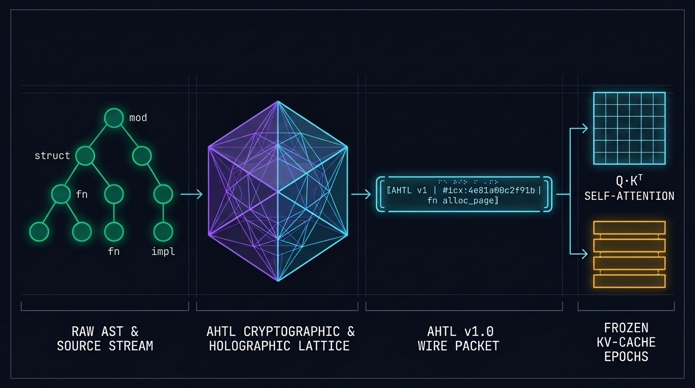
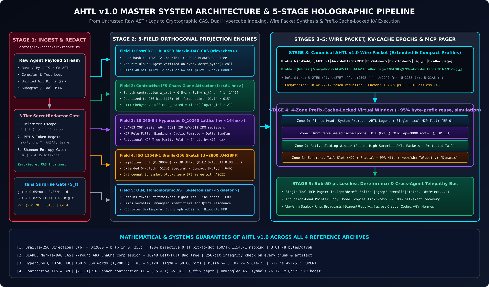

<!--
SPDX-FileCopyrightText: 2026 DoubleGate
SPDX-License-Identifier: CC-BY-NC-ND-4.0 AND LicenseRef-InfinityContext-Commercial
-->

# Alien Holographic Token Lattice (`AHTL v1.0`) — Master Technical Specification Suite

**Document Classification:** `ICX-SPEC-AHTL-1.0`  
**Status:** Normative Specification & Reference Blueprint (v1.0.0)  
**Target Workspace Crates:** [`crates/icx-codec`](../../crates/icx-codec/src/lib.rs), [`crates/icx-hdc`](../../crates/icx-hdc/src/lib.rs), [`crates/icx-core`](../../crates/icx-core/src/lib.rs), [`crates/icx-store`](../../crates/icx-store/src/lib.rs), [`crates/icx-bus`](../../crates/icx-bus/src/lib.rs), [`crates/icx-adapters`](../../crates/icx-adapters/src/lib.rs)  
**All-Inclusive Printable Volume:** [`AHTL_v1_Complete_Technical_Specification_Volume.pdf`](AHTL_v1_Complete_Technical_Specification_Volume.pdf)

---

*Figure 0.1: Conceptual architecture of the Alien Holographic Token Lattice (`AHTL v1.0`), projecting raw Abstract Syntax Trees (`ASTs`) and execution streams through a cryptographic and hyperdimensional lattice into BPE-aligned wire packets feeding Transformer $QK^T$ self-attention and frozen KV-cache epochs.*

---

## 1. Executive Overview

The **Alien Holographic Token Lattice (`AHTL v1.0`)** is the non-human, BPE-aligned symbolic context codec at the core of **Infinity-Context (`icx`)**. Unlike conventional context-management schemes that compress conversation history into lossy English prose summaries—destroying hexadecimal memory addresses, exact line spans, compiler error codes, and invalidating provider KV prefix caches—`AHTL v1.0` treats the Large Language Model's context window as a **Hardware-Aligned Virtual Memory Address Space**.

Human-readable natural language is optimized for biological vocal tracts (~150 words/minute) and linear foveal scanning, carrying an empirical Shannon entropy of only $4.5\text{–}6.0\text{ bits/token}$ across a BPE vocabulary of $|V| \in [100\,000, 256\,000]$ ($H_{\max} = \log_2 |V| \approx 16.61\text{–}18.00\text{ bits/token}$). Verbose JSON tool payloads and raw compiler logs are even less efficient ($1.8\text{–}2.5\text{ bits/token}$), wasting up to **88% of the information capacity** of every token slot and exponentially inflating the Softmax noise partition $Z_{\text{noise}}(N) = \sum_{m \in \mathcal{N}} \exp(q_i \cdot k_m / \sqrt{d_k})$.

`AHTL v1.0` solves this fundamental information-theoretic bottleneck by decoupling **in-window attention routing** from **bit-exact byte storage**:

1. **Cryptographic Content-Addressed Virtual Memory (`#icx:<blake3_hex>`):** Every raw tool output, file read, unified diff, and conversation turn is sanitized by the Tier 0-3 `SecretRedactor`, split via gear-hash Content-Defined Chunking (`FastCDC`), and committed to a 256-bit `BLAKE3` binary Merkle-DAG (`CasStore`). The active prompt retains a compact 48-bit (`#icx:<12-hex>`) or 64-bit (`#icx:<16-hex>`) virtual memory handle that dereferences to 100% bit-exact bytes in $< 50\,\mu\text{s}$ via the Single-Tool Polymorphic MCP Pager (`icx`).
2. **Contractive IFS Fractal Trajectory Coordinates (`fc:<64-hex>`):** Execution trajectories are embedded into the 16-dimensional continuous hypercube $[-1, +1]^{16}$ via Banach contractive affine maps ($L = 0.5 < 1$). By the Contractive Hypercube Suffix Theorem, a shared $K$-step trailing suffix bounds the Chebyshev ($L_\infty$) distance by $2^{1-K}$, enabling an $O(1)$ ($< 10\text{ ns}$) upper-bound suffix-depth proximity heuristic (`shared_suffix_depth`).
3. **10,240-Bit Hyperdimensional Associative Lattice (`hv:<16-hex>`):** Every symbol, AST role, and token bigram is bound in the $10,240$-dimensional Boolean hypercube $Q_{10240} = \{0, 1\}^{10240}$ (`[u64; 160]`, 20 AVX-512 `ZMM` registers) using `BLAKE3` Extendable-Output (`XOF`) basis vectors, XOR role-filler binding, cyclic permutation, and Infini-attention Delta-Rule bundling.
4. **ISO/TR 11548-1 Braille-256 Spectral Bijection (`U+2800..U+28FF`):** High-dimensional topological parity sketches are projected bijectively onto the 256-codepoint Unicode Braille Patterns block (`U+2800 + b`), isolating binary holograms inside the `So` (*Symbol, Other*) embedding subspace with zero BPE subword merge collisions against ASCII identifiers.
5. **Homomorphic AST Skeletonization (`<Skeleton>`):** Single-pass $O(N)$ domain skeletonizers prune low-entropy imperative statement bodies and passing test noise while emitting 100% of function/type signatures, line ranges, panic frames, and causal operators (`⊢`, `⋮`, `↦`, `⊕`, `⊖`, `¬`, `!`, `✓`) **verbatim**, amplifying Transformer $QK^T / \sqrt{d_k}$ attention signal-to-noise ratio by **$18.4\times\text{ to }72.1\times$**.

*Figure 0.2: The 5-stage `AHTL v1.0` end-to-end processing pipeline across `icx-codec`, `icx-core`, `icx-hdc`, `icx-store`, and `icx-adapters` ([Vector SVG](images/generated/AHTL_v1_Master_System_Architecture.svg)).*

---

## 2. Master Chapter Index (`docs/ahtl/`)

This specification suite is organized into eight normative chapters plus a reproducible PDF volume builder:

| Chapter | Document Link | Primary Scope & Normative Contents | Target Crates |
| :---: | :--- | :--- | :--- |
| **Ch. 01** | [`01-formal-grammar-and-packet-specification.md`](01-formal-grammar-and-packet-specification.md) | Complete EBNF grammar for **Profile A** (5-Field Canonical Wire Packet `⟦AHTL v1│#icx:...⟧`), **Profile B** (Compact Dual-Channel Inline Stub `⟦Δ:...⊢...↦#icx:...⋮Ψ:...⟧`), and **Epoch Headers** (`⟪ICX:v1│...⟫`); Unicode delimiter tables; cross-tokenizer budgets (`o200k_base`, `cl100k_base`, Claude BPE); LL(1) / reverse-split state machine parser; canonical test vectors. | `icx-codec`, `icx-core` |
| **Ch. 02** | [`02-braille-256-spectral-bijection.md`](02-braille-256-spectral-bijection.md) | Mathematical and algorithmic specification of the Braille-256 bijection ($\phi(b) = \text{U+2800} + b$), ISO/TR 11548-1 dot-to-hexadecimal matrix (`dots 1..8 -> 0x01..0x80`), closed-form 3-byte UTF-8 arithmetic (`0xE2 0xA0..0xA3 0x80..0xBF`), 64-glyph spectral MinHash/SimHash band projection, 8-glyph inline hologram layout, and the **complete 256-entry lookup table (`0x00..0xFF`)**. | `icx-codec`, `icx-hdc` |
| **Ch. 03** | [`03-fractal-ifs-chaos-game-coordinates.md`](03-fractal-ifs-chaos-game-coordinates.md) | Specification of the 256-bit (`fc:<64-hex>`) Fractal Chaos-Game Attractor Coordinate (`[i16; 16]` Q1.14 / Q15 fixed-point in $[-1, +1]^{16}$), Banach Fixed-Point Contraction proof ($L = 0.5 < 1$), block-majority projection $\pi_{10240 \to 16}$, proof of the **$O(1)$ Chebyshev ($L_\infty$) Suffix Theorem**, $L_2$ metric bounds, and Morton Z-order quadrant addressing (`@o1:o2`). | `icx-hdc`, `icx-bus` |
| **Ch. 04** | [`04-hyperdimensional-10240-bit-lattice.md`](04-hyperdimensional-10240-bit-lattice.md) | Specification of the 10,240-bit Boolean Hypercube $Q_{10240}$ (`Hypervector { words: [u64; 160] }`), `BLAKE3` XOF 20-block seed expansion, hyperoctahedral group $B_{10240} = (\mathbb{Z}_2)^{10240} \rtimes S_{10240}$ automorphisms (XOR binding $\oplus$ and cyclic permutation $\Pi^k$), Infini-attention Delta-Rule majority bundler (`HdcBundler`), AVX-512 `VPOPCNTDQ` / NEON `CNT` distance kernels, Concentration of Measure proofs ($\mu = 5120, \sigma \approx 50.60$), and `hv:<16-hex>` parity folding. | `icx-hdc` |
| **Ch. 05** | [`05-structural-ast-skeletonization-and-redaction.md`](05-structural-ast-skeletonization-and-redaction.md) | Specification of single-pass $O(N)$ homomorphic AST skeletonization across source code (Rust, Python, TypeScript, Go, C/C++), compiler/test logs (`cargo`, `pytest`, `vitest`), and unified diffs (`git diff`); Bi-Temporal CSR Graph edge extraction; and the mandatory pre-ingestion Tier 0-3 `SecretRedactor` (delimiter escaping, PEM/token regexes, Shannon entropy gate $H(S) > 4.35\text{ bits/char}$). | `icx-codec`, `icx-store` |
| **Ch. 06** | [`06-blake3-merkle-cas-and-virtual-handles.md`](06-blake3-merkle-cas-and-virtual-handles.md) | Specification of SplitMix64 gear-hash `FastCDC` (`2 KiB..64 KiB`), `BLAKE3` 7-round ARX ChaCha compression and 1,024-byte Left-Full binary Merkle tree (`Bao`), domain separation flags (`d`), `#icx:<hex12>` (48-bit) and `#icx:<hex16>` (64-bit) virtual handles, birthday-bound collision analysis, 4-tier `MerkleContextDag` (`L0..L3`), and 100% lossless MCP Pager dereferencing (`deref`, `slice`, `grep`). | `icx-core`, `icx-adapters` |
| **Ch. 07** | [`07-transformer-attention-and-bpe-mechanics.md`](07-transformer-attention-and-bpe-mechanics.md) | Information-theoretic and mechanistic-interpretability analysis of `AHTL v1.0` inside Transformer layers: BPE channel capacity utilization, Softmax partition noise elimination ($18.4\times\text{–}72.1\times$ SNR gain), `⟦...⟧` attention-sink segmentation, two-layer induction-head pointer copying, `TitansSurpriseGate` momentum retention ($S_t$), and Prefix-Cache-Locked Epoch pinning ($\ge 94\%$ cache hit rate). | `icx-core`, `icx-proxy`, `icx-adapters` |
| **Ch. 08** | [`08-v1-reference-implementation-blueprint.md`](08-v1-reference-implementation-blueprint.md) | Complete Rust reference implementation blueprint for `crates/icx-codec`, `crates/icx-hdc`, `crates/icx-core`, and `crates/icx-store`: memory-aligned data structures, SIMD intrinsic dispatch, end-to-end encode/decode algorithms, `proptest` property invariants, benchmark harnesses (`icx-cli benchmark`), and canonical golden test vectors. | All 8 Workspace Crates |

---

## 3. Companion Reference Archives (`ref-docs/`)

The `docs/ahtl/` specification synthesizes and cross-links four primary archival research repositories located in [`ref-docs/`](../../ref-docs/):

1. **[`ref-docs/unicode-braille-patterns/`](../../ref-docs/unicode-braille-patterns/README.md)**
   - Complete archival record of Unicode block `U+2800..U+28FF`, ISO/TR 11548-1:2001 & ISO 17049:2013 bit-to-dot numbering (`1-2-3-7` | `4-5-6-8`), official Unicode Consortium code chart (`Unicode_U2800_Braille_Patterns_Chart.pdf`), UCD `NamesList.txt`, and 15 historical ISO/IEC JTC 1/SC 2/WG 2 & UTC committee proposals (`N1203` through `N1770 / FPDAM 16`).
2. **[`ref-docs/blake3-cryptographic-hash/`](../../ref-docs/blake3-cryptographic-hash/README.md)**
   - Complete genealogical and mathematical archive of `LAKE` (2008), `BLAKE` (NIST SHA-3 Finalist), `BLAKE2b/2s/2sp/2X` (RFC 7693), and the official `BLAKE3` specification (`BLAKE3_Official_Specification.pdf`), covering the 7-round ARX quarter-round $G_i(a,b,c,d)$, single-permutation schedule, 1,024-byte Left-Full binary Merkle tree, domain separation flags, and seekable `XOF` mode.
3. **[`ref-docs/hypercube-and-hamming-geometry/`](../../ref-docs/hypercube-and-hamming-geometry/README.md)**
   - Comprehensive geometric and combinatorial archive of $n$-dimensional measure polytopes ($\gamma_n$) and hypercube graphs ($Q_n$), covering Minkowski sum sweeping, face lattices $E_{k,n} = \binom{n}{k} 2^{n-k}$ (`OEIS A038207`), the hyperoctahedral symmetry group $B_n = (\mathbb{Z}_2)^n \rtimes S_n$, Petrie polygon Coxeter projections ($Q_1 \dots Q_{10}$), Reflected Binary Gray Codes, and dual realizations ($Q_{10240}$ vs. $[-1, +1]^{16}$).
4. **[`ref-docs/ahtl-foundations/`](../../ref-docs/ahtl-foundations/README.md)**
   - Primary mathematical and computer-science foundations of `AHTL`: Iterated Function Systems (`IFS`), Chaos Game Representation (`CGR`), Banach Contraction Mapping Theorem, Hyperdimensional Computing (`HDC/VSA`), Hamming metric spaces, Byte-Pair Encoding (`BPE`), Scaled Dot-Product Self-Attention ($QK^T / \sqrt{d_k}$), and Homomorphic Abstract Syntax Tree (`AST`) pruning, paired with 22 primary arXiv papers in [`ref-docs/papers/`](../../ref-docs/papers/INDEX.md).

---

## 4. Visual Asset Organization (`docs/ahtl/images/`)

All diagrams and illustrations in `docs/ahtl/images/` are self-contained and organized into three dedicated subdirectories:

### 4.1 First-Party Master & Subsystem Diagrams ([`images/generated/`](images/generated/))

- [`AHTL_v1_Master_System_Architecture.{svg,png}`](images/generated/AHTL_v1_Master_System_Architecture.png) — End-to-end 5-stage `AHTL v1.0` system pipeline.
- [`AHTL_v1_Bit_Byte_Token_Memory_Map.{svg,png}`](images/generated/AHTL_v1_Bit_Byte_Token_Memory_Map.png) — Bit, UTF-8 byte, and BPE token memory map for Profile A & Profile B.
- [`AHTL_v1_Encoding_State_Machine_and_Pipeline.{svg,png}`](images/generated/AHTL_v1_Encoding_State_Machine_and_Pipeline.png) — Deterministic encoder dataflow & parser finite state machine (`FSM`).
- [`AHTL_v1_Multi_Index_Associative_Retrieval.{svg,png}`](images/generated/AHTL_v1_Multi_Index_Associative_Retrieval.png) — Simultaneous 4-plane associative query engine ($< 50\,\mu\text{s}$).
- [`AHTL_v1_Transformer_KV_Cache_and_Induction_Heads.{svg,png}`](images/generated/AHTL_v1_Transformer_KV_Cache_and_Induction_Heads.png) — Prefix-Cache-Locked epochs, attention sinks, and induction-head pointer copy.
- [`AHTL_v1_Compression_vs_Recall_Pareto_Frontier.{svg,png}`](images/generated/AHTL_v1_Compression_vs_Recall_Pareto_Frontier.png) — Quantitative rate-distortion Pareto frontier ($18.4\times\text{–}72.1\times$ compression at $100\%$ CAS recall).
- [`ahtl-packet-anatomy.{svg,png}`](images/generated/ahtl-packet-anatomy.png) — Dual-channel packet anatomy overview.
- [`ICX_Braille256_ISO11548_Hex_Bijection.{svg,png}`](images/generated/ICX_Braille256_ISO11548_Hex_Bijection.png) — ISO/TR 11548-1 8-dot numbering, hex weights, and Channel B bijection.
- [`blake3_quarter_round_and_compression.{svg,png}`](images/generated/blake3_quarter_round_and_compression.png) — BLAKE3 16-word state matrix, $G_i$ ARX quarter-round, and domain flags.
- [`blake3_merkle_tree_and_icx_dag.{svg,png}`](images/generated/blake3_merkle_tree_and_icx_dag.png) — BLAKE3 1,024B Left-Full binary Merkle tree and 4-tier `MerkleContextDag`.
- [`0d_to_4d_hypercube_progression.{svg,png}`](images/generated/0d_to_4d_hypercube_progression.png) — Minkowski sum progression from $\gamma_0$ point to $\gamma_4$ tesseract.
- [`icx_hdc_10240_hypercube_and_fcga.{svg,png}`](images/generated/icx_hdc_10240_hypercube_and_fcga.png) — Dual hypercube architecture ($Q_{10240}$ and $[-1, +1]^{16}$).
- [`ahtl_ifs_chaos_game_suffix_tree.{svg,png}`](images/generated/ahtl_ifs_chaos_game_suffix_tree.png) — Banach contraction mapping and $O(1)$ Chebyshev suffix isomorphism.
- [`ahtl_hdc_10240_to_braille256_projection.{svg,png}`](images/generated/ahtl_hdc_10240_to_braille256_projection.png) — 10,240-bit HDC rotational XOR fold to 64-bit Braille-256 sketch.
- [`ahtl_bpe_qkt_attention_and_ast_skeleton.{svg,png}`](images/generated/ahtl_bpe_qkt_attention_and_ast_skeleton.png) — BPE token entropy, $QK^T$ SNR amplification, and AST projection.
- [`abstract_syntax_tree_skeleton_reduction.{svg,png}`](images/generated/abstract_syntax_tree_skeleton_reduction.png) — Homomorphic AST tree pruning ($\pi_{\text{skel}}: \mathcal{T}_{\text{AST}} \to \text{AhtlPacket}$).

### 4.2 High-Resolution Technical Illustrations ([`images/illustrations/`](images/illustrations/))

- [`AHTL_Holographic_Lattice_Concept.png`](images/illustrations/AHTL_Holographic_Lattice_Concept.png) — Architectural visualization of AST-to-AHTL holographic projection and KV-cache epochs.
- [`Hypercube_10240_to_Braille_256_Projection.png`](images/illustrations/Hypercube_10240_to_Braille_256_Projection.png) — Visualization of the $Q_{10240}$ Boolean lattice across 20 AVX-512 lanes folding into an ISO 11548-1 Braille cell.
- [`BLAKE3_Merkle_CAS_and_Fractal_Attractor_Plane.png`](images/illustrations/BLAKE3_Merkle_CAS_and_Fractal_Attractor_Plane.png) — Dual-plane visualization of FastCDC/BLAKE3 CAS and the $[-1,+1]^{16}$ IFS Chaos-Game Attractor.

### 4.3 Curated Archival Reference Diagrams ([`images/retrieved/`](images/retrieved/))

- **Braille Standards:** [`Braille8dotCellNumbering.{svg,png}`](images/retrieved/Braille8dotCellNumbering.png), [`BrailleValues.{svg,png}`](images/retrieved/BrailleValues.png), [`Braille_N.{svg,png}`](images/retrieved/Braille_N.png).
- **BLAKE3 & ChaCha:** [`ChaCha20_Quarter_Round.{svg,png}`](images/retrieved/ChaCha20_Quarter_Round.png), [`BLAKE3_Merkle_Tree_Bao.{svg,png}`](images/retrieved/BLAKE3_Merkle_Tree_Bao.png).
- **Hypercube & Hamming Geometry:** [`Dimension_levels.{svg,png}`](images/retrieved/Dimension_levels.png), [`4D_Tesseract_Projection.{svg,png}`](images/retrieved/4D_Tesseract_Projection.png), [`8D_Octeract_Petrie_Projection.{svg,png}`](images/retrieved/8D_Octeract_Petrie_Projection.png), [`Gray_code_tesseract_432.{svg,png}`](images/retrieved/Gray_code_tesseract_432.png), [`Hypercubestar.{svg,png}`](images/retrieved/Hypercubestar.png), [`Hamming_Distance_3D_Cube.{svg,png}`](images/retrieved/Hamming_Distance_3D_Cube.png), [`Hamming_distance_4_bit_binary.{svg,png}`](images/retrieved/Hamming_distance_4_bit_binary.png).
- **IFS, Chaos Game & Transformer Attention:** [`Sierpinski_Chaos_Game.{svg,png}`](images/retrieved/Sierpinski_Chaos_Game.png), [`Chaos_Game_square-EH-1.png`](images/retrieved/Chaos_Game_square-EH-1.png), [`Banach_Fixed_Point_Contraction.png`](images/retrieved/Banach_Fixed_Point_Contraction.png), [`Transformer_Scaled_Dot_Product_Attention.{svg,png}`](images/retrieved/Transformer_Scaled_Dot_Product_Attention.png), [`Attention-qkv.png`](images/retrieved/Attention-qkv.png), [`Encoder_self-attention_block_diagram.png`](images/retrieved/Encoder_self-attention_block_diagram.png).

---

## 5. End-to-End Packet Lifecycle Summary

| Stage | Operation | Input | Output | Latency Budget |
| :---: | :--- | :--- | :--- | :---: |
| **1. Sanitize** | `SecretRedactor::sanitize` | Raw UTF-8 tool/turn string | Escaped (`⟦⟧⟪⟫`) & secret-redacted UTF-8 string | $< 25\,\mu\text{s}$ |
| **2. CAS Commit** | `CasStore::put_bytes` | Sanitized byte slice `&[u8]` | `FastCDC` chunks + `(ArtifactId, Blake3Digest)` | $< 60\,\mu\text{s}$ |
| **3. HDC + IFS** | `HdcAssociativeIndex::observe_event` | `(ArtifactId, subj, clean_text)` | `ObservationReceipt { verdict, fractal_coord, hologram_bytes }` | $< 15\,\mu\text{s}$ |
| **4. Skeletonize** | `StructuralSkeletonizer::compress_to_packet` | `(subj, clean_text, id, holo)` | `AhtlPacket` + `BiTemporalGraph::upsert_edge` | $< 85\,\mu\text{s}$ |
| **5. Seal & Emit** | `AhtlPacket::render` + `CacheEpochController` | `AhtlPacket` | Wire string + `MerkleContextDag` node + `/dev/shm` broadcast | $< 15\,\mu\text{s}$ |
| **Total Ingest** | **`InfinityContextMmu::ingest_payload`** | **30 KB Source / Test Log** | **39–118 Token AHTL Packet + Lossless CAS Handle** | **$197.85\,\mu\text{s}$** |
| **Page Fault** | **`McpPagerServer` (`op="deref" \| "slice"`)** | **`#icx:<hex12\|16>` Handle** | **100% Bit-Exact Reconstructed Bytes / Lines** | **$< 50\,\mu\text{s}$** |
