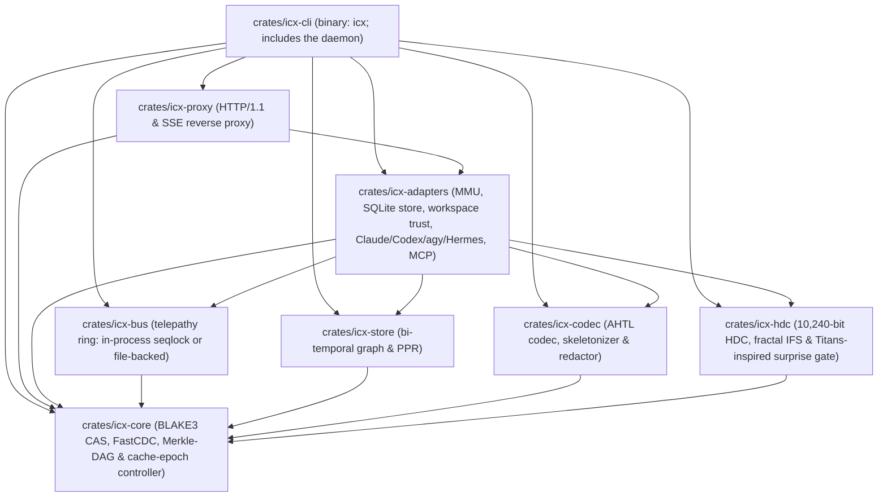
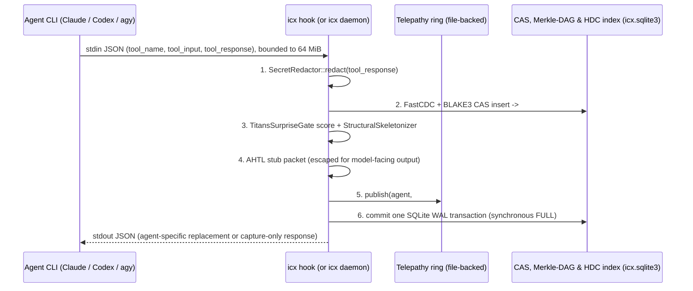

# System Architecture Specification

**Applies to:** `icx` v1.2.0 candidate

**References:** [ref-docs/research-report.md](../ref-docs/research-report.md) §§1–7, [ref-docs/initial-concept.md](../ref-docs/initial-concept.md), [docs/adr/0005-v1-1-0-workspace-trust-store-and-daemon.md](adr/0005-v1-1-0-workspace-trust-store-and-daemon.md)

---

## 1. Architectural Overview & Core Principles

**Infinity-Context (`icx`)** is structured around five invariants:

1. **Central-State Ownership (Module 50):** Each project has one **workspace**, a private
   directory outside the repository holding a single SQLite store (`icx.sqlite3`). Every writer
   (hook, daemon, MCP server, proxy) takes the workspace lock before saving, and every save is one
   transaction. When `icx daemon` is running it keeps the MMU resident and serializes its
   requests with other writers through the same lock; `icx hook` forwards to it over a private
   Unix socket and falls back to in-process handling on any daemon error.
2. **One-Directional Crate Dependency DAG:** No circular dependencies exist across the 8
   workspace crates (§2).
3. **Lossless Provenance After Redaction (Module 20):** Every compressed packet (`AHTL`) in the
   active window carries a `#icx:<hash>` handle into a BLAKE3-verified content-addressed store.
   The store holds the tool output after secret redaction, byte for byte; dereferencing returns
   exactly those bytes.
4. **Bounded Context and Retained-Prefix Stability:** Sealed cache epochs are not rewritten in
   cold history. Prompt assembly selects whole recent frames within a persisted model budget;
   older frames can be omitted from the prompt while remaining recoverable. Per-turn recall
   and cross-agent events go into the **Ephemeral Tail Slot**. Paging or changing model policy
   can change the selected prefix and invalidate provider caches; no unlimited stable prefix or
   provider cache-hit rate is guaranteed. See [ADR 0006](adr/0006-v1-2-0-context-and-compatibility.md).
5. **No Network or Model Calls in Synchronous Hooks:** `PreToolUse`, `PostToolUse`,
   `PreInvocation` and `UserPromptSubmit` handling is local, deterministic Rust.

---

## 2. Workspace Crate Topology & Dependency Graph

### Crate Responsibilities

| Crate | Layer | Responsibility |
| :--- | :--- | :--- |
| `icx-core` | L0 Foundation | Core identifiers (`ArtifactId`, `Blake3Digest`, `AgentKind`) and `IcxError`, FastCDC content-defined chunking (spread masks), BLAKE3 CAS with collision detection (`IcxError::HashCollision`), `MerkleContextDag`, and `CacheEpochController`. Chunks are stored uncompressed. |
| `icx-hdc` | L1 Math/Index | 10,240-bit `Hypervector` (`[u64; 160]`), XOR binding, permutation, Delta-rule bundling, Hamming distance via `u64::count_ones`, hybrid exact-token/HDC candidate retrieval with lexical precedence, `ICXHDC05` snapshots, `FractalTrajectoryArchive` (`FCGA`), and the Titans-inspired `TitansSurpriseGate`. Legacy `03`/`04` snapshots remain readable and the MMU rebuilds their postings from CAS events. |
| `icx-codec` | L1 Codec | Secret redaction (`SecretRedactor::redact` for storage, `sanitize` for model-facing text), structural skeletonizer (`StructuralSkeletonizer`), and the **AHTL** encoder/decoder. |
| `icx-store` | L2 Graph | In-memory **bi-temporal knowledge graph** compiled to CSR, and **HippoRAG-style Personalized PageRank** (`PPR`). Persistence is handled by `icx-adapters`. |
| `icx-bus` | L2 IPC | `SeqlockTelemetryBus`: a 256-slot ring with an in-process atomic seqlock backend and a file-backed backend (positional I/O, writer mutex plus file lock, optimistic readers). See [docs/wire-protocol-and-shm-bus.md](wire-protocol-and-shm-bus.md). |
| `icx-adapters` | L3 Harnesses | `InfinityContextMmu`; the SQLite workspace store (`store.rs`) and workspace location/trust policy (`workspace.rs`); hook wire translators for **Claude Code**, **OpenAI Codex**, **Antigravity CLI (`agy`)** and **Hermes Agent** (logic only; Hermes needs a Python `ContextEngine` shim that calls `icx hook --agent hermes`); and the single-tool MCP pager. |
| `icx-proxy` | L3 Wire Plane | Local HTTP/1.1 reverse proxy with SSE for Anthropic, OpenAI and Gemini request formats: token authentication, cache-breakpoint placement, forged-marker escaping and streaming deref expansion. Upstream requests are sent with `curl`. |
| `icx-cli` | L4 Entrypoint | The `icx` binary: `init`, `trust`, `context-budget`, `daemon`, `hook`, `mcp-serve`, `proxy`, `proxy-transform`, `encode-ahtl`, `decode-ahtl`, `deref`, `status`, `doctor`, `benchmark`. |

---

## 3. End-to-End Execution Flows

### 3.1 Flow A: Bulky Tool Output Virtualization (`PostToolUse`)

The response shape is agent-specific; for example Claude Code requires `updatedToolOutput` in
the tool's own output shape. Codex captures output for later recall but sends no unsupported
replacement field; the original native output remains visible. See
[docs/agent-adapters-and-interception.md](agent-adapters-and-interception.md).

### 3.2 Flow B: Pre-Model Associative Recall & Cross-Agent Events (`SessionStart` / `UserPromptSubmit` / `PreInvocation` / `select_context`)

1. The user submits a prompt or the agent prepares its next model call.
2. `icx` computes a query hypervector from the prompt text and the current trajectory
   coordinate, and extracts query tokens.
3. It then:
   - polls the telepathy ring for events from other agents in the same workspace
     (`poll_workspace_since`);
   - unions exact token postings with approximate candidates (Stage 1: 1,024-bit hypervector
     prefix, Bloom and summary features; Stage 2: full 10,240-bit Hamming distance and verified
     fractal suffix depth); exact query-token coverage has precedence in final ranking;
   - runs Personalized PageRank ($\alpha = 0.15$, 6 iterations in the MMU) over edges currently
     valid in the bi-temporal graph.
4. The selected packets and cross-agent frames are packed whole into the **Ephemeral Tail Slot**
   (default 1,024 conservative accounting units; the Anthropic/OpenAI presets use 2,048).
   Header and best recall are prioritized; oversized subjects can use compact recoverable
   handles. Unsent sibling events do not advance the read cursor. The slot is returned via:
   - Claude Code and Codex: `hookSpecificOutput.additionalContext`;
   - Antigravity CLI: `injectSteps[].systemMessage` with `metadata.user_markdown: ""`;
   - Hermes: the `ContextEngine.select_context()` tail message.

### 3.3 Flow C: Workspace Resolution and the Resident Daemon

1. **Resolve the workspace:** `--dir` > `ICX_DIR` > the per-project default
   `<state_dir>/workspaces/<first 16 hex of blake3(canonical project root)>`, where the project
   root is the nearest ancestor containing `.git` and `state_dir` is `ICX_STATE_HOME`, else
   `$XDG_STATE_HOME/icx`, else `~/.local/state/icx`.
2. **Verify trust:** the directory must be owned by the effective uid, have no group/other
   permission bits, and carry a valid `OWNER` seal; a sealed store must carry a valid MAC. A
   repository-local `.icx/` is never used implicitly (`icx trust --dir <path>` adopts one). See
   [docs/security-and-threat-model.md](security-and-threat-model.md) §4.1.
3. **Dispatch:** `icx hook` connects to `ws-<hash>.sock` in `$XDG_RUNTIME_DIR/icx` if a daemon is
   running (disable with `ICX_NO_DAEMON=1`; `ICX_DAEMON_AUTOSTART=1` starts one in the background
   on first use). The daemon checks the peer uid with `SO_PEERCRED`, handles the request against
   its resident MMU, and commits to SQLite under the workspace lock **before** sending success.
   WAL uses `synchronous=FULL`. Save failure produces a failed response and discards the unsaved
   state (the daemon exits after 5 consecutive failures, v1.2.1); a failed dispatch is never
   saved; there is no acknowledged write-behind queue. Each request revalidates the store `generation`,
   so writes by the MCP server or proxy are picked up. Filesystem and hardware synchronization
   behavior still bounds durability guarantees.
4. **Fallback:** with no daemon, or on any daemon error, the hook loads the store, handles the
   event and saves in one transaction.

---

## 4. Rejected Architectural Alternatives

See `docs/adr/` for the Nygard-format ADRs:

- **Rejected: LLM-on-the-Critical-Path Summarization:** calling a secondary model during
  `PostToolUse` or `PreInvocation` adds network latency and can produce summaries that drop or
  invent identifiers. `icx` uses deterministic structural extraction, surprise gating and AHTL
  encoding on the hot path.
- **Rejected: Mutating Mid-History Messages Every Turn:** rewriting message $i < N - k$
  invalidates the provider's prefix cache for every later token. `icx` seals history into stable
  epochs. Bounded window selection can nevertheless remove older frames from the selected
  provider prefix; the tradeoff is documented in ADR 0006.
- **Rejected (v1.1.0): Repository-local workspace by default:** a `.icx/` inside the repository can
  be shipped by a cloned repository and would be trusted. See ADR-0005.
- **Rejected (v1.1.0): Multiple JSON state files:** they could not be saved atomically together
  and forced a full reload per hook. Replaced by one SQLite store. See ADR-0005.
