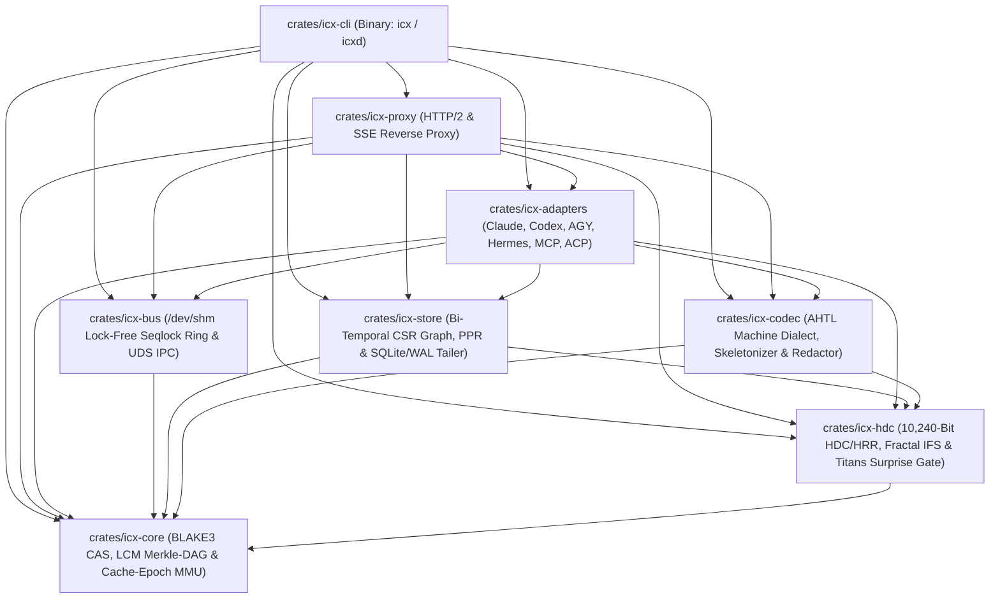
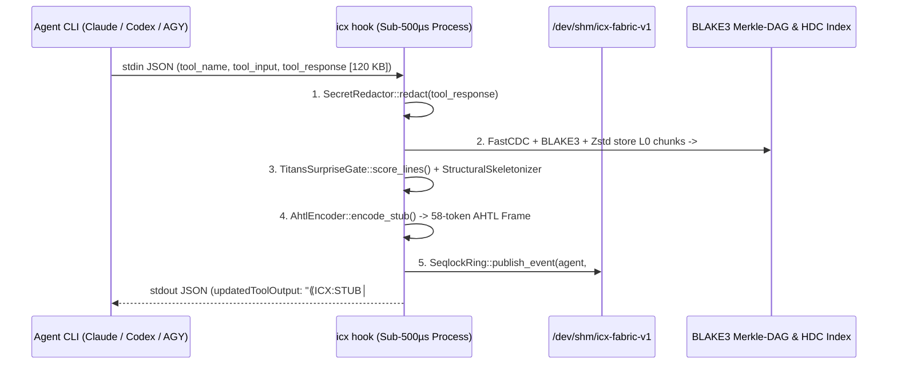

# System Architecture Specification

**References:** [ref-docs/research-report.md](../ref-docs/research-report.md) §§1–7, [ref-docs/initial-concept.md](../ref-docs/initial-concept.md)

---

## 1. Architectural Overview & Core Principles

**Infinity-Context (`icx`)** is structured around five strict systems-engineering invariants:

1. **Central-State Ownership (Module 50):** A single resident Rust daemon (`icxd`) and its memory-mapped shared-memory segment (`/dev/shm/icx-fabric-v1`) own the authoritative cross-agent state; ephemeral CLI hook invocations (`icx hook`) attach to `/dev/shm` read-only or append via lock-free atomic seqlocks and Unix Domain Socket (`UDS`) RPC.
2. **One-Directional Crate Dependency DAG:** No circular dependencies exist across the 8 workspace crates.
3. **Byte-Exact Lossless Provenance (Module 20):** Every compressed token packet (`AHTL`) in the active window is backed by an immutable `BLAKE3` Merkle-DAG path (`LCM`) down to the exact raw bytes (`L0`).
4. **Prefix-Cache Immutability (`arXiv:2610.28577`):** Sealed Cache Epochs (`E_0 .. E_{k-1}`) never mutate on the wire. Dynamic associative recall and cross-agent telepathy updates are injected exclusively into the **Ephemeral Tail Slot** after the cached prefix.
5. **Sub-500µs Synchronous Critical Path:** No network calls or LLM inference ever run inside synchronous agent hooks (`PreToolUse`, `PostToolUse`, `PreInvocation`, `UserPromptSubmit`).

---

## 2. Workspace Crate Topology & Dependency Graph

### Crate Responsibilities

| Crate | Layer | Responsibility |
| :--- | :--- | :--- |
| `icx-core` | L0 Foundation | Core identifiers (`ArtifactId`, `EpochId`, `SessionId`, `AgentKind`), FastCDC content-defined chunking, BLAKE3 CAS, Zstd dictionary compression, `MerkleContextDag`, and `CacheEpochController`. |
| `icx-hdc` | L1 Math/Index | 10,240-bit `Hypervector` (`[u64; 160]`), XOR binding, circular permutation, Delta-Rule majority bundling, AVX-512 `VPOPCNTDQ` Hamming distance, `FractalTrajectoryArchive` (`FCGA`), and `TitansSurpriseGate`. |
| `icx-codec` | L1 Codec | Pre-ingestion secret redaction (`SecretRedactor`), structural AST/log/diff skeletonizer (`StructuralSkeletonizer`), and the **Alien Holographic Token Lattice (`AHTL`)** encoder/decoder. |
| `icx-store` | L2 Storage/Graph | Persistent CAS + metadata store, in-memory Compressed Sparse Row (CSR) **Bi-Temporal Knowledge Graph**, **HippoRAG Personalized PageRank (`PPR`)**, and external agent SQLite WAL / JSONL tailer. |
| `icx-bus` | L2 IPC/Shm | POSIX `/dev/shm/icx-fabric-v1` memory-mapped **Lock-Free Seqlock Ring Buffer** (`SeqlockTelemetryBus`) and Unix Domain Socket framing for `< 100 µs` cross-agent telepathy. |
| `icx-adapters` | L3 Harnesses | Native hook Input/Output wire translators for **Claude Code**, **OpenAI Codex**, **Antigravity CLI (`agy`)**, **Hermes Agent**, and the **Single-Tool Polymorphic MCP Pager**. |
| `icx-proxy` | L3 Wire Plane | Transparent async HTTP/1.1, HTTP/2 & SSE reverse proxy for Anthropic, OpenAI, and Gemini APIs with automatic Cache-Epoch breakpoint injection and streaming pointer expansion. |
| `icx-cli` | L4 Entrypoint | Unified `icx` binary providing `init`, `daemon`, `hook`, `mcp-serve`, `encode-ahtl`, `decode-ahtl`, `deref`, `status`, `doctor`, and `benchmark`. |

---

## 3. End-to-End Execution Flows

### 3.1 Flow A: Bulky Tool Output Virtualization (`PostToolUse`)

### 3.2 Flow B: Pre-Model Associative Recall & Cross-Agent Telepathy (`PreInvocation` / `UserPromptSubmit` / `select_context`)

1. The user submits a prompt or an agent prepares its next model invocation.
2. `icx` extracts the active observation window (last $W = 64$ tokens + current query entities) and computes:
   - Query `Hypervector` $Q_{\text{HDC}} \in \{0, 1\}^{10240}$
   - Current trajectory `FractalCoord` $z_t \in [-1, 1]^{16}$
   - Entity seed vector $s_0$ for Personalized PageRank (`PPR`).
3. In `< 250 µs`, `icx` executes in parallel:
   - **Cross-Agent `/dev/shm` Ring Poll:** Reads any unseen high-surprise events published by sibling agents in the same workspace or linked repositories.
   - **HDC Hamming Scan + Quest Bounding-Box Filter:** Finds top-$K$ historical epochs/artifacts with normalized Hamming similarity $> 0.62$.
   - **Bi-Temporal PPR Walk:** 8 iterations of Personalized PageRank ($\alpha = 0.15$) over currently valid edges (`t_invalid == None`).
4. The winning historical AHTL packets and cross-agent telepathy frames are packed into a single **Ephemeral Tail Slot** block (`<= 1,024` tokens) and returned via:
   - Claude Code / Codex: `hookSpecificOutput.additionalContext`
   - Antigravity CLI: `injectSteps[].systemMessage` (with `metadata.user_markdown: ""` so the human UI stays completely clean)
   - Hermes: `ContextEngine.select_context()` tail message.

---

## 4. Rejected Architectural Alternatives

See `docs/adr/` for full Michael Nygard ADRs:
- **Rejected: LLM-on-the-Critical-Path Summarization:** Calling a secondary LLM during `PostToolUse` or `PreInvocation` adds 800–4,000 ms of latency and introduces hallucinated summaries. `icx` uses deterministic AST/diagnostic extraction + Titans Surprise Gating + AHTL symbolic encoding on the hot path (`< 500 µs`).
- **Rejected: Mutating Mid-History Messages Every Turn:** Rewriting message index $i < N - k$ invalidates the KV cache for all tokens $j > i$. `icx` seals history into immutable Cache Epochs and mutates only the Ephemeral Tail Slot.
