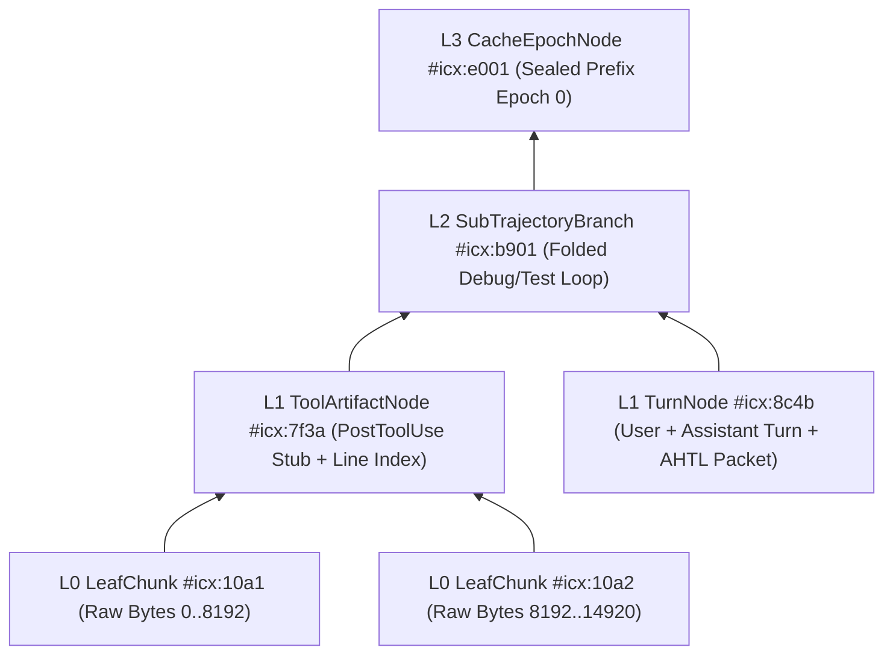

# Virtual Memory & Lossless Merkle-DAG Engine (`LCM`) Specification

**References:** [ref-docs/papers/INDEX.md](../ref-docs/papers/INDEX.md) §§1.1–1.5 & 2.1, [ref-docs/research-report.md](../ref-docs/research-report.md) §4.3  
**Target Crate:** `crates/icx-core`

---

## 1. Purpose

`crates/icx-core` implements the **Virtual Context Memory Management Unit (MMU)** and the **Lossless Context Management (`LCM`) BLAKE3 Merkle-DAG**. It guarantees that:
1. Every byte of conversation history, tool input, tool output, and subagent execution is stored immutably and losslessly (`L0` leaves).
2. Active context is organized into a 4-tier virtual memory hierarchy (`L1 Active Verbatim/Stubs`, `L2 Sealed Cache Epochs`, `L3 Hot Shared-Memory Ring`, `L4 Zstd Cold CAS`).
3. Context compaction is a **deterministic Merkle-DAG fold operation** rather than a destructive overwrite.
4. Outbound prompts obey **Prefix-Cache Epoch Pinning** so provider KV caches remain valid across hundreds of turns.

---

## 2. Content-Addressed Storage (CAS) & FastCDC Chunking

### 2.1 Content-Defined Chunking (`FastCDC`)
Large payloads (e.g., 500 KB file reads or build logs) frequently share identical prefixes or suffixes across turns. Rather than storing duplicate blobs, `icx-core` splits inputs larger than `8 KiB` using gear-hash **Content-Defined Chunking**:
- Minimum chunk size: `2,048` bytes
- Average chunk size: `8,192` bytes
- Maximum chunk size: `65,536` bytes

Each chunk $C_i$ is identified by its 256-bit `BLAKE3` hash (`Blake3Hash([u8; 32])`) and addressed in AHTL frames by its 64-bit short handle (`ArtifactId(u64)`, formatted as `#icx:<16-hex-digits>`).

### 2.2 Lossless Dereference Contract
Given any `ArtifactId` handle `#icx:<hex16>`:
- `CasStore::deref_all(id) -> Result<Vec<u8>, IcxError>` reconstructs the exact original byte sequence by concatenating its `L0` chunks and verifying the top-level 256-bit `BLAKE3` digest.
- `CasStore::deref_lines(id, start_line, end_line) -> Result<String, IcxError>` returns an exact 1-based inclusive line slice without loading unrelated chunks.
- `CasStore::grep_cold(id, pattern, context_lines) -> Result<Vec<LineMatch>, IcxError>` executes regex/literal search directly over the stored artifact and returns matching lines with line numbers.

---

## 3. Hierarchical Merkle-DAG (`MerkleContextDag`)

### Node Types
1. **`DagNode::LeafChunk` (`L0`):** Raw bytes + `Blake3Hash`.
2. **`DagNode::ToolArtifact` (`L1`):** Tool name, arguments hash, exit status, ordered `Vec<ArtifactId>` of `L0` chunks, line-offset index table, and its precomputed `AHTL` Holographic Stub.
3. **`DagNode::Turn` (`L1`):** Turn ordinal, agent identity, role, raw content `ArtifactId`, `AHTL` representation, and `TitansSurprise` score.
4. **`DagNode::SubTrajectoryBranch` (`L2`):** Created when an agent enters a multi-turn iterative loop (e.g., compile -> fix -> compile -> test) or spawns a subagent (`Context-Folding`, `arXiv:2510.11967`). When the branch resolves, all intermediate `L1` nodes are folded into one `L2` node whose active representation is a single 40–80 token `⟦Φ:...⟧` commit packet pointing to its child `L1` nodes.
5. **`DagNode::CacheEpoch` (`L3`):** Created when the unsealed active window exceeds `epoch_token_threshold` (default `16,384` tokens). Seals a contiguous range of `L1`/`L2` nodes into an immutable **AHTL Epoch Frame** with a `BLAKE3` Merkle root.

---

## 4. Prefix-Cache Epoch Controller (`CacheEpochController`)

### 4.1 State Machine
The `CacheEpochController` partitions the logical context window of budget $B$ tokens into four zones:

| Zone | Typical Budget Share | Mutability | Provider Cache Status |
| :--- | :--- | :--- | :--- |
| **Zone 0: Pinned System Head** | `2%–8%` | Immutable per session | Breakpoint 0 (100% cached) |
| **Zone 1: Sealed Cache Epochs (`E_0..E_{k-1}`)** | `40%–65%` | Strictly Append-Only | Breakpoints 1..3 (100% cached) |
| **Zone 2: Active Sliding Window (`W_active`)** | `20%–40%` | Append-only until epoch rollover | Prefix-cached on 1024-token blocks |
| **Zone 3: Ephemeral Tail Slot (`S_tail`)** | `2%–5%` (`<= 2,048` tok) | Recomputed every turn | Uncached tail (negligible prefill cost) |

### 4.2 Epoch Rollover Algorithm
When `tokens(W_active) > epoch_rollover_threshold`:
1. Partition `W_active` into `[head_to_seal, protected_recent_tail]` where `protected_recent_tail` keeps the last `protect_last_n` (default `6`) turns verbatim.
2. Detect any resolved build/test/debug cycles inside `head_to_seal` and fold them into `L2 SubTrajectoryBranch` nodes.
3. Compile the remaining `L1` and `L2` nodes in `head_to_seal` into a sealed `L3 CacheEpochNode` (`E_k`), retaining full `L1` AHTL clauses for turns with `TitansSurprise >= 0.65` and compact micro-beacons for low-surprise turns.
4. Append `E_k` to Zone 1 and advance the provider `cache_control` breakpoint to the end of `E_k`.

---

## 5. Single-Node CAS Availability, Retention, Backup & Integrity Policy

1. **Workspace Persistence Layout (`.icx/`):**
   - Every initialized workspace directory (`.icx/` by default, or `ICX_DIR` / `--dir <PATH>`) stores four files protected by OS advisory locking (`cas_store.lock` via `InfinityContextMmu::acquire_workspace_lock`):
     - `cas_store.json`: FastCDC `L0` chunks (`BTreeMap<ArtifactId, (Blake3Digest, Vec<u8>)>`) and top-level `StoredArtifact` metadata (`LineIndexEntry` tables and 256-bit `full_digest`).
     - `mmu_state.json`: Serialized `MerkleContextDag`, `CacheEpochController`, `HdcAssociativeIndex`, `redacted_artifacts`, and per-agent occurrence tables (`agent_occurrences`).
     - `bitemporal_graph.json`: Bi-Temporal Knowledge Graph edges (`t_valid`, `t_invalid`, `t_tx_start`, `t_tx_end`) and provenance `ArtifactId` sets.
     - `icx-fabric-v1.shm`: `1,048,640`-byte (`64 B` `FabricHeader` + `256 x 4,096 B` `SeqlockSlot`) shared-memory telepathy ring.
2. **Atomic Crash-Safe Writes & `0o600` Access Control:**
   - All state snapshots (`CasStore::save_to_dir`, `BiTemporalGraph::save_to_dir`, and `InfinityContextMmu::save_workspace_dir`) write to a sibling `.tmp.<pid>` file created with owner-only `0o600` Unix permissions (`OpenOptionsExt::mode(0o600)`), flush kernel buffers via `File::sync_all()`, and atomically replace the target file via `std::fs::rename`.
   - `SeqlockTelemetryBus::open_shared_file` enforces `0o600` owner-only permissions on the shared ring file, rejecting group/world-accessible segments with `Err(BusError::InsecurePermissions)`.
3. **Fail-Closed Corruption & Collision Protection:**
   - On load (`CasStore::load_from_dir`) or explicit health check (`CasStore::verify_all_integrity` and `MerkleContextDag::verify_merkle_integrity`), every `L0` chunk and every reassembled artifact is verified against its full 256-bit `BLAKE3` digest (`Blake3Digest`). If any bit is corrupted or any JSON snapshot fails to parse, `icx` fails closed (`IcxError::IntegrityViolation`) and refuses to overwrite the existing `.icx/` files during subsequent hook or CLI calls.
   - `CasStore::put_bytes_checked` enforces the `64 MiB` (`ICX_MAX_INGEST_BYTES`) STRIDE DoS ceiling and verifies full 256-bit digest equality on any 64-bit `ArtifactId` or `L0` chunk collision.
4. **Retention, Backup & `icx doctor` Verification:**
   - Because `.icx/` is self-contained and updated exclusively via atomic `rename` under `cas_store.lock`, backing up or archiving a session requires only copying `.icx/{cas_store.json,mmu_state.json,bitemporal_graph.json}`.
   - Running `icx doctor [--dir <PATH>]` inspects local agent harnesses, verifies `/dev/shm` writability, loads `<PATH>` (default `.icx`), and executes `mmu.cas.verify_all_integrity()` + `mmu.dag.verify_all_merkle_integrity_with_cas(Some(&mmu.cas))` to report `[VERIFIED] Workspace Storage & Merkle-DAG`.

---

## 6. Edge Cases and Invariants

- **Model Switch Calibration Reset:** If an agent switches mid-session from a 1M-token model to a 128K-token model (e.g., `PreModelSwitch` in Claude Code or `update_model()` in Hermes), `CacheEpochController::retarget_budget(new_budget)` hierarchically folds existing `L3` epochs `(E_0, E_1) -> E_{0..1}^{(L4)}` without losing a single `L0` leaf in the DAG.
- **Deterministic Replay:** Given the same sequence of turns and tool outputs, `MerkleContextDag` produces bit-for-bit identical `Blake3Hash` roots and AHTL Epoch Frames.
