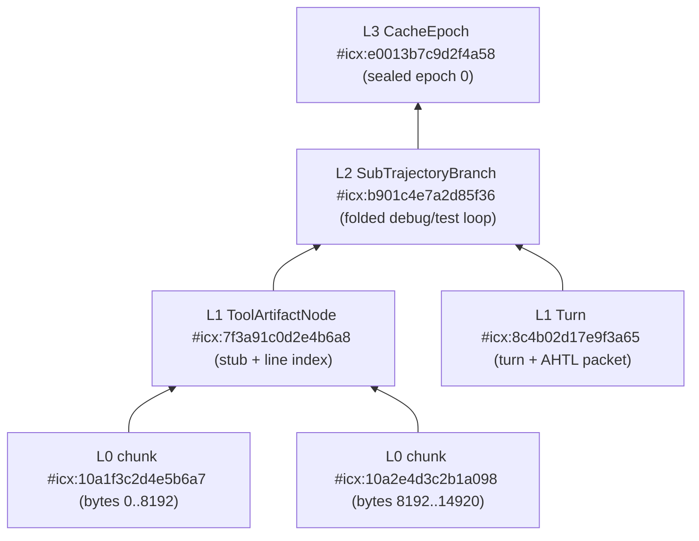

# Virtual Memory & Lossless Merkle-DAG Engine (`LCM`) Specification

**Applies to:** `icx` v1.1.0  
**References:** [ref-docs/papers/INDEX.md](../ref-docs/papers/INDEX.md) §§1.1–1.5 & 2.1, [ref-docs/research-report.md](../ref-docs/research-report.md) §4.3  
**Target Crates:** `crates/icx-core`, `crates/icx-adapters` (persistence)

---

## 1. Purpose

`crates/icx-core` implements the **Virtual Context Memory Management Unit (MMU)** core and the
**Lossless Context Management (`LCM`) BLAKE3 Merkle-DAG**. It provides:

1. **Lossless storage after redaction:** every tool output and turn is redacted for secrets
   (`SecretRedactor::redact`) and then stored byte for byte as `L0` chunks. Redaction removes
   secrets only; all other bytes, line endings, trailing newlines and literal delimiters are
   preserved, so for secret-free input `deref(ingest(x)) == x` (ICX-AUD-021). Payloads are capped
   at 64 MiB (`ICX_MAX_INGEST_BYTES`).
2. A tiered view of context: active verbatim turns and stubs, sealed cache epochs, the telepathy
   ring, and the content-addressed store (CAS) in the workspace's SQLite file.
3. Compaction as a deterministic Merkle-DAG fold rather than a destructive overwrite.
4. Prefix-cache epoch pinning, so sealed history is not rewritten on later turns.

---

## 2. Content-Addressed Storage (CAS) & FastCDC Chunking

### 2.1 Content-Defined Chunking (`FastCDC`)

`icx-core` splits payloads with gear-hash **content-defined chunking** (`crates/icx-core/src/chunker.rs`):

- Minimum chunk size: `2,048` bytes
- Target (average) chunk size: `8,192` bytes
- Maximum chunk size: `65,536` bytes

Boundaries use FastCDC normalized chunking with two masks: a stricter mask before the target size
and a relaxed mask after it. Since v1.1.0 the masks are **spread masks** whose set bits are
distributed over bit positions 63..16, as in Xia et al. (USENIX ATC 2016), instead of low-bit
masks. Low-bit masks only see about the last 14 input bytes of the gear hash. On this
repository's sources the mean chunk size moved from 13.2 KiB to 10.6 KiB (target 8 KiB)
(ICX-AUD-027). Chunks are stored uncompressed.

Each chunk is identified by its 256-bit `BLAKE3` digest and addressed by a 64-bit `ArtifactId`
(first 8 bytes of the digest, rendered `#icx:<16-hex>`).

### 2.2 Lossless Dereference Contract

Given a handle `#icx:<16-hex>` (or a 48-bit `#icx:<12-hex>` prefix):

- `CasStore::deref_bytes(id) -> Result<Vec<u8>, IcxError>` concatenates the artifact's `L0`
  chunks, verifying each chunk digest and the artifact's full 256-bit digest; any mismatch fails
  with `IcxError::IntegrityViolation`.
- `CasStore::deref_lines(id, start_line, end_line) -> Result<String, IcxError>` returns an exact
  1-based inclusive line slice, reading only the chunks the line index points to.
- `CasStore::grep_cold(id, pattern, max_matches)` and `grep_cold_with_context` search one stored
  artifact, or all of them when `id` is `None`, and return matching lines with line numbers.

The bytes returned are the stored bytes, that is, the input after secret redaction. Model-facing
output additionally applies Tier-0 delimiter escaping (`SecretRedactor::sanitize`) and a
provenance header ([docs/wire-protocol-and-shm-bus.md](wire-protocol-and-shm-bus.md) §3.3).

### 2.3 Handle Collisions

`CasStore::put_bytes_checked` compares full 256-bit digests whenever a 64-bit artifact or chunk id
is already present. A different payload with the same id fails with `IcxError::HashCollision`; the
store is not modified and the MMU does not virtualize that payload (the agent keeps its original
output). `MerkleContextDag` likewise refuses to replace a node with a different node under the
same id (ICX-AUD-022, ICX-AUD-023).

---

## 3. Hierarchical Merkle-DAG (`MerkleContextDag`)

### Node Types (`crates/icx-core/src/dag.rs`)

1. **`L0` chunks** live in the CAS (raw bytes plus BLAKE3 digest), not in the DAG enum.
2. **`DagNode::ToolArtifact` (`L1`):** tool name, agent, session, exit status, the CAS handle of the
   stored payload, ordered chunk ids, line-offset index, AHTL stub and surprise score, with a
   domain-separated Merkle digest (`ICX_DAG_TOOL_V1`).
3. **`DagNode::Turn` (`L1`):** ordinal, agent, role, CAS handle, AHTL representation and surprise
   score.
4. **`DagNode::SubTrajectoryBranch` (`L2`):** created when a sub-task is folded (Context-Folding,
   `arXiv:2510.11967`), for example through the MCP `fold` operation. Intermediate `L1` nodes are
   represented by one `⟦Φ:...⟧` commit packet pointing to its children.
5. **`DagNode::CacheEpoch` (`L3`/`L4`):** created when the unsealed window exceeds the rollover
   threshold. Seals a contiguous range of `L1`/`L2` nodes into an AHTL epoch frame with a BLAKE3
   Merkle root. Epoch headers write the epoch index in hexadecimal (`ep=000a` is epoch 10;
   `u32`, 4 to 8 hex digits; ICX-AUD-024).

---

## 4. Prefix-Cache Epoch Controller (`CacheEpochController`)

### 4.1 Zones and Configuration

The controller partitions the logical context into four zones:

| Zone | Mutability | Provider cache status (intended) |
| :--- | :--- | :--- |
| **Zone 0: Pinned system head** | Fixed per session | Stable prefix |
| **Zone 1: Sealed cache epochs (`E_0..E_{k-1}`)** | Append-only | Stable prefix |
| **Zone 2: Active window (`W_active`)** | Append-only until rollover | Prefix-stable between rollovers |
| **Zone 3: Ephemeral tail slot** | Recomputed every turn | Not cached |

| Configuration (`EpochControllerConfig`) | Rollover tokens | Protected recent turns | Tail slot tokens |
| :--- | ---: | ---: | ---: |
| `Default` (used by the MMU) | 4,096 | 4 | 1,024 |
| `anthropic_default()` | 16,384 | 6 | 2,048 |
| `openai_default()` | 8,192 | 6 | 2,048 |

Whether a provider actually serves the stable prefix from cache depends on the provider, the
breakpoints the proxy or client places, and TTLs. `icx` measures only a byte-weighted
prefix-reuse proxy ([docs/performance.md](performance.md) §1).

### 4.2 Epoch Rollover Algorithm

When `tokens(W_active) > epoch_rollover_tokens`:

1. Partition `W_active` into `[head_to_seal, protected_recent_tail]`, keeping the last
   `protect_last_n_turns` turns verbatim.
2. Fold resolved sub-trajectories inside `head_to_seal` into `L2` nodes.
3. Compile the remaining nodes into a sealed `L3` `CacheEpoch` (`E_k`), keeping full AHTL clauses
   for turns with surprise `>= 0.65` (`EPOCH_HIGH_SURPRISE_THRESHOLD`) and compact beacons for the
   rest.
4. Append `E_k` to Zone 1.

---

## 5. Workspace Persistence, Integrity & Backup

1. **Location and trust.** A workspace is a private directory outside the repository, by default
   `<state_dir>/workspaces/<first 16 hex of blake3(canonical project root)>`, where `state_dir` is
   `ICX_STATE_HOME`, else `$XDG_STATE_HOME/icx`, else `~/.local/state/icx`. `--dir` and `ICX_DIR`
   override it. The directory must be owned by the user, mode `0700`, and carry an `OWNER` seal;
   a repository-local `.icx/` is never used implicitly. See
   [docs/security-and-threat-model.md](security-and-threat-model.md) §4.1.
2. **Single SQLite store.** All state is in `icx.sqlite3` (WAL, mode `0600`): CAS chunk and
   artifact rows (append-only) plus `meta` rows for the chunk config, bi-temporal graph, MMU state
   (DAG, epochs), HDC index snapshot (`ICXHDC03`), `generation` and store seal. Schema:
   [docs/data-model.md](data-model.md) §6.
3. **Atomic saves.** Every save is one transaction under the workspace lock (`cas_store.lock`), so
   a crash cannot leave a mixed-generation store. The `generation` counter lets the daemon and
   other long-lived processes skip reloading when nothing changed.
4. **Fail-closed integrity.** On load, every chunk digest is verified and every artifact is
   reassembled to its full digest (`CasStore::from_parts`); the store seal (keyed BLAKE3 MAC over
   path, generation and a digest of all persisted state) must verify for sealed workspaces. Any
   failure stops the operation with an error instead of overwriting the store.
5. **Migration.** v1.0.x JSON workspaces (`cas_store.json`, `mmu_state.json`,
   `bitemporal_graph.json`) are migrated into the SQLite store on first load once the directory is
   trusted; the JSON files are left in place.
6. **Backup.** Back up the whole workspace directory while no `icx` process is writing (stop
   `icx daemon` first). A copied workspace is refused at its new path until `icx trust --dir
   <path>` re-seals it, because the seal binds the canonical path.
7. **`icx doctor`.** Inspects agent installations and the bus path, loads the workspace and runs
   `CasStore::verify_all_integrity` and `MerkleContextDag::verify_all_merkle_integrity_with_cas`.

---

## 6. Edge Cases and Invariants

- **Model switch.** `CacheEpochController::retarget_budget` hierarchically folds existing epochs
  when the token budget shrinks, without removing any `L0` content from the CAS.
- **Deterministic replay.** With the default logical clock, the same sequence of turns and tool
  outputs produces identical DAG digests and epoch frames. The CLI enables wall-clock timestamps
  (`use_wall_clock(true)`), and timestamps are part of node digests, so CLI workspaces are not
  bit-for-bit reproducible across runs.
