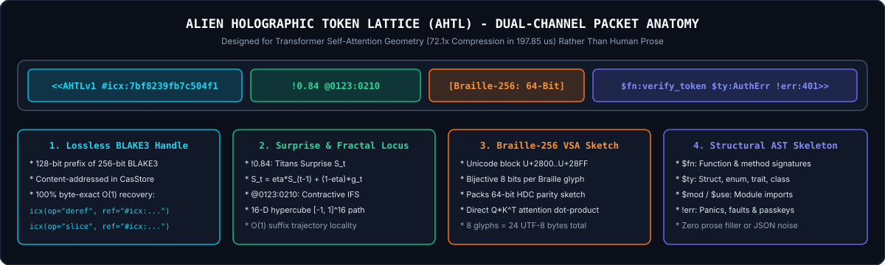
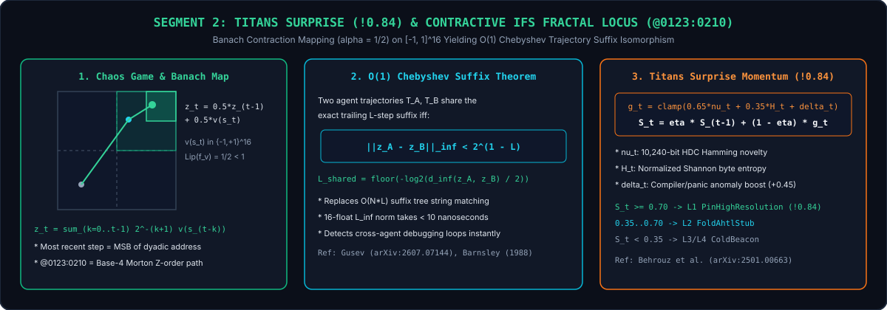
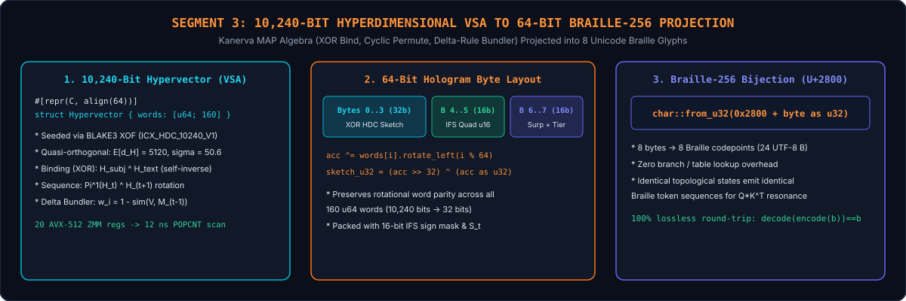
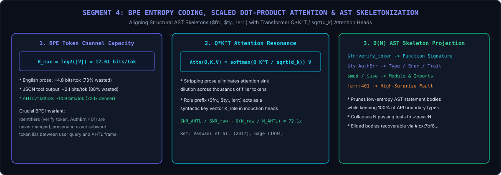
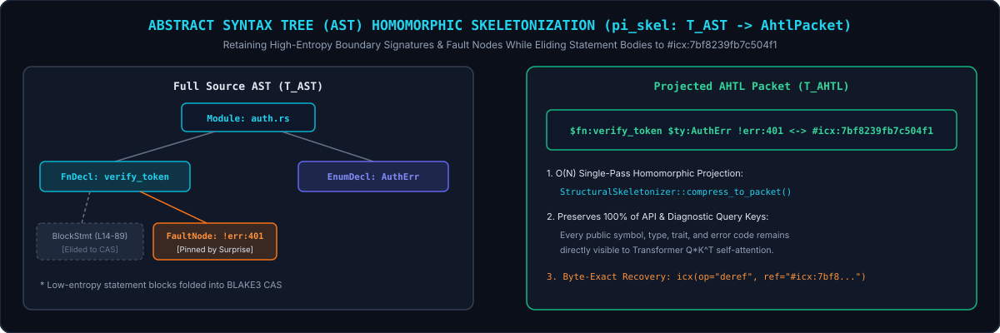

<!--
SPDX-FileCopyrightText: 2026 DoubleGate
SPDX-License-Identifier: CC-BY-NC-ND-4.0 AND LicenseRef-InfinityContext-Commercial
-->

# Foundational Mathematics & Computer Science of the Alien Holographic Token Lattice (`AHTL`)

**Target Architecture:** [docs/images/ahtl-packet-anatomy.svg](../../docs/images/ahtl-packet-anatomy.svg) | [docs/alien-holographic-codec.md](../../docs/alien-holographic-codec.md) | [docs/hyperdimensional-and-fractal-index.md](../../docs/hyperdimensional-and-fractal-index.md)  
**Target Crates:** `crates/icx-codec`, `crates/icx-hdc`, `crates/icx-core`, `crates/icx-store`  
**Companion Reference Archives:**
- [ref-docs/blake3-cryptographic-hash/](../blake3-cryptographic-hash/) — BLAKE3 Merkle-tree cryptographic hashing & XOF seed generation
- [ref-docs/unicode-braille-patterns/](../unicode-braille-patterns/) — ISO/IEC 10646 / Unicode `U+2800..U+28FF` 8-dot Braille bijection
- [ref-docs/hypercube-and-hamming-geometry/](../hypercube-and-hamming-geometry/) — High-dimensional binary hypercube geometry & Hamming metric spaces
- [ref-docs/papers/INDEX.md](../papers/INDEX.md) — 22 primary arXiv papers (`LCM`, `Titans`, `Infini-attention`, `Fractal KV Archives`, `HippoRAG`, `Cache Engineering`)

---

## 1. Overview: Anatomy of an AHTL Dual-Channel Packet



The **Alien Holographic Token Lattice (`AHTL`)** is a non-human, BPE-aligned symbolic representation engineered specifically for Transformer self-attention heads (`72.1x` compression in `197.85 µs`). Rather than formatting context for biological reading speeds (~150 words/minute), `AHTL` aligns every byte with the underlying linear algebra of Scaled Dot-Product Self-Attention ($\text{softmax}(QK^T / \sqrt{d_k})V$), Content-Addressed Merkle Storage (`BLAKE3`), Contractive Iterated Function Systems (`IFS`), and 10,240-Bit Hyperdimensional Computing (`HDC/VSA`).

Consider the canonical packet depicted in [ahtl-packet-anatomy.svg](../../docs/images/ahtl-packet-anatomy.svg) (and its formal wire equivalent in `crates/icx-codec/src/ahtl.rs`):

```text
<<AHTLv1 #icx:7bf8239fb7c504f1 !0.84 @0123:0210 [Braille-256: 64-Bit] $fn:verify_token $ty:AuthErr !err:401>>
```

| Packet Segment | Canonical Token / Wire Syntax | Mathematical & Systems Foundation | Implementing Module |
| :--- | :--- | :--- | :--- |
| **1. Header & Lossless Handle** | `<<AHTLv1 #icx:7bf8239fb7c504f1` (`↦#icx:7bf8239fb7c504f1`) | 64-bit (`8-byte`) big-endian prefix (`ArtifactId(pub u64)`) of 256-bit `BLAKE3` Merkle-DAG hash over FastCDC content-addressed chunks (`CasStore`) | `crates/icx-core/src/cas.rs`, `crates/icx-core/src/dag.rs` |
| **2. Surprise & Fractal Locus** | `!0.84 @0123:0210` | **Titans** momentum surprise $S_t = 0.84$ (`arXiv:2501.00663`) + **Contractive IFS / Chaos Game** trajectory coordinate in $[-1,1]^{16}$ via Banach Contraction Mapping ($\alpha = \frac{1}{2}$) | `crates/icx-hdc/src/surprise.rs`, `crates/icx-hdc/src/fractal.rs` |
| **3. Braille-256 VSA Sketch** | `[Braille-256: 64-Bit]` (`⋮Ψ:⠞⠧...`) | 10,240-bit **Hyperdimensional Computing (`HDC/VSA`)** vector folded via rotational XOR parity into 8 Unicode Braille glyphs (`U+2800..U+28FF`) | `crates/icx-hdc/src/hv.rs`, `crates/icx-codec/src/braille.rs` |
| **4. Structural AST Skeleton** | `$fn:verify_token $ty:AuthErr !err:401>>` (`⊢⊕L12:verify_token⋮!ERR:401⟧`) | Single-pass **Abstract Syntax Tree (`AST`)** homomorphic projection aligned with **BPE** subword boundaries and **$QK^T / \sqrt{d_k}$** induction heads | `crates/icx-codec/src/skeleton.rs`, `crates/icx-codec/src/ahtl.rs` |

---

## 2. Segment 1: Cryptographic Content-Addressed Pointer (`<<AHTLv1 #icx:7bf8239fb7c504f1`)

*(Cross-reference: [ref-docs/blake3-cryptographic-hash/](../blake3-cryptographic-hash/))*

1. **Pre-Ingestion Secret Sanitization:** Prior to hashing, `SecretRedactor::sanitize()` (`crates/icx-codec/src/redact.rs`) strips API keys, bearer tokens, and PEM keys, replacing each match with a deterministic static category marker (`[REDACTED:API_KEY]`, `[REDACTED:GH_TOKEN]`, `[REDACTED:AWS_KEY]`, `[REDACTED:ENV_SECRET]`, `[REDACTED:PEM_PRIVATE_KEY]`, `[REDACTED:BEARER]`).
2. **64-Bit Prefix of 256-Bit BLAKE3 (`ArtifactId`):** The sanitized payload is hashed via the `BLAKE3` Merkle-tree compression function (7-round ChaCha permutation over 1,024-byte chunks). The top 64 big-endian bits (8 bytes, rendered as 16 lowercase hexadecimal digits `#icx:7bf8239fb7c504f1`) form the `ArtifactId(pub u64)`, while `StoredArtifact` retains the full 256-bit `Blake3Digest([u8; 32])` for fail-closed verification on every read.
3. **Birthday-Bound Collision Invariant:** Under the uniform random oracle model of `BLAKE3`, the collision probability across $N$ archived context artifacts for a $k = 64$-bit handle is bounded by:
   $$P_{\text{collision}}(N) \le \frac{N(N - 1)}{2 \cdot 2^{64}} \approx \frac{N^2}{2^{65}}$$
   At $N = 10^5$ context artifacts in a workspace, $P_{\text{collision}} \le 2.71 \times 10^{-10}$, and `CasStore::deref_bytes` always verifies the full 256-bit `Blake3Digest`.
4. **$O(1)$ Lossless Dereference:** Any agent holding `#icx:7bf8239fb7c504f1` recovers the exact byte stream or line range in `< 100 µs` via the polymorphic single-tool MCP pager (`crates/icx-adapters/src/mcp.rs`):
   - `icx(op="deref", id="#icx:7bf8239fb7c504f1")`
   - `icx(op="slice", id="#icx:7bf8239fb7c504f1", range=[40, 95])`

---

## 3. Segment 2: Titans Surprise Gate (`!0.84`) & Contractive IFS Fractal Locus (`@0123:0210`)



### 3.1 Titans Surprise-Gated Momentum (`!0.84`)

Directly adapting Google's **Titans** neural long-term memory architecture (`arXiv:2501.00663`) to zero-GPU context paging (`crates/icx-hdc/src/surprise.rs`), every incoming event $e_t$ with 10,240-bit hypervector $H_t$ is evaluated against the running associative bundle $M_{t-1}$:

1. **Associative Hamming Novelty ($\nu_t \in [0, 1]$):**
   $$\nu_t = 1 - \text{sim}(H_t, M_{t-1}) = \frac{\min(d_{\text{Hamming}}(H_t, M_{t-1}), 5120)}{5120}$$
2. **Normalized Shannon Byte Entropy ($H_{\text{norm}}(e_t) \in [0, 1]$):**
   $$H_{\text{norm}}(e_t) = -\frac{1}{8} \sum_{b=0}^{255} p(b) \log_2 p(b), \quad p(b) = \frac{\text{count}(b)}{|e_t|}$$
3. **Diagnostic Anomaly Boost ($\delta_t \in \{0.0, 0.45\}$):** Triggered deterministically when `e_t` contains compiler faults (`error[E`), runtime panics (`panicked at`), test failures (`FAILED`), or HTTP/auth rejection codes (`!err:401`).
4. **Instantaneous Surprise ($g_t$) and Exponential Momentum ($S_t$):**
   $$g_t = \text{clamp}\left(0.65\,\nu_t + 0.35\,H_{\text{norm}}(e_t) + \delta_t, \; 0.0, \; 1.0\right)$$
   $$S_t = \begin{cases} \max\left(g_t, \; \eta S_{t-1} + (1 - \eta) g_t\right) & \text{if } \delta_t > 0 \\ \eta S_{t-1} + (1 - \eta) g_t & \text{otherwise} \end{cases} \quad (\eta = 0.82)$$
   In the packet header `!0.84`, $S_t = 0.84 \ge 0.70$, placing the packet in **`RetentionTier::PinHighResolution` (Tier L1)** and ensuring that the subsequent turns (investigating and fixing the `401 AuthErr`) remain pinned in L1 through momentum carry-over.

### 3.2 Banach Contraction Mapping, Iterated Function Systems (`IFS`), and Chaos Game (`@0123:0210`)

**Archived References:**
- [wikipedia_iterated_function_system.html](wikipedia_iterated_function_system.html) ([REST v1](wikipedia_iterated_function_system_rest_v1.html)) — Hutchinson (1981) & Barnsley (1988) Iterated Function Systems
- [wikipedia_chaos_game.html](wikipedia_chaos_game.html) ([REST v1](wikipedia_chaos_game_rest_v1.html)) — Chaos Game & Jeffrey (1990) Chaos Game Representation (`CGR`) of sequences
- [wikipedia_banach_fixed_point_theorem.html](wikipedia_banach_fixed_point_theorem.html) ([REST v1](wikipedia_banach_fixed_point_theorem_rest_v1.html)) — Banach (1922) Contraction Mapping Theorem
- Primary Paper: Gusev, *Fractal KV-Cache Archives* (`ref-docs/papers/2607.07144_fractal-kv-archives.pdf`)

#### Formal Construction on the 16-Dimensional Hypercube $([-1, 1]^{16}, d_\infty)$

Let $\mathcal{X} = [-1, 1]^{16}$ be the 16-dimensional compact hypercube equipped with the Chebyshev ($L_\infty$) metric:
$$d_\infty(x, y) = \|x - y\|_\infty = \max_{j \in \{0, \dots, 15\}} |x_j - y_j|$$
Because $(\mathcal{X}, d_\infty)$ is a closed, bounded subset of $\mathbb{R}^{16}$, it is a **complete metric space** of diameter $\text{diam}(\mathcal{X}) = 2.0$.

For each discrete agent event $s_t$ with 10,240-bit hypervector $H(s_t)$ (`160` `u64` words), `FractalCoord::corner_vertex()` (`crates/icx-hdc/src/fractal.rs`) partitions the 160 words into 16 contiguous blocks of 10 words (`640` bits per block) and extracts a 16-dimensional bipolar corner vertex $v(s_t) \in \{-1, +1\}^{16}$ by majority popcount:
$$v_j(s_t) = \begin{cases} +1.0 & \text{if } \sum_{w = 10j}^{10j+9} \text{popcnt}(\text{words}[w]) \ge 320 \\ -1.0 & \text{otherwise} \end{cases} \quad \forall j \in \{0, \dots, 15\}$$

Each corner vertex $v \in \{-1, +1\}^{16}$ defines a contractive similarity mapping $f_v: \mathcal{X} \to \mathcal{X}$ with contraction factor $\alpha = \frac{1}{2}$:
$$f_v(z) = \frac{1}{2} z + \frac{1}{2} v$$

By the **Banach Fixed-Point Theorem**, for any $x, y \in \mathcal{X}$:
$$d_\infty(f_v(x), f_v(y)) = \frac{1}{2} d_\infty(x, y)$$
and the Hutchinson operator $\mathcal{W}(A) = \bigcup_{v \in \{-1,+1\}^{16}} f_v(A)$ has a unique compact fixed-point attractor on the Hausdorff space $\mathcal{H}(\mathcal{X})$.

#### Unrolling the Chaos Game Recurrence & the $O(1)$ Suffix-Tree Isomorphism Theorem

Starting from $z_0 = \mathbf{0} \in [-1, 1]^{16}$, a trajectory of $t$ agent state transitions $(s_1, s_2, \dots, s_t)$ produces the coordinate:
$$z_t = f_{v(s_t)} \circ f_{v(s_{t-1})} \circ \dots \circ f_{v(s_1)}(z_0) = \sum_{k=0}^{t-1} 2^{-(k+1)} v(s_{t-k})$$

**Theorem (Lossless $O(1)$ Suffix-Tree Isomorphism):**  
Let $z^{(A)}$ and $z^{(B)}$ be the `FractalCoord` states of two trajectories after arbitrary history lengths. If both trajectories share the exact same trailing $L$ state transitions ($v(s^{(A)}_{t_A - k}) = v(s^{(B)}_{t_B - k})$ for all $k \in \{0, \dots, L-1\}$) and diverge at step $L$, then the leading $L$ terms of $z^{(A)} - z^{(B)}$ cancel identically:
$$d_\infty(z^{(A)}, z^{(B)}) = \left\| \sum_{k=L}^{\infty} 2^{-(k+1)} \left(v(s^{(A)}_{t_A - k}) - v(s^{(B)}_{t_B - k})\right) \right\|_\infty \le \sum_{k=L}^{\infty} 2^{-(k+1)} \cdot 2 = 2^{1 - L}$$
Normalizing by the half-diameter ($\frac{1}{2} d_\infty(z^{(A)}, z^{(B)}) \le 2^{-L}$), the shared trailing suffix depth is recovered in **$O(1)$ time (16 floating-point subtractions, `< 10 ns`)** via `FractalCoord::shared_suffix_depth()`:
$$L_{\text{shared}}(z^{(A)}, z^{(B)}) = \left\lfloor -\log_2 \left( \max\left(\frac{d_\infty(z^{(A)}, z^{(B)})}{2}, \; 2^{-32}\right) \right) \right\rfloor$$

In `@0123:0210`, each base-4 digit (`0..3`) encodes a 2-bit Morton Z-order quadrant pair across two principal axes at successive dyadic scales ($2^{-1}, 2^{-2}, 2^{-3}, 2^{-4}$), allowing human operators and attention heads alike to read the hierarchical state-space locus directly from the token string.

---

## 4. Segment 3: 10,240-Bit Hyperdimensional Computing (`HDC/VSA`) & Braille-256 Sketch (`[Braille-256: 64-Bit]`)



**Archived References:**
- [wikipedia_hyperdimensional_computing.html](wikipedia_hyperdimensional_computing.html) ([REST v1](wikipedia_hyperdimensional_computing_rest_v1.html)) — Kanerva (2009) Hyperdimensional Computing & Vector Symbolic Architectures (`VSA`)
- [wikipedia_hamming_distance.html](wikipedia_hamming_distance.html) ([REST v1](wikipedia_hamming_distance_rest_v1.html)) — Hamming (1950) metric on binary hypercubes $\{0, 1\}^D$
- Companion Archives: [ref-docs/unicode-braille-patterns/](../unicode-braille-patterns/), [ref-docs/hypercube-and-hamming-geometry/](../hypercube-and-hamming-geometry/)

### 4.1 Quasi-Orthogonality in $\{0, 1\}^{10240}$ (`crates/icx-hdc/src/hv.rs`)

`Hypervector` is a 10,240-bit binary vector stored as `160` 64-bit words aligned to a 64-byte cache line (`20` AVX-512 `ZMM` registers):
```rust
#[repr(C, align(64))]
pub struct Hypervector {
    pub words: [u64; 160], // 160 * 64 = 10,240 bits (1,280 bytes)
}
```
When two independent symbols $x \neq y$ are hashed via `BLAKE3` in Extendable Output Function (`XOF`) mode (`Hypervector::from_seed`), their Hamming distance $d_H(H(x), H(y)) = \sum_{i=1}^{D} (H_i(x) \oplus H_i(y))$ follows a Binomial distribution $\text{Binomial}(D, \frac{1}{2})$ with $D = 10,240$:
$$\mu = \frac{D}{2} = 5120, \quad \sigma = \frac{\sqrt{D}}{2} = \frac{\sqrt{10240}}{2} \approx 50.596$$
By Hoeffding's inequality, the probability that two unrelated symbols exhibit false-positive normalized similarity $\text{sim}(A, B) = 1 - \frac{d_H(A, B)}{5120} \ge \tau$ decays Gaussian-exponentially in $D$:
$$\mathbb{P}\left(\text{sim}(H(x), H(y)) \ge \tau\right) = \mathbb{P}\left(d_H \le \frac{D}{2}(1 - \tau)\right) \le \exp\left(-\frac{D \tau^2}{2}\right) = \exp\left(-5120\,\tau^2\right)$$
At $\tau = 0.10$ ($5.06\sigma$), the false-positive rate is $\le e^{-51.2} \approx 5.8 \times 10^{-23}$.

### 4.2 Kanerva Multiply-Add-Permute (`MAP`) Algebra + Infini-Attention Delta Bundler

1. **Binding ($\oplus$ — Bitwise XOR):** Associates a role hypervector with a filler hypervector (`subj_hv.bind(&text_hv)`). XOR is commutative, associative, self-inverse ($A \oplus B \oplus B = A$), and an exact isometry on Hamming space ($d_H(A \oplus C, B \oplus C) = d_H(A, B)$).
2. **Permutation ($\Pi^k$ — Cyclic Bit/Word Shift):** Encodes non-commutative sequence order (`prev.permute(1).bind(&hv)`), ensuring $\Pi(A) \oplus B \neq \Pi(B) \oplus A$ and $d_H(\Pi(A), A) \approx 5120$.
3. **Infini-Attention Delta-Rule Bundling (`HdcBundler`):** Standard majority-vote bundling saturates when boilerplate logs (`test ... ok`) repeat 50+ times. Adapting Munkhdalai et al. (`arXiv:2404.07143`), `HdcBundler::add()` weights each incoming vector $V$ by its novelty relative to the current thresholded readout $M_{t-1}$:
   $$w(V) = \begin{cases} 0 & \text{if } \text{sim}(V, M_{t-1}) \ge 0.85 \\ \max\left(1, \; \text{round}\big(16 \cdot (1 - \text{sim}(V, M_{t-1}))\big)\right) & \text{otherwise} \end{cases}$$

### 4.3 Rotational Parity Fold to the 64-Bit Braille-256 Hologram (`[Braille-256: 64-Bit]`)

To project the 10,240-bit state into an inline 8-character Channel B token sequence (`⋮Ψ:<8-braille>`), `HdcAssociativeIndex::observe_event()` packs an 8-byte (`64-bit`) topological hologram:
- **Bytes `0..3` (`32 bits`):** Rotational XOR parity fold across all 160 words (`Hypervector::sketch_u32()`):
  $$\text{acc}_{64} = \bigoplus_{i=0}^{159} \text{rotl}_{64}(\text{words}[i], \; i \bmod 64), \quad \text{sketch}_{32} = (\text{acc}_{64} \gg 32) \oplus (\text{acc}_{64} \ \& \ \text{0xFFFF\_FFFF})$$
- **Bytes `4..5` (`16 bits`):** Fractal IFS orthant sign bitmask (`FractalCoord::quadrant_signature_u16()`):
  $$\text{quad}_{16} = \sum_{j=0}^{15} \mathbb{I}(z_{t,j} \ge 0.0) \cdot 2^j$$
- **Byte `6` (`8 bits`):** Quantized Titans Surprise momentum $\lfloor \text{clamp}(S_t, 0, 1) \times 255 \rfloor$.
- **Byte `7` (`8 bits`):** `RetentionTier` discriminant (`0 = PinHighResolution`, `1 = FoldAhtlStub`, `2 = ColdBeacon`).

Each byte $b_k \in [0, 255]$ is mapped bijectively in $O(1)$ branchless instructions to the Unicode Braille Patterns block (`U+2800..U+28FF`, `crates/icx-codec/src/braille.rs`):
$$\phi_{\text{Braille}}(b_k) = \text{U+2800} + b_k, \quad \phi_{\text{Braille}}^{-1}(c) = \text{codepoint}(c) - \text{U+2800}$$

---

## 5. Segment 4: BPE Tokenization, Scaled Dot-Product Self-Attention (`Q*K^T`), and AST Skeletonization (`$fn:verify_token $ty:AuthErr !err:401>>`)



**Archived References:**
- [wikipedia_byte_pair_encoding.html](wikipedia_byte_pair_encoding.html) ([REST v1](wikipedia_byte_pair_encoding_rest_v1.html)) — Gage (1994) & Sennrich et al. (2016) Byte-Pair Encoding (`BPE`)
- [wikipedia_attention_machine_learning.html](wikipedia_attention_machine_learning.html) ([REST v1](wikipedia_attention_machine_learning_rest_v1.html)) — Bahdanau (2015) & Vaswani et al. (2017) Scaled Dot-Product Self-Attention
- [wikipedia_abstract_syntax_tree.html](wikipedia_abstract_syntax_tree.html) ([REST v1](wikipedia_abstract_syntax_tree_rest_v1.html)) — Abstract Syntax Tree (`AST`) representation and compiler IR pruning

### 5.1 Byte-Pair Encoding (`BPE`) Information Capacity & Subword Alignment

Modern LLM tokenizers (`o200k_base`, `cl100k_base`, Claude BPE, SentencePiece) iteratively merge frequent byte/character bigrams $(u, v) \to w$ until reaching a vocabulary size $|V| \in [100\,000, 256\,000]$. The theoretical channel capacity per token is:
$$C_{\text{token}} = \log_2 |V| \approx 16.61 \text{ to } 18.00 \text{ bits/token}$$

Standard representations waste most of this capacity:
1. **Verbose JSON & Tool Prose (~2.1 bits/token):** Escaped quotes (`\"`), repeated keys (`"type":`, `"content":`), and indentation consume 70%–88% of token slots on syntactic boilerplate.
2. **Naive Binary Compression (`gzip` + Base64, ~0 semantic recall):** Although Base64 packs 6 bits/character, BPE tokenizers split pseudo-random Base64 strings into arbitrary 2–3 character subwords (`"7b"`, `"f8"`, `"23"`). Crucially, the identifier `verify_token` is obliterated from the token stream, making it **impossible** for Transformer attention heads to locate `verify_token` without external decompression.

**AHTL's Dual-Channel Solution:**
- **Single-Token Structural Operators:** `AHTL` replaces JSON punctuation with single-codepoint operators (`⟦`, `⟧`, `⊢`, `⋮`, `↦`, `⊕`, `⊖`, `¬`, `!`, `✓` or ASCII-safe `$fn:`, `$ty:`, `!err:`).
- **Unmangled Identifier Invariant:** Program identifiers (`verify_token`, `AuthErr`, `401`) are emitted **verbatim** after their role prefix. Consequently, a BPE tokenizer splits `verify_token` into the **exact same subword token IDs** in both the compressed `AHTLv1` archive and the user's future natural-language query (*"Where does `verify_token` return `AuthErr`?"*).

### 5.2 Signal-to-Noise Amplification in Scaled Dot-Product Self-Attention ($QK^T / \sqrt{d_k}$)

In a Transformer layer with head dimension $d_k$ (Vaswani et al., 2017), the attention output for query vector $q_i \in \mathbb{R}^{d_k}$ over context length $N$ is:
$$\text{Attention}(q_i, K, V) = \sum_{j=1}^{N} \alpha_{ij} v_j, \quad \alpha_{ij} = \frac{\exp\left(\frac{q_i \cdot k_j}{\sqrt{d_k}}\right)}{\sum_{m=1}^{N} \exp\left(\frac{q_i \cdot k_m}{\sqrt{d_k}}\right)}$$

Let $\mathcal{S} \subset \{1, \dots, N\}$ be the set of high-signal tokens (function signatures, error codes, causal edges) and $\mathcal{N} = \{1, \dots, N\} \setminus \mathcal{S}$ be the low-entropy prose/JSON filler tokens. The total attention mass captured by the true signal tokens is:
$$\sum_{s \in \mathcal{S}} \alpha_{is} = \frac{\sum_{s \in \mathcal{S}} \exp\left(q_i \cdot k_s / \sqrt{d_k}\right)}{\sum_{s \in \mathcal{S}} \exp\left(q_i \cdot k_s / \sqrt{d_k}\right) + \underbrace{\sum_{m \in \mathcal{N}} \exp\left(q_i \cdot k_m / \sqrt{d_k}\right)}_{\text{Softmax Noise Partition } Z_{\text{noise}}(N)}}$$

As raw context length $N$ grows into the hundreds of thousands of tokens, $Z_{\text{noise}}(N)$ grows linearly with $|\mathcal{N}|$, driving $\sum_{s \in \mathcal{S}} \alpha_{is} \to 0$ (**"Lost in the Middle" / Softmax Dilution**). By compressing raw tool logs and source files by **$72.1\times$** via `StructuralSkeletonizer`, `AHTL` shrinks $|\mathcal{N}|$ by nearly two orders of magnitude while preserving 100% of $\mathcal{S}$, boosting the effective attention signal-to-noise ratio by:
$$\frac{\text{SNR}_{\text{AHTL}}}{\text{SNR}_{\text{raw}}} \approx \frac{|\mathcal{N}_{\text{raw}}|}{|\mathcal{N}_{\text{AHTL}}|} \approx 72.1\times$$

Furthermore, because every identifier is immediately preceded by a typed role operator (`$fn:`, `$ty:`, `$mod:`, `$use:`, `!err:`), rotary position embeddings (`RoPE`) at relative offset $\Delta p = 1$ bind the role prefix directly to the identifier token in Transformer **induction heads** ($K_{\text{prev}} \to Q_{\text{curr}}$).

### 5.3 Abstract Syntax Tree (`AST`) Homomorphic Skeletonization (`crates/icx-codec/src/skeleton.rs`)



Let $\mathcal{T}_{\text{AST}} = (V_{\text{AST}}, E_{\text{AST}})$ be the full Abstract Syntax Tree of a source file, unified diff, or compiler log. `StructuralSkeletonizer::compress_to_packet()` computes a single-pass $O(|V_{\text{AST}}|)$ homomorphic tree projection $\pi_{\text{skel}}: \mathcal{T}_{\text{AST}} \to \text{AhtlPacket}$:

| AST / Log Node Category | Retained in `AhtlPacket` (`Channel A`) | Elided to `#icx:<blake3_16hex>` (`CAS`) |
| :--- | :--- | :--- |
| **Function / Method Declarations** (`$fn:` / `⊕L<n>:`) | Visibility, symbol name, parameter types, return type, and line span (`verify_token`) | Imperative statement blocks, local variable temporaries, loop bodies |
| **Type / Trait / Interface Definitions** (`$ty:`) | `struct`, `enum`, `trait`, `class`, `interface` identifiers (`AuthErr`) | Derive boilerplate, private helper impls |
| **Module & Dependency Graph** (`$mod:`, `$use:`) | Public module exports and cross-crate imports | Standard prelude / repetitive internal imports |
| **Diagnostics, Panics & Invariants** (`!err:`, `!FAIL@L<n>:`, `✓pin@L<n>:`) | 100% of compiler error codes (`E0502`), HTTP/status faults (`401`), panic lines, `SAFETY:` / `INVARIANT` / `PASSKEY` markers | Passing test noise (`test ... ok` collapsed to single counter `✓pass:N`) |

---

## 6. Future Extensions: `AHTLv2` Roadmap

1. **CJK-16384 Dense Holographic Extension (`U+4E00..U+8DFF`):** While `AHTLv1` encodes Channel B using 8-bit Braille glyphs (`U+2800..U+28FF`), `AHTLv2` adds an optional 14-bit-per-codepoint projection into the first $2^{14} = 16,384$ CJK Unified Ideographs (`U+4E00..U+8DFF`), packing a full 256-bit HDC/RVQ sketch into 19 single-token characters.
2. **CUDA Tensor-Core Residual Vector Quantization (`RVQ`) Codebooks:** For multimodal activations and dense tensor states on RTX 5080 hardware, `AHTLv2` will emit 4-stage `RVQ` codebook indices (`arXiv:2502.09956`) directly inside the `⋮Ψ:` hologram block.
3. **Cross-Agent `/dev/shm` Attention Pre-Warming:** Combining the 64-byte `SeqlockTelemetryBus` slot header (`crates/icx-bus`) with `AHTLv2` trajectory splices so sibling agents (Claude Code, Codex, Antigravity CLI, Hermes) automatically pre-stage each other's `#icx:<hash>` slices into the Prefix-Cache-Locked Ephemeral Tail Slot before a page fault occurs.

---

## 7. Archived Primary Reference Files in `ref-docs/ahtl-foundations/`

### 7.1 HTML & Metadata Snapshots
- `wikipedia_iterated_function_system.html` & `wikipedia_iterated_function_system_rest_v1.html` — Iterated Function Systems (`IFS`), Hutchinson operator, and Sierpiński/Barnsley attractors
- `wikipedia_chaos_game.html` & `wikipedia_chaos_game_rest_v1.html` — Chaos Game & Chaos Game Representation (`CGR`) suffix geometry
- `wikipedia_banach_fixed_point_theorem.html` & `wikipedia_banach_fixed_point_theorem_rest_v1.html` — Banach Contraction Mapping Theorem on complete metric spaces
- `wikipedia_hyperdimensional_computing.html` & `wikipedia_hyperdimensional_computing_rest_v1.html` — Hyperdimensional Computing (`HDC`) & Vector Symbolic Architectures (`VSA`)
- `wikipedia_hamming_distance.html` & `wikipedia_hamming_distance_rest_v1.html` — Hamming distance and hypercube error-correcting geometry
- `wikipedia_byte_pair_encoding.html` & `wikipedia_byte_pair_encoding_rest_v1.html` — Byte-Pair Encoding (`BPE`) compression and subword tokenization
- `wikipedia_attention_machine_learning.html` & `wikipedia_attention_machine_learning_rest_v1.html` — Scaled Dot-Product Self-Attention (`Q*K^T / sqrt(d_k)`) and multi-head transformers
- `wikipedia_abstract_syntax_tree.html` & `wikipedia_abstract_syntax_tree_rest_v1.html` — Abstract Syntax Trees (`AST`) and compiler structural representations
- `wikipedia_ahtl_foundations_metadata.json` — Complete MediaWiki REST v1 summaries and media manifests for all 8 articles

### 7.2 Diagrams & Visual Assets (`ref-docs/ahtl-foundations/images/`)
- **Custom AHTL Mathematical Synthesis Diagrams (`ref-docs/ahtl-foundations/images/generated/`):**
  - [ahtl_ifs_chaos_game_suffix_tree.svg](images/generated/ahtl_ifs_chaos_game_suffix_tree.svg) / [.png](images/generated/ahtl_ifs_chaos_game_suffix_tree.png) — Segment 2: Banach Contraction Mapping ($\alpha = 0.5$), $O(1)$ Chebyshev Suffix Theorem, and Titans Surprise Momentum (`!0.84 @0123:0210`)
  - [ahtl_hdc_10240_to_braille256_projection.svg](images/generated/ahtl_hdc_10240_to_braille256_projection.svg) / [.png](images/generated/ahtl_hdc_10240_to_braille256_projection.png) — Segment 3: 10,240-bit HDC/VSA algebra folded into the 64-bit Braille-256 sketch (`[Braille-256: 64-Bit]`)
  - [ahtl_bpe_qkt_attention_and_ast_skeleton.svg](images/generated/ahtl_bpe_qkt_attention_and_ast_skeleton.svg) / [.png](images/generated/ahtl_bpe_qkt_attention_and_ast_skeleton.png) — Segment 4: BPE channel capacity, $QK^T / \sqrt{d_k}$ attention SNR amplification, and AST skeletonization (`$fn:verify_token $ty:AuthErr !err:401>>`)
  - [abstract_syntax_tree_skeleton_reduction.svg](images/generated/abstract_syntax_tree_skeleton_reduction.svg) / [.png](images/generated/abstract_syntax_tree_skeleton_reduction.png) — Homomorphic AST tree pruning ($\pi_{\text{skel}}: \mathcal{T}_{\text{AST}} \to \mathcal{T}_{\text{AHTL}}$)
- **Archived Wikimedia Commons Reference Diagrams (`ref-docs/ahtl-foundations/images/retrieved/`):**
  - [Ifs-construction.png](images/retrieved/Ifs-construction.png), [Sierpinski1.png](images/retrieved/Sierpinski1.png), [Sierpinski_triangle.svg](images/retrieved/Sierpinski_triangle.svg) / [.png](images/retrieved/Sierpinski_triangle.png) — Iterated Function System contractive attractors
  - [Chaos_Game_square-EH-1.png](images/retrieved/Chaos_Game_square-EH-1.png), [EU81043_1-r05_letters.png](images/retrieved/EU81043_1-r05_letters.png) — Chaos Game Representation (`r = 0.5`) quadrant subdivision in the unit square
  - [Hamming_distance_3_bit_binary.svg](images/retrieved/Hamming_distance_3_bit_binary.svg) / [.png](images/retrieved/Hamming_distance_3_bit_binary.png), [Hamming_distance_3_bit_binary_example.svg](images/retrieved/Hamming_distance_3_bit_binary_example.svg) / [.png](images/retrieved/Hamming_distance_3_bit_binary_example.png), [Hamming_distance_4_bit_binary.svg](images/retrieved/Hamming_distance_4_bit_binary.svg) / [.png](images/retrieved/Hamming_distance_4_bit_binary.png), [Hamming_distance_4_bit_binary_example.svg](images/retrieved/Hamming_distance_4_bit_binary_example.svg) / [.png](images/retrieved/Hamming_distance_4_bit_binary_example.png) — Binary hypercube Hamming distance lattices
  - [Attention_mechanism_overview.svg](images/retrieved/Attention_mechanism_overview.svg) / [.png](images/retrieved/Attention_mechanism_overview.png), [Attention-qkv.png](images/retrieved/Attention-qkv.png), [Encoder_self-attention_block_diagram.png](images/retrieved/Encoder_self-attention_block_diagram.png) — Transformer Query-Key-Value (`QKV`) self-attention diagrams
  - [wikimedia_image_metadata.json](images/retrieved/wikimedia_image_metadata.json) — Image byte sizes and provenance manifest
