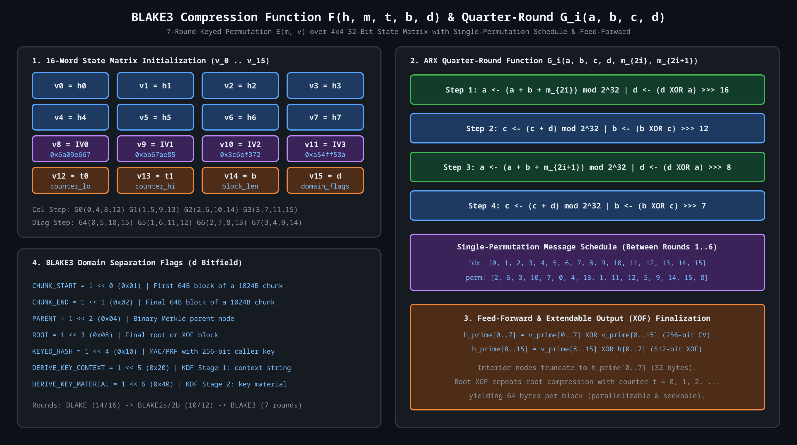
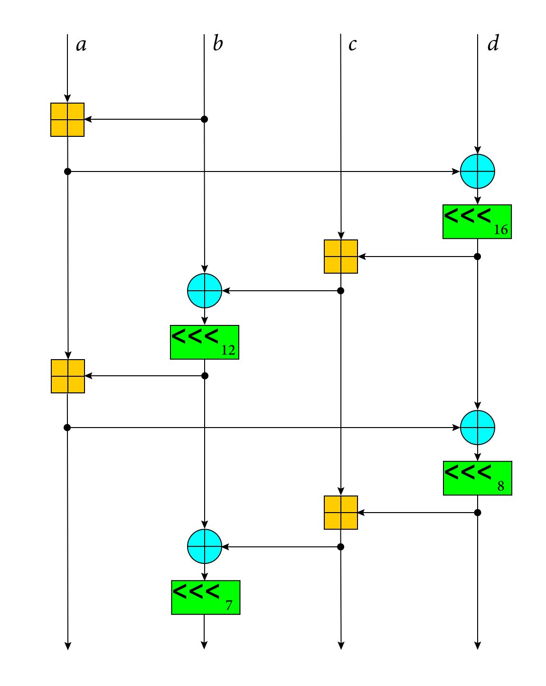
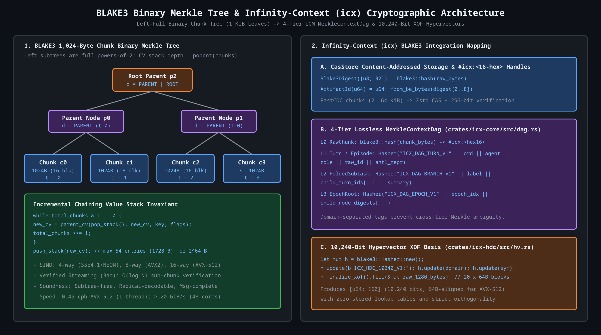
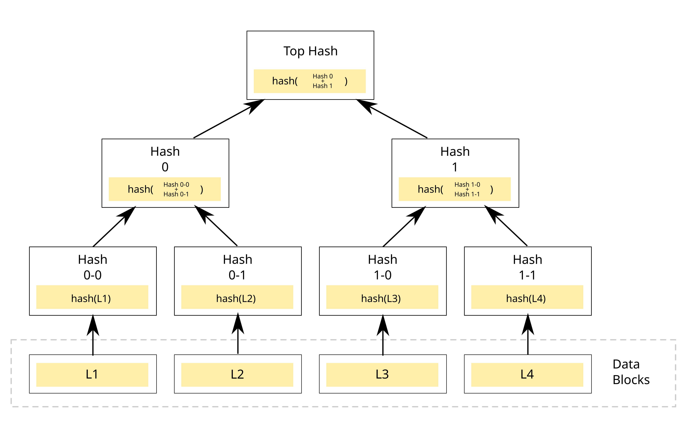

<!--
SPDX-FileCopyrightText: 2026 DoubleGate
SPDX-License-Identifier: CC-BY-NC-ND-4.0 AND LicenseRef-InfinityContext-Commercial
-->

# BLAKE, BLAKE2, and BLAKE3 Cryptographic Hash Family — Archival Synthesis & Infinity-Context (`icx`) Reference Specification

**Primary Archival Sources:**
- **Wikipedia Article:** [`https://en.wikipedia.org/wiki/BLAKE_(hash_function)`](https://en.wikipedia.org/wiki/BLAKE_(hash_function)) (Archived HTML: [wikipedia_blake_hash_function.html](wikipedia_blake_hash_function.html), REST v1 HTML: [wikipedia_blake_rest_v1.html](wikipedia_blake_rest_v1.html), MediaWiki Parse JSON: [wikipedia_blake_metadata.json](wikipedia_blake_metadata.json))
- **Official BLAKE3 Specification:** Jack O'Connor, Jean-Philippe Aumasson, Samuel Neves, and Zooko Wilcox-O'Hearn, *"BLAKE3: one function, fast everywhere"* (Archived PDF: [BLAKE3_Official_Specification.pdf](BLAKE3_Official_Specification.pdf))
- **Target `icx` Crates:** [`crates/icx-core`](../../crates/icx-core/src/lib.rs) (`CasStore`, `MerkleContextDag`, `ArtifactId`, `Blake3Digest`) and [`crates/icx-hdc`](../../crates/icx-hdc/src/hv.rs) (`Hypervector::from_seed` via `blake3::Hasher::finalize_xof()`)

---

## 1. Executive Summary & Genealogical Evolution

The **BLAKE** family of cryptographic hash functions is built on Addition-Rotation-XOR (**ARX**) constructions derived from Daniel J. Bernstein's **ChaCha** stream cipher, combined with **HAIFA** (HAsh Iterative FrAmework) domain separation and—in **BLAKE3**—a binary **Merkle tree** topology with native **Extendable-Output Function (`XOF`)** streaming.

| Generation | Designers | Year | Construction / Topology | Word Size | Block / Chunk Size | Rounds | Digest Size | Peak x86-64 Speed |
| :--- | :--- | :--- | :--- | :--- | :--- | :--- | :--- | :--- |
| **LAKE** (Predecessor) | J.-P. Aumasson, W. Meier, R. C.-W. Phan | 2008 | HAIFA serial compression | 32 / 64-bit | 64 B / 128 B | 8 / 10 | 256 / 512 bits | Pre-SHA-3 baseline |
| **BLAKE-224 / BLAKE-256** | J.-P. Aumasson, L. Henzen, W. Meier, R. C.-W. Phan | 2008–2012 | HAIFA + ChaCha ARX + $\pi$ constants | 32-bit (`u32`) | 64 bytes | 14 (tweaked from 10) | 224 / 256 bits | ~8.4 cpb (Core 2) |
| **BLAKE-384 / BLAKE-512** | J.-P. Aumasson, L. Henzen, W. Meier, R. C.-W. Phan | 2008–2012 | HAIFA + ChaCha ARX + $\pi$ constants | 64-bit (`u64`) | 128 bytes | 16 (tweaked from 14) | 384 / 512 bits | ~7.8 cpb (Core 2) |
| **BLAKE2s / BLAKE2sp** | J.-P. Aumasson, S. Neves, Z. Wilcox-O'Hearn, C. Winnerlein | 2012 (RFC 7693) | Simplified HAIFA / 8-way interleaved tree (`2sp`) | 32-bit (`u32`) | 64 bytes | 10 | 1..32 bytes (`256`-bit) | ~4.5 cpb (`2s`) / ~1.1 cpb (`2sp`) |
| **BLAKE2b / BLAKE2bp** | J.-P. Aumasson, S. Neves, Z. Wilcox-O'Hearn, C. Winnerlein | 2012 (RFC 7693) | Simplified HAIFA / 4-way interleaved tree (`2bp`) | 64-bit (`u64`) | 128 bytes | 12 | 1..64 bytes (`512`-bit) | ~3.5 cpb (Ivy Bridge) |
| **BLAKE2X** | J.-P. Aumasson, S. Neves, Z. Wilcox-O'Hearn, C. Winnerlein | 2016 | Counter-mode XOF wrapper over BLAKE2s/2b | 32 / 64-bit | 64 B / 128 B | 10 / 12 | Up to 256 GiB | Same as BLAKE2s/2b |
| **BLAKE3** | J. O'Connor, J.-P. Aumasson, S. Neves, Z. Wilcox-O'Hearn | 2020 | **Left-Full Binary Merkle Tree** + 7-round BLAKE2s + Seekable XOF | 32-bit (`u32`) | **64 B block / 1,024 B chunk** | **7** | **256 bits default, extensible to $2^{64}-1$ bytes** | **0.49 cpb (Cascade Lake AVX-512)** |



*Vector source:* [blake3_quarter_round_and_compression.svg](images/generated/blake3_quarter_round_and_compression.svg) | *High-Res PNG:* [blake3_quarter_round_and_compression.png](images/generated/blake3_quarter_round_and_compression.png)

---

## 2. Detailed Synthesis of the BLAKE Cryptographic Family

### 2.1 Original BLAKE (NIST SHA-3 Finalist, 2008–2012)

Submitted to the 2008 NIST SHA-3 competition among 51 candidates, **BLAKE** advanced to the final five alongside Keccak (the eventual SHA-3 winner), Grøstl, JH, and Skein.

1. **State Matrix and Constants:**
   - Operates on a $4 \times 4$ matrix of sixteen words ($v_0 \dots v_{15}$), preserving an 8-word chaining state ($h_0 \dots h_7$) between blocks.
   - Uses 16 constant words $n_0 \dots n_{15}$ extracted from the leading 512 bits (for 32-bit `BLAKE-256`) or 1,024 bits (for 64-bit `BLAKE-512`) of the fractional part of $\pi$ (*nothing-up-my-sleeve* numbers).
   - Uses a table of 10 distinct 16-element message permutations $\sigma[0 \dots 9]$:
     ```text
     σ[0] =  0  1  2  3  4  5  6  7  8  9 10 11 12 13 14 15
     σ[1] = 14 10  4  8  9 15 13  6  1 12  0  2 11  7  5  3
     σ[2] = 11  8 12  0  5  2 15 13 10 14  3  6  7  1  9  4
     σ[3] =  7  9  3  1 13 12 11 14  2  6  5 10  4  0 15  8
     σ[4] =  9  0  5  7  2  4 10 15 14  1 11 12  6  8  3 13
     σ[5] =  2 12  6 10  0 11  8  3  4 13  7  5 15 14  1  9
     σ[6] = 12  5  1 15 14 13  4 10  0  7  6  3  9  2  8 11
     σ[7] = 13 11  7 14 12  1  3  9  5  0 15  4  8  6  2 10
     σ[8] =  6 15 14  9 11  3  0  8 12  2 13  7  1  4 10  5
     σ[9] = 10  2  8  4  7  6  1  5 15 11  9 14  3 12 13  0
     ```

2. **BLAKE Quarter-Round Operation ($G_i$):**
   For round $r \in [0, R-1]$ ($R=14$ for 32-bit, $R=16$ for 64-bit after the final-round NIST tweak from $10/14$) and quarter-round index $i \in [0, 7]$, let $j = \sigma[r \bmod 10][2i]$ and $k = \sigma[r \bmod 10][2i+1]$:
   $$\begin{aligned}
   a &\leftarrow a + b + (m_j \oplus n_k) \\
   d &\leftarrow (d \oplus a) \ggg R_1 \\
   c &\leftarrow c + d \\
   b &\leftarrow (b \oplus c) \ggg R_2 \\
   a &\leftarrow a + b + (m_k \oplus n_j) \\
   d &\leftarrow (d \oplus a) \ggg R_3 \\
   c &\leftarrow c + d \\
   b &\leftarrow (b \oplus c) \ggg R_4
   \end{aligned}$$
   - **Rotation Constants $(R_1, R_2, R_3, R_4)$:**
     - **BLAKE-256 / BLAKE-224 (32-bit):** $(16, 12, 8, 7)$ — identical magnitudes to ChaCha's quarter-round, but rotated **right** (`>>>`) rather than left (`<<<`). As Jean-Philippe Aumasson noted in *Crypto Dictionary* (2021), this reversal originated from a specification typo in the initial BLAKE design that had no adverse cryptographic impact and was retained throughout BLAKE2 and BLAKE3.
     - **BLAKE-512 / BLAKE-384 (64-bit):** $(32, 25, 16, 11)$.



*Archival Wikimedia Diagram:* [ChaCha_Cipher_Quarter_Round_Function.svg](images/retrieved/ChaCha_Cipher_Quarter_Round_Function.svg) | [ChaCha_Cipher_Quarter_Round_Function.png](images/retrieved/ChaCha_Cipher_Quarter_Round_Function.png)

3. **Canonical BLAKE Empty-String Test Vectors:**
   - `BLAKE-224("")`: `7dc5313b1c04512a174bd6503b89607aecbee0903d40a8a569c94eed`
   - `BLAKE-256("")`: `716f6e863f744b9ac22c97ec7b76ea5f5908bc5b2f67c61510bfc4751384ea7a`
   - `BLAKE-384("")`: `c6cbd89c926ab525c242e6621f2f5fa73aa4afe3d9e24aed727faaadd6af38b620bdb623dd2b4788b1c8086984af8706`
   - `BLAKE-512("")`: `a8cfbbd73726062df0c6864dda65defe58ef0cc52a5625090fa17601e1eecd1b628e94f396ae402a00acc9eab77b4d4c2e852aaaa25a636d80af3fc7913ef5b8`

---

### 2.2 BLAKE2 (`BLAKE2b`, `BLAKE2s`, `BLAKE2bp`, `BLAKE2sp`, `BLAKE2X` — RFC 7693)

Announced on December 21, 2012, and standardized in **IETF RFC 7693** (November 2015), **BLAKE2** streamlined BLAKE for high-speed software execution to replace MD5 and SHA-1:

1. **Architectural Modifications from BLAKE to BLAKE2:**
   - **Constant-Addition Elimination:** Removed the XOR of round constants $n_k, n_j$ with message words $m_j, m_k$ inside the quarter-round `Mix` function, reducing instruction count and register pressure.
   - **Rotation Tuning (64-bit `BLAKE2b`):** Changed 64-bit rotation constants from $(32, 25, 16, 11)$ to **$(32, 24, 16, 63)$**. Notably, rotations by $32$, $24$, and $16$ bits map to byte-aligned vector shuffles (`PSHUFB`) on SSSE3/AVX2, and rotation right by $63$ is a 1-bit left rotation (`ROL 1` / `VPADDQ + VPSRLQ`).
   - **Round Reduction:** Reduced rounds from $16 \to 12$ for `BLAKE2b` (64-bit, 128-byte blocks) and from $14 \to 10$ for `BLAKE2s` (32-bit, 64-byte blocks).
   - **Little-Endian Word Encoding:** Switched from big-endian (BLAKE/SHA-2) to native little-endian word parsing (`u32`/`u64`), eliminating byte-swap instructions on x86-64 and ARM.
   - **Parameter Block & Initialization Vector (`IV`):** Uses the same fractional square-root of the first 8 primes ($\lfloor 2^{64} \cdot \text{frac}(\sqrt{p_i}) \rfloor$ for `BLAKE2b`, $\lfloor 2^{32} \cdot \text{frac}(\sqrt{p_i}) \rfloor$ for `BLAKE2s`) as SHA-512/SHA-256, XORed with a structured parameter block ($h_0 \leftarrow \text{IV}_0 \oplus \text{0x0101kknn}$ for key length `kk` and digest byte length `nn`, plus optional salt, personalization, and tree fanout/depth metadata).
   - **Simplified Final-Block Flagging:** Replaces bit-length padding blocks with zero-padding up to the 64/128-byte block boundary, tracks cumulative compressed byte count $t \in [0, 2^{128})$ in $V_{12}:V_{13}$, and inverts all bits of $V_{14}$ ($V_{14} \leftarrow V_{14} \oplus \text{0xFFFF...FFFF}$) on the final block (`f0`), or $V_{15}$ on tree root finalization (`f1`).

2. **64-Bit Initialization Vector (`BLAKE2b` / SHA-512) & 32-Bit Initialization Vector (`BLAKE2s` / `BLAKE3` / SHA-256):**

   | Index | Prime $p_i$ | `BLAKE2b` 64-Bit $\text{IV}_i$ | `BLAKE2s` & **`BLAKE3`** 32-Bit $\text{IV}_i$ |
   | :--- | :--- | :--- | :--- |
   | $\text{IV}_0$ | $\sqrt{2}$ | `0x6a09e667f3bcc908` | `0x6a09e667` |
   | $\text{IV}_1$ | $\sqrt{3}$ | `0xbb67ae8584caa73b` | `0xbb67ae85` |
   | $\text{IV}_2$ | $\sqrt{5}$ | `0x3c6ef372fe94f82b` | `0x3c6ef372` |
   | $\text{IV}_3$ | $\sqrt{7}$ | `0xa54ff53a5f1d36f1` | `0xa54ff53a` |
   | $\text{IV}_4$ | $\sqrt{11}$ | `0x510e527fade682d1` | `0x510e527f` |
   | $\text{IV}_5$ | $\sqrt{13}$ | `0x9b05688c2b3e6c1f` | `0x9b05688c` |
   | $\text{IV}_6$ | $\sqrt{17}$ | `0x1f83d9abfb41bd6b` | `0x1f83d9ab` |
   | $\text{IV}_7$ | $\sqrt{19}$ | `0x5be0cd19137e2179` | `0x5be0cd19` |

3. **Canonical BLAKE2 Empty-String Test Vectors:**
   - `BLAKE2s-224("")`: `1fa1291e65248b37b3433475b2a0dd63d54a11ecc4e3e034e7bc1ef4`
   - `BLAKE2s-256("")`: `69217a3079908094e11121d042354a7c1f55b6482ca1a51e1b250dfd1ed0eef9`
   - `BLAKE2b-384("")`: `b32811423377f52d7862286ee1a72ee540524380fda1724a6f25d7978c6fd3244a6caf0498812673c5e05ef583825100`
   - `BLAKE2b-512("")`: `786a02f742015903c6c6fd852552d272912f4740e15847618a86e217f71f5419d25e1031afee585313896444934eb04b903a685b1448b755d56f701afe9be2ce`

---

## 3. Complete Technical Specification of BLAKE3

Announced on January 9, 2020 at Real World Crypto by Jack O'Connor, Jean-Philippe Aumasson, Samuel Neves, and Zooko Wilcox-O'Hearn, **BLAKE3** unifies the fragmented BLAKE2 variant matrix (`2b`, `2s`, `2bp`, `2sp`, `2X`) into a **single canonical algorithm** with zero configuration variants.



*Vector source:* [blake3_merkle_tree_and_icx_dag.svg](images/generated/blake3_merkle_tree_and_icx_dag.svg) | *High-Res PNG:* [blake3_merkle_tree_and_icx_dag.png](images/generated/blake3_merkle_tree_and_icx_dag.png)

### 3.1 1,024-Byte (`1 KiB`) Chunking & Binary Merkle Tree Topology

BLAKE3 partitions an input byte stream of length $0 \le \ell < 2^{64}$ into contiguous **chunks of $1,024$ bytes (`1 KiB`)**, where each chunk consists of up to **16 blocks of $64$ bytes**:
- The final chunk may be shorter than $1,024$ bytes, and is never empty unless the entire message is empty ($\ell = 0$, which forms a single 0-byte chunk with one zero-padded 64-byte block where $b = 0$).
- If the input fits in a single chunk ($\ell \le 1,024$ bytes), that chunk is the **root node** and only node of the tree.
- For inputs of $n > 1,024$ bytes, chunks are arranged as the leaves of a **binary Merkle tree** (fanout $F = 2$) governed by two structural invariants ([BLAKE3_Official_Specification.pdf](BLAKE3_Official_Specification.pdf) §2.1):
  1. **Left subtrees are full:** Every left subtree is a complete binary tree with all chunks at the same depth and a chunk count equal to a power of $2$.
  2. **Left subtrees are big:** Every left subtree contains a number of chunks greater than or equal to the number of chunks in its sibling right subtree.

Mathematically, for any message of $n > 1,024$ bytes, the left subtree of the root spans the exact byte count:
$$L(n) = 2^{10 + \lfloor \log_2(\lfloor \frac{n - 1}{1024} \rfloor) \rfloor} \text{ bytes}$$
and the right subtree recursively hashes the remaining $n - L(n)$ bytes.



*Archival Wikimedia Diagram:* [Hash_Tree.svg](images/retrieved/Hash_Tree.svg) | [Hash_Tree.png](images/retrieved/Hash_Tree.png)

#### Incremental Chaining Value (`CV`) Stack Algorithm
During streaming (`Hasher::update`), BLAKE3 maintains:
1. A 104-byte `ChunkState` for the currently accumulating $1,024$-byte chunk.
2. A stack of 32-byte subtree Chaining Values (`cv_stack: [[u32; 8]; 54]`, requiring at most $54 \times 32 = 1,728$ bytes for inputs up to $2^{64}-1$ bytes, since $\log_2(2^{64} / 2^{10}) = 54$).

Because every completed left subtree in `cv_stack` spans a distinct power-of-2 number of chunks, **the entries on `cv_stack` correspond 1-to-1 with the `1`-bits in the binary representation of `total_chunks`**. When the $k$-th chunk completes (and at least 1 byte of chunk $k+1$ has arrived, confirming chunk $k$ is not the tree root), the number of completed subtrees equals the number of trailing `0`-bits in the updated `total_chunks`:

```rust
fn add_chunk_chaining_value(&mut self, mut new_cv: [u32; 8], mut total_chunks: u64) {
    while total_chunks & 1 == 0 {
        new_cv = parent_cv(self.pop_stack(), new_cv, self.key, self.flags);
        total_chunks >>= 1;
    }
    self.push_stack(new_cv);
}
```

### 3.2 The 7-Round BLAKE3 Compression Function $F(h, m, t, b, d)$

The BLAKE3 compression function operates on 32-bit little-endian words (`u32`) and accepts five inputs:
1. **`h` ($h_0 \dots h_7$, 256 bits):** Input chaining value (either $\text{IV}_0 \dots \text{IV}_7$, a 256-bit caller key $k_0 \dots k_7$, or the previous block's CV).
2. **`m` ($m_0 \dots m_{15}$, 512 bits):** 64-byte message block (or concatenated 32-byte left child CV $\Vert$ 32-byte right child CV for parent nodes).
3. **`t` ($t = t_0, t_1$, 64 bits):** 64-bit counter split into $t_0 = t \bmod 2^{32}$ (low word) and $t_1 = \lfloor t / 2^{32} \rfloor$ (high word). During chunk compression, $t$ is the 0-based **chunk index** (`0` for all blocks in chunk 0, `1` for all blocks in chunk 1, etc.); during parent compression, $t = 0$; during `ROOT` XOF expansion, $t = 0, 1, 2, \dots$ indexes the 64-byte output block.
4. **`b` (32 bits):** Number of actual input bytes in the block ($0 \le b \le 64$; always $64$ for non-final blocks and parent nodes).
5. **`d` (32 bits):** Domain separation bitfield flags.

#### State Matrix Setup
The 16-word internal state $v_0 \dots v_{15}$ is initialized as:
$$\begin{pmatrix}
v_0 & v_1 & v_2 & v_3 \\
v_4 & v_5 & v_6 & v_7 \\
v_8 & v_9 & v_{10} & v_{11} \\
v_{12} & v_{13} & v_{14} & v_{15}
\end{pmatrix} \leftarrow \begin{pmatrix}
h_0 & h_1 & h_2 & h_3 \\
h_4 & h_5 & h_6 & h_7 \\
\text{IV}_0 & \text{IV}_1 & \text{IV}_2 & \text{IV}_3 \\
t_0 & t_1 & b & d
\end{pmatrix}$$
Notice that $\text{IV}_4 \dots \text{IV}_7$ are no longer placed in the bottom row (unlike BLAKE2s, which XORed $t_0, t_1, f_0, f_1$ into $\text{IV}_4 \dots \text{IV}_7$). Instead, the bottom row directly holds $(t_0, t_1, b, d)$, which frees the parameter block so that **keyed hashing loads the 256-bit key directly into $h_0 \dots h_7$ with zero extra compression blocks**.

#### 7 Rounds of Column + Diagonal Quarter-Rounds
Each of the **7 rounds** applies the quarter-round $G_i(a, b, c, d)$ to the 4 columns in parallel, followed by the 4 diagonals in parallel:
- **Column Step:** $G_0(v_0, v_4, v_8, v_{12})$, $G_1(v_1, v_5, v_9, v_{13})$, $G_2(v_2, v_6, v_{10}, v_{14})$, $G_3(v_3, v_7, v_{11}, v_{15})$
- **Diagonal Step:** $G_4(v_0, v_5, v_{10}, v_{15})$, $G_5(v_1, v_6, v_{11}, v_{12})$, $G_6(v_2, v_7, v_8, v_{13})$, $G_7(v_3, v_4, v_9, v_{14})$

Where each $G_i(a, b, c, d)$ computes:
$$\begin{aligned}
a &\leftarrow (a + b + m_{2i+0}) \bmod 2^{32}, \quad & d &\leftarrow (d \oplus a) \ggg 16 \\
c &\leftarrow (c + d) \bmod 2^{32}, \quad & b &\leftarrow (b \oplus c) \ggg 12 \\
a &\leftarrow (a + b + m_{2i+1}) \bmod 2^{32}, \quad & d &\leftarrow (d \oplus a) \ggg 8 \\
c &\leftarrow (c + d) \bmod 2^{32}, \quad & b &\leftarrow (b \oplus c) \ggg 7
\end{aligned}$$

#### Single-Permutation Message Schedule
Between rounds (after rounds 1 through 6), BLAKE3 replaces BLAKE/BLAKE2's 10 distinct lookup tables with a **single fixed permutation** applied in-place to the message words $m_0 \dots m_{15}$:

| Input Index $i$ | `0` | `1` | `2` | `3` | `4` | `5` | `6` | `7` | `8` | `9` | `10` | `11` | `12` | `13` | `14` | `15` |
| :--- | :---: | :---: | :---: | :---: | :---: | :---: | :---: | :---: | :---: | :---: | :---: | :---: | :---: | :---: | :---: | :---: |
| **Permuted Index $\pi(i)$** | **`2`** | **`6`** | **`3`** | **`10`** | **`7`** | **`0`** | **`4`** | **`13`** | **`1`** | **`11`** | **`12`** | **`5`** | **`9`** | **`14`** | **`15`** | **`8`** |

This permutation consists of two 8-cycles: $(0\ 2\ 3\ 10\ 12\ 9\ 11\ 5)$ and $(1\ 6\ 4\ 7\ 13\ 14\ 15\ 8)$. Among the 12 candidate permutations satisfying the 8-round balance criteria (every word appears 4 times in columns, 4 times in diagonals, 4 times in the first $G$ addition, and 4 times in the second $G$ addition), this unique schedule achieved the lowest 3-round differential trail probability ($2^{-21}$ vs. $2^{-13}$ for runner-up candidates; see Table 6 of [BLAKE3_Official_Specification.pdf](BLAKE3_Official_Specification.pdf)).

#### Finalization & Asymmetric Feed-Forward
After 7 rounds produce $v'_0 \dots v'_{15}$, the 16-word (512-bit) output state $h'_0 \dots h'_{15}$ is formed via:
$$\begin{aligned}
h'_i &\leftarrow v'_i \oplus v'_{i+8} \quad &&\text{for } i \in \{0 \dots 7\} \quad (\text{Lower 256 bits: Chaining Value}) \\
h'_{i+8} &\leftarrow v'_{i+8} \oplus h_i \quad &&\text{for } i \in \{0 \dots 7\} \quad (\text{Upper 256 bits: Feed-Forward for XOF})
\end{aligned}$$
In block matrix form over 256-bit halves $v_l = (v_0 \dots v_7)$ and $v_h = (v_8 \dots v_{15})$:
$$\begin{pmatrix} h'_l \\ h'_h \end{pmatrix} = \begin{pmatrix} 1 & 1 \\ 0 & 1 \end{pmatrix} \cdot \begin{pmatrix} v'_l \\ v'_h \end{pmatrix} + \begin{pmatrix} 0 \\ v_l \end{pmatrix}$$
- All interior block and parent node compressions truncate the output to $h'_l = (h'_0 \dots h'_7)$ (256 bits / 32 bytes), skipping the computation of $h'_h$ entirely.
- Only root XOF expansions exceeding 32 bytes use the full 512-bit (64-byte) output $(h'_0 \dots h'_{15})$, where the feed-forward of $h_i$ prevents an attacker who knows $m$ from inverting $E(m, v)$ when all 16 words are exposed.

---

### 3.3 Domain Separation Flags (`d`) & Operating Modes

BLAKE3 defines 7 orthogonal bit flags in the 32-bit domain parameter $d$:

| Flag Constant | Power of 2 | Hex Mask | Bit | Semantic Purpose & Security Guarantee |
| :--- | :--- | :--- | :--- | :--- |
| **`CHUNK_START`** | $2^0 = 1$ | `0x01` | `0` | Set on the first 64-byte block (block 0) of every 1,024-byte chunk. Separates leaf chunk starts from interior blocks and parent nodes; prevents IV/key collisions with interior CVs. |
| **`CHUNK_END`** | $2^1 = 2$ | `0x02` | `1` | Set on the final 64-byte block of every chunk (including single-block chunks, which set `CHUNK_START \| CHUNK_END`). Prevents sub-chunk length extension. |
| **`PARENT`** | $2^2 = 4$ | `0x04` | `2` | Set on every interior binary Merkle tree node compressing `(left_cv \|\| right_cv)` with $t = 0, b = 64$. |
| **`ROOT`** | $2^3 = 8$ | `0x08` | `3` | Set on the single root node of the tree (combined with `CHUNK_END` on a single-chunk message, or with `PARENT` on a multi-chunk tree). Enforces **subtree-freeness** and prevents length extension. |
| **`KEYED_HASH`** | $2^4 = 16$ | `0x10` | `4` | Set on every compression call in `keyed_hash(key: [u8; 32], input)` MAC/PRF mode. |
| **`DERIVE_KEY_CONTEXT`** | $2^5 = 32$ | `0x20` | `5` | Set on every compression call in Stage 1 of `derive_key(context, key_material)` while hashing the hardcoded context string under $k = \text{IV}$. |
| **`DERIVE_KEY_MATERIAL`** | $2^6 = 64$ | `0x40` | `6` | Set on every compression call in Stage 2 of `derive_key(context, key_material)` while hashing the secret key material under $k = \text{context\_cv}$. |

#### The Three Domain-Separated API Modes
1. **`hash(input)`:** $k_0 \dots k_7 = \text{IV}_0 \dots \text{IV}_7$, additional mode flag $= 0$.
2. **`keyed_hash(key, input)`:** $k_0 \dots k_7 = \text{little\_endian\_u32}(key[0..32])$, additional mode flag $= \text{KEYED\_HASH}$ (`0x10`). Requires **zero extra compressions** (unlike HMAC, which adds 3 compressions, or keyed BLAKE2, which adds 1 full key-block compression).
3. **`derive_key(context, key_material)`:**
   - *Stage 1:* Hash `context` with $k = \text{IV}_0 \dots \text{IV}_7$ and flag `DERIVE_KEY_CONTEXT` (`0x20`) to produce a 32-byte context chaining value $K_{\text{ctx}}$.
   - *Stage 2:* Hash `key_material` with $k = K_{\text{ctx}}$ and flag `DERIVE_KEY_MATERIAL` (`0x40`) to produce an arbitrary-length derived key via XOF.

---

### 3.4 Extendable-Output Function (`XOF` / `finalize_xof()`)

Unlike SHA-2, HKDF, or Keccak/SHAKE (which must squeeze 1,088-bit rate blocks sequentially), BLAKE3's XOF mode (`OutputReader` returned by `Hasher::finalize_xof()`) is **random-access seekable and arbitrarily parallelizable**:
- Once the root node's compression inputs $(h_{\text{root}}, m_{\text{root}}, b_{\text{root}}, d_{\text{root}} \mid \text{ROOT})$ are determined, generating output byte range $[0, L)$ simply evaluates the root compression function $F$ repeatedly with **incrementing 64-bit block counter $t = 0, 1, 2, \dots, \lfloor (L - 1) / 64 \rfloor$**:
  $$\text{XOF\_Block}(t) = \text{LE\_Bytes}_{64}\Big(F(h_{\text{root}}, m_{\text{root}}, t, b_{\text{root}}, d_{\text{root}} \mid \text{ROOT})\Big)$$
- Because each 64-byte output block depends only on $t$, an AVX-512 implementation can generate **16 consecutive 64-byte XOF blocks (`1,024` bytes) in a single vectorized call**, and a caller can seek to any byte offset in $O(1)$ time.
- Shorter BLAKE3 outputs are exact prefixes of longer outputs (the standard 32-byte `blake3::Hash` is simply the first 32 bytes of $\text{XOF\_Block}(0)$).

---

## 4. Direct Architectural Mapping to Infinity-Context (`icx`)

**Infinity-Context (`icx`)** uses the `blake3` crate across its Virtual Context Memory Management Unit (`icx-core`) and Hyperdimensional Associative Index (`icx-hdc`). Every design property of BLAKE3—its 1,024-byte SIMD chunking, domain-separated Merkle tree soundness, and seekable 64-byte-block XOF—maps directly onto `icx`'s core invariants:

### 4.1 256-Bit Content-Addressed Storage (`CasStore`) & `#icx:<16-hex>` Virtual Memory Handles

In [`crates/icx-core/src/lib.rs`](../../crates/icx-core/src/lib.rs#L15-L79) and [`crates/icx-core/src/cas.rs`](../../crates/icx-core/src/cas.rs#L18-L142):

1. **Dual-Resolution Cryptographic Addressing:**
   - **`Blake3Digest([u8; 32])`:** Full 256-bit cryptographic digest computed via `*blake3::hash(bytes).as_bytes()`. Stored on every `StoredArtifact` and every `FastCDC` chunk in `CasStore::chunks: BTreeMap<ArtifactId, (Blake3Digest, Vec<u8>)>`.
   - **`ArtifactId(pub u64)` (`#icx:<16-lowercase-hex>`):** Compact 64-bit token-efficient handle extracted from the first 8 big-endian bytes of `Blake3Digest` (`u64::from_be_bytes(digest[0..8])`) for inline embedding inside AHTL `⟦Ψ:...↦#icx:7f3a9c01e4b2d810⟧` packets, paired with the 128-bit `IcxHandle` architectural envelope in cross-node wire protocols.
2. **Birthday-Bound Collision Resistance & Full-Digest Verification:**
   - Under the random oracle model, the probability of a collision among $N$ distinct artifacts in a $B$-bit handle space is bounded by:
     $$P_{\text{coll}}(N, B) = 1 - \prod_{k=1}^{N-1} \left(1 - \frac{k}{2^B}\right) \le \frac{N(N - 1)}{2^{B+1}}$$
   - For the 128-bit `IcxHandle` wire space ($B = 128$), even at $N = 2^{32}$ ($4.29 \times 10^9$) stored chunks across a multi-agent cluster, $P_{\text{coll}} \le \frac{2^{64}}{2^{129}} = 2^{-65} < 2^{-64}$.
   - For the compact 64-bit `ArtifactId` AHTL token handle ($B = 64$), at $N = 10^5 \approx 2^{16.6}$ chunks in a session, $P_{\text{coll}} \approx 2^{-31.8}$. Furthermore, `CasStore::deref_bytes(id)` ([`crates/icx-core/src/cas.rs:119-142`](../../crates/icx-core/src/cas.rs#L119-L142)) verifies the **full 256-bit `Blake3Digest`** (`B = 256`, $P_{\text{coll}} < 2^{-128}$) on **every single chunk and top-level artifact** before returning bytes:
     ```rust
     if Blake3Digest::hash(bytes) != *cdigest {
         return Err(IcxError::IntegrityViolation(cid));
     }
     ```
     Any bit-rot, memory corruption, or handle collision immediately triggers `IcxError::IntegrityViolation`.

---

### 4.2 4-Tier `MerkleContextDag` Cryptographic Node Sealing (`LCM`)

In [`crates/icx-core/src/dag.rs`](../../crates/icx-core/src/dag.rs#L8-L259) and [`docs/virtual-memory-and-dag-engine.md`](../../docs/virtual-memory-and-dag-engine.md#L36-L58), `icx` mirrors BLAKE3's domain-separated Merkle tree construction (`Subtree-freeness` + `Radical-decodability`) at the **semantic context DAG level**, using explicit versioned domain-separation prefixes so nodes from different tiers can never collide:

| `icx` DAG Tier | Rust Type / Location | Domain Prefix / BLAKE3 Construction | Role in Lossless Context Management (`LCM`) |
| :--- | :--- | :--- | :--- |
| **`L0 RawChunk`** | `CasStore::chunks` ([`cas.rs:79-86`](../../crates/icx-core/src/cas.rs#L79-L86)) | `blake3::hash(fastcdc_slice)` (`2 KiB..64 KiB` gear-hash chunks) | Immutable raw byte leaves of tool outputs, file reads, and conversation turns. |
| **`L1 EpisodeNode`** | `DagNode::Turn` ([`dag.rs:101-143`](../../crates/icx-core/src/dag.rs#L101-L143)) | `blake3::Hasher`: `b"ICX_DAG_TURN_V1" \|\| ordinal.to_be_bytes() \|\| [agent as u8] \|\| role \|\| raw_artifact.0.to_be_bytes() \|\| ahtl_repr` | Seals a single conversational turn or tool-use episode together with its `AgentKind`, `TitansSurprise` score, and `L0` raw artifact pointer. |
| **`L2 FoldedSubtask`** | `DagNode::SubTrajectoryBranch` ([`dag.rs:155-194`](../../crates/icx-core/src/dag.rs#L155-L194)) | `blake3::Hasher`: `b"ICX_DAG_BRANCH_V1" \|\| label \|\| child_turn_ids[..] \|\| outcome_summary` | Folds an iterative build/debug/test sub-trajectory (`Context-Folding`, `arXiv:2510.11967`) into a single `⟦Φ:label⊢steps=N⋮✓outcome↦#icx:..⟧` commit packet while preserving lossless pointers to every child `L1` node. |
| **`L3 EpochRoot`** | `DagNode::CacheEpoch` ([`dag.rs:197-258`](../../crates/icx-core/src/dag.rs#L197-L258)) | `blake3::Hasher`: `b"ICX_DAG_EPOCH_V1" \|\| epoch_index.to_be_bytes() \|\| child_node_digests[0..k]` | Cryptographically seals a contiguous prefix window into an immutable AHTL Epoch Frame (`⟪ICX:v1│ep=0000│root=<8-hex>│nodes=K⟫`), pinning provider KV-cache breakpoints (`>= 94%` hit rate). |

---

### 4.3 `BLAKE3::finalize_xof()` 10,240-Bit Orthogonal `Hypervector` Basis Generation

In [`crates/icx-hdc/src/hv.rs`](../../crates/icx-hdc/src/hv.rs#L4-L49), `icx-hdc` implements a **10,240-bit Binary/Bipolar Hyperdimensional Computing (`HDC/HRR`)** algebra (`HV_WORDS = 160`, `HV_BITS = 10,240`, aligned to 64-byte AVX-512 cache lines via `#[repr(C, align(64))]`):

```rust
pub const HV_WORDS: usize = 160;
pub const HV_BITS: usize = HV_WORDS * 64; // 10,240 bits (1,280 bytes)

pub fn from_seed(domain: &str, symbol: &str) -> Self {
    let mut hasher = blake3::Hasher::new();
    hasher.update(b"ICX_HDC_10240_V1:");
    hasher.update(domain.as_bytes());
    hasher.update(b"::");
    hasher.update(symbol.as_bytes());
    let mut xof = hasher.finalize_xof();

    let mut raw = [0u8; HV_WORDS * 8]; // 1,280 bytes = 20 x 64-byte BLAKE3 XOF blocks
    xof.fill(&mut raw);
    // ... parsed into [u64; 160] in little-endian order
}
```

#### Why `BLAKE3::finalize_xof()` Is Ideal for 10,240-Bit HDC Basis Generation
1. **Exact 20-Block Alignment:** `10,240` bits equals exactly `1,280` bytes, which is **20 full 64-byte root XOF blocks** ($t = 0, 1, \dots, 19$) with zero wasted trailing bytes.
2. **SIMD Multi-Block Expansion:** Because BLAKE3's XOF mode evaluates root compressions at $t = 0 \dots 19$ independently, `xof.fill(&mut raw)` executes two 8-way AVX2 (or one 16-way AVX-512 + one 4-way SSE4.1) parallel compressions, synthesizing a 10,240-bit hypervector in **$< 450\text{ ns}$**.
3. **Zero-Weight Memory Footprint:** Traditional HDC encoders store an $M \times D$ item memory table in RAM (e.g., $100,000 \text{ tokens} \times 1,280\text{ B} = 128\text{ MB}$). By using BLAKE3's XOF as a cryptographic random oracle over `"ICX_HDC_10240_V1:" || domain || "::" || symbol`, `icx-hdc` supports an **infinite vocabulary** (`"tok"`, `"subj"`, `"role"`, `"ast"`) with **0 bytes of stored basis tables**.
4. **Strict Concentration-of-Measure Orthogonality:** Because BLAKE3 is indifferentiable from a random oracle up to $2^{128}$ queries, any two distinct `(domain, symbol)` pairs produce independent uniform bitstreams in $\{0, 1\}^{10,240}$ with expected Hamming distance $\mu = 5,120$ bits and standard deviation $\sigma = \sqrt{10,240 \times 0.25} \approx 50.596$ bits. The probability of two unrelated symbols exhibiting normalized similarity $\ge 0.15$ ($\ge 15.18\sigma$) is $< 10^{-51}$.

---

## 5. Archived Diagrams & Visual Assets Inventory

All visual assets are organized into two sub-directories under [`ref-docs/blake3-cryptographic-hash/images/`](images/):
- [`images/generated/`](images/generated/) — Custom architectural and mathematical vector diagrams (`BLAKE3` compression/quarter-round and `BLAKE3` Merkle tree / `icx` `MerkleContextDag` mapping).
- [`images/retrieved/`](images/retrieved/) — Diagrams and icons retrieved from `https://en.wikipedia.org/wiki/BLAKE_(hash_function)` and Wikimedia Commons.

| Subfolder | Asset Basename | Vector (`.svg`) | Raster (`.png`) | Description |
| :--- | :--- | :--- | :--- | :--- |
| `generated/` | **`blake3_quarter_round_and_compression`** | [SVG](images/generated/blake3_quarter_round_and_compression.svg) | [PNG](images/generated/blake3_quarter_round_and_compression.png) | 16-word state matrix $(v_0 \dots v_{15})$, $G_i(a,b,c,d)$ ARX quarter-round, single-permutation schedule, feed-forward XOF, and domain flags $d$. |
| `generated/` | **`blake3_merkle_tree_and_icx_dag`** | [SVG](images/generated/blake3_merkle_tree_and_icx_dag.svg) | [PNG](images/generated/blake3_merkle_tree_and_icx_dag.png) | BLAKE3 1,024-byte Left-Full binary Merkle tree (`CV` stack) and direct mapping to `icx` `CasStore`, 4-tier `MerkleContextDag`, and 10,240-bit XOF `Hypervector`. |
| `retrieved/` | **`ChaCha_Cipher_Quarter_Round_Function`** | [SVG](images/retrieved/ChaCha_Cipher_Quarter_Round_Function.svg) | [PNG](images/retrieved/ChaCha_Cipher_Quarter_Round_Function.png) | Wikimedia Commons ARX quarter-round dataflow diagram (`a, b, c, d` modular additions, XORs, and rotations `16, 12, 8, 7`). |
| `retrieved/` | **`Hash_Tree`** | [SVG](images/retrieved/Hash_Tree.svg) | [PNG](images/retrieved/Hash_Tree.png) | Wikimedia Commons binary Merkle hash tree diagram showing leaf data blocks, interior parent hashes, and top hash root. |
| `retrieved/` | **`Symbol_category_class`** | [SVG](images/retrieved/Symbol_category_class.svg) | [PNG](images/retrieved/Symbol_category_class.png) | Embedded Wikipedia category icon on `BLAKE_(hash_function)`. |
| `retrieved/` | **`Lock-green` / `Lock-gray-alt-2` / `Lock-red-alt-2`** | [SVG](images/retrieved/Lock-green.svg) | [PNG](images/retrieved/Lock-green.png) | Embedded Wikipedia citation access-status icons. |
| `retrieved/` | **`Wikisource-logo` / `enwiki-25` / `wikimedia` / `mediawiki_compact`** | [SVG](images/retrieved/enwiki-25.svg) | [PNG](images/retrieved/enwiki-25.png) | Embedded Wikipedia page Chrome/branding SVGs archived for offline HTML fidelity. |

---

## 6. Complete Bibliography & External Links Catalog

### 6.1 Primary Specifications & Official Repositories Linked from `https://en.wikipedia.org/wiki/BLAKE_(hash_function)`

1. **LAKE (Predecessor, FSE 2008):** Jean-Philippe Aumasson, Willi Meier, and Raphael C.-W. Phan (2008). *"The Hash Function Family LAKE"*. Fast Software Encryption (FSE 2008), LNCS Vol. 5086, pp. 36–53.
   - PDF: `https://www.aumasson.jp/data/papers/AMP08.pdf`
   - DOI: `https://doi.org/10.1007/978-3-540-71039-4_3`
   - Archive: `https://web.archive.org/web/20250417074017/https://www.aumasson.jp/data/papers/AMP08.pdf`
2. **BLAKE Official Website (SHA-3 Finalist):** `https://131002.net/blake/`
3. **Crypto Dictionary (BLAKE Rotation Direction Note):** Jean-Philippe Aumasson (2021). *Crypto Dictionary: 500 Tasty Tidbits for the Curious Cryptographer*. No Starch Press. ISBN `978-1-7185-0140-9`.
4. **BLAKE2 Official Website & ACNS Slides:**
   - Website: `https://blake2.net/`
   - ACNS Slides: `https://blake2.net/acns/slides.html`
   - Announcement Mailing List Post (Zooko Wilcox-O'Hearn, Dec 21, 2012): `http://lists.randombit.net/pipermail/cryptography/2012-December/003562.html` ([Archived](https://web.archive.org/web/20161005024333/https://lists.randombit.net/pipermail/cryptography/2012-December/003562.html))
5. **BLAKE2 Paper (ACNS 2013 / IACR ePrint 2013/322):** Jean-Philippe Aumasson, Samuel Neves, Zooko Wilcox-O'Hearn, and Christian Winnerlein (2013). *"BLAKE2: simpler, smaller, fast as MD5"*. `https://eprint.iacr.org/2013/322.pdf`
6. **BLAKE2X Extendable-Output Specification:** `https://blake2.net/blake2x.pdf`
7. **IETF RFC 7693 (BLAKE2b & BLAKE2s Standard):** M.-J. Saarinen and J.-P. Aumasson (November 2015). *The BLAKE2 Cryptographic Hash and Message Authentication Code (MAC)*.
   - RFC: `https://www.rfc-editor.org/rfc/rfc7693`
   - DOI: `https://doi.org/10.17487/RFC7693`
8. **BLAKE2 Official Reference Implementations:** `https://github.com/BLAKE2/BLAKE2`
9. **BLAKE3 Official Specification PDF (Archived Locally):** Jack O'Connor, Jean-Philippe Aumasson, Samuel Neves, and Zooko Wilcox-O'Hearn (2020/2021). *"BLAKE3: one function, fast everywhere"*.
   - Remote URL: `https://github.com/BLAKE3-team/BLAKE3-specs/raw/master/blake3.pdf`
   - Local Copy: [BLAKE3_Official_Specification.pdf](BLAKE3_Official_Specification.pdf)
10. **BLAKE3 Official Website & Repository:**
    - Website: `https://blake3.io/`
    - Repository (Rust & C SIMD implementations): `https://github.com/BLAKE3-team/BLAKE3`
    - License (CC0 1.0 Public Domain / Apache-2.0): `https://github.com/BLAKE3-team/BLAKE3/blob/master/LICENSE`
    - Real World Crypto 2020 Announcement Note: `https://news.ycombinator.com/item?id=22023152`
11. **Bao Verified Streaming Specification:** Jack O'Connor. `https://github.com/oconnor663/bao/blob/ae247d2aff286dfe0a31d41b6afc02b263956091/docs/spec.md`
12. **Too Much Crypto (Round-Reduction Rationale, RWC 2020 / IACR ePrint 2019/1492):** Jean-Philippe Aumasson (2020). *"Too Much Crypto"*. `https://eprint.iacr.org/2019/1492.pdf`

### 6.2 Production Adopters & Ecosystem Links from `https://en.wikipedia.org/wiki/BLAKE_(hash_function)`

- **BLAKE2 Adopters:**
  - Chef Habitat: `https://docs.chef.io/habitat/`
  - GNU Coreutils (`b2sum`): `https://github.com/coreutils/coreutils/tree/master/src/blake2`
  - `librsync`: `https://github.com/librsync/librsync/tree/master/src/blake2`
  - WhatsApp Security Whitepaper: `https://www.whatsapp.com/security/WhatsApp-Security-Whitepaper.pdf`
  - WinRAR (RAR5 format): `http://rarsoft.com/rarnew.htm`
  - 7-Zip Discussion: `https://sourceforge.net/p/sevenzip/feature-requests/1489/#320e`
  - `rmlint`: `https://rmlint.readthedocs.io/en/latest/rmlint.1.html`
  - WireGuard Kernel Network Tunnel (Jason A. Donenfeld, NDSS 2017): `https://www.wireguard.com/papers/wireguard.pdf`
  - Nano Cryptocurrency (`BLAKE2b` PoW, Signing, Seed KDF): `https://docs.nano.org/integration-guides/work-generation/?h=+blake2b#work-equation`, `https://docs.nano.org/whitepaper/english/?h=+blake2b#signing-algorithm`, `https://docs.nano.org/integration-guides/the-basics/?h=+blake2b#seed`
  - Linux Kernel 5.17+ CSPRNG (`/dev/random` & `/dev/urandom` migrated from SHA-1 to `BLAKE2s`): `https://www.phoronix.com/scan.php?page=news_item&px=Linux-5.17-RNG`
  - Beckn Protocol Subscriber Signing: `https://developers.becknprotocol.io/docs/infrastructure-layer-specification/authentication/subscriber-signing`
  - CORZ Checksum: `https://corz.org/windows/software/checksum/`
- **BLAKE3 Adopters:**
  - Bazel 6.4.0+ Digest Function: `https://github.com/bazelbuild/bazel/releases/tag/6.4.0`
  - `ccache` 4.0+ Compiler Cache: `https://ccache.dev/releasenotes.html#_ccache_4_0`
  - ClickHouse `chcache`: `https://github.com/ClickHouse/ClickHouse/blob/master/rust/chcache/Cargo.toml`
  - IPFS `go-verifcid` Multihash: `https://github.com/ipfs/go-verifcid/issues/13`
  - Rust `cargo` Checksum Freshness (PR #14137): `https://github.com/rust-lang/cargo/pull/14137`
  - Czkawka File Deduplicator: `https://github.com/qarmin/czkawka`
  - LLVM `llvm::blake3` Support (D121510): `https://reviews.llvm.org/D121510`
  - Wasmer WebAssembly Cache: `https://github.com/wasmerio/wasmer/blob/4f935a8c162bf604df223003e434e4f7ca253688/lib/cache/src/hash.rs#L21`
  - CycloneDX v1.6 SBOM Standard: `https://cyclonedx.org/docs/1.6/proto/`
  - Mosaic Ed25519 Signature Spec: `https://stevefarroll.github.io/mosaic-spec/record.html#construction`
  - Epic Games Lore Version Control System: `https://epicgames.github.io/lore/explanation/system-design/#13-terminology`
