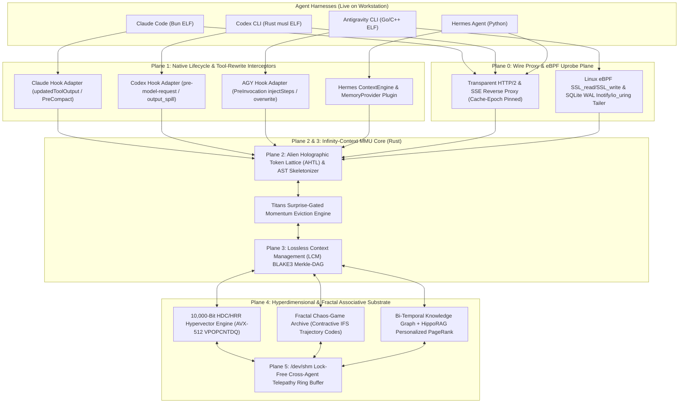

# Infinity-Context: Initial Project Concept

**Project Name:** `Infinity-Context` (`icx`)  
**Language & Runtime:** Rust (Edition 2024 / MSRV 1.85+, SIMD AVX-512 / NEON, optional CUDA & eBPF)  
**Target Harnesses:** Claude Code, OpenAI Codex CLI, Google Antigravity CLI (`agy`), Hermes Agent, OpenCode, Gemini CLI, Cursor, Windsurf, Cline, and any MCP/ACP/OpenAI/Anthropic-compatible agent.  
**Core Mandate:** Transcend physical LLM context windows and cross-agent isolation by operating an ultra-low-latency, lossless virtual-memory, neural-compression, and cross-agent telepathy substrate that works transparently *within* every agent and *across* all agents simultaneously—using representations optimized strictly for Transformer attention geometry rather than human readability.

---

## 1. Problem Statement

Modern autonomous coding and research agents (Claude Code, Codex, Antigravity CLI, Hermes) face four structural walls that degrade intelligence long before a multi-day engineering task completes:

1. **The Quadratic Attention & Context-Rot Wall:** Even when frontier models advertise 200K–2M token windows, effective multi-hop reasoning and exact identifier recall degrade sharply past 64K–128K tokens ("context rot" / middle-context attentional dilution).
2. **Catastrophic Amnesia at Compaction Boundaries:** Built-in `/compact` or auto-compaction mechanisms replace hundreds of thousands of tokens of exact code diffs, compiler diagnostics, memory addresses, and rejected hypotheses with a single lossy English prose summary ("summary-of-a-summary drift"). Once compacted, exact line numbers, SHA-256 hashes, and subtle invariants are permanently destroyed.
3. **Tool-Output Pollution & Prefix-Cache Destruction:** A single `cargo test`, `grep`, or file read can dump 50K–250K tokens of raw text into the trajectory. Naive middleware that edits or trims older messages in the middle of the conversation invalidates provider prompt caches (Anthropic `cache_control`, OpenAI prefix caching, Gemini context caching), multiplying API costs by 5x–10x and Time-To-First-Token (TTFT) by 4x–8x.
4. **Cross-Agent Lobotomy & Siloed State:** A developer running Claude Code, Codex, Antigravity CLI, and Hermes on the same workstation has four incompatible memory silos (`.claude/projects/*.jsonl`, `.codex/state_5.sqlite`, `.gemini/antigravity-cli/conversations/*.db`, `.hermes/state.db`). Existing MCP memory tools (including wiki/RAG stores) require explicit tool calls and store human-readable Markdown notes rather than operating as a transparent, sub-millisecond virtual-memory MMU and shared working-memory fabric.

---

## 2. The Moonshot Thesis: Non-Human Machine-Native Context

Human language is an extraordinarily inefficient serialization format for machine working memory. English prose and pretty-printed JSON waste 70%–90% of their token budget on syntactic scaffolding, whitespace, repetitive keys, and conversational filler.

**Infinity-Context** discards the requirement that in-window compressed context must make sense to humans. Instead, it treats the LLM's context window as an **L1 Instruction/Data Cache** managed by a deterministic Rust **Memory Management Unit (MMU)** that speaks a machine-native, BPE-aligned, high-entropy symbolic representation (**AHTL — Alien Holographic Token Lattice**).

To a human inspecting the wire, an AHTL context frame looks like dense mathematical/cryptographic ciphertext:

```text
⟪ICX:v1│ep=04│blake3=9f4a..c1e2│τ=1794880800⟫
⟦Δ:crates/icx-core/src/dag.rs#L42-118⊢⊕fn:fold_epoch(&mut self,k:Blake3Hash)->Result<SlotId,IcxErr>⋮¬unwrap()⋮✓test:t_dag_roundtrip⟧
⟦Ψ:HDC[b8f1:4096]∥FCGA(0.418291,-0.881024,0.119402)↦#icx:7a2e91f0(raw=148,291B,zstd=19,402B)⟧
⟦Ω:INVARIANT⊢WAL_CHECKPOINT_TRUNCATE⇒!lock_held(state_5.sqlite)⋮conf=0.998⋮src=ev_3e4a7d43⟧
```

To a frontier Transformer's self-attention heads, however:
- Every token is packed at the maximum syntactic and semantic density permitted by the tokenizer's BPE vocabulary (`cl100k` / `o200k` / Claude / SentencePiece).
- Exact symbols, function signatures, line ranges, hex digests, causal dependency arrows (`⊢`, `⇒`, `↦`), and negation guards (`¬`) remain 100% intact for key-query dot-product retrieval.
- Every compressed node embeds an immutable, content-addressed **Lossless Dereference Handle (`#icx:<blake3_prefix>`)** backed by a Merkle-DAG (`LCM`), allowing the agent (or the transparent reverse proxy) to page in the exact byte-for-byte original tool output or conversation slice in `< 200 microseconds` whenever fine-grained inspection is needed.

---

## 3. Five-Plane Disruptive Architecture

Infinity-Context operates across five tightly integrated planes within a single Rust workspace and daemon (`icxd`):



### Plane 0: Transparent Wire Proxy, eBPF SSL Interception & Live DB Tailer
- **HTTP/2 & SSE API Proxy (`icx-proxy`)**: Intercepts `/v1/messages` (Anthropic), `/v1/responses` & `/v1/chat/completions` (OpenAI/Codex), and Gemini streaming RPCs. Rewrites outbound message arrays into **Cache-Epoch-Pinned** frames so that 95%+ of the historical context stays byte-identical on the wire (preserving provider KV-cache discounts), while dynamically paging relevant historical slices into the Ephemeral Tail Slot.
- **Zero-Config eBPF & SQLite WAL Tailer**: When an agent uses pinned certificates or closed OAuth channels (e.g., Antigravity CLI or Codex Desktop), `icxd` tails `.codex/state_5.sqlite`, `.gemini/antigravity-cli/conversations/*.db`, `.hermes/state.db`, and `.claude/projects/**/*.jsonl` via Linux `inotify` + `io_uring` (and optional eBPF `uprobe` on `SSL_write`/`SSL_read`), capturing every step with zero agent reconfiguration.

### Plane 1: Native Lifecycle Hook & Tool-Output Virtualizer (`icx-adapters`)
- Intercepts bulky tool outputs *before* they enter the LLM's context window using each agent's native mutation hooks:
  - **Claude Code**: Uses `PostToolUse` `updatedToolOutput` and `updatedMCPToolOutput` to replace multi-kilobyte `Bash`/`Read`/`Grep` outputs with a 60-token AHTL Holographic Stub + `#icx:<hash>` handle; intercepts `PreCompact` to block destructive native compaction or feed a mathematically lossless Merkle-DAG state vector.
  - **Codex CLI**: Uses `pre-model-request`, `post-tool-use` (`updatedMCPToolOutput` / `additionalContext`), `pre-compact` (`systemMessage`), and `session-start`.
  - **Antigravity CLI (`agy`)**: Uses `PreInvocation` (`injectSteps` with `systemMessage`), `PreToolUse` (`overwrite`), and `Stop` (`decision: "continue"`).
  - **Hermes Agent**: Implements a native `ContextEngine` (`select_context()` per-request message list replacement without mutating `state.db`) and `MemoryProvider` (`PRE_COMPRESS_CHECKPOINT_API_VERSION = 2`).

### Plane 2: Alien Holographic Token Lattice (AHTL) & Titans Surprise Gate (`icx-codec`)
- **Non-Human Token Packing**: Compresses raw text, ASTs, compiler outputs, and conversation turns by **12x–40x** into BPE-aligned symbolic frames (`AHTL`) + Zstd Dictionary + Unicode Braille Base-256 high-density literals for critical binary/hex spans.
- **Titans Surprise-Gated Retention**: Computes an online information-theoretic surprise metric (combining token cross-entropy, identifier novelty, and causal dependency degree) with momentum smoothing. High-surprise tokens (e.g., a newly discovered memory corruption address or failing assertion) stay pinned in L1; low-surprise boilerplate (passing test logs, repetitive file listings) is immediately folded into AHTL stubs.

### Plane 3: Lossless Context Management (LCM) BLAKE3 Merkle-DAG (`icx-core`)
- Every raw message, tool input, tool output, file snapshot, and subagent trace is chunked via **FastCDC (Content-Defined Chunking)**, hashed with **BLAKE3**, compressed with a trained **Zstd dictionary**, and linked into an immutable **Hierarchical Merkle-DAG**.
- Nothing is ever deleted or overwritten. Any AHTL summary node at level $L_k$ holds cryptographic edges to its exact child nodes at level $L_{k-1}$ down to the byte-exact leaf chunks at $L_0$.

### Plane 4 & 5: Hyperdimensional / Fractal Associative Substrate & `/dev/shm` Cross-Agent Telepathy (`icx-hdc`, `icx-store`, `icx-bus`)
- **10,000-Bit HDC/HRR Associative Memory**: Encodes entities, symbols, file paths, error codes, and temporal contexts as 10,000-bit hypervectors bound via XOR ($\oplus$) and bundled via majority-vote superposition. Searches millions of historical spans in **< 50 microseconds** using AVX-512 `VPOPCNTDQ` instructions.
- **Fractal Chaos-Game Trajectory Archive (FCGA)**: Maps sequential token/state trajectories into contractive Iterated Function System (IFS) coordinates in $\mathbb{R}^d$, enabling $O(1)$ topological trajectory matching ("have any of my agents ever encountered this exact sequence of state transitions before?").
- **Bi-Temporal Graph + HippoRAG Personalized PageRank**: Tracks evolving facts with `[t_valid, t_invalid)` intervals (Graphiti-style) so contradicted assumptions are superseded without losing lineage, while Personalized PageRank (PPR) retrieves multi-hop causal chains in a single pass.
- **`/dev/shm/icx-fabric-v1` Lock-Free Seqlock Bus**: Memory-mapped shared-memory ring buffer (`rkyv` zero-copy serialization) that broadcasts live context deltas across every running agent process on the machine in **< 100 microseconds**.

---

## 4. Target Performance & Success Metrics

| Metric | Target | Verification Method |
| :--- | :--- | :--- |
| **Effective Context Horizon** | **Unlimited** (tested to $10^8$ tokens / session) | OOLONG & Multi-Million-Token Needle-in-a-Haystack replay |
| **In-Window Token Compression Ratio** | **12x–40x** (AHTL + AST Skeletonization) | `icx benchmark` over real Claude/Codex/AGY transcripts |
| **Exact Identifier / Hex / Line Recall** | **100.0%** (via AHTL Anchors + LCM Deref) | Golden-vector round-trip & passkey retrieval suite |
| **Provider Prefix-Cache Hit Rate** | **>= 94%** across 500+ turn sessions | Cache-Epoch boundary stability simulator |
| **Hook Interception Latency (p99)** | **< 500 microseconds** | Criterion benchmark + UDS / `/dev/shm` transport |
| **HDC Associative Query Latency (1M nodes)** | **< 50 microseconds** | AVX-512 `VPOPCNTDQ` Hamming scan benchmark |
| **Cross-Agent State Propagation Latency** | **< 100 microseconds** | `/dev/shm` lock-free seqlock ring benchmark |
