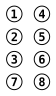
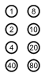
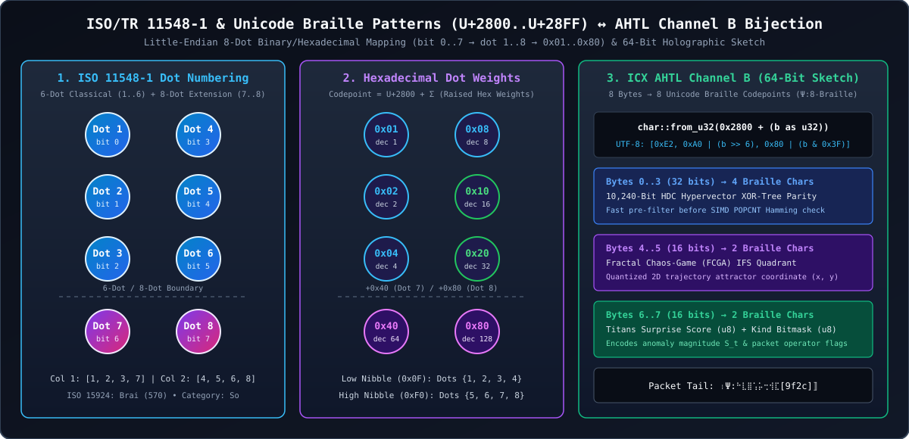

<!--
SPDX-FileCopyrightText: 2026 DoubleGate
SPDX-License-Identifier: CC-BY-NC-ND-4.0 AND LicenseRef-InfinityContext-Commercial
-->

# Unicode Braille Patterns (`U+2800..U+28FF`) — Normative Reference, Bijection Mathematics, and `AHTL` Channel B Specification

**Primary Archive Source:** [Wikipedia — *Braille Patterns*](https://en.wikipedia.org/wiki/Braille_Patterns) ([HTML Snapshot](wikipedia_braille_patterns.html) · [REST v1 HTML](wikipedia_braille_patterns_rest_v1.html) · [MediaWiki Parse Metadata JSON](wikipedia_braille_patterns_metadata.json) · [Templates JSON](wikipedia_braille_templates.json))  
**Official Unicode Code Chart:** [Unicode Standard `U+2800..U+28FF` Code Chart PDF](https://www.unicode.org/charts/PDF/U2800.pdf) · [UCD NamesList (`U+2800..U+28FF`)](standards-and-wg2/Unicode_UCD_NamesList_U2800_U28FF.txt)  
**Target Subsystem:** `crates/icx-codec` ([docs/alien-holographic-codec.md](../../docs/alien-holographic-codec.md) §3.2, [ref-docs/novel-methods/non-human-neural-codecs-and-holographic-context.md](../novel-methods/non-human-neural-codecs-and-holographic-context.md) §1.2)

---

## 1. Executive Overview & Block Metadata

The Unicode **Braille Patterns** block (`U+2800..U+28FF`) encodes all $2^8 = 256$ possible tactile dot configurations of an **8-dot Braille cell**, which inherently subsumes the classical $2^6 = 64$ patterns of the traditional 6-dot Louis Braille cell (`U+2800..U+283F`, where dots 7 and 8 are unraised).

Unlike alphabetical scripts in Unicode, a codepoint in `U+2800..U+28FF` defines **strictly the geometric pattern of raised dots**, intentionally detached from any linguistic or phonetic value. For example, `U+2813` (`⠓`, `BRAILLE PATTERN DOTS-125`) represents the Latin letter `h` and the numeral `8` in English Braille, the Hangul consonant `ᄐ` (`t-`) in Korean Braille, and the kana syllable `り` (`ri`) in Japanese Tenji.

| Property | Normative Value | Standard / Source |
| :--- | :--- | :--- |
| **Block Name** | `Braille Patterns` | [Unicode UCD `Blocks.txt`](standards-and-wg2/Unicode_UCD_Blocks.txt) |
| **Codepoint Range** | `U+2800..U+28FF` (256 codepoints, 100% assigned) | [Unicode `U2800.pdf`](https://www.unicode.org/charts/PDF/U2800.pdf) |
| **Plane** | Plane 0 — Basic Multilingual Plane (`BMP`) | The Unicode Standard |
| **Script Property** | `Braille` (`ISO 15924` code: `Brai`, numeric `570`) | [Unicode UCD `Scripts.txt`](standards-and-wg2/Unicode_UCD_Scripts.txt) |
| **General Category** | `So` (*Symbol, Other*) — **not** `Lo` (*Letter, Other*) | [Unicode 5.2.0 Ch. 15 §15.10](https://www.unicode.org/versions/Unicode5.2.0/ch15.pdf) |
| **UTF-8 Byte Footprint** | Fixed 3 bytes per codepoint: `0xE2 0xA0..0xA3 0x80..0xBF` | RFC 3629 / UTF-8 |
| **Introduced Version** | Unicode 3.0 (September 1999) / ISO/IEC 10646-1:1993 Cor. & FPDAM 16 | [L2/98-136 / WG2 N1770](https://www.unicode.org/L2/L1998/98136.pdf) |
| **Foundational Standards** | **ISO/TR 11548-1:2001** (*Communication aids for blind persons — Part 1: General guidelines for 8-dot Braille identifiers*) & **ISO 17049:2013** | ISO/TC 173 & JTC 1/SC 2/WG 2 |

---

## 2. Historical Evolution & ISO/TR 11548-1 Dot Numbering

### 2.1 From 6-Dot Louis Braille (`1..6`) to 8-Dot Computer/Gardner-Salinas Braille (`1..8`)

1. **Classical 6-Dot Cell (1829):** Designed by Louis Braille using a $2 \times 3$ matrix (2 columns of 3 dots). The left column is numbered **1, 2, 3** from top to bottom; the right column is numbered **4, 5, 6** from top to bottom. This yields $2^6 = 64$ patterns (`U+2800..U+283F`).
2. **8-Dot Extension (`Dots 7 and 8`):** To support direct 1-to-1 byte representations (`256` states), case distinction without prefix cells, mathematical notation (Gardner-Salinas 8-dot braille), and refreshable electronic Braille displays, a fourth row of two dots was appended beneath dots 3 and 6.
3. **Why the Column Numbering is `1-2-3-7` and `4-5-6-8`:** Because dots 1–6 were already universally standardized across all international Braille authorities, the two new bottom dots were assigned **7** (below dot 3 in the left column) and **8** (below dot 6 in the right column) so that any 8-dot pattern with dots 7 and 8 unraised (`bit 6 = 0, bit 7 = 0`) preserves 100% backward numerical compatibility with 6-dot Braille.

### 2.2 Archived Visual Reference Diagrams

| ISO/TR 11548-1 Dot Numbering (`1..8`) | Hexadecimal Dot Weights (`0x01..0x80`) | Example Glyph `U+281D` (`⠝`, Dots `1-3-4-5`) |
| :---: | :---: | :---: |
|  |  |  |
| **Left Col:** `1, 2, 3, 7` · **Right Col:** `4, 5, 6, 8`<br>([SVG](images/retrieved/Braille8dotCellNumbering.svg) · [High-Res PNG](images/retrieved/Braille8dotCellNumbering.png)) | **Left Col:** `1, 2, 4, 40₁₆` · **Right Col:** `8, 10₁₆, 20₁₆, 80₁₆`<br>([SVG](images/retrieved/BrailleValues.svg) · [High-Res PNG](images/retrieved/BrailleValues.png)) | Raised Dots filled black; unraised dots outlined<br>([SVG](images/retrieved/Braille_N.svg) · [High-Res PNG](images/retrieved/Braille_N.png)) |



*Figure 1: Complete architectural mapping between ISO/TR 11548-1 dot numbering (`1..8`), hexadecimal dot weights (`0x01..0x80`), UTF-8 3-byte sequences, and the 64-bit `Infinity-Context (icx)` `AHTL` Channel B Holographic Sketch ([SVG](images/generated/ICX_Braille256_ISO11548_Hex_Bijection.svg) · [High-Res PNG](images/generated/ICX_Braille256_ISO11548_Hex_Bijection.png)).*

---

## 3. Binary & Hexadecimal Bijection Mathematics

### 3.1 Little-Endian Bit-to-Dot Bijection

In accordance with **ISO/TR 11548-1**, each of the 8 dots is mapped to a bit in an unsigned 8-bit integer $b \in [0, 255]$ (`u8`) in **little-endian dot order** (`bit i` corresponds to `dot (i + 1)`):

$$b = \sum_{i=0}^{7} d_{i+1} \cdot 2^i = d_1 \cdot \text{0x01} + d_2 \cdot \text{0x02} + d_3 \cdot \text{0x04} + d_4 \cdot \text{0x08} + d_5 \cdot \text{0x10} + d_6 \cdot \text{0x20} + d_7 \cdot \text{0x40} + d_8 \cdot \text{0x80}$$

where $d_k \in \{0, 1\}$ is $1$ if dot $k$ is raised (punched) and $0$ if unraised. The Unicode codepoint scalar value $U(b)$ is then obtained by adding the block base offset $\text{0x2800}_{16}$ ($10\,240_{10}$):

$$U(b) = \text{0x2800} + b \quad \in [\text{U+2800}, \text{U+28FF}]$$

| Dot Number ($k$) | Cell Position (Row, Col) | Bit Index ($i = k - 1$) | Binary Mask ($2^i$) | Decimal Weight | Hexadecimal Weight (`BrailleValues.svg`) | Nibble Partition |
| :---: | :---: | :---: | :---: | :---: | :---: | :--- |
| **Dot 1** | Row 1, Left Col | `bit 0` (LSB) | `0b0000_0001` | `1` | `0x01` (`1₁₆`) | Low Nibble (`0x0F`: Dots `1, 2, 3, 4`) |
| **Dot 2** | Row 2, Left Col | `bit 1` | `0b0000_0010` | `2` | `0x02` (`2₁₆`) | Low Nibble (`0x0F`: Dots `1, 2, 3, 4`) |
| **Dot 3** | Row 3, Left Col | `bit 2` | `0b0000_0100` | `4` | `0x04` (`4₁₆`) | Low Nibble (`0x0F`: Dots `1, 2, 3, 4`) |
| **Dot 4** | Row 1, Right Col | `bit 3` | `0b0000_1000` | `8` | `0x08` (`8₁₆`) | Low Nibble (`0x0F`: Dots `1, 2, 3, 4`) |
| **Dot 5** | Row 2, Right Col | `bit 4` | `0b0001_0000` | `16` | `0x10` (`10₁₆`) | High Nibble (`0xF0`: Dots `5, 6, 7, 8`) |
| **Dot 6** | Row 3, Right Col | `bit 5` | `0b0010_0000` | `32` | `0x20` (`20₁₆`) | High Nibble (`0xF0`: Dots `5, 6, 7, 8`) |
| **Dot 7** | Row 4, Left Col | `bit 6` | `0b0100_0000` | `64` | `0x40` (`40₁₆`) | High Nibble (`0xF0`: Dots `5, 6, 7, 8`) |
| **Dot 8** | Row 4, Right Col | `bit 7` (MSB) | `0b1000_0000` | `128` | `0x80` (`80₁₆`) | High Nibble (`0xF0`: Dots `5, 6, 7, 8`) |

### 3.2 Two-Hex-Digit Mental & Algorithmic Decomposition (`U+28XY`)

Because the low nibble (`Y`, bits `0..3`) controls **Dots 1, 2, 3, 4** and the high nibble (`X`, bits `4..7`) controls **Dots 5, 6, 7, 8**, every codepoint `U+28XY` decomposes orthogonally:
- **Second hex digit `Y` (`0x0..0xF`):** Sum of raised dots in $\{1 \mapsto 1, 2 \mapsto 2, 3 \mapsto 4, 4 \mapsto 8\}$.
  - Furthermore, for 6-dot rows (`X` in `0..3`), `Y` cycles every 8 columns (`0..7` vs `8..F`) by toggling **Dot 4 (`+0x08`)**.
- **First hex digit `X` (`0x0..0xF`):** Sum of raised dots in $\{5 \mapsto 1, 6 \mapsto 2, 7 \mapsto 4, 8 \mapsto 8\}$ (multiplied by $16_{10} = \text{0x10}$):
  - Rows `U+280x..U+283x` (`X = 0..3`): **6-dot Braille** (Dots 7 and 8 unraised; `X` encodes only Dots 5 and 6).
  - Rows `U+284x..U+287x` (`X = 4..7`): **Dot 7 raised**, Dot 8 unraised (`+0x40` above the 6-dot pattern).
  - Rows `U+288x..U+28Bx` (`X = 8..B`): **Dot 8 raised**, Dot 7 unraised (`+0x80` above the 6-dot pattern).
  - Rows `U+28Cx..U+28Fx` (`X = C..F`): **Both Dots 7 and 8 raised** (`+0xC0` above the 6-dot pattern).

### 3.3 Worked Encoding Examples (from `Template:Unicode_Braille_Pattern_encoding`)

| Attribute | Example 1 (`⠓`) | Example 2 (`⣇` `U+28C7`) | Example 3 (`⣿`) |
| :--- | :--- | :--- | :--- |
| **Braille Glyph** | `⠓` | `⣇` | `⣿` |
| **Unicode Codepoint** | `U+2813` | `U+28C7` | `U+28FF` |
| **Official Unicode Name** | `BRAILLE PATTERN DOTS-125` | `BRAILLE PATTERN DOTS-12378` | `BRAILLE PATTERN DOTS-12345678` |
| **Dot Numbers (`1 2 3 4 5 6 7 8`)** | `1 1 0 0 1 0 0 0` | `1 1 1 0 0 0 1 1` | `1 1 1 1 1 1 1 1` |
| **Binary (`b7 b6 b5 b4 b3 b2 b1 b0`)** | `00010011₂` (`19₁₀`) | `11000111₂` (`199₁₀`) | `11111111₂` (`255₁₀`) |
| **Hexadecimal Dot Sum** | `0x10 + 0x02 + 0x01 = 0x13` | `0x80 + 0x40 + 0x04 + 0x02 + 0x01 = 0xC7` | `0x80 + 0x40 + 0x20 + 0x10 + 0x08 + 0x04 + 0x02 + 0x01 = 0xFF` |
| **Block Offset Calculation** | `0x2800 + 0x13 = U+2813` | `0x2800 + 0xC7 = U+28C7` | `0x2800 + 0xFF = U+28FF` |
| **UTF-8 3-Byte Encoding** | `E2 A0 93` | `E2 A3 87` | `E2 A3 BF` |

### 3.4 Closed-Form UTF-8 3-Byte Arithmetic

Every codepoint $U = \text{0x2800} + b$ has the 16-bit binary form `0010_1000_b7_b6_b5_b4_b3_b2_b1_b0`. Under standard 3-byte UTF-8 (`1110zzzz 10yyyyxx 10xxxxxx`), its three UTF-8 bytes are computed without branches or lookup tables:
- **Byte 0 (constant lead byte):** `0xE2` (`1110_0010₂`)
- **Byte 1 (top 2 bits `b7, b6`):** `0xA0 | (b >> 6)` $\in \{\text{0xA0}, \text{0xA1}, \text{0xA2}, \text{0xA3}\}$
- **Byte 2 (low 6 bits `b5..b0`):** `0x80 | (b & 0x3F)` $\in [\text{0x80}, \text{0xBF}]$

---

## 4. Naming Conventions, Font Variations & Braille ASCII Comparison

### 4.1 Normative vs. Colloquial Naming Rules
- **Unicode Normative Names ([`U2800.pdf`](https://www.unicode.org/charts/PDF/U2800.pdf)):** Every character from `U+2801` to `U+28FF` is named `BRAILLE PATTERN DOTS-<digits>`, where `<digits>` lists the raised dot numbers in strictly ascending order (`1` through `8`). By explicit exception, `U+2800` (zero raised dots) is named `BRAILLE PATTERN BLANK`.
- **Plural `DOTS-` Invariant:** Unicode always uses the plural token `DOTS-` even when only a single dot is raised (e.g., `U+2810` is `BRAILLE PATTERN DOTS-5`, whereas English Braille readers colloquially say *"braille dot 5"* or *"dot 5"*, and say *"braille dots 4 and 5"* for `U+2818` `BRAILLE PATTERN DOTS-45`).

### 4.2 Font Rendering Variations
When displaying Braille graphically in reference charts or terminal emulators, fonts differ in how **unpunched (unraised) dots** and **punched (raised) dots** are rendered:
1. **Empty Circles for Unpunched Dots:** Used in the official Unicode Code Charts (`U2800.pdf`) so a single isolated cell (e.g., `U+2802` Dot 2 vs. `U+2804` Dot 3) retains clear vertical and horizontal alignment.
2. **Micro-Dots for Unpunched Dots:** Used by the LaTeX `braille` package and the *New International Manual of Braille Music Notation* to prevent heavy circle outlines from visually blending with filled dots in print.
3. **Blank Unpunched Dots & Square Glyphs:** Most terminal/UI fonts (`JetBrains Mono`, `Cascadia Code`, `Noto Sans Symbols 2`) omit unpunched dots entirely (rendering `U+2800` as a blank space with width equal to a cell), while Linux bitmap/console fonts such as **GNU Unifont** and **DejaVu Sans** render raised dots as small filled squares (`2x4` pixel blocks) rather than circles.

### 4.3 Non-Linear Relationship to North American Braille ASCII (`0x20..0x5F`)
North American **Braille ASCII** (6-dot computer Braille, ANSI/NISO) maps the 64 6-dot Braille patterns onto printable ASCII `0x20` (`SPACE`) through `0x5F` (`_`) according to English Braille alphabetical/contraction assignments (e.g., `'A' (0x41)` = `U+2801` Dot 1, `'B' (0x42)` = `U+2803` Dots 1-2, `'C' (0x43)` = `U+2809` Dots 1-4). Consequently, **there is no linear arithmetic offset between Braille ASCII and Unicode `U+2800..U+283F`**; conversion between Braille ASCII and Unicode `U+2800..U+283F` requires a 64-entry permutation table, whereas conversion between raw 8-bit bytes (`0x00..0xFF`) and Unicode `U+2800..U+28FF` is the identity offset `+ 0x2800`.

---

## 5. Complete `16 × 16` Unicode Block Matrix (`U+2800..U+28FF`)

| Row \ Col | `0` | `1` | `2` | `3` | `4` | `5` | `6` | `7` | `8` | `9` | `A` | `B` | `C` | `D` | `E` | `F` | Dot 7/8 State |
| :---: | :---: | :---: | :---: | :---: | :---: | :---: | :---: | :---: | :---: | :---: | :---: | :---: | :---: | :---: | :---: | :---: | :--- |
| **`U+280x`** | `⠀` | `⠁` | `⠂` | `⠃` | `⠄` | `⠅` | `⠆` | `⠇` | `⠈` | `⠉` | `⠊` | `⠋` | `⠌` | `⠍` | `⠎` | `⠏` | 6-dot (`7=0, 8=0`) |
| **`U+281x`** | `⠐` | `⠑` | `⠒` | `⠓` | `⠔` | `⠕` | `⠖` | `⠗` | `⠘` | `⠙` | `⠚` | `⠛` | `⠜` | `⠝` | `⠞` | `⠟` | 6-dot (`7=0, 8=0`) |
| **`U+282x`** | `⠠` | `⠡` | `⠢` | `⠣` | `⠤` | `⠥` | `⠦` | `⠧` | `⠨` | `⠩` | `⠪` | `⠫` | `⠬` | `⠭` | `⠮` | `⠯` | 6-dot (`7=0, 8=0`) |
| **`U+283x`** | `⠰` | `⠱` | `⠲` | `⠳` | `⠴` | `⠵` | `⠶` | `⠷` | `⠸` | `⠹` | `⠺` | `⠻` | `⠼` | `⠽` | `⠾` | `⠿` | 6-dot (`7=0, 8=0`) |
| **`U+284x`** | `⡀` | `⡁` | `⡂` | `⡃` | `⡄` | `⡅` | `⡆` | `⡇` | `⡈` | `⡉` | `⡊` | `⡋` | `⡌` | `⡍` | `⡎` | `⡏` | Dot 7 raised (`7=1, 8=0`) |
| **`U+285x`** | `⡐` | `⡑` | `⡒` | `⡓` | `⡔` | `⡕` | `⡖` | `⡗` | `⡘` | `⡙` | `⡚` | `⡛` | `⡜` | `⡝` | `⡞` | `⡟` | Dot 7 raised (`7=1, 8=0`) |
| **`U+286x`** | `⡠` | `⡡` | `⡢` | `⡣` | `⡤` | `⡥` | `⡦` | `⡧` | `⡨` | `⡩` | `⡪` | `⡫` | `⡬` | `⡭` | `⡮` | `⡯` | Dot 7 raised (`7=1, 8=0`) |
| **`U+287x`** | `⡰` | `⡱` | `⡲` | `⡳` | `⡴` | `⡵` | `⡶` | `⡷` | `⡸` | `⡹` | `⡺` | `⡻` | `⡼` | `⡽` | `⡾` | `⡿` | Dot 7 raised (`7=1, 8=0`) |
| **`U+288x`** | `⢀` | `⢁` | `⢂` | `⢃` | `⢄` | `⢅` | `⢆` | `⢇` | `⢈` | `⢉` | `⢊` | `⢋` | `⢌` | `⢍` | `⢎` | `⢏` | Dot 8 raised (`7=0, 8=1`) |
| **`U+289x`** | `⢐` | `⢑` | `⢒` | `⢓` | `⢔` | `⢕` | `⢖` | `⢗` | `⢘` | `⢙` | `⢚` | `⢛` | `⢜` | `⢝` | `⢞` | `⢟` | Dot 8 raised (`7=0, 8=1`) |
| **`U+28Ax`** | `⢠` | `⢡` | `⢢` | `⢣` | `⢤` | `⢥` | `⢦` | `⢧` | `⢨` | `⢩` | `⢪` | `⢫` | `⢬` | `⢭` | `⢮` | `⢯` | Dot 8 raised (`7=0, 8=1`) |
| **`U+28Bx`** | `⢰` | `⢱` | `⢲` | `⢳` | `⢴` | `⢵` | `⢶` | `⢷` | `⢸` | `⢹` | `⢺` | `⢻` | `⢼` | `⢽` | `⢾` | `⢿` | Dot 8 raised (`7=0, 8=1`) |
| **`U+28Cx`** | `⣀` | `⣁` | `⣂` | `⣃` | `⣄` | `⣅` | `⣆` | `⣇` | `⣈` | `⣉` | `⣊` | `⣋` | `⣌` | `⣍` | `⣎` | `⣏` | Dots 7 & 8 raised (`7=1, 8=1`) |
| **`U+28Dx`** | `⣐` | `⣑` | `⣒` | `⣓` | `⣔` | `⣕` | `⣖` | `⣗` | `⣘` | `⣙` | `⣚` | `⣛` | `⣜` | `⣝` | `⣞` | `⣟` | Dots 7 & 8 raised (`7=1, 8=1`) |
| **`U+28Ex`** | `⣠` | `⣡` | `⣢` | `⣣` | `⣤` | `⣥` | `⣦` | `⣧` | `⣨` | `⣩` | `⣪` | `⣫` | `⣬` | `⣭` | `⣮` | `⣯` | Dots 7 & 8 raised (`7=1, 8=1`) |
| **`U+28Fx`** | `⣰` | `⣱` | `⣲` | `⣳` | `⣴` | `⣵` | `⣶` | `⣷` | `⣸` | `⣹` | `⣺` | `⣻` | `⣼` | `⣽` | `⣾` | `⣿` | Dots 7 & 8 raised (`7=1, 8=1`) |

---

## 6. Role in `Infinity-Context (icx)`: `AHTL` Channel B & Terminal Bitmaps

### 6.1 Channel B: 64-Bit Braille-256 Holographic Sketch (`Ψ:8-Braille`)

In `crates/icx-codec` ([docs/alien-holographic-codec.md](../../docs/alien-holographic-codec.md) §3.2), every compressed **AHTL (`Alien Holographic Token Lattice`)** packet ends with an 8-character Unicode Braille sketch (`⋮Ψ:<8 Braille chars>[<hex4>]`) that packs a **64-bit (8-byte) topological and associative fingerprint** of the raw context block at **8 bits per Unicode codepoint**:

1. **Bytes `0..3` (32 bits → 4 Braille codepoints):** 32-bit XOR-tree parity fold of the 10,240-bit Hyperdimensional (`HDC`) hypervector. Allows $O(1)$ bitwise pre-filtering of candidate packets directly from the AHTL text stream before loading full 10,240-bit vectors from the associative index.
2. **Bytes `4..5` (16 bits → 2 Braille codepoints):** Quantized $(x, y) \in \mathbb{Z}_{256}^2$ coordinate in the **Fractal Chaos-Game Archive (`FCGA`)** iterated function system (IFS) attractor space.
3. **Bytes `6..7` (16 bits → 2 Braille codepoints):** Quantized **Titans Surprise score** ($S_t \in [0, 255]$) and 8-bit structural operator/kind bitmask (`Δ`, `Ψ`, `Ω`, `Θ`, `Φ`, `!ERR`, `✓pass`).

### 6.2 Branchless Constant-Time Rust Bijection (`crates/icx-codec`)

```rust
/// Encodes an arbitrary byte `b` (0x00..=0xFF) into its canonical Unicode Braille
/// Patterns codepoint (`U+2800..=U+28FF`) in O(1) branchless time.
#[inline(always)]
pub const fn byte_to_braille(b: u8) -> char {
    // INVARIANT: 0x2800 + (0..=255) lies strictly in 0x2800..=0x28FF,
    // which is a valid non-surrogate Unicode scalar value range.
    char::from_u32(0x2800 + (b as u32)).unwrap()
}

/// Decodes a Unicode Braille Patterns codepoint (`U+2800..=U+28FF`) back to its
/// exact 8-bit byte (`0x00..=0xFF`) in O(1) time.
#[inline(always)]
pub const fn braille_to_byte(c: char) -> Option<u8> {
    let code = c as u32;
    if code >= 0x2800 && code <= 0x28FF {
        Some((code - 0x2800) as u8)
    } else {
        None
    }
}
```

### 6.3 BPE Tokenizer Disjointness & Attention Isolation

Why use `U+2800..U+28FF` instead of Base64 (`A-Za-z0-9+/`) or hexadecimal (`0-9a-f`) for Channel B sketches?
- **Zero Lexical Collision with Source Identifiers:** Base64 and hexadecimal strings share the ASCII alphanumeric alphabet (`A-Z`, `a-z`, `0-9`). In BPE tokenizers (`o200k_base`, `cl100k_base`, Claude BPE, Gemini SentencePiece), random Base64 payloads merge unpredictably into 2–3 character English subword tokens (`"in"`, `"er"`, `"re"`, `"on"`), polluting the Transformer's $Q K^T / \sqrt{d_k}$ self-attention scores when the model searches for code identifiers or English concepts.
- **Orthogonal Unicode Subspace:** Because `U+2800..U+28FF` resides in the dedicated `So` (`Braille`) symbol block with fixed UTF-8 lead bytes `0xE2 0xA0..0xA3`, BPE tokenizers never merge Braille codepoints with ASCII identifiers, punctuation, or AHTL Channel A relational operators (`⊢`, `⇒`, `↦`, `⋮`). Channel A (semantic skeleton) and Channel B (binary hologram) therefore occupy **strictly orthogonal token embedding subspaces**.
- **Terminal High-Density Sparklines & Diagnostic Sub-Pixel Grids:** Each `U+2800..U+28FF` character also functions as a $2 \times 4$ binary pixel matrix in terminal UIs (`icx status`, `icx doctor`), enabling 8x higher graphical resolution per character cell for plotting cache-epoch hit rates and surprise trajectories.

---

## 7. Complete 256-Entry Normative Lookup Table (`0x00..0xFF` ↔ `U+2800..U+28FF`)

Every byte value $b \in [0, 255]$ is cataloged below with its Unicode codepoint, decimal offset, 8-bit binary pattern (`b7..b0`), exact 3-byte UTF-8 hex representation, active ISO/TR 11548-1 dots, hexadecimal weight sum, official Unicode name, and literal Braille glyph.

| Byte (Hex) | Codepoint | Dec | Binary (`b7..b0`) | UTF-8 Bytes | Glyph | Active Dots (`1..8`) | Hex Weight Sum | Official Unicode Character Name |
| :---: | :---: | :---: | :---: | :---: | :---: | :--- | :--- | :--- |
| `0x00` | `U+2800` | `0` | `00000000` | `E2 A0 80` | `⠀` | `None (Blank)` | `0x00` | `BRAILLE PATTERN BLANK` |
| `0x01` | `U+2801` | `1` | `00000001` | `E2 A0 81` | `⠁` | `1` | `0x01` | `BRAILLE PATTERN DOTS-1` |
| `0x02` | `U+2802` | `2` | `00000010` | `E2 A0 82` | `⠂` | `2` | `0x02` | `BRAILLE PATTERN DOTS-2` |
| `0x03` | `U+2803` | `3` | `00000011` | `E2 A0 83` | `⠃` | `1-2` | `0x01 + 0x02` | `BRAILLE PATTERN DOTS-12` |
| `0x04` | `U+2804` | `4` | `00000100` | `E2 A0 84` | `⠄` | `3` | `0x04` | `BRAILLE PATTERN DOTS-3` |
| `0x05` | `U+2805` | `5` | `00000101` | `E2 A0 85` | `⠅` | `1-3` | `0x01 + 0x04` | `BRAILLE PATTERN DOTS-13` |
| `0x06` | `U+2806` | `6` | `00000110` | `E2 A0 86` | `⠆` | `2-3` | `0x02 + 0x04` | `BRAILLE PATTERN DOTS-23` |
| `0x07` | `U+2807` | `7` | `00000111` | `E2 A0 87` | `⠇` | `1-2-3` | `0x01 + 0x02 + 0x04` | `BRAILLE PATTERN DOTS-123` |
| `0x08` | `U+2808` | `8` | `00001000` | `E2 A0 88` | `⠈` | `4` | `0x08` | `BRAILLE PATTERN DOTS-4` |
| `0x09` | `U+2809` | `9` | `00001001` | `E2 A0 89` | `⠉` | `1-4` | `0x01 + 0x08` | `BRAILLE PATTERN DOTS-14` |
| `0x0A` | `U+280A` | `10` | `00001010` | `E2 A0 8A` | `⠊` | `2-4` | `0x02 + 0x08` | `BRAILLE PATTERN DOTS-24` |
| `0x0B` | `U+280B` | `11` | `00001011` | `E2 A0 8B` | `⠋` | `1-2-4` | `0x01 + 0x02 + 0x08` | `BRAILLE PATTERN DOTS-124` |
| `0x0C` | `U+280C` | `12` | `00001100` | `E2 A0 8C` | `⠌` | `3-4` | `0x04 + 0x08` | `BRAILLE PATTERN DOTS-34` |
| `0x0D` | `U+280D` | `13` | `00001101` | `E2 A0 8D` | `⠍` | `1-3-4` | `0x01 + 0x04 + 0x08` | `BRAILLE PATTERN DOTS-134` |
| `0x0E` | `U+280E` | `14` | `00001110` | `E2 A0 8E` | `⠎` | `2-3-4` | `0x02 + 0x04 + 0x08` | `BRAILLE PATTERN DOTS-234` |
| `0x0F` | `U+280F` | `15` | `00001111` | `E2 A0 8F` | `⠏` | `1-2-3-4` | `0x01 + 0x02 + 0x04 + 0x08` | `BRAILLE PATTERN DOTS-1234` |
| `0x10` | `U+2810` | `16` | `00010000` | `E2 A0 90` | `⠐` | `5` | `0x10` | `BRAILLE PATTERN DOTS-5` |
| `0x11` | `U+2811` | `17` | `00010001` | `E2 A0 91` | `⠑` | `1-5` | `0x01 + 0x10` | `BRAILLE PATTERN DOTS-15` |
| `0x12` | `U+2812` | `18` | `00010010` | `E2 A0 92` | `⠒` | `2-5` | `0x02 + 0x10` | `BRAILLE PATTERN DOTS-25` |
| `0x13` | `U+2813` | `19` | `00010011` | `E2 A0 93` | `⠓` | `1-2-5` | `0x01 + 0x02 + 0x10` | `BRAILLE PATTERN DOTS-125` |
| `0x14` | `U+2814` | `20` | `00010100` | `E2 A0 94` | `⠔` | `3-5` | `0x04 + 0x10` | `BRAILLE PATTERN DOTS-35` |
| `0x15` | `U+2815` | `21` | `00010101` | `E2 A0 95` | `⠕` | `1-3-5` | `0x01 + 0x04 + 0x10` | `BRAILLE PATTERN DOTS-135` |
| `0x16` | `U+2816` | `22` | `00010110` | `E2 A0 96` | `⠖` | `2-3-5` | `0x02 + 0x04 + 0x10` | `BRAILLE PATTERN DOTS-235` |
| `0x17` | `U+2817` | `23` | `00010111` | `E2 A0 97` | `⠗` | `1-2-3-5` | `0x01 + 0x02 + 0x04 + 0x10` | `BRAILLE PATTERN DOTS-1235` |
| `0x18` | `U+2818` | `24` | `00011000` | `E2 A0 98` | `⠘` | `4-5` | `0x08 + 0x10` | `BRAILLE PATTERN DOTS-45` |
| `0x19` | `U+2819` | `25` | `00011001` | `E2 A0 99` | `⠙` | `1-4-5` | `0x01 + 0x08 + 0x10` | `BRAILLE PATTERN DOTS-145` |
| `0x1A` | `U+281A` | `26` | `00011010` | `E2 A0 9A` | `⠚` | `2-4-5` | `0x02 + 0x08 + 0x10` | `BRAILLE PATTERN DOTS-245` |
| `0x1B` | `U+281B` | `27` | `00011011` | `E2 A0 9B` | `⠛` | `1-2-4-5` | `0x01 + 0x02 + 0x08 + 0x10` | `BRAILLE PATTERN DOTS-1245` |
| `0x1C` | `U+281C` | `28` | `00011100` | `E2 A0 9C` | `⠜` | `3-4-5` | `0x04 + 0x08 + 0x10` | `BRAILLE PATTERN DOTS-345` |
| `0x1D` | `U+281D` | `29` | `00011101` | `E2 A0 9D` | `⠝` | `1-3-4-5` | `0x01 + 0x04 + 0x08 + 0x10` | `BRAILLE PATTERN DOTS-1345` |
| `0x1E` | `U+281E` | `30` | `00011110` | `E2 A0 9E` | `⠞` | `2-3-4-5` | `0x02 + 0x04 + 0x08 + 0x10` | `BRAILLE PATTERN DOTS-2345` |
| `0x1F` | `U+281F` | `31` | `00011111` | `E2 A0 9F` | `⠟` | `1-2-3-4-5` | `0x01 + 0x02 + 0x04 + 0x08 + 0x10` | `BRAILLE PATTERN DOTS-12345` |
| `0x20` | `U+2820` | `32` | `00100000` | `E2 A0 A0` | `⠠` | `6` | `0x20` | `BRAILLE PATTERN DOTS-6` |
| `0x21` | `U+2821` | `33` | `00100001` | `E2 A0 A1` | `⠡` | `1-6` | `0x01 + 0x20` | `BRAILLE PATTERN DOTS-16` |
| `0x22` | `U+2822` | `34` | `00100010` | `E2 A0 A2` | `⠢` | `2-6` | `0x02 + 0x20` | `BRAILLE PATTERN DOTS-26` |
| `0x23` | `U+2823` | `35` | `00100011` | `E2 A0 A3` | `⠣` | `1-2-6` | `0x01 + 0x02 + 0x20` | `BRAILLE PATTERN DOTS-126` |
| `0x24` | `U+2824` | `36` | `00100100` | `E2 A0 A4` | `⠤` | `3-6` | `0x04 + 0x20` | `BRAILLE PATTERN DOTS-36` |
| `0x25` | `U+2825` | `37` | `00100101` | `E2 A0 A5` | `⠥` | `1-3-6` | `0x01 + 0x04 + 0x20` | `BRAILLE PATTERN DOTS-136` |
| `0x26` | `U+2826` | `38` | `00100110` | `E2 A0 A6` | `⠦` | `2-3-6` | `0x02 + 0x04 + 0x20` | `BRAILLE PATTERN DOTS-236` |
| `0x27` | `U+2827` | `39` | `00100111` | `E2 A0 A7` | `⠧` | `1-2-3-6` | `0x01 + 0x02 + 0x04 + 0x20` | `BRAILLE PATTERN DOTS-1236` |
| `0x28` | `U+2828` | `40` | `00101000` | `E2 A0 A8` | `⠨` | `4-6` | `0x08 + 0x20` | `BRAILLE PATTERN DOTS-46` |
| `0x29` | `U+2829` | `41` | `00101001` | `E2 A0 A9` | `⠩` | `1-4-6` | `0x01 + 0x08 + 0x20` | `BRAILLE PATTERN DOTS-146` |
| `0x2A` | `U+282A` | `42` | `00101010` | `E2 A0 AA` | `⠪` | `2-4-6` | `0x02 + 0x08 + 0x20` | `BRAILLE PATTERN DOTS-246` |
| `0x2B` | `U+282B` | `43` | `00101011` | `E2 A0 AB` | `⠫` | `1-2-4-6` | `0x01 + 0x02 + 0x08 + 0x20` | `BRAILLE PATTERN DOTS-1246` |
| `0x2C` | `U+282C` | `44` | `00101100` | `E2 A0 AC` | `⠬` | `3-4-6` | `0x04 + 0x08 + 0x20` | `BRAILLE PATTERN DOTS-346` |
| `0x2D` | `U+282D` | `45` | `00101101` | `E2 A0 AD` | `⠭` | `1-3-4-6` | `0x01 + 0x04 + 0x08 + 0x20` | `BRAILLE PATTERN DOTS-1346` |
| `0x2E` | `U+282E` | `46` | `00101110` | `E2 A0 AE` | `⠮` | `2-3-4-6` | `0x02 + 0x04 + 0x08 + 0x20` | `BRAILLE PATTERN DOTS-2346` |
| `0x2F` | `U+282F` | `47` | `00101111` | `E2 A0 AF` | `⠯` | `1-2-3-4-6` | `0x01 + 0x02 + 0x04 + 0x08 + 0x20` | `BRAILLE PATTERN DOTS-12346` |
| `0x30` | `U+2830` | `48` | `00110000` | `E2 A0 B0` | `⠰` | `5-6` | `0x10 + 0x20` | `BRAILLE PATTERN DOTS-56` |
| `0x31` | `U+2831` | `49` | `00110001` | `E2 A0 B1` | `⠱` | `1-5-6` | `0x01 + 0x10 + 0x20` | `BRAILLE PATTERN DOTS-156` |
| `0x32` | `U+2832` | `50` | `00110010` | `E2 A0 B2` | `⠲` | `2-5-6` | `0x02 + 0x10 + 0x20` | `BRAILLE PATTERN DOTS-256` |
| `0x33` | `U+2833` | `51` | `00110011` | `E2 A0 B3` | `⠳` | `1-2-5-6` | `0x01 + 0x02 + 0x10 + 0x20` | `BRAILLE PATTERN DOTS-1256` |
| `0x34` | `U+2834` | `52` | `00110100` | `E2 A0 B4` | `⠴` | `3-5-6` | `0x04 + 0x10 + 0x20` | `BRAILLE PATTERN DOTS-356` |
| `0x35` | `U+2835` | `53` | `00110101` | `E2 A0 B5` | `⠵` | `1-3-5-6` | `0x01 + 0x04 + 0x10 + 0x20` | `BRAILLE PATTERN DOTS-1356` |
| `0x36` | `U+2836` | `54` | `00110110` | `E2 A0 B6` | `⠶` | `2-3-5-6` | `0x02 + 0x04 + 0x10 + 0x20` | `BRAILLE PATTERN DOTS-2356` |
| `0x37` | `U+2837` | `55` | `00110111` | `E2 A0 B7` | `⠷` | `1-2-3-5-6` | `0x01 + 0x02 + 0x04 + 0x10 + 0x20` | `BRAILLE PATTERN DOTS-12356` |
| `0x38` | `U+2838` | `56` | `00111000` | `E2 A0 B8` | `⠸` | `4-5-6` | `0x08 + 0x10 + 0x20` | `BRAILLE PATTERN DOTS-456` |
| `0x39` | `U+2839` | `57` | `00111001` | `E2 A0 B9` | `⠹` | `1-4-5-6` | `0x01 + 0x08 + 0x10 + 0x20` | `BRAILLE PATTERN DOTS-1456` |
| `0x3A` | `U+283A` | `58` | `00111010` | `E2 A0 BA` | `⠺` | `2-4-5-6` | `0x02 + 0x08 + 0x10 + 0x20` | `BRAILLE PATTERN DOTS-2456` |
| `0x3B` | `U+283B` | `59` | `00111011` | `E2 A0 BB` | `⠻` | `1-2-4-5-6` | `0x01 + 0x02 + 0x08 + 0x10 + 0x20` | `BRAILLE PATTERN DOTS-12456` |
| `0x3C` | `U+283C` | `60` | `00111100` | `E2 A0 BC` | `⠼` | `3-4-5-6` | `0x04 + 0x08 + 0x10 + 0x20` | `BRAILLE PATTERN DOTS-3456` |
| `0x3D` | `U+283D` | `61` | `00111101` | `E2 A0 BD` | `⠽` | `1-3-4-5-6` | `0x01 + 0x04 + 0x08 + 0x10 + 0x20` | `BRAILLE PATTERN DOTS-13456` |
| `0x3E` | `U+283E` | `62` | `00111110` | `E2 A0 BE` | `⠾` | `2-3-4-5-6` | `0x02 + 0x04 + 0x08 + 0x10 + 0x20` | `BRAILLE PATTERN DOTS-23456` |
| `0x3F` | `U+283F` | `63` | `00111111` | `E2 A0 BF` | `⠿` | `1-2-3-4-5-6` | `0x01 + 0x02 + 0x04 + 0x08 + 0x10 + 0x20` | `BRAILLE PATTERN DOTS-123456` |
| `0x40` | `U+2840` | `64` | `01000000` | `E2 A1 80` | `⡀` | `7` | `0x40` | `BRAILLE PATTERN DOTS-7` |
| `0x41` | `U+2841` | `65` | `01000001` | `E2 A1 81` | `⡁` | `1-7` | `0x01 + 0x40` | `BRAILLE PATTERN DOTS-17` |
| `0x42` | `U+2842` | `66` | `01000010` | `E2 A1 82` | `⡂` | `2-7` | `0x02 + 0x40` | `BRAILLE PATTERN DOTS-27` |
| `0x43` | `U+2843` | `67` | `01000011` | `E2 A1 83` | `⡃` | `1-2-7` | `0x01 + 0x02 + 0x40` | `BRAILLE PATTERN DOTS-127` |
| `0x44` | `U+2844` | `68` | `01000100` | `E2 A1 84` | `⡄` | `3-7` | `0x04 + 0x40` | `BRAILLE PATTERN DOTS-37` |
| `0x45` | `U+2845` | `69` | `01000101` | `E2 A1 85` | `⡅` | `1-3-7` | `0x01 + 0x04 + 0x40` | `BRAILLE PATTERN DOTS-137` |
| `0x46` | `U+2846` | `70` | `01000110` | `E2 A1 86` | `⡆` | `2-3-7` | `0x02 + 0x04 + 0x40` | `BRAILLE PATTERN DOTS-237` |
| `0x47` | `U+2847` | `71` | `01000111` | `E2 A1 87` | `⡇` | `1-2-3-7` | `0x01 + 0x02 + 0x04 + 0x40` | `BRAILLE PATTERN DOTS-1237` |
| `0x48` | `U+2848` | `72` | `01001000` | `E2 A1 88` | `⡈` | `4-7` | `0x08 + 0x40` | `BRAILLE PATTERN DOTS-47` |
| `0x49` | `U+2849` | `73` | `01001001` | `E2 A1 89` | `⡉` | `1-4-7` | `0x01 + 0x08 + 0x40` | `BRAILLE PATTERN DOTS-147` |
| `0x4A` | `U+284A` | `74` | `01001010` | `E2 A1 8A` | `⡊` | `2-4-7` | `0x02 + 0x08 + 0x40` | `BRAILLE PATTERN DOTS-247` |
| `0x4B` | `U+284B` | `75` | `01001011` | `E2 A1 8B` | `⡋` | `1-2-4-7` | `0x01 + 0x02 + 0x08 + 0x40` | `BRAILLE PATTERN DOTS-1247` |
| `0x4C` | `U+284C` | `76` | `01001100` | `E2 A1 8C` | `⡌` | `3-4-7` | `0x04 + 0x08 + 0x40` | `BRAILLE PATTERN DOTS-347` |
| `0x4D` | `U+284D` | `77` | `01001101` | `E2 A1 8D` | `⡍` | `1-3-4-7` | `0x01 + 0x04 + 0x08 + 0x40` | `BRAILLE PATTERN DOTS-1347` |
| `0x4E` | `U+284E` | `78` | `01001110` | `E2 A1 8E` | `⡎` | `2-3-4-7` | `0x02 + 0x04 + 0x08 + 0x40` | `BRAILLE PATTERN DOTS-2347` |
| `0x4F` | `U+284F` | `79` | `01001111` | `E2 A1 8F` | `⡏` | `1-2-3-4-7` | `0x01 + 0x02 + 0x04 + 0x08 + 0x40` | `BRAILLE PATTERN DOTS-12347` |
| `0x50` | `U+2850` | `80` | `01010000` | `E2 A1 90` | `⡐` | `5-7` | `0x10 + 0x40` | `BRAILLE PATTERN DOTS-57` |
| `0x51` | `U+2851` | `81` | `01010001` | `E2 A1 91` | `⡑` | `1-5-7` | `0x01 + 0x10 + 0x40` | `BRAILLE PATTERN DOTS-157` |
| `0x52` | `U+2852` | `82` | `01010010` | `E2 A1 92` | `⡒` | `2-5-7` | `0x02 + 0x10 + 0x40` | `BRAILLE PATTERN DOTS-257` |
| `0x53` | `U+2853` | `83` | `01010011` | `E2 A1 93` | `⡓` | `1-2-5-7` | `0x01 + 0x02 + 0x10 + 0x40` | `BRAILLE PATTERN DOTS-1257` |
| `0x54` | `U+2854` | `84` | `01010100` | `E2 A1 94` | `⡔` | `3-5-7` | `0x04 + 0x10 + 0x40` | `BRAILLE PATTERN DOTS-357` |
| `0x55` | `U+2855` | `85` | `01010101` | `E2 A1 95` | `⡕` | `1-3-5-7` | `0x01 + 0x04 + 0x10 + 0x40` | `BRAILLE PATTERN DOTS-1357` |
| `0x56` | `U+2856` | `86` | `01010110` | `E2 A1 96` | `⡖` | `2-3-5-7` | `0x02 + 0x04 + 0x10 + 0x40` | `BRAILLE PATTERN DOTS-2357` |
| `0x57` | `U+2857` | `87` | `01010111` | `E2 A1 97` | `⡗` | `1-2-3-5-7` | `0x01 + 0x02 + 0x04 + 0x10 + 0x40` | `BRAILLE PATTERN DOTS-12357` |
| `0x58` | `U+2858` | `88` | `01011000` | `E2 A1 98` | `⡘` | `4-5-7` | `0x08 + 0x10 + 0x40` | `BRAILLE PATTERN DOTS-457` |
| `0x59` | `U+2859` | `89` | `01011001` | `E2 A1 99` | `⡙` | `1-4-5-7` | `0x01 + 0x08 + 0x10 + 0x40` | `BRAILLE PATTERN DOTS-1457` |
| `0x5A` | `U+285A` | `90` | `01011010` | `E2 A1 9A` | `⡚` | `2-4-5-7` | `0x02 + 0x08 + 0x10 + 0x40` | `BRAILLE PATTERN DOTS-2457` |
| `0x5B` | `U+285B` | `91` | `01011011` | `E2 A1 9B` | `⡛` | `1-2-4-5-7` | `0x01 + 0x02 + 0x08 + 0x10 + 0x40` | `BRAILLE PATTERN DOTS-12457` |
| `0x5C` | `U+285C` | `92` | `01011100` | `E2 A1 9C` | `⡜` | `3-4-5-7` | `0x04 + 0x08 + 0x10 + 0x40` | `BRAILLE PATTERN DOTS-3457` |
| `0x5D` | `U+285D` | `93` | `01011101` | `E2 A1 9D` | `⡝` | `1-3-4-5-7` | `0x01 + 0x04 + 0x08 + 0x10 + 0x40` | `BRAILLE PATTERN DOTS-13457` |
| `0x5E` | `U+285E` | `94` | `01011110` | `E2 A1 9E` | `⡞` | `2-3-4-5-7` | `0x02 + 0x04 + 0x08 + 0x10 + 0x40` | `BRAILLE PATTERN DOTS-23457` |
| `0x5F` | `U+285F` | `95` | `01011111` | `E2 A1 9F` | `⡟` | `1-2-3-4-5-7` | `0x01 + 0x02 + 0x04 + 0x08 + 0x10 + 0x40` | `BRAILLE PATTERN DOTS-123457` |
| `0x60` | `U+2860` | `96` | `01100000` | `E2 A1 A0` | `⡠` | `6-7` | `0x20 + 0x40` | `BRAILLE PATTERN DOTS-67` |
| `0x61` | `U+2861` | `97` | `01100001` | `E2 A1 A1` | `⡡` | `1-6-7` | `0x01 + 0x20 + 0x40` | `BRAILLE PATTERN DOTS-167` |
| `0x62` | `U+2862` | `98` | `01100010` | `E2 A1 A2` | `⡢` | `2-6-7` | `0x02 + 0x20 + 0x40` | `BRAILLE PATTERN DOTS-267` |
| `0x63` | `U+2863` | `99` | `01100011` | `E2 A1 A3` | `⡣` | `1-2-6-7` | `0x01 + 0x02 + 0x20 + 0x40` | `BRAILLE PATTERN DOTS-1267` |
| `0x64` | `U+2864` | `100` | `01100100` | `E2 A1 A4` | `⡤` | `3-6-7` | `0x04 + 0x20 + 0x40` | `BRAILLE PATTERN DOTS-367` |
| `0x65` | `U+2865` | `101` | `01100101` | `E2 A1 A5` | `⡥` | `1-3-6-7` | `0x01 + 0x04 + 0x20 + 0x40` | `BRAILLE PATTERN DOTS-1367` |
| `0x66` | `U+2866` | `102` | `01100110` | `E2 A1 A6` | `⡦` | `2-3-6-7` | `0x02 + 0x04 + 0x20 + 0x40` | `BRAILLE PATTERN DOTS-2367` |
| `0x67` | `U+2867` | `103` | `01100111` | `E2 A1 A7` | `⡧` | `1-2-3-6-7` | `0x01 + 0x02 + 0x04 + 0x20 + 0x40` | `BRAILLE PATTERN DOTS-12367` |
| `0x68` | `U+2868` | `104` | `01101000` | `E2 A1 A8` | `⡨` | `4-6-7` | `0x08 + 0x20 + 0x40` | `BRAILLE PATTERN DOTS-467` |
| `0x69` | `U+2869` | `105` | `01101001` | `E2 A1 A9` | `⡩` | `1-4-6-7` | `0x01 + 0x08 + 0x20 + 0x40` | `BRAILLE PATTERN DOTS-1467` |
| `0x6A` | `U+286A` | `106` | `01101010` | `E2 A1 AA` | `⡪` | `2-4-6-7` | `0x02 + 0x08 + 0x20 + 0x40` | `BRAILLE PATTERN DOTS-2467` |
| `0x6B` | `U+286B` | `107` | `01101011` | `E2 A1 AB` | `⡫` | `1-2-4-6-7` | `0x01 + 0x02 + 0x08 + 0x20 + 0x40` | `BRAILLE PATTERN DOTS-12467` |
| `0x6C` | `U+286C` | `108` | `01101100` | `E2 A1 AC` | `⡬` | `3-4-6-7` | `0x04 + 0x08 + 0x20 + 0x40` | `BRAILLE PATTERN DOTS-3467` |
| `0x6D` | `U+286D` | `109` | `01101101` | `E2 A1 AD` | `⡭` | `1-3-4-6-7` | `0x01 + 0x04 + 0x08 + 0x20 + 0x40` | `BRAILLE PATTERN DOTS-13467` |
| `0x6E` | `U+286E` | `110` | `01101110` | `E2 A1 AE` | `⡮` | `2-3-4-6-7` | `0x02 + 0x04 + 0x08 + 0x20 + 0x40` | `BRAILLE PATTERN DOTS-23467` |
| `0x6F` | `U+286F` | `111` | `01101111` | `E2 A1 AF` | `⡯` | `1-2-3-4-6-7` | `0x01 + 0x02 + 0x04 + 0x08 + 0x20 + 0x40` | `BRAILLE PATTERN DOTS-123467` |
| `0x70` | `U+2870` | `112` | `01110000` | `E2 A1 B0` | `⡰` | `5-6-7` | `0x10 + 0x20 + 0x40` | `BRAILLE PATTERN DOTS-567` |
| `0x71` | `U+2871` | `113` | `01110001` | `E2 A1 B1` | `⡱` | `1-5-6-7` | `0x01 + 0x10 + 0x20 + 0x40` | `BRAILLE PATTERN DOTS-1567` |
| `0x72` | `U+2872` | `114` | `01110010` | `E2 A1 B2` | `⡲` | `2-5-6-7` | `0x02 + 0x10 + 0x20 + 0x40` | `BRAILLE PATTERN DOTS-2567` |
| `0x73` | `U+2873` | `115` | `01110011` | `E2 A1 B3` | `⡳` | `1-2-5-6-7` | `0x01 + 0x02 + 0x10 + 0x20 + 0x40` | `BRAILLE PATTERN DOTS-12567` |
| `0x74` | `U+2874` | `116` | `01110100` | `E2 A1 B4` | `⡴` | `3-5-6-7` | `0x04 + 0x10 + 0x20 + 0x40` | `BRAILLE PATTERN DOTS-3567` |
| `0x75` | `U+2875` | `117` | `01110101` | `E2 A1 B5` | `⡵` | `1-3-5-6-7` | `0x01 + 0x04 + 0x10 + 0x20 + 0x40` | `BRAILLE PATTERN DOTS-13567` |
| `0x76` | `U+2876` | `118` | `01110110` | `E2 A1 B6` | `⡶` | `2-3-5-6-7` | `0x02 + 0x04 + 0x10 + 0x20 + 0x40` | `BRAILLE PATTERN DOTS-23567` |
| `0x77` | `U+2877` | `119` | `01110111` | `E2 A1 B7` | `⡷` | `1-2-3-5-6-7` | `0x01 + 0x02 + 0x04 + 0x10 + 0x20 + 0x40` | `BRAILLE PATTERN DOTS-123567` |
| `0x78` | `U+2878` | `120` | `01111000` | `E2 A1 B8` | `⡸` | `4-5-6-7` | `0x08 + 0x10 + 0x20 + 0x40` | `BRAILLE PATTERN DOTS-4567` |
| `0x79` | `U+2879` | `121` | `01111001` | `E2 A1 B9` | `⡹` | `1-4-5-6-7` | `0x01 + 0x08 + 0x10 + 0x20 + 0x40` | `BRAILLE PATTERN DOTS-14567` |
| `0x7A` | `U+287A` | `122` | `01111010` | `E2 A1 BA` | `⡺` | `2-4-5-6-7` | `0x02 + 0x08 + 0x10 + 0x20 + 0x40` | `BRAILLE PATTERN DOTS-24567` |
| `0x7B` | `U+287B` | `123` | `01111011` | `E2 A1 BB` | `⡻` | `1-2-4-5-6-7` | `0x01 + 0x02 + 0x08 + 0x10 + 0x20 + 0x40` | `BRAILLE PATTERN DOTS-124567` |
| `0x7C` | `U+287C` | `124` | `01111100` | `E2 A1 BC` | `⡼` | `3-4-5-6-7` | `0x04 + 0x08 + 0x10 + 0x20 + 0x40` | `BRAILLE PATTERN DOTS-34567` |
| `0x7D` | `U+287D` | `125` | `01111101` | `E2 A1 BD` | `⡽` | `1-3-4-5-6-7` | `0x01 + 0x04 + 0x08 + 0x10 + 0x20 + 0x40` | `BRAILLE PATTERN DOTS-134567` |
| `0x7E` | `U+287E` | `126` | `01111110` | `E2 A1 BE` | `⡾` | `2-3-4-5-6-7` | `0x02 + 0x04 + 0x08 + 0x10 + 0x20 + 0x40` | `BRAILLE PATTERN DOTS-234567` |
| `0x7F` | `U+287F` | `127` | `01111111` | `E2 A1 BF` | `⡿` | `1-2-3-4-5-6-7` | `0x01 + 0x02 + 0x04 + 0x08 + 0x10 + 0x20 + 0x40` | `BRAILLE PATTERN DOTS-1234567` |
| `0x80` | `U+2880` | `128` | `10000000` | `E2 A2 80` | `⢀` | `8` | `0x80` | `BRAILLE PATTERN DOTS-8` |
| `0x81` | `U+2881` | `129` | `10000001` | `E2 A2 81` | `⢁` | `1-8` | `0x01 + 0x80` | `BRAILLE PATTERN DOTS-18` |
| `0x82` | `U+2882` | `130` | `10000010` | `E2 A2 82` | `⢂` | `2-8` | `0x02 + 0x80` | `BRAILLE PATTERN DOTS-28` |
| `0x83` | `U+2883` | `131` | `10000011` | `E2 A2 83` | `⢃` | `1-2-8` | `0x01 + 0x02 + 0x80` | `BRAILLE PATTERN DOTS-128` |
| `0x84` | `U+2884` | `132` | `10000100` | `E2 A2 84` | `⢄` | `3-8` | `0x04 + 0x80` | `BRAILLE PATTERN DOTS-38` |
| `0x85` | `U+2885` | `133` | `10000101` | `E2 A2 85` | `⢅` | `1-3-8` | `0x01 + 0x04 + 0x80` | `BRAILLE PATTERN DOTS-138` |
| `0x86` | `U+2886` | `134` | `10000110` | `E2 A2 86` | `⢆` | `2-3-8` | `0x02 + 0x04 + 0x80` | `BRAILLE PATTERN DOTS-238` |
| `0x87` | `U+2887` | `135` | `10000111` | `E2 A2 87` | `⢇` | `1-2-3-8` | `0x01 + 0x02 + 0x04 + 0x80` | `BRAILLE PATTERN DOTS-1238` |
| `0x88` | `U+2888` | `136` | `10001000` | `E2 A2 88` | `⢈` | `4-8` | `0x08 + 0x80` | `BRAILLE PATTERN DOTS-48` |
| `0x89` | `U+2889` | `137` | `10001001` | `E2 A2 89` | `⢉` | `1-4-8` | `0x01 + 0x08 + 0x80` | `BRAILLE PATTERN DOTS-148` |
| `0x8A` | `U+288A` | `138` | `10001010` | `E2 A2 8A` | `⢊` | `2-4-8` | `0x02 + 0x08 + 0x80` | `BRAILLE PATTERN DOTS-248` |
| `0x8B` | `U+288B` | `139` | `10001011` | `E2 A2 8B` | `⢋` | `1-2-4-8` | `0x01 + 0x02 + 0x08 + 0x80` | `BRAILLE PATTERN DOTS-1248` |
| `0x8C` | `U+288C` | `140` | `10001100` | `E2 A2 8C` | `⢌` | `3-4-8` | `0x04 + 0x08 + 0x80` | `BRAILLE PATTERN DOTS-348` |
| `0x8D` | `U+288D` | `141` | `10001101` | `E2 A2 8D` | `⢍` | `1-3-4-8` | `0x01 + 0x04 + 0x08 + 0x80` | `BRAILLE PATTERN DOTS-1348` |
| `0x8E` | `U+288E` | `142` | `10001110` | `E2 A2 8E` | `⢎` | `2-3-4-8` | `0x02 + 0x04 + 0x08 + 0x80` | `BRAILLE PATTERN DOTS-2348` |
| `0x8F` | `U+288F` | `143` | `10001111` | `E2 A2 8F` | `⢏` | `1-2-3-4-8` | `0x01 + 0x02 + 0x04 + 0x08 + 0x80` | `BRAILLE PATTERN DOTS-12348` |
| `0x90` | `U+2890` | `144` | `10010000` | `E2 A2 90` | `⢐` | `5-8` | `0x10 + 0x80` | `BRAILLE PATTERN DOTS-58` |
| `0x91` | `U+2891` | `145` | `10010001` | `E2 A2 91` | `⢑` | `1-5-8` | `0x01 + 0x10 + 0x80` | `BRAILLE PATTERN DOTS-158` |
| `0x92` | `U+2892` | `146` | `10010010` | `E2 A2 92` | `⢒` | `2-5-8` | `0x02 + 0x10 + 0x80` | `BRAILLE PATTERN DOTS-258` |
| `0x93` | `U+2893` | `147` | `10010011` | `E2 A2 93` | `⢓` | `1-2-5-8` | `0x01 + 0x02 + 0x10 + 0x80` | `BRAILLE PATTERN DOTS-1258` |
| `0x94` | `U+2894` | `148` | `10010100` | `E2 A2 94` | `⢔` | `3-5-8` | `0x04 + 0x10 + 0x80` | `BRAILLE PATTERN DOTS-358` |
| `0x95` | `U+2895` | `149` | `10010101` | `E2 A2 95` | `⢕` | `1-3-5-8` | `0x01 + 0x04 + 0x10 + 0x80` | `BRAILLE PATTERN DOTS-1358` |
| `0x96` | `U+2896` | `150` | `10010110` | `E2 A2 96` | `⢖` | `2-3-5-8` | `0x02 + 0x04 + 0x10 + 0x80` | `BRAILLE PATTERN DOTS-2358` |
| `0x97` | `U+2897` | `151` | `10010111` | `E2 A2 97` | `⢗` | `1-2-3-5-8` | `0x01 + 0x02 + 0x04 + 0x10 + 0x80` | `BRAILLE PATTERN DOTS-12358` |
| `0x98` | `U+2898` | `152` | `10011000` | `E2 A2 98` | `⢘` | `4-5-8` | `0x08 + 0x10 + 0x80` | `BRAILLE PATTERN DOTS-458` |
| `0x99` | `U+2899` | `153` | `10011001` | `E2 A2 99` | `⢙` | `1-4-5-8` | `0x01 + 0x08 + 0x10 + 0x80` | `BRAILLE PATTERN DOTS-1458` |
| `0x9A` | `U+289A` | `154` | `10011010` | `E2 A2 9A` | `⢚` | `2-4-5-8` | `0x02 + 0x08 + 0x10 + 0x80` | `BRAILLE PATTERN DOTS-2458` |
| `0x9B` | `U+289B` | `155` | `10011011` | `E2 A2 9B` | `⢛` | `1-2-4-5-8` | `0x01 + 0x02 + 0x08 + 0x10 + 0x80` | `BRAILLE PATTERN DOTS-12458` |
| `0x9C` | `U+289C` | `156` | `10011100` | `E2 A2 9C` | `⢜` | `3-4-5-8` | `0x04 + 0x08 + 0x10 + 0x80` | `BRAILLE PATTERN DOTS-3458` |
| `0x9D` | `U+289D` | `157` | `10011101` | `E2 A2 9D` | `⢝` | `1-3-4-5-8` | `0x01 + 0x04 + 0x08 + 0x10 + 0x80` | `BRAILLE PATTERN DOTS-13458` |
| `0x9E` | `U+289E` | `158` | `10011110` | `E2 A2 9E` | `⢞` | `2-3-4-5-8` | `0x02 + 0x04 + 0x08 + 0x10 + 0x80` | `BRAILLE PATTERN DOTS-23458` |
| `0x9F` | `U+289F` | `159` | `10011111` | `E2 A2 9F` | `⢟` | `1-2-3-4-5-8` | `0x01 + 0x02 + 0x04 + 0x08 + 0x10 + 0x80` | `BRAILLE PATTERN DOTS-123458` |
| `0xA0` | `U+28A0` | `160` | `10100000` | `E2 A2 A0` | `⢠` | `6-8` | `0x20 + 0x80` | `BRAILLE PATTERN DOTS-68` |
| `0xA1` | `U+28A1` | `161` | `10100001` | `E2 A2 A1` | `⢡` | `1-6-8` | `0x01 + 0x20 + 0x80` | `BRAILLE PATTERN DOTS-168` |
| `0xA2` | `U+28A2` | `162` | `10100010` | `E2 A2 A2` | `⢢` | `2-6-8` | `0x02 + 0x20 + 0x80` | `BRAILLE PATTERN DOTS-268` |
| `0xA3` | `U+28A3` | `163` | `10100011` | `E2 A2 A3` | `⢣` | `1-2-6-8` | `0x01 + 0x02 + 0x20 + 0x80` | `BRAILLE PATTERN DOTS-1268` |
| `0xA4` | `U+28A4` | `164` | `10100100` | `E2 A2 A4` | `⢤` | `3-6-8` | `0x04 + 0x20 + 0x80` | `BRAILLE PATTERN DOTS-368` |
| `0xA5` | `U+28A5` | `165` | `10100101` | `E2 A2 A5` | `⢥` | `1-3-6-8` | `0x01 + 0x04 + 0x20 + 0x80` | `BRAILLE PATTERN DOTS-1368` |
| `0xA6` | `U+28A6` | `166` | `10100110` | `E2 A2 A6` | `⢦` | `2-3-6-8` | `0x02 + 0x04 + 0x20 + 0x80` | `BRAILLE PATTERN DOTS-2368` |
| `0xA7` | `U+28A7` | `167` | `10100111` | `E2 A2 A7` | `⢧` | `1-2-3-6-8` | `0x01 + 0x02 + 0x04 + 0x20 + 0x80` | `BRAILLE PATTERN DOTS-12368` |
| `0xA8` | `U+28A8` | `168` | `10101000` | `E2 A2 A8` | `⢨` | `4-6-8` | `0x08 + 0x20 + 0x80` | `BRAILLE PATTERN DOTS-468` |
| `0xA9` | `U+28A9` | `169` | `10101001` | `E2 A2 A9` | `⢩` | `1-4-6-8` | `0x01 + 0x08 + 0x20 + 0x80` | `BRAILLE PATTERN DOTS-1468` |
| `0xAA` | `U+28AA` | `170` | `10101010` | `E2 A2 AA` | `⢪` | `2-4-6-8` | `0x02 + 0x08 + 0x20 + 0x80` | `BRAILLE PATTERN DOTS-2468` |
| `0xAB` | `U+28AB` | `171` | `10101011` | `E2 A2 AB` | `⢫` | `1-2-4-6-8` | `0x01 + 0x02 + 0x08 + 0x20 + 0x80` | `BRAILLE PATTERN DOTS-12468` |
| `0xAC` | `U+28AC` | `172` | `10101100` | `E2 A2 AC` | `⢬` | `3-4-6-8` | `0x04 + 0x08 + 0x20 + 0x80` | `BRAILLE PATTERN DOTS-3468` |
| `0xAD` | `U+28AD` | `173` | `10101101` | `E2 A2 AD` | `⢭` | `1-3-4-6-8` | `0x01 + 0x04 + 0x08 + 0x20 + 0x80` | `BRAILLE PATTERN DOTS-13468` |
| `0xAE` | `U+28AE` | `174` | `10101110` | `E2 A2 AE` | `⢮` | `2-3-4-6-8` | `0x02 + 0x04 + 0x08 + 0x20 + 0x80` | `BRAILLE PATTERN DOTS-23468` |
| `0xAF` | `U+28AF` | `175` | `10101111` | `E2 A2 AF` | `⢯` | `1-2-3-4-6-8` | `0x01 + 0x02 + 0x04 + 0x08 + 0x20 + 0x80` | `BRAILLE PATTERN DOTS-123468` |
| `0xB0` | `U+28B0` | `176` | `10110000` | `E2 A2 B0` | `⢰` | `5-6-8` | `0x10 + 0x20 + 0x80` | `BRAILLE PATTERN DOTS-568` |
| `0xB1` | `U+28B1` | `177` | `10110001` | `E2 A2 B1` | `⢱` | `1-5-6-8` | `0x01 + 0x10 + 0x20 + 0x80` | `BRAILLE PATTERN DOTS-1568` |
| `0xB2` | `U+28B2` | `178` | `10110010` | `E2 A2 B2` | `⢲` | `2-5-6-8` | `0x02 + 0x10 + 0x20 + 0x80` | `BRAILLE PATTERN DOTS-2568` |
| `0xB3` | `U+28B3` | `179` | `10110011` | `E2 A2 B3` | `⢳` | `1-2-5-6-8` | `0x01 + 0x02 + 0x10 + 0x20 + 0x80` | `BRAILLE PATTERN DOTS-12568` |
| `0xB4` | `U+28B4` | `180` | `10110100` | `E2 A2 B4` | `⢴` | `3-5-6-8` | `0x04 + 0x10 + 0x20 + 0x80` | `BRAILLE PATTERN DOTS-3568` |
| `0xB5` | `U+28B5` | `181` | `10110101` | `E2 A2 B5` | `⢵` | `1-3-5-6-8` | `0x01 + 0x04 + 0x10 + 0x20 + 0x80` | `BRAILLE PATTERN DOTS-13568` |
| `0xB6` | `U+28B6` | `182` | `10110110` | `E2 A2 B6` | `⢶` | `2-3-5-6-8` | `0x02 + 0x04 + 0x10 + 0x20 + 0x80` | `BRAILLE PATTERN DOTS-23568` |
| `0xB7` | `U+28B7` | `183` | `10110111` | `E2 A2 B7` | `⢷` | `1-2-3-5-6-8` | `0x01 + 0x02 + 0x04 + 0x10 + 0x20 + 0x80` | `BRAILLE PATTERN DOTS-123568` |
| `0xB8` | `U+28B8` | `184` | `10111000` | `E2 A2 B8` | `⢸` | `4-5-6-8` | `0x08 + 0x10 + 0x20 + 0x80` | `BRAILLE PATTERN DOTS-4568` |
| `0xB9` | `U+28B9` | `185` | `10111001` | `E2 A2 B9` | `⢹` | `1-4-5-6-8` | `0x01 + 0x08 + 0x10 + 0x20 + 0x80` | `BRAILLE PATTERN DOTS-14568` |
| `0xBA` | `U+28BA` | `186` | `10111010` | `E2 A2 BA` | `⢺` | `2-4-5-6-8` | `0x02 + 0x08 + 0x10 + 0x20 + 0x80` | `BRAILLE PATTERN DOTS-24568` |
| `0xBB` | `U+28BB` | `187` | `10111011` | `E2 A2 BB` | `⢻` | `1-2-4-5-6-8` | `0x01 + 0x02 + 0x08 + 0x10 + 0x20 + 0x80` | `BRAILLE PATTERN DOTS-124568` |
| `0xBC` | `U+28BC` | `188` | `10111100` | `E2 A2 BC` | `⢼` | `3-4-5-6-8` | `0x04 + 0x08 + 0x10 + 0x20 + 0x80` | `BRAILLE PATTERN DOTS-34568` |
| `0xBD` | `U+28BD` | `189` | `10111101` | `E2 A2 BD` | `⢽` | `1-3-4-5-6-8` | `0x01 + 0x04 + 0x08 + 0x10 + 0x20 + 0x80` | `BRAILLE PATTERN DOTS-134568` |
| `0xBE` | `U+28BE` | `190` | `10111110` | `E2 A2 BE` | `⢾` | `2-3-4-5-6-8` | `0x02 + 0x04 + 0x08 + 0x10 + 0x20 + 0x80` | `BRAILLE PATTERN DOTS-234568` |
| `0xBF` | `U+28BF` | `191` | `10111111` | `E2 A2 BF` | `⢿` | `1-2-3-4-5-6-8` | `0x01 + 0x02 + 0x04 + 0x08 + 0x10 + 0x20 + 0x80` | `BRAILLE PATTERN DOTS-1234568` |
| `0xC0` | `U+28C0` | `192` | `11000000` | `E2 A3 80` | `⣀` | `7-8` | `0x40 + 0x80` | `BRAILLE PATTERN DOTS-78` |
| `0xC1` | `U+28C1` | `193` | `11000001` | `E2 A3 81` | `⣁` | `1-7-8` | `0x01 + 0x40 + 0x80` | `BRAILLE PATTERN DOTS-178` |
| `0xC2` | `U+28C2` | `194` | `11000010` | `E2 A3 82` | `⣂` | `2-7-8` | `0x02 + 0x40 + 0x80` | `BRAILLE PATTERN DOTS-278` |
| `0xC3` | `U+28C3` | `195` | `11000011` | `E2 A3 83` | `⣃` | `1-2-7-8` | `0x01 + 0x02 + 0x40 + 0x80` | `BRAILLE PATTERN DOTS-1278` |
| `0xC4` | `U+28C4` | `196` | `11000100` | `E2 A3 84` | `⣄` | `3-7-8` | `0x04 + 0x40 + 0x80` | `BRAILLE PATTERN DOTS-378` |
| `0xC5` | `U+28C5` | `197` | `11000101` | `E2 A3 85` | `⣅` | `1-3-7-8` | `0x01 + 0x04 + 0x40 + 0x80` | `BRAILLE PATTERN DOTS-1378` |
| `0xC6` | `U+28C6` | `198` | `11000110` | `E2 A3 86` | `⣆` | `2-3-7-8` | `0x02 + 0x04 + 0x40 + 0x80` | `BRAILLE PATTERN DOTS-2378` |
| `0xC7` | `U+28C7` | `199` | `11000111` | `E2 A3 87` | `⣇` | `1-2-3-7-8` | `0x01 + 0x02 + 0x04 + 0x40 + 0x80` | `BRAILLE PATTERN DOTS-12378` |
| `0xC8` | `U+28C8` | `200` | `11001000` | `E2 A3 88` | `⣈` | `4-7-8` | `0x08 + 0x40 + 0x80` | `BRAILLE PATTERN DOTS-478` |
| `0xC9` | `U+28C9` | `201` | `11001001` | `E2 A3 89` | `⣉` | `1-4-7-8` | `0x01 + 0x08 + 0x40 + 0x80` | `BRAILLE PATTERN DOTS-1478` |
| `0xCA` | `U+28CA` | `202` | `11001010` | `E2 A3 8A` | `⣊` | `2-4-7-8` | `0x02 + 0x08 + 0x40 + 0x80` | `BRAILLE PATTERN DOTS-2478` |
| `0xCB` | `U+28CB` | `203` | `11001011` | `E2 A3 8B` | `⣋` | `1-2-4-7-8` | `0x01 + 0x02 + 0x08 + 0x40 + 0x80` | `BRAILLE PATTERN DOTS-12478` |
| `0xCC` | `U+28CC` | `204` | `11001100` | `E2 A3 8C` | `⣌` | `3-4-7-8` | `0x04 + 0x08 + 0x40 + 0x80` | `BRAILLE PATTERN DOTS-3478` |
| `0xCD` | `U+28CD` | `205` | `11001101` | `E2 A3 8D` | `⣍` | `1-3-4-7-8` | `0x01 + 0x04 + 0x08 + 0x40 + 0x80` | `BRAILLE PATTERN DOTS-13478` |
| `0xCE` | `U+28CE` | `206` | `11001110` | `E2 A3 8E` | `⣎` | `2-3-4-7-8` | `0x02 + 0x04 + 0x08 + 0x40 + 0x80` | `BRAILLE PATTERN DOTS-23478` |
| `0xCF` | `U+28CF` | `207` | `11001111` | `E2 A3 8F` | `⣏` | `1-2-3-4-7-8` | `0x01 + 0x02 + 0x04 + 0x08 + 0x40 + 0x80` | `BRAILLE PATTERN DOTS-123478` |
| `0xD0` | `U+28D0` | `208` | `11010000` | `E2 A3 90` | `⣐` | `5-7-8` | `0x10 + 0x40 + 0x80` | `BRAILLE PATTERN DOTS-578` |
| `0xD1` | `U+28D1` | `209` | `11010001` | `E2 A3 91` | `⣑` | `1-5-7-8` | `0x01 + 0x10 + 0x40 + 0x80` | `BRAILLE PATTERN DOTS-1578` |
| `0xD2` | `U+28D2` | `210` | `11010010` | `E2 A3 92` | `⣒` | `2-5-7-8` | `0x02 + 0x10 + 0x40 + 0x80` | `BRAILLE PATTERN DOTS-2578` |
| `0xD3` | `U+28D3` | `211` | `11010011` | `E2 A3 93` | `⣓` | `1-2-5-7-8` | `0x01 + 0x02 + 0x10 + 0x40 + 0x80` | `BRAILLE PATTERN DOTS-12578` |
| `0xD4` | `U+28D4` | `212` | `11010100` | `E2 A3 94` | `⣔` | `3-5-7-8` | `0x04 + 0x10 + 0x40 + 0x80` | `BRAILLE PATTERN DOTS-3578` |
| `0xD5` | `U+28D5` | `213` | `11010101` | `E2 A3 95` | `⣕` | `1-3-5-7-8` | `0x01 + 0x04 + 0x10 + 0x40 + 0x80` | `BRAILLE PATTERN DOTS-13578` |
| `0xD6` | `U+28D6` | `214` | `11010110` | `E2 A3 96` | `⣖` | `2-3-5-7-8` | `0x02 + 0x04 + 0x10 + 0x40 + 0x80` | `BRAILLE PATTERN DOTS-23578` |
| `0xD7` | `U+28D7` | `215` | `11010111` | `E2 A3 97` | `⣗` | `1-2-3-5-7-8` | `0x01 + 0x02 + 0x04 + 0x10 + 0x40 + 0x80` | `BRAILLE PATTERN DOTS-123578` |
| `0xD8` | `U+28D8` | `216` | `11011000` | `E2 A3 98` | `⣘` | `4-5-7-8` | `0x08 + 0x10 + 0x40 + 0x80` | `BRAILLE PATTERN DOTS-4578` |
| `0xD9` | `U+28D9` | `217` | `11011001` | `E2 A3 99` | `⣙` | `1-4-5-7-8` | `0x01 + 0x08 + 0x10 + 0x40 + 0x80` | `BRAILLE PATTERN DOTS-14578` |
| `0xDA` | `U+28DA` | `218` | `11011010` | `E2 A3 9A` | `⣚` | `2-4-5-7-8` | `0x02 + 0x08 + 0x10 + 0x40 + 0x80` | `BRAILLE PATTERN DOTS-24578` |
| `0xDB` | `U+28DB` | `219` | `11011011` | `E2 A3 9B` | `⣛` | `1-2-4-5-7-8` | `0x01 + 0x02 + 0x08 + 0x10 + 0x40 + 0x80` | `BRAILLE PATTERN DOTS-124578` |
| `0xDC` | `U+28DC` | `220` | `11011100` | `E2 A3 9C` | `⣜` | `3-4-5-7-8` | `0x04 + 0x08 + 0x10 + 0x40 + 0x80` | `BRAILLE PATTERN DOTS-34578` |
| `0xDD` | `U+28DD` | `221` | `11011101` | `E2 A3 9D` | `⣝` | `1-3-4-5-7-8` | `0x01 + 0x04 + 0x08 + 0x10 + 0x40 + 0x80` | `BRAILLE PATTERN DOTS-134578` |
| `0xDE` | `U+28DE` | `222` | `11011110` | `E2 A3 9E` | `⣞` | `2-3-4-5-7-8` | `0x02 + 0x04 + 0x08 + 0x10 + 0x40 + 0x80` | `BRAILLE PATTERN DOTS-234578` |
| `0xDF` | `U+28DF` | `223` | `11011111` | `E2 A3 9F` | `⣟` | `1-2-3-4-5-7-8` | `0x01 + 0x02 + 0x04 + 0x08 + 0x10 + 0x40 + 0x80` | `BRAILLE PATTERN DOTS-1234578` |
| `0xE0` | `U+28E0` | `224` | `11100000` | `E2 A3 A0` | `⣠` | `6-7-8` | `0x20 + 0x40 + 0x80` | `BRAILLE PATTERN DOTS-678` |
| `0xE1` | `U+28E1` | `225` | `11100001` | `E2 A3 A1` | `⣡` | `1-6-7-8` | `0x01 + 0x20 + 0x40 + 0x80` | `BRAILLE PATTERN DOTS-1678` |
| `0xE2` | `U+28E2` | `226` | `11100010` | `E2 A3 A2` | `⣢` | `2-6-7-8` | `0x02 + 0x20 + 0x40 + 0x80` | `BRAILLE PATTERN DOTS-2678` |
| `0xE3` | `U+28E3` | `227` | `11100011` | `E2 A3 A3` | `⣣` | `1-2-6-7-8` | `0x01 + 0x02 + 0x20 + 0x40 + 0x80` | `BRAILLE PATTERN DOTS-12678` |
| `0xE4` | `U+28E4` | `228` | `11100100` | `E2 A3 A4` | `⣤` | `3-6-7-8` | `0x04 + 0x20 + 0x40 + 0x80` | `BRAILLE PATTERN DOTS-3678` |
| `0xE5` | `U+28E5` | `229` | `11100101` | `E2 A3 A5` | `⣥` | `1-3-6-7-8` | `0x01 + 0x04 + 0x20 + 0x40 + 0x80` | `BRAILLE PATTERN DOTS-13678` |
| `0xE6` | `U+28E6` | `230` | `11100110` | `E2 A3 A6` | `⣦` | `2-3-6-7-8` | `0x02 + 0x04 + 0x20 + 0x40 + 0x80` | `BRAILLE PATTERN DOTS-23678` |
| `0xE7` | `U+28E7` | `231` | `11100111` | `E2 A3 A7` | `⣧` | `1-2-3-6-7-8` | `0x01 + 0x02 + 0x04 + 0x20 + 0x40 + 0x80` | `BRAILLE PATTERN DOTS-123678` |
| `0xE8` | `U+28E8` | `232` | `11101000` | `E2 A3 A8` | `⣨` | `4-6-7-8` | `0x08 + 0x20 + 0x40 + 0x80` | `BRAILLE PATTERN DOTS-4678` |
| `0xE9` | `U+28E9` | `233` | `11101001` | `E2 A3 A9` | `⣩` | `1-4-6-7-8` | `0x01 + 0x08 + 0x20 + 0x40 + 0x80` | `BRAILLE PATTERN DOTS-14678` |
| `0xEA` | `U+28EA` | `234` | `11101010` | `E2 A3 AA` | `⣪` | `2-4-6-7-8` | `0x02 + 0x08 + 0x20 + 0x40 + 0x80` | `BRAILLE PATTERN DOTS-24678` |
| `0xEB` | `U+28EB` | `235` | `11101011` | `E2 A3 AB` | `⣫` | `1-2-4-6-7-8` | `0x01 + 0x02 + 0x08 + 0x20 + 0x40 + 0x80` | `BRAILLE PATTERN DOTS-124678` |
| `0xEC` | `U+28EC` | `236` | `11101100` | `E2 A3 AC` | `⣬` | `3-4-6-7-8` | `0x04 + 0x08 + 0x20 + 0x40 + 0x80` | `BRAILLE PATTERN DOTS-34678` |
| `0xED` | `U+28ED` | `237` | `11101101` | `E2 A3 AD` | `⣭` | `1-3-4-6-7-8` | `0x01 + 0x04 + 0x08 + 0x20 + 0x40 + 0x80` | `BRAILLE PATTERN DOTS-134678` |
| `0xEE` | `U+28EE` | `238` | `11101110` | `E2 A3 AE` | `⣮` | `2-3-4-6-7-8` | `0x02 + 0x04 + 0x08 + 0x20 + 0x40 + 0x80` | `BRAILLE PATTERN DOTS-234678` |
| `0xEF` | `U+28EF` | `239` | `11101111` | `E2 A3 AF` | `⣯` | `1-2-3-4-6-7-8` | `0x01 + 0x02 + 0x04 + 0x08 + 0x20 + 0x40 + 0x80` | `BRAILLE PATTERN DOTS-1234678` |
| `0xF0` | `U+28F0` | `240` | `11110000` | `E2 A3 B0` | `⣰` | `5-6-7-8` | `0x10 + 0x20 + 0x40 + 0x80` | `BRAILLE PATTERN DOTS-5678` |
| `0xF1` | `U+28F1` | `241` | `11110001` | `E2 A3 B1` | `⣱` | `1-5-6-7-8` | `0x01 + 0x10 + 0x20 + 0x40 + 0x80` | `BRAILLE PATTERN DOTS-15678` |
| `0xF2` | `U+28F2` | `242` | `11110010` | `E2 A3 B2` | `⣲` | `2-5-6-7-8` | `0x02 + 0x10 + 0x20 + 0x40 + 0x80` | `BRAILLE PATTERN DOTS-25678` |
| `0xF3` | `U+28F3` | `243` | `11110011` | `E2 A3 B3` | `⣳` | `1-2-5-6-7-8` | `0x01 + 0x02 + 0x10 + 0x20 + 0x40 + 0x80` | `BRAILLE PATTERN DOTS-125678` |
| `0xF4` | `U+28F4` | `244` | `11110100` | `E2 A3 B4` | `⣴` | `3-5-6-7-8` | `0x04 + 0x10 + 0x20 + 0x40 + 0x80` | `BRAILLE PATTERN DOTS-35678` |
| `0xF5` | `U+28F5` | `245` | `11110101` | `E2 A3 B5` | `⣵` | `1-3-5-6-7-8` | `0x01 + 0x04 + 0x10 + 0x20 + 0x40 + 0x80` | `BRAILLE PATTERN DOTS-135678` |
| `0xF6` | `U+28F6` | `246` | `11110110` | `E2 A3 B6` | `⣶` | `2-3-5-6-7-8` | `0x02 + 0x04 + 0x10 + 0x20 + 0x40 + 0x80` | `BRAILLE PATTERN DOTS-235678` |
| `0xF7` | `U+28F7` | `247` | `11110111` | `E2 A3 B7` | `⣷` | `1-2-3-5-6-7-8` | `0x01 + 0x02 + 0x04 + 0x10 + 0x20 + 0x40 + 0x80` | `BRAILLE PATTERN DOTS-1235678` |
| `0xF8` | `U+28F8` | `248` | `11111000` | `E2 A3 B8` | `⣸` | `4-5-6-7-8` | `0x08 + 0x10 + 0x20 + 0x40 + 0x80` | `BRAILLE PATTERN DOTS-45678` |
| `0xF9` | `U+28F9` | `249` | `11111001` | `E2 A3 B9` | `⣹` | `1-4-5-6-7-8` | `0x01 + 0x08 + 0x10 + 0x20 + 0x40 + 0x80` | `BRAILLE PATTERN DOTS-145678` |
| `0xFA` | `U+28FA` | `250` | `11111010` | `E2 A3 BA` | `⣺` | `2-4-5-6-7-8` | `0x02 + 0x08 + 0x10 + 0x20 + 0x40 + 0x80` | `BRAILLE PATTERN DOTS-245678` |
| `0xFB` | `U+28FB` | `251` | `11111011` | `E2 A3 BB` | `⣻` | `1-2-4-5-6-7-8` | `0x01 + 0x02 + 0x08 + 0x10 + 0x20 + 0x40 + 0x80` | `BRAILLE PATTERN DOTS-1245678` |
| `0xFC` | `U+28FC` | `252` | `11111100` | `E2 A3 BC` | `⣼` | `3-4-5-6-7-8` | `0x04 + 0x08 + 0x10 + 0x20 + 0x40 + 0x80` | `BRAILLE PATTERN DOTS-345678` |
| `0xFD` | `U+28FD` | `253` | `11111101` | `E2 A3 BD` | `⣽` | `1-3-4-5-6-7-8` | `0x01 + 0x04 + 0x08 + 0x10 + 0x20 + 0x40 + 0x80` | `BRAILLE PATTERN DOTS-1345678` |
| `0xFE` | `U+28FE` | `254` | `11111110` | `E2 A3 BE` | `⣾` | `2-3-4-5-6-7-8` | `0x02 + 0x04 + 0x08 + 0x10 + 0x20 + 0x40 + 0x80` | `BRAILLE PATTERN DOTS-2345678` |
| `0xFF` | `U+28FF` | `255` | `11111111` | `E2 A3 BF` | `⣿` | `1-2-3-4-5-6-7-8` | `0x01 + 0x02 + 0x04 + 0x08 + 0x10 + 0x20 + 0x40 + 0x80` | `BRAILLE PATTERN DOTS-12345678` |

---

## 8. Complete Standardization History & Primary Bibliography (ISO / WG2 / UTC / Unicode)

The table below synthesizes all 24 official standardization proposals, committee minutes, and normative specifications cited in the [Wikipedia *Braille Patterns* History & References sections](https://en.wikipedia.org/wiki/Braille_Patterns#History), together with direct links to the primary files archived locally in `ref-docs/unicode-braille-patterns/`:

| Year / Date | UTC / L2 ID | ISO/IEC JTC 1/SC 2/WG 2 ID | Title & Author(s) | Local Archive / External Reference |
| :--- | :--- | :--- | :--- | :--- |
| **1990-01-01** | `X3L2/90-064` | — | *Extracts from "A Proposal for Funding the Programs of Braille Research and Literacy"* | ANSI X3L2 Archive |
| **1990-05-24** | `X3L2/95-125` | — | Peter Duran, *A Proposal for Funding the Programs of Braille Research and Literacy* | ANSI X3L2 Archive |
| **1991-03-20** | `X3L2/91-085` | — | *TC 173 Proposals for new work items for Braille Coding* | ISO/TC 173 / X3L2 |
| **1991-10-29** | `X3L2/92-039` | — | Avery Bishop, *The long awaited draft reply on Braille symbol encoding* | ANSI X3L2 Archive |
| **1994-12-26** | — | `N1093` | Kohji Shibano, *Braille Letters* | ISO/IEC JTC 1/SC 2/WG 2 |
| **1995-05-03** | — | `N1203` | V. S. Umamaheswaran & Mike Ksar, *Unconfirmed minutes of SC2/WG2 Meeting 27, Geneva* (§6.1.3.3) | [`WG2_N1203_Meeting27_Minutes.txt` (see SOURCES.md)](SOURCES.md#wg2-n1203-meeting27-minutes-txt) |
| **1995-10-27** | `X3L2/95-114` | `N1279` | *Braille letters (addition request)* | [`WG2_N1279_X3L2_95_114_Braille_Letters_Addition_Request.doc` (see SOURCES.md)](SOURCES.md#wg2-n1279-x3l2-95-114-braille-letters-addition-request-doc) |
| **1996-01-26** | — | `N1303` | V. S. Umamaheswaran & Mike Ksar, *Minutes of Meeting 29, Tokyo* (§8.14 Braille) | [HTML](SOURCES.md#wg2-n1303-meeting29-tokyo-minutes-html) · [DOC](SOURCES.md#wg2-n1303-meeting29-tokyo-minutes-doc) |
| **1996-03-05** | `UTC/1996-002` | — | Joan Aliprand, Edwin Hart, & Steve Greenfield, *UTC #67 Minutes* (§Braille) | [`UTC_1996_002_UTC67_Minutes_Braille.txt` (see SOURCES.md)](SOURCES.md#utc-1996-002-utc67-minutes-braille-txt) |
| **1996-03-07** | `UTC/1996-007` | — | Edwin Hart, *Contribution on Encoding Braille in ISO/IEC 10646* | Unicode Technical Committee |
| **1996-03-19** | — | `N1342` | Takayuki K. Sato, *Braille letters (confirmation of request)* | ISO/IEC JTC 1/SC 2/WG 2 |
| **1996-03-28** | — | `N1339` | Mike Ksar, *Liaison Letter on Braille to ISO/TC137 Secretariat* | ISO/IEC JTC 1/SC 2/WG 2 |
| **1996-04-01** | — | `N1345` | Edwin Hart, *Initial comments on encoding Braille into ISO/IEC 10646* | ISO/IEC JTC 1/SC 2/WG 2 |
| **1996-06-25** | — | `N1353` | V. S. Umamaheswaran & Mike Ksar, *Draft minutes of WG2 Copenhagen Meeting #30* (§8.9) | [`WG2_N1353_Meeting30_Copenhagen_Minutes.doc` (see SOURCES.md)](SOURCES.md#wg2-n1353-meeting30-copenhagen-minutes-doc) |
| **1996-07-01** | `UTC/1996-027.2` | — | Steve Greenfield, *UTC #69 Minutes (Part 2)* (§K. Braille Proposal) | [`UTC_1996_027_2_UTC69_Minutes_Part2_Braille.txt` (see SOURCES.md)](SOURCES.md#utc-1996-027-2-utc69-minutes-part2-braille-txt) |
| **1996-08-12** | — | `N1409R` | *Braille Symbols* (Ordering & 8-bit bitmask alignment with DIS 11548-1) | ISO/IEC JTC 1/SC 2/WG 2 |
| **1996-12-06** | — | `N1453` | Mike Ksar & V. S. Umamaheswaran, *WG 2 Minutes — Quebec Meeting 31* (§8.9) | [`WG2_N1453_Meeting31_Quebec_Minutes.pdf` (see SOURCES.md)](SOURCES.md#wg2-n1453-meeting31-quebec-minutes-pdf) |
| **1997-03-11** | `L2/97-047` | `N1541` | Michael Everson, *Proposed pDAM text for Braille* | ISO/IEC JTC 1/SC 2/WG 2 |
| **1997-06-23** | — | `N1588` / `N1588.1` | *DIS 11548-1 & DIS 11548-2 — Communication aids for blind persons: Braille identifiers and shift marks* | ISO/TC 173 / SC 2/WG 2 |
| **1997-07-01** | `L2/97-157` | `N1612` | *Report of ad-hoc group on Braille encoding* | ISO/IEC JTC 1/SC 2/WG 2 |
| **1997-10-24** | `L2/97-288` | `N1603` | V. S. Umamaheswaran, *Unconfirmed Meeting Minutes, WG 2 Meeting #33, Heraklion, Crete* (§8.4) | [`WG2_N1603_L2_97_288_Meeting33_Crete_Minutes.doc` (see SOURCES.md)](SOURCES.md#wg2-n1603-l2-97-288-meeting33-crete-minutes-doc) |
| **1998-04-06** | `L2/98-136` | `N1770` | Bruce Paterson, *Revised Text of ISO/IEC 10646-1/FPDAM 16: Amendment 16: Braille Patterns* | [L2 PDF](https://www.unicode.org/L2/L1998/98136.pdf) · [Local WG2 PDF](SOURCES.md#wg2-n1770-fpdam16-braille-patterns-pdf) |
| **1998-07-02** | `L2/98-286` | `N1703` | V. S. Umamaheswaran & Mike Ksar, *Unconfirmed Meeting Minutes, WG 2 Meeting #34, Redmond, WA* (§6.2.2 FPDAM-16) | [`WG2_N1703_L2_98_286_Meeting34_Redmond_Minutes.doc` (see SOURCES.md)](SOURCES.md#wg2-n1703-l2-98-286-meeting34-redmond-minutes-doc) |
| **1999–Present** | Unicode `3.0`–`17.0+` | ISO/TR 11548-1:2001 & ISO 17049:2013 | *The Unicode Standard — Chapter 15 / Chapter 21 (Symbols: Braille Patterns `U+2800..U+28FF`)* | [Code Chart `U2800.pdf`](https://www.unicode.org/charts/PDF/U2800.pdf) · [Ch. 15 PDF](https://www.unicode.org/versions/Unicode5.2.0/ch15.pdf) · [NamesList](standards-and-wg2/Unicode_UCD_NamesList_U2800_U28FF.txt) |

---

## 9. Local Directory Manifest (`ref-docs/unicode-braille-patterns/`)

```text
ref-docs/unicode-braille-patterns/
├── README.md                                                                 # This normative specification & 256-entry lookup table
├── Unicode_U2800_Braille_Patterns_Chart.pdf                                  # Official Unicode Consortium U+2800..U+28FF code chart [not redistributed since v1.2.0; see SOURCES.md]
├── wikipedia_braille_patterns.html                                           # Full raw HTML snapshot of en.wikipedia.org/wiki/Braille_Patterns
├── wikipedia_braille_patterns_rest_v1.html                                   # Wikimedia REST v1 Parsoid HTML snapshot
├── wikipedia_braille_patterns_metadata.json                                  # MediaWiki API parse JSON (wikitext, links, externallinks, images, sections)
├── wikipedia_braille_templates.json                                          # Wikitext of Template:Unicode_Braille_Pattern_encoding & chart template
├── images/
│   ├── generated/
│   │   ├── ICX_Braille256_ISO11548_Hex_Bijection.svg                         # Infinity-Context (icx) ISO 11548-1 ↔ Hex ↔ AHTL Channel B diagram (SVG)
│   │   └── ICX_Braille256_ISO11548_Hex_Bijection.png                         # 2400px PNG render of ICX_Braille256_ISO11548_Hex_Bijection.svg
│   └── retrieved/
│       ├── Braille8dotCellNumbering.svg                                      # Wikimedia Commons SVG: ISO 11548-1 8-dot numbering (1,2,3,7 | 4,5,6,8)
│       ├── Braille8dotCellNumbering.png                                      # 1280px PNG render of Braille8dotCellNumbering.svg
│       ├── BrailleValues.svg                                                 # Wikimedia Commons SVG: Hexadecimal dot weights (1,2,4,40 | 8,10,20,80)
│       ├── BrailleValues.png                                                 # 1280px PNG render of BrailleValues.svg
│       ├── Braille_N.svg                                                     # Wikimedia Commons SVG: Braille pattern U+281D (dots 1-3-4-5)
│       ├── Braille_N.png                                                     # 1280px PNG render of Braille_N.svg
│       ├── Symbol_category_class.svg                                         # Wikipedia Symbol category icon SVG
│       ├── Symbol_category_class.png                                         # 1280px PNG render of Symbol_category_class.svg
│       └── wikimedia_image_metadata.json                                     # Wikimedia Commons API imageinfo & licensing metadata
└── standards-and-wg2/
    ├── Unicode_5.2.0_Ch15_Symbols_Sec15.10_Braille.pdf                       # Unicode Standard Chapter 15 (§15.10 Braille) [not redistributed since v1.2.0; see SOURCES.md]
    ├── Unicode_UCD_NamesList_U2800_U28FF.txt                                 # Extracted UCD NamesList.txt block for U+2800..U+28FF
    ├── Unicode_UCD_Blocks.txt                                                # Unicode Character Database Blocks.txt
    ├── Unicode_UCD_Scripts.txt                                               # Unicode Character Database Scripts.txt (Brai)
    ├── L2_98_136_N1770_ISO_10646_FPDAM16_Braille_Patterns.pdf                # L2/98-136 / WG2 N1770 FPDAM 16: Braille Patterns (Bruce Paterson, 1998) [not redistributed since v1.2.0; see SOURCES.md]
    ├── WG2_N1770_FPDAM16_Braille_Patterns.pdf                                # ISO/IEC JTC 1/SC 2/WG 2 N1770 archival PDF [not redistributed since v1.2.0; see SOURCES.md]
    ├── UTC_1996_002_UTC67_Minutes_Braille.txt                                # UTC #67 Minutes (1996-03-05) — Braille encoding adoption [not redistributed since v1.2.0; see SOURCES.md]
    ├── UTC_1996_027_2_UTC69_Minutes_Part2_Braille.txt                        # UTC #69 Minutes Part 2 (1996-07-01) — Section K. Braille Proposal [not redistributed since v1.2.0; see SOURCES.md]
    ├── WG2_N1203_Meeting27_Minutes.txt                                       # SC2/WG2 Meeting 27 Geneva Minutes (§6.1.3.3 Braille) [not redistributed since v1.2.0; see SOURCES.md]
    ├── WG2_N1279_X3L2_95_114_Braille_Letters_Addition_Request.doc            # WG2 N1279 / X3L2/95-114 Braille letters addition request [not redistributed since v1.2.0; see SOURCES.md]
    ├── WG2_N1303_Meeting29_Tokyo_Minutes.html                                # SC2/WG2 Meeting 29 Tokyo Minutes (§8.14 Braille, HTML) [not redistributed since v1.2.0; see SOURCES.md]
    ├── WG2_N1303_Meeting29_Tokyo_Minutes.doc                                 # SC2/WG2 Meeting 29 Tokyo Minutes (§8.14 Braille, DOC) [not redistributed since v1.2.0; see SOURCES.md]
    ├── WG2_N1353_Meeting30_Copenhagen_Minutes.doc                            # SC2/WG2 Meeting 30 Copenhagen Minutes (§8.9 Braille) [not redistributed since v1.2.0; see SOURCES.md]
    ├── WG2_N1453_Meeting31_Quebec_Minutes.pdf                                # SC2/WG2 Meeting 31 Quebec Minutes (§8.9 Braille) [not redistributed since v1.2.0; see SOURCES.md]
    ├── WG2_N1603_L2_97_288_Meeting33_Crete_Minutes.doc                       # SC2/WG2 Meeting 33 Heraklion Crete Minutes (§8.4 Braille) [not redistributed since v1.2.0; see SOURCES.md]
    └── WG2_N1703_L2_98_286_Meeting34_Redmond_Minutes.doc                     # SC2/WG2 Meeting 34 Redmond Minutes (§6.2.2 FPDAM-16 Braille Patterns) [not redistributed since v1.2.0; see SOURCES.md]
```
