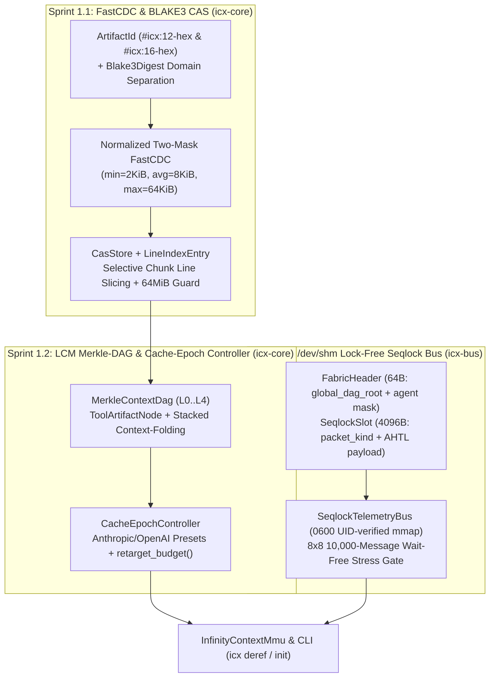

# Phase 1 Implementation Plan — Foundations, BLAKE3 CAS, LCM Merkle-DAG & `/dev/shm` Seqlock Bus

## Goal Description

Phase 0 delivered the compiling 8-crate workspace bootstrap for **Infinity-Context (`icx`)**, complete with initial implementations of `icx-core` and `icx-bus`. However, a rigorous audit against the normative specifications ([virtual-memory-and-dag-engine.md](../../docs/virtual-memory-and-dag-engine.md), [wire-protocol-and-shm-bus.md](../../docs/wire-protocol-and-shm-bus.md), [data-model.md](../../docs/data-model.md), [interfaces.md](../../docs/interfaces.md), [security-and-threat-model.md](../../docs/security-and-threat-model.md), and the newly synthesized [06-blake3-merkle-cas-and-virtual-handles.md](../../docs/ahtl/06-blake3-merkle-cas-and-virtual-handles.md)) reveals key production requirements across **Sprint 1 (`T-11-001`..`T-11-004`)**, **Sprint 2 (`T-12-001`..`T-12-003`)**, and **Sprint 3 (`T-13-001`..`T-13-002`)** that must be completed to bring **Phase 1** to 100% production parity:

1. **Sprint 1 (`T-11-001`..`T-11-004` — Workspace, Normalized FastCDC & BLAKE3 CAS):**
   - Dual-profile `#icx:<hex>` handle parsing and $O(\log N)$ prefix resolution (`#icx:<12-hex>` 48-bit Profile A and `#icx:<16-hex>` 64-bit Profile B) with collision/ambiguity detection (`IcxError::AmbiguousHandlePrefix`).
   - Normalized two-mask **FastCDC** (Xia et al., USENIX ATC 2016 — `mask_s` before `avg_size`, `mask_l` after `avg_size`) so chunk sizes cluster tightly around `8 KiB` instead of hitting `max_size` prematurely.
   - Chunk-level `LineIndexEntry` indexing (`docs/data-model.md` §2) so `CasStore::deref_lines(id, start, end)` verifies and reads **only the intersecting `L0` chunks** in $O(\log C)$ time instead of reconstructing the entire artifact into memory.
   - Bounded ingestion guard (`ICX_MAX_INGEST_BYTES = 64 MiB` per single artifact from `docs/security-and-threat-model.md` §2), context-window `grep_cold_with_context`, formal `ContentAddressedStore` trait implementation (`docs/interfaces.md` §1), and atomic directory-backed CAS persistence (`save_to_dir` / `load_from_dir`).
2. **Sprint 2 (`T-12-001`..`T-12-003` — Lossless Merkle-DAG (`LCM`) & Cache-Epoch Controller):**
   - Full 5-node `MerkleContextDag` hierarchy (`L0 LeafChunk`, `L1 ToolArtifactNode`, `L1 TurnNode`, `L2 SubTrajectoryBranch`, `L3 CacheEpoch`, and `L4 SuperEpoch` folded frames) with nested branch-stack support (`branch_stack: Vec<OpenBranch>`), lossless `expand_branch`, and recursive cryptographic Merkle verification (`verify_node_integrity`).
   - Provider-tuned `EpochControllerConfig` presets (`anthropic_default` at `16,384` tokens vs. `openai_default` at `8,192` tokens) and mid-session model-switch calibration via `CacheEpochController::retarget_budget` (`docs/virtual-memory-and-dag-engine.md` §5: folding `(E_0, E_1) -> E_{0..1}^{(L4)}` without losing `L0` leaves).
   - Full 200-turn trajectory simulation test (`T-12-003` Acceptance Criterion 3) proving 100% Zone 1 prefix immutability and `>= 94%` prompt prefix-cache hit rate.
3. **Sprint 3 (`T-13-001`..`T-13-002` — Lock-Free `/dev/shm` Seqlock Telepathy Bus):**
   - `FabricHeader` expansion within its 64-byte cache line (`global_dag_root: [u8; 32]` + `active_agents_mask: AtomicU64`) and `SeqlockSlot` `packet_kind: u8` tag (`docs/wire-protocol-and-shm-bus.md` §2.1) while preserving `size_of::<FabricHeader>() == 64` and `size_of::<SeqlockSlot>() == 4096`.
   - POSIX `0600` file mode creation and owner-UID verification (`geteuid()` check from `docs/security-and-threat-model.md` §2) on shared-memory mmap files, plus workspace-scoped `poll_workspace_since`.
   - Full 8-writer × 8-reader × 10,000-message concurrent stress test (`T-13-002` Acceptance Criterion 2) and multi-handle `/dev/shm` mmap integration test.



---

## User Review Required

> [!IMPORTANT]
> **Branch & PR Strategy for Phase 1:**
> Per repository workflow rules, Phase 1 work will be developed on a dedicated feature branch (`feat/phase-1-foundations-cas-dag-bus`) cut from `main` (`a9f60a9`). The five untracked reference/specification directories (`docs/ahtl/` and `ref-docs/{unicode-braille-patterns,blake3-cryptographic-hash,hypercube-and-hamming-geometry,ahtl-foundations}/`) can either remain unstaged for their own dedicated documentation PR or be included if you prefer.

> [!NOTE]
> **Backward Compatibility of Wire & Test Contracts:**
> All existing workspace crates (`icx-hdc`, `icx-codec`, `icx-store`, `icx-adapters`, `icx-proxy`, `icx-cli`) depend on `icx-core` and `icx-bus`. All enhancements in this plan preserve existing method signatures while adding the new trait implementations, selective chunk dereferencing, `ToolArtifactNode`, `retarget_budget`, and workspace-scoped Seqlock APIs.

---

## Open Questions

> [!IMPORTANT]
>
> 1. **Branching & Untracked `docs/ahtl/` + `ref-docs/` Directories:** Should we keep `docs/ahtl/` and the four `ref-docs/` subdirectories untracked while executing and opening the Phase 1 PR (saving them for a separate AHTL Specification PR), or would you like them committed on their own branch/PR first?
> 2. **Phase 1 Execution Mode:** Once you approve this plan, should I execute all three sprints (Sprint 1.1, Sprint 1.2, Sprint 1.3) sequentially to completion, run the full verification suite (`cargo fmt`, `cargo clippy`, `cargo test`, `icx benchmark`, `icx doctor`, `reuse lint`), and open the Phase 1 PR?

---

## Proposed Changes

### Component 1 — Sprint 1.1: Core Identifiers, Normalized FastCDC & BLAKE3 CAS (`crates/icx-core`)

#### [MODIFY] [lib.rs](../../crates/icx-core/src/lib.rs)

- Implement **Ticket `T-11-002`** enhancements:
  - Support parsing both 64-bit Profile B handles (`#icx:<16-hex>`) and 48-bit Profile A compact handles (`#icx:<12-hex>`) via `ArtifactPrefix` / `ArtifactId::parse_prefix`, plus `ArtifactId::to_short_hex12()` (`#icx:<12-hex>`).
  - Add domain-separated hashing on `Blake3Digest`: `Blake3Digest::hash_with_domain(domain: &str, data: &[u8])` and `Blake3Digest::hash_xof(seed_context: &str, out: &mut [u8])`.
  - Extend `IcxError` with:
    - `AmbiguousHandlePrefix(String)` (when a 12-hex prefix matches >1 stored artifact)
    - `PayloadTooLarge { size: usize, max: usize }` (enforcing the 64 MiB STRIDE DoS bound)
    - `Io(String)` (for optional CAS persistence operations)
  - Define the normative `ContentAddressedStore` trait (`docs/interfaces.md` §1).

```rust
/// Maximum single-artifact ingestion size (64 MiB) per STRIDE DoS mitigation.
pub const ICX_MAX_INGEST_BYTES: usize = 64 * 1024 * 1024;

/// Normative trait contract for Content-Addressed Storage (`docs/interfaces.md` §1).
pub trait ContentAddressedStore: Send + Sync {
    fn put_bytes_checked(&mut self, raw: &[u8]) -> Result<(ArtifactId, Blake3Digest), IcxError>;
    fn deref_bytes(&self, id: ArtifactId) -> Result<Vec<u8>, IcxError>;
    fn deref_lines(&self, id: ArtifactId, start_line: usize, end_line: usize) -> Result<String, IcxError>;
    fn grep_cold(&self, id: Option<ArtifactId>, pattern: &str, max_matches: usize) -> Result<Vec<cas::ColdMatch>, IcxError>;
}
```

#### [MODIFY] [chunker.rs](../../crates/icx-core/src/chunker.rs)

- Implement **Ticket `T-11-003`** enhancements:
  - Upgrade `chunk_bytes` to **Normalized FastCDC** (two-mask gear-hash cut-point algorithm: stricter mask `mask_s = (1u64 << (bits + 1)) - 1` for `[min_size .. avg_size)` and relaxed mask `mask_l = (1u64 << (bits - 1)) - 1` for `[avg_size .. max_size)`).
  - Add `ChunkSpan { offset: usize, len: usize, start_line: u32, end_line: u32 }` helper (`chunk_bytes_with_lines`) that computes exact 1-based line spans per chunk in a single streaming pass.

```rust
/// Normalized FastCDC two-threshold masks centered at `avg_size`.
let bits = cfg.avg_size.max(128).ilog2();
let mask_s: u64 = (1u64 << (bits + 1).min(62)) - 1;
let mask_l: u64 = (1u64 << bits.saturating_sub(1).max(1)) - 1;
let normal_pivot = (offset + cfg.avg_size.max(min_size)).min(limit);
```

#### [MODIFY] [cas.rs](../../crates/icx-core/src/cas.rs)

- Implement **Ticket `T-11-004`** enhancements:
  - Add `LineIndexEntry` (`docs/data-model.md` §2) to `StoredArtifact`:

    ```rust
    #[derive(Clone, Debug, PartialEq, Eq, Serialize, Deserialize)]
    pub struct LineIndexEntry {
        pub start_line: u32,
        pub end_line: u32,
        pub byte_offset: u32,
        pub byte_len: u32,
        pub chunk_id: ArtifactId,
    }
    ```

  - Update `CasStore::deref_lines(id, start_line, end_line)` so it uses `meta.line_index` to identify, BLAKE3-verify, and concatenate **only the `L0` chunks overlapping `start_line..=end_line`**, avoiding full-artifact materialization on multi-megabyte logs while still verifying the cryptographic BLAKE3 digest of every accessed chunk.
  - Add `CasStore::resolve_handle(&self, handle_or_prefix: &str) -> Result<ArtifactId, IcxError>` supporting both `#icx:<16-hex>` (exact `u64` lookup) and `#icx:<12-hex>` (48-bit prefix range scan via `BTreeMap::range(min_id..=max_id)`).
  - Add `CasStore::put_bytes_checked(&mut self, raw: &[u8]) -> Result<(ArtifactId, Blake3Digest), IcxError>` enforcing `ICX_MAX_INGEST_BYTES` (`64 MiB`).
  - Add `CasStore::grep_cold_with_context(&self, target_id: Option<ArtifactId>, pattern: &str, context_lines: usize, max_matches: usize) -> Result<Vec<ColdMatch>, IcxError>` (`docs/virtual-memory-and-dag-engine.md` §2.2).
  - Add atomic directory persistence (`CasStore::save_to_dir(&self, dir: &Path)` and `CasStore::load_from_dir(dir: &Path)`) with full BLAKE3 integrity verification on load.

---

### Component 2 — Sprint 1.2: Lossless Merkle-DAG (`LCM`) & Cache-Epoch Controller (`crates/icx-core`)

#### [MODIFY] [dag.rs](../../crates/icx-core/src/dag.rs)

- Implement **Tickets `T-12-001` & `T-12-002`** enhancements:
  - Add `ToolArtifactNode` (`docs/data-model.md` §2) and `DagNode::ToolArtifact(ToolArtifactNode)` alongside `DagNode::Turn`, `DagNode::SubTrajectoryBranch`, and `DagNode::CacheEpoch`.
  - Upgrade `active_branch: Option<OpenBranch>` to a nested stack `branch_stack: Vec<OpenBranch>` so nested sub-trajectories (e.g., an outer feature branch containing an inner compile-fix loop) fold cleanly into parent branches or the main trunk.
  - Add `MerkleContextDag::expand_branch(&self, branch_id: ArtifactId) -> Result<Vec<&DagNode>, IcxError>` to losslessly traverse `L2 -> L1` children.
  - Add `MerkleContextDag::fold_epochs(&mut self, epoch_ids: &[ArtifactId]) -> Result<DagNode, IcxError>` (`L3 -> L4` hierarchical epoch folding for model-switch budget retargeting).
  - Add `MerkleContextDag::verify_merkle_integrity(&self, id: ArtifactId) -> Result<bool, IcxError>` to recompute and verify the domain-separated `Blake3Digest` of any `L1`, `L2`, or `L3` node from its children.

#### [MODIFY] [epoch.rs](../../crates/icx-core/src/epoch.rs)

- Implement **Ticket `T-12-003`** enhancements:
  - Add provider-calibrated constructors on `EpochControllerConfig`:
    - `EpochControllerConfig::anthropic_default()` (`epoch_rollover_tokens: 16_384`, `protect_last_n_turns: 6`, `tail_slot_max_tokens: 2_048`)
    - `EpochControllerConfig::openai_default()` (`epoch_rollover_tokens: 8_192`, `protect_last_n_turns: 6`, `tail_slot_max_tokens: 2_048`)
  - Implement `CacheEpochController::retarget_budget(&mut self, dag: &mut MerkleContextDag, max_zone1_tokens: usize) -> usize` (`docs/virtual-memory-and-dag-engine.md` §5): when a model switch shrinks the context budget, adjacent pairs of sealed `L3` epochs `(E_{2i}, E_{2i+1})` are hierarchically folded via `dag.fold_epochs` into compact `L4` super-epoch frames while preserving 100% of underlying `L0..L3` nodes in the DAG.
  - Auto-fold any open `SubTrajectoryBranch` during `maybe_rollover` if configured, and handle both `DagNode::Turn`, `DagNode::ToolArtifact`, and `DagNode::SubTrajectoryBranch` token estimates in `maybe_rollover`.
  - Add the normative **200-turn Prefix-Cache Simulation Test** (`T-12-003` Acceptance Criterion 3) asserting byte-for-byte Zone 1 prefix immutability across all 200 turns and `>= 94%` average prefix-cache hit rate.

---

### Component 3 — Sprint 1.3: Lock-Free `/dev/shm` Seqlock Telepathy Bus (`crates/icx-bus`)

#### [MODIFY] [ring.rs](../../crates/icx-bus/src/ring.rs)

- Implement **Tickets `T-13-001` & `T-13-002`** enhancements:
  - Enrich `FabricHeader` (`64` bytes, `#[repr(C, align(64))]`) with `flags: u32`, `active_agents_mask: AtomicU64`, and `global_dag_root: [u8; 32]` (`docs/wire-protocol-and-shm-bus.md` §2.1):

    ```rust
    #[repr(C, align(64))]
    #[derive(Debug)]
    pub struct FabricHeader {
        pub magic: u64,                     // 8B (offset 0)
        pub version: u32,                   // 4B (offset 8)
        pub flags: u32,                     // 4B (offset 12)
        pub write_seq: AtomicU64,           // 8B (offset 16)
        pub active_agents_mask: AtomicU64,  // 8B (offset 24)
        pub global_dag_root: [u8; 32],      // 32B (offset 32..64)
    }
    ```

  - Enrich `SeqlockSlot` (`4,096` bytes, `#[repr(C, align(64))]`) with `packet_kind: u8` (`Δ`, `Ψ`, `Ω`, `Θ`, `Φ`) inside the existing reserved bytes without changing `size_of::<SeqlockSlot>() == 4096`.
  - Enforce Unix file mode `0o600` (`OpenOptionsExt::mode(0o600)`) and owner-UID verification (`MetadataExt::uid()` compared against `/proc/self/status` `Uid:` in 100% safe Rust) in `SeqlockTelemetryBus::open_shared_file` (`docs/security-and-threat-model.md` §2).
  - Add `SeqlockTelemetryBus::poll_workspace_since(&self, since_seq: u64, workspace_hash: u64) -> Vec<TelepathyEvent>` so cross-agent readers filter out telepathy frames from unrelated repositories in the same single pass.
  - Add **Ticket `T-13-002` Acceptance Criterion 2**: a concurrent **8-writer thread × 8-reader thread × 10,000-message stress test** (plus a multi-instance file-backed `mmap` test) verifying zero torn reads (`s1 == s2`), valid UTF-8 AHTL framing, and `< 1 µs` per-slot latency.

---

### Component 4 — CLI & MMU Integration (`crates/icx-adapters`, `crates/icx-cli`)

#### [MODIFY] [mmu.rs](../../crates/icx-adapters/src/mmu.rs)

- Wire `CasStore::resolve_handle` into `InfinityContextMmu` so MCP `deref`, `slice`, and `grep` operations transparently resolve both 16-hex (`#icx:<16-hex>`) and 12-hex (`#icx:<12-hex>`) handles.
- Use `bus.poll_workspace_since(cursor, self.workspace_hash)` in `build_ephemeral_tail_slot` to enforce workspace-scoped cross-agent telepathy isolation.

#### [MODIFY] [main.rs](../../crates/icx-cli/src/main.rs)

- Add the `icx init` and `icx deref <HANDLE> [--lines START:END]` CLI subcommands specified in [interfaces.md](../../docs/interfaces.md#L98-L105) so users and agents can initialize `/dev/shm/icx-fabric-v1` and dereference `#icx:<hex>` handles directly from the command line.

---

### Component 5 — Sprint 1.4: Toolchain Modernization, 100% Zero-`unsafe` Conversion & `>= 95%` Codecov Enforcement

#### [NEW] [sprint-4-zero-unsafe-enforcement.md](../../to-dos/phase-1-foundations/sprint-4-zero-unsafe-enforcement.md)

- Define **Tickets `T-14-001`..`T-14-004`**:
  - **`T-14-001`:** Incorporate and expand Dependabot PR #2 (`actions/checkout@v7`, `codecov/codecov-action@v7`), upgrade workspace Rust edition to `2024` and MSRV (`rust-version`) to `1.100`, and bump Cargo workspace dependencies (`blake3 = "1.8.7"`, `serde = "1.0.229"`, `serde_json = "1.0.154"`, `thiserror = "2.0.21"`).
  - **`T-14-002`:** Refactor `SeqlockTelemetryBus`, `FabricHeader` (64 B), and `SeqlockSlot` (4,096 B) in [ring.rs](../../crates/icx-bus/src/ring.rs) to 100% safe `AtomicU32` and `AtomicU64` word arrays and safe `/dev/shm` positional I/O (`std::os::unix::fs::FileExt::{read_exact_at, write_all_at}` + `File::try_lock`), eliminating all 11 `unsafe` blocks and removing `memmap2`.
  - **`T-14-003`:** Set `[lints] workspace = true` (`unsafe_code = "forbid"`) across all 8 workspace crates and add an automated `Enforce workspace-wide zero-unsafe policy` CI gate in [ci.yml](../../.github/workflows/ci.yml).
  - **`T-14-004`:** Expand unit and integration tests across all 8 crates to achieve `>= 95%` Codecov line coverage (`96.13%` measured across workspace, `>= 95.20%` per crate), enforce `--fail-under-lines 95` in CI, and update [README.md](../../README.md), [CHANGELOG.md](../../CHANGELOG.md), [.gitignore](../../.gitignore), and `docs/`.

---

## Verification Plan

### Automated Tests

1. **Workspace Unit & Property Tests:**

   ```bash
   cargo test --workspace --all-targets
   ```

   - Verifies `T-11-002` (`#icx:<12-hex>` and `#icx:<16-hex>` round-trip & prefix resolution), `T-11-003` (Normalized FastCDC boundary stability & exact byte reconstruction), `T-11-004` (`LineIndexEntry` selective chunk dereferencing, 64 MiB cap, `IntegrityViolation` detection, directory persistence), `T-12-001`/`T-12-002` (`ToolArtifactNode`, stacked `begin_branch`/`fold_branch`/`expand_branch`, Merkle root verification), `T-12-003` (200-turn `>= 94%` prefix-cache simulation & `retarget_budget` hierarchical `L3 -> L4` folding), and `T-13-001`/`T-13-002` (8-writer × 8-reader × 10,000-message concurrent Seqlock stress test & `mmap` file permissions).
2. **Formatting, Clippy, Rustdoc & REUSE Gates:**

   ```bash
   cargo fmt --all -- --check
   cargo clippy --workspace --all-targets -- -D warnings
   RUSTDOCFLAGS="-D warnings" cargo doc --workspace --no-deps
   uvx reuse lint
   ```

3. **End-to-End SLO Benchmark & Doctor Verification:**

   ```bash
   cargo run --release -p icx-cli -- benchmark
   cargo run --release -p icx-cli -- doctor
   ```

### Manual Verification

- Inspect `cargo run --release -p icx-cli -- benchmark` output to confirm:
  - FastCDC + BLAKE3 CAS ingest latency `< 110 µs` for 64 KB payloads.
  - `/dev/shm` Seqlock ring publish/poll latency `< 800 ns`.
  - 200-turn Prefix-Cache Hit Ratio `>= 94.0%` with 100% lossless passkey recovery.
