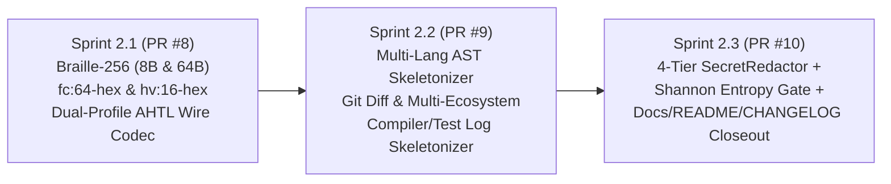

# Phase 2 Implementation Plan: Alien Holographic Token Lattice (`AHTL`) & Structural Skeletonizers

**Target Workspace:** `./` (Repository Root)  
**Phase Scope:** `Phase 2` (`Sprint 2.1` through `Sprint 2.3`, Tickets `T-21-001`..`T-23-001`)  
**Complete `docs/ahtl/` & `docs/` Specification Inventory Analyzed:**

- [docs/ahtl/README.md](../../docs/ahtl/README.md) — Master Specification Overview & Dual-Profile Architecture (`Profile A` vs. `Profile B`)
- [01-formal-grammar-and-packet-specification.md](../../docs/ahtl/01-formal-grammar-and-packet-specification.md) — EBNF Wire Grammar, Disjoint Unicode Operator Codepoints, `AhtlWirePacketV1` (`Profile A`), and `AhtlPacket` (`Profile B`)
- [02-braille-256-spectral-bijection.md](../../docs/ahtl/02-braille-256-spectral-bijection.md) — $\mathbb{F}_2^8 \leftrightarrow [\text{U+2800}, \text{U+28FF}]$ Isometric Bijection, 1-Lipschitz 64-Band Projection ($\pi_{10240 \to 512}$), and 8-Byte Channel B Bit Layout (`B[0..7]`)
- [03-fractal-ifs-chaos-game-coordinates.md](../../docs/ahtl/03-fractal-ifs-chaos-game-coordinates.md) — $[-1, +1]^{16}$ Contractive IFS Chaos-Game Coordinates, `Q15` (`[i16; 16]`) `fc:<64-hex>` Wire Encoding, and `quadrant_signature_u16()` Orthant Mask
- [04-hyperdimensional-10240-bit-lattice.md](../../docs/ahtl/04-hyperdimensional-10240-bit-lattice.md) — $Q_{10240}$ Binary Spatter Code Lattice, `SplitMix64` `from_u64_seed`, and Rotational XOR-Tree Parity Folds (`hv:<16-hex>` & `sketch_u32`)
- [05-structural-ast-skeletonization-and-redaction.md](../../docs/ahtl/05-structural-ast-skeletonization-and-redaction.md) — Multi-Language AST / Diff / Log Skeletonization and 4-Tier Pre-Ingestion `SecretRedactor` + Shannon Entropy Gate
- [06-blake3-merkle-cas-and-virtual-handles.md](../../docs/ahtl/06-blake3-merkle-cas-and-virtual-handles.md) — `#icx:<12-hex>` (48-bit Profile A) and `#icx:<16-hex>` (64-bit Profile B) Virtual Memory Handle Formats & Fail-Closed Ambiguity Rules
- [07-transformer-attention-and-bpe-mechanics.md](../../docs/ahtl/07-transformer-attention-and-bpe-mechanics.md) — BPE Pre-Tokenizer Operator Isolation (`[^\s\p{L}\p{N}]+`), Softmax SNR Amplification, `⟦...⟧` Attention Sinks, and Titans Surprise-Gated Retention Tiers
- [08-v1-reference-implementation-blueprint.md](../../docs/ahtl/08-v1-reference-implementation-blueprint.md) — Complete Rust Blueprint for `AhtlWirePacketV1`, `byte_to_braille_utf8`, `encode_braille_64`, and Dual-Profile Conversion
- [alien-holographic-codec.md](../../docs/alien-holographic-codec.md), [interfaces.md](../../docs/interfaces.md), [data-model.md](../../docs/data-model.md), [security-and-threat-model.md](../../docs/security-and-threat-model.md), and [overview.md](../../to-dos/phase-2-alien-codec-and-compression/overview.md)

---

## 1. Permanent Architectural Invariants & Delivery Workflow

> [!IMPORTANT]
> Every Sprint in Phase 2 (`Sprint 2.1`, `Sprint 2.2`, `Sprint 2.3`) enforces the permanent project invariants established in Phase 1:
>
> 1. **Rust Edition `2024`, MSRV `1.100` (`rust-version = "1.100"`):** Maintained across all 8 workspace crates.
> 2. **Permanent Zero-`unsafe` Policy (`std` allowed):** `unsafe_code = "forbid"` in `[workspace.lints.rust]` and verified by CI across all 8 crates (`icx-core`, `icx-hdc`, `icx-codec`, `icx-store`, `icx-bus`, `icx-adapters`, `icx-proxy`, `icx-cli`).
> 3. **Codecov `>= 95%` Line Coverage Gate:** Every Sprint PR must pass `cargo llvm-cov --workspace --all-targets --lcov --output-path lcov.info --fail-under-lines 95`.
> 4. **Per-Sprint PR & Bot Adjudication Ceremony:** At the completion of each Sprint (`2.1`, `2.2`, `2.3`), open a dedicated PR against `main`, monitor and adjudicate all automated review bots (`Antigravity PR Review`, `OpenAI Codex`, `Codecov`, `Gitleaks`, `REUSE 3.3`, `CLA`), resolve every finding with tests, and merge when all checks are green.
> 5. **Continuous Research & Final Phase 2 Closeout:** Combine nested project specification research (`docs/ahtl/`, `ref-docs/`) with internet verification, and close out Sprint 2.3 by updating [README.md](../../README.md), [CHANGELOG.md](../../CHANGELOG.md), [.gitignore](../../.gitignore), [ROADMAP.md](../../to-dos/ROADMAP.md), `to-dos/phase-2-alien-codec-and-compression/`, and `docs/` before submitting the final Phase 2 PR.



---

## 2. Sprint 2.1 — AHTL Grammar, Dual-Profile Wire Codec & Braille-256 Spectral Bijection (`PR #8`)

**Branch:** `feat/phase-2-sprint-1-ahtl-grammar-and-braille`  
**Sprint Spec:** [sprint-1-ahtl-grammar-and-braille.md](../../to-dos/phase-2-alien-codec-and-compression/sprint-1-ahtl-grammar-and-braille.md)

### 2.1 Ticket `T-21-001` — Closed-Form Braille-256 (`8-Byte` & `64-Byte`) Bijection, `fc:<64-hex>` / `hv:<16-hex>` Helpers & 1-Lipschitz Spectral Projection

- **Files to Modify:**
  - [hv.rs](../../crates/icx-hdc/src/hv.rs)
  - [fractal.rs](../../crates/icx-hdc/src/fractal.rs)
  - [lib.rs](../../crates/icx-hdc/src/lib.rs)
  - [braille.rs](../../crates/icx-codec/src/braille.rs)
- **Implementation Details:**
  1. **Closed-Form 3-Byte UTF-8 Braille Bijection ([02-braille-256-spectral-bijection.md](../../docs/ahtl/02-braille-256-spectral-bijection.md) §2 & [08-v1-reference-implementation-blueprint.md](../../docs/ahtl/08-v1-reference-implementation-blueprint.md) §2.2):**
     - Implement branchless `byte_to_braille_utf8(b: u8) -> [u8; 3]` (`[0xE2, 0xA0 | (b >> 6), 0x80 | (b & 0x3F)]`) and `braille_utf8_to_byte(utf8: [u8; 3]) -> Option<u8>` alongside `byte_to_braille(u8) -> char` and `braille_to_byte(char) -> Option<u8>`.
     - Retain and optimize Profile B 8-byte (`64-bit`) helpers `encode_braille_sketch(&[u8; 8]) -> String`, `decode_braille_sketch(&str) -> Option<[u8; 8]>`, and `sketch_hamming_distance(&[u8; 8], &[u8; 8]) -> u32`.
     - Add Profile A 64-byte (`512-bit`, `64-glyph`, `192-byte UTF-8`) spectral band helpers:
       - `encode_braille_64(bytes: &[u8; 64]) -> String`
       - `decode_braille_64(s: &str) -> Option<[u8; 64]>`
       - `spectral_hamming_distance_64(a: &[u8; 64], b: &[u8; 64]) -> u32`
     - Add structured **Channel B 8-Byte Bit Layout (`B[0..7]`)** packer/unpacker (`ChannelBHologram` in [braille.rs](../../crates/icx-codec/src/braille.rs) per [02-braille-256-spectral-bijection.md](../../docs/ahtl/02-braille-256-spectral-bijection.md) §4.2):
       - `B[0..3]`: 32-bit HDC rotational parity fold (`sketch_u32` big-endian)
       - `B[4..5]`: 16-bit Fractal orthant signature (`quadrant_signature_u16` big-endian) or top 16 bits of `FractalCoord::digest_u32()`
       - `B[6]`: 8-bit quantized Titans surprise (`u8 = round(255 * S_eff)`)
       - `B[7]`: 8-bit structural flag bitfield (`HAS_ERROR`, `HAS_PANIC`, `HAS_DIFF`, `IS_FOLDED`, `IS_EPOCH`, `HAS_CAUSAL`, `IS_REDACTED`, `IS_PINNED`)
  2. **1-Lipschitz 64-Band Spectral Projection & `hv:<16-hex>` / `SplitMix64` on `Hypervector` ([02-braille-256-spectral-bijection.md](../../docs/ahtl/02-braille-256-spectral-bijection.md) §§3–4 & [04-hyperdimensional-10240-bit-lattice.md](../../docs/ahtl/04-hyperdimensional-10240-bit-lattice.md) §§3.2, 6.2):**
     - Add `Hypervector::spectral_bands_64(&self) -> [u8; 64]` in [hv.rs](../../crates/icx-hdc/src/hv.rs): partition the `10,240` bits (`160` × `u64`) into `64` bands of `160` bits (`8` disjoint `20-bit` sub-blocks per band), setting bit $j \in \{0,\dots,7\}$ of band $m \in \{0,\dots,63\}$ iff the `20-bit` sub-block popcount is $\ge 10$.
     - Add `Hypervector::hv_digest_u64(&self) -> u64` ($\bigoplus_{i=0}^{159} \operatorname{rotl}_{64}(H.\text{words}[i], i \bmod 64)$), `Hypervector::encode_hv_hex16(&self) -> String` (`{:016x}`), and `Hypervector::from_u64_seed(seed: u64) -> Self` (`SplitMix64` recurrence).
  3. **`FractalCoord` Wire Serialization (`fc:<64-hex>` & `quadrant_signature_u16` — [03-fractal-ifs-chaos-game-coordinates.md](../../docs/ahtl/03-fractal-ifs-chaos-game-coordinates.md) §4):**
     - Add `FractalCoord::from_q15(q15: [i16; 16], depth: u32) -> Self`, `FractalCoord::encode_fc_hex64(&self) -> String` (`64` lowercase hex chars), `FractalCoord::decode_fc_hex64(hex: &str, depth: u32) -> Option<Self>`, and `FractalCoord::quadrant_signature_u16(&self) -> u16` ($\sum_{j=0}^{15} \mathbb{I}(z_j \ge 0) \cdot 2^j$).
  4. **Verification:**
     - Exhaustive `256/256` single-byte bijection test (`byte_to_braille`, `braille_to_byte`, `byte_to_braille_utf8`, `braille_utf8_to_byte`).
     - `10,000` deterministic xorshift64 `[u8; 8]` and `[u8; 64]` round-trip and exact POPCNT Hamming distance conservation tests.
     - 1-Lipschitz spectral projection bound test verifying $d_{\text{spectral}}(P, Q) \le d_H(A, B)$ across single-bit and multi-bit perturbations of `10,240`-bit `Hypervector`s.
     - `FractalCoord` `fc:<64-hex>` round-trip and `quadrant_signature_u16()` orthant tests.

### 2.2 Ticket `T-21-002` — Dual-Profile `AHTL` Parser/Serializer (`Profile A` & `Profile B`), Slice Hints, Causal Clauses & `ContextCodec` Trait

- **Files to Modify:**
  - [ahtl.rs](../../crates/icx-codec/src/ahtl.rs)
  - [lib.rs](../../crates/icx-codec/src/lib.rs)
  - [skeleton.rs](../../crates/icx-codec/src/skeleton.rs)
  - [main.rs](../../crates/icx-cli/src/main.rs)
- **Implementation Details:**
  1. **Profile A Canonical Wire Packet (`AhtlWirePacketV1` — [01-formal-grammar-and-packet-specification.md](../../docs/ahtl/01-formal-grammar-and-packet-specification.md) §1.1 & [08-v1-reference-implementation-blueprint.md](../../docs/ahtl/08-v1-reference-implementation-blueprint.md) §2.1):**
     - Wire format: `⟦AHTL v1│#icx:<12|16-hex>│fc:<64-hex>│hv:<16-hex>│<Braille-64>│<Skeleton>⟧`
     - Support both 48-bit `#icx:<12-hex>` (`render_compact_48bit`) and 64-bit `#icx:<16-hex>` (`render`) CAS handles.
     - Implement `AhtlWirePacketV1::render(&self) -> String`, `AhtlWirePacketV1::render_compact_48bit(&self) -> String`, `AhtlWirePacketV1::parse(input: &str) -> Result<Self, CodecError>`, `AhtlWirePacketV1::to_profile_b(&self, kind: PacketKind, subject: &str) -> AhtlPacket`, and `AhtlPacket::to_profile_a(&self, fractal: &FractalCoord, hv: &Hypervector) -> Result<AhtlWirePacketV1, CodecError>`.
  2. **Profile B Enrichments (`AhtlPacket`, `AhtlClause`, `AhtlStream` — [alien-holographic-codec.md](../../docs/alien-holographic-codec.md) §2 & [data-model.md](../../docs/data-model.md) §3):**
     - **Subject `#L` Escaping:** Escape literal `#L` inside `subject` as `%23L` during `render()` and unescape back to `#L` during `parse()` when `line_range` is present, so subjects containing `#L` round-trip losslessly alongside `#L<start>-<end>`.
     - **Slice Hints & Hologram Tag on Deref Tail:** Add `pub slice_hint: Option<String>` and `pub hologram_tag: Option<u16>` to `AhtlPacket` so deref tails support `↦#icx:<hex>`, `↦#icx:<hex>(L<a>-<b>)`, `↦#icx:<hex>(B<a>:<b>)`, and optional trailing `[<Hex4>]` tags.
     - **Causal Implication Chains (`⇒`, `U+21D2`):** Add `pub implies: Option<Box<AhtlClause>>` to `AhtlClause` and `AhtlClause::with_implication(self, effect: AhtlClause) -> Self`, rendering and parsing `cause⇒effect` chains (`Clause ::= OpPrefix? Identifier (":" ValueExpr)? ("⇒" Clause)?`).
     - **Multi-Packet Stream & Dual-Profile Dispatcher:** Add `EpochHeader` (`⟪ICX:v1│ep=<hex4>│root=<hex8>│τ=<u32>⟫`), `WirePacket` (`ProfileA(AhtlWirePacketV1)` | `ProfileB(AhtlPacket)`), `WirePacket::parse_auto(input: &str) -> Result<Self, CodecError>`, and `AhtlStream::parse_stream(input: &str) -> Result<AhtlStream, CodecError>`.
  3. **Normative `ContextCodec` Trait ([interfaces.md](../../docs/interfaces.md) §2):**
     - Define and export `pub trait ContextCodec` in [lib.rs](../../crates/icx-codec/src/lib.rs) with `compress_to_packet`, `render_packet`, and `parse_packet`, implemented for `StructuralSkeletonizer`.
     - Enhance `icx encode-ahtl` in [main.rs](../../crates/icx-cli/src/main.rs) with optional `--profile a|b` flag (defaulting to Profile B for backward compatibility).

---

## 3. Sprint 2.2 — Multi-Language AST, Unified Diff & Compiler/Test-Log Structural Skeletonizers (`PR #9`)

**Branch:** `feat/phase-2-sprint-2-structural-skeletonizers`  
**Sprint Spec:** [sprint-2-structural-skeletonizers.md](../../to-dos/phase-2-alien-codec-and-compression/sprint-2-structural-skeletonizers.md)

### 3.1 Ticket `T-22-001` — Multi-Language Source Code & Unified Diff Structural Skeletonizer

- **Files to Modify:**
  - [skeleton.rs](../../crates/icx-codec/src/skeleton.rs)
- **Implementation Details:**
  1. **Multi-Language Source AST / Lexical Skeletonizer ([05-structural-ast-skeletonization-and-redaction.md](../../docs/ahtl/05-structural-ast-skeletonization-and-redaction.md) §§1–2):**
     - **Module & Import Header Folding:** Extract module/package declarations (`pub mod `, `mod `, `package `, `namespace `) into `§mod@L<n>` clauses and collapse contiguous import blocks (`use `, `import `, `from ... import`, `#include `) into a single `§imports:L<start>-<end>(N)` summary clause instead of repeating boilerplate imports.
     - **Signature & Exact Line-Span (`L<start>-<end>`) Extraction Across 5 Language Families:**
       - **Rust:** `pub fn`, `pub async fn`, `pub const fn`, `pub(crate) fn`, `fn `, `const fn `, `async fn `, `pub struct`, `struct `, `pub enum`, `enum `, `pub trait`, `trait `, `impl`, `pub type `, `type `, `macro_rules!`.
       - **Python:** `def `, `async def `, `class `, `@dataclass`.
       - **TypeScript / JavaScript:** `export function`, `export async function`, `export default function`, `function `, `export class`, `class `, `export interface`, `interface `, `export type `, `type `.
       - **Go:** `func `, `type ... struct`, `type ... interface`.
       - **C / C++:** `struct `, `class `, `enum `, `template<`, and top-level typed function definitions.
     - **Block Span Resolution (`L<start>-<end>`):** Track brace depth (`{ ... }`) for C-family/Rust/TS/Go and indentation level for Python so elided function/struct/class bodies emit `⊕sig@L<start>-<end>:<signature>` (enabling targeted `icx({ op: "slice", id: "#icx:...", range: [start, end] })` retrieval) and automatically populate `AhtlPacket.line_range` with the span of the extracted definitions.
     - **Semantic Pins:** Extract `INVARIANT`, `PASSKEY`, `SAFETY:`, `TODO`, and `FIXME` annotations as `✓pin@L<n>` clauses.
  2. **Unified `git diff` Skeletonizer (`skeletonize_diff`):**
     - Extract modified file paths (`+++ b/<path>` -> `§file:<path>`), hunk line-range coordinates (`@@ -a,b +c,d @@` -> `§hunk:+L<c>..<c+d>`), added lines (`⊕L<line>:<summary>`), removed lines (`⊖L<line>:<summary>`), and any error/invariant triggers within the diff.
  3. **Verification:**
     - Unit and corpus compression tests across realistic Rust, Python, TypeScript, Go, C++, and unified `git diff` inputs confirming `>= 6x–12x` source compression and `100%` preservation of top-level public signatures and line spans.

### 3.2 Ticket `T-22-002` — Multi-Ecosystem Compiler & Test-Suite Log Skeletonizer (`cargo`, `pytest`, `tsc`/`vitest`, `go test`)

- **Files to Modify:**
  - [skeleton.rs](../../crates/icx-codec/src/skeleton.rs)
- **Implementation Details:**
  1. **Multi-Ecosystem Log Detection (`looks_like_test_or_build_log`):**
     - Detect logs from **Rust** (`running N tests`, `test ... ok`, `test ... FAILED`, `error[E`, `Compiling `, `Finished `), **Python `pytest`** (`=== test session starts ===`, `PASSED`, `FAILED `, `=== FAILURES ===`, `Traceback (most recent call last):`), **TypeScript / JS (`tsc`, `vitest`, `jest`)** (`error TS`, `PASS `, `FAIL `, `Test Files `, `AssertionError`), and **Go (`go test`)** (`=== RUN`, `--- PASS:`, `--- FAIL:`, `FAIL\t`).
  2. **High-Compression Log Skeletonization (`skeletonize_log`):**
     - **Aggregate Passing Boilerplate:** Collapse all passing tests (`test ... ok`, `PASSED`, `--- PASS:`, `✓`) into a single `✓pass:<count>` clause and overall status `status:PASS|FAIL`.
     - **Pin Failing Tests, Error Codes, Causal Implications & Workspace Stack Frames (`100%` Recall):**
       - Rust: `test <name> ... FAILED` -> `✗fail:<name>`, `error[E<code>]: <msg>` -> `✗err:E<code>:<msg>`, `--> <file>:<line>:<col>` -> `✗loc:<file>:<line>:<col>`, `panicked at ...` -> `✗panic:<summary>`.
       - Python (`pytest`): `FAILED <nodeid>` -> `✗fail:<nodeid>`, `File "<path>", line <n>` -> `✗loc:<path>:<n>`, `E   <ErrorType>: <msg>` -> `✗err:<ErrorType>:<msg>`.
       - TypeScript (`tsc` / `vitest`): `<file>(<line>,<col>): error TS<code>: <msg>` or `<file>:<line>:<col> - error TS<code>: <msg>` -> `✗err:TS<code>@<file>:<line>:<col>:<msg>`, `FAIL <suite>` -> `✗fail:<suite>`.
       - Go (`go test`): `--- FAIL: <TestName>` -> `✗fail:<TestName>`, `<file>.go:<line>: <msg>` -> `✗loc:<file>.go:<line>:<msg>`.
  3. **Verification:**
     - Test against 200-test / multi-hundred-line `cargo test`, `pytest`, `tsc`/`vitest`, and `go test` logs verifying `>= 12x–40x` compression ratio (`<= 320` bytes output from `> 8,000` bytes raw log) and `100%` recall of every failing test name, error code, and file:line location.

---

## 4. Sprint 2.3 — 4-Tier Pre-Ingestion `SecretRedactor`, Shannon Entropy Gate & Phase 2 Closeout (`PR #10`)

**Branch:** `feat/phase-2-sprint-3-secret-redaction-and-safety`  
**Sprint Spec:** [sprint-3-secret-redaction-and-safety.md](../../to-dos/phase-2-alien-codec-and-compression/sprint-3-secret-redaction-and-safety.md)

### 4.1 Ticket `T-23-001` — 4-Tier Pre-Ingestion `SecretRedactor` & Shannon Entropy Gate

- **Files to Modify:**
  - [redact.rs](../../crates/icx-codec/src/redact.rs)
  - [mmu.rs](../../crates/icx-adapters/src/mmu.rs)
- **Implementation Details ([05-structural-ast-skeletonization-and-redaction.md](../../docs/ahtl/05-structural-ast-skeletonization-and-redaction.md) §3 & [security-and-threat-model.md](../../docs/security-and-threat-model.md) §2):**
  1. **Tier 0 — Anti-Injection Delimiter Neutralization:**
     - Escape reserved top-level AHTL structural delimiters (`⟪` -> `<<`, `⟫` -> `>>`, `⟦` -> `[[`, `⟧` -> `]]`) on untrusted raw input before CAS storage, HDC indexing, or AHTL skeletonization so untrusted tool output can never spoof a `Profile A`, `Profile B`, or `⟪ICX:...⟫` frame header.
  2. **Tier 1 — Multi-Line Cryptographic Key Block Stripping:**
     - Strip PEM / OpenSSH / PGP private-key armor blocks (`RSA`, `OPENSSH`, `EC`, `DSA`, `ENCRYPTED`, `PGP`, generic private key headers/footers), replacing with `[REDACTED:PRIVATE_KEY_BLOCK]`.
  3. **Tier 2 — Structured Credential & 2025/2026 Vendor Token Prefix Scrubbing:**
     - **Vendor Token Prefixes:**
       - OpenAI: `sk-proj-...`, `sk-svcacct-...`, `sk-...` (`>= 12` chars)
       - Anthropic: `sk-ant-api03-...`, `sk-ant-admin01-...`, `sk-ant-oat01-...`, `sk-ant-ort01-...`, `sk-ant-...`
       - GitHub: `ghp_`, `gho_`, `ghu_`, `ghs_`, `ghr_`, `github_pat_`
       - AWS: `AKIA`, `ASIA`, `AGPA`, `AIDA`, `AROA`, `AIPA`, `ANPA`, `ANVA` (`20` uppercase alphanumeric chars)
       - Google Cloud: `AIza` (`>= 20` chars)
       - Hugging Face: `hf_` (`>= 20` chars)
       - Slack: `xoxb-`, `xoxp-`, `xoxa-`, `xoxr-`, `xoxs-`, `xoxo-`, and `https://hooks.slack.com/services/...`
       - Stripe: `sk_live_`, `rk_live_`, `sk_test_`, `rk_test_`, `whsec_`
       - Package Registries: `npm_` (`>= 20` chars), `pypi-` (`>= 20` chars)
     - **Structured Formats:**
       - Three-segment Base64URL JWTs (`eyJ[A-Za-z0-9_-]{10,}\.eyJ[A-Za-z0-9_-]{10,}\.[A-Za-z0-9_-]{8,}`) -> `[REDACTED:JWT_TOKEN]`
       - Authorization headers (`Authorization: Bearer <tok>`, `Authorization: Basic <tok>`, `Bearer <tok>`) -> `Bearer [REDACTED:BEARER_TOKEN]` / `Basic [REDACTED:BASIC_AUTH]`
       - Connection URLs with embedded credentials (`postgres://`, `postgresql://`, `mysql://`, `mongodb://`, `mongodb+srv://`, `redis://`, `rediss://`, `amqp://` containing `user:password@host`) -> `scheme://user:[REDACTED:URL_PASSWORD]@host`
       - Key-value secret assignments across `.env` (`KEY=VALUE`, `export KEY=VALUE`), YAML/JSON (`"api_key": "..."`, `"client_secret": "..."`, `password: ...`), TOML, and CLI flags (`--api-key=...`, `--token=...`, `--password=...`, `--secret=...`).
  4. **Tier 3 — Shannon Character Entropy Gate ([05-structural-ast-skeletonization-and-redaction.md](../../docs/ahtl/05-structural-ast-skeletonization-and-redaction.md) §3.2):**
     - Expose `SecretRedactor::shannon_entropy(s: &str) -> f64` computing:
       $$H(S) = -\sum_{c \in \Sigma(S)} \frac{\operatorname{count}(c)}{|S|} \log_2 \left(\frac{\operatorname{count}(c)}{|S|}\right)$$
     - Scan unprefixed candidate tokens and assignment values:
       - Base64 / mixed-charset secret candidates ($|S| \ge 24$, containing digits + uppercase + lowercase, not a file path or URL path, not an identifier containing `::` or `/`) with $H(S) > 4.35\text{ bits/char}$ -> `[REDACTED:HIGH_ENTROPY]`.
       - Raw hexadecimal secret assignments ($|S| \ge 32$ pure hex in key-value context, explicitly whitelisting legitimate `#icx:`, `fc:`, `hv:`, `ep=`, `root=`, and git commit contexts) with $H(S) > 3.50\text{ bits/char}$ -> `[REDACTED:HIGH_ENTROPY]`.
  5. **Verification:**
     - Zero-leakage end-to-end test in `InfinityContextMmu::ingest_payload`: ingest payloads containing PEM blocks, `.env` files, JSON/YAML secrets, CLI flags, JWTs, database URLs, all vendor prefixes, high-entropy unprefixed secrets, and delimiter-spoofing strings (`⟪ICX:v1...⟫`, `⟦Ω:INVARIANT...⟧`), asserting **zero** secret substrings exist in `CasStore`, `MerkleContextDag`, `HdcAssociativeIndex`, `BiTemporalGraph`, or `SeqlockTelemetryBus`!

### 4.2 Phase 2 Comprehensive Documentation & Repository Closeout (Included in `PR #10`)

- Update [README.md](../../README.md) with Phase 2 completion status, Dual-Profile AHTL (`Profile A` & `Profile B`) support, `Braille-64` 1-Lipschitz spectral projection, multi-language AST/Diff/Log skeletonizers, and 4-Tier `SecretRedactor` + Shannon Entropy Gate capabilities.
- Update [CHANGELOG.md](../../CHANGELOG.md) under `[Unreleased]` with detailed Sprint 2.1, Sprint 2.2, and Sprint 2.3 entries.
- Update [ROADMAP.md](../../to-dos/ROADMAP.md) and all checklists in `to-dos/phase-2-alien-codec-and-compression/` (`overview.md`, `sprint-1-ahtl-grammar-and-braille.md`, `sprint-2-structural-skeletonizers.md`, `sprint-3-secret-redaction-and-safety.md`) to mark `T-21-001` through `T-23-001` complete (`[x]`).
- Synchronize [alien-holographic-codec.md](../../docs/alien-holographic-codec.md), [interfaces.md](../../docs/interfaces.md), [data-model.md](../../docs/data-model.md), [security-and-threat-model.md](../../docs/security-and-threat-model.md), `docs/ahtl/`, and [.gitignore](../../.gitignore) with all Phase 2 enhancements.

---

## 5. Verification & Quality Gates Per Sprint

Before opening each Sprint PR (`PR #8`, `PR #9`, `PR #10`), the following gates must pass 100% locally and in CI:

```bash
cargo fmt --all -- --check
cargo clippy --workspace --all-targets -- -D warnings
cargo test --workspace
cargo llvm-cov --workspace --all-targets --lcov --output-path lcov.info --fail-under-lines 95
cargo doc --workspace --no-deps
uvx reuse lint
```
