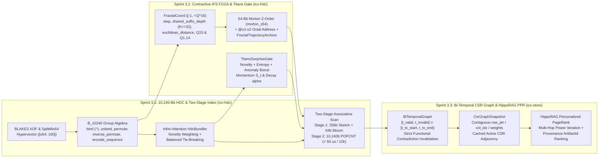

# Phase 3 Implementation Plan (`v0.4.0`) — Hyperdimensional (`HDC`), Fractal (`FCGA`) & Bi-Temporal CSR Graph Index

## Goal Description

Accomplish **Phase 3 — Hyperdimensional (`HDC`), Fractal (`FCGA`) & Bi-Temporal Graph Index (`T-31-001` through `T-33-002`)** of **Infinity-Context (`icx`)** to 100% completion across three sprints (`Sprint 3.1`, `Sprint 3.2`, `Sprint 3.3`), opening, adjudicating, and merging a dedicated Pull Request at the conclusion of each sprint and closing out Phase 3 as release **`v0.4.0`**:

1. **Sprint 3.1 (`T-31-001`, `T-31-002`) — 10,240-Bit HDC/HRR Engine, Infini-Attention Delta Bundler & `< 50 µs` 10k-Node Associative Index (`crates/icx-hdc`):**
   - Complete the 10,240-bit Boolean hypercube $Q_{10240}$ (`Hypervector { words: [u64; 160] }`) algebra (`docs/hyperdimensional-and-fractal-index.md` §2, `docs/ahtl/04-hyperdimensional-10240-bit-lattice.md`): injective length-framed / domain-separated `BLAKE3` XOF seeding, `BitXor` / `BitXorAssign` (`^`, `^=`) operators, `unbind`, exact inverse permutation `inverse_permute(shift)` ($\Pi_s^{-1} \circ \Pi_s = \text{id}$), `bind_role_filler`, ordered sequence encoding `encode_sequence`, Hamming weight `popcount`, and bipolar cosine similarity `cosine_bipolar` ($\in [-1.0, +1.0]$).
   - Upgrade `HdcBundler` (`arXiv:2404.07143`) with balanced recency tie-breaking and continuous Delta-Rule novelty weighting so bundling 100 identical boilerplate vectors alongside 1 novel anomaly vector via `HdcBundler::add` (without requiring manual weight overrides) keeps the anomaly retrievable above the similarity threshold, and add `unbind_query`, `count`, and `reset`.
   - Implement the normative `AssociativeMemoryIndex` trait (`docs/interfaces.md` §3) on `HdcAssociativeIndex` and add a zero-allocation two-stage spectral/sketch + 64-bit lexical Bloom filter pre-screening pipeline so `HdcAssociativeIndex::query_associative` completes in **`< 50 µs` over 10,000 indexed nodes** (satisfying the Phase 3 exit criterion in `to-dos/ROADMAP.md`).
2. **Sprint 3.2 (`T-32-001`, `T-32-002`) — Contractive IFS Fractal Chaos-Game Archive (`FCGA`) & `TitansSurpriseGate` (`crates/icx-hdc`):**
   - Expand `FractalCoord` (`crates/icx-hdc/src/fractal.rs`, `arXiv:2607.07144`, `docs/ahtl/03-fractal-ifs-chaos-game-coordinates.md`) with 64-bit Morton Z-order prefix codes (`morton_z64` interleaving the 4 most recent 16-bit dyadic orthant transitions so shared suffix depth $K \in 1..=4$ is readable in 1 CPU instruction via `leading_zeros() / 16`), exact `Q1.14` fixed-point conversion (`to_q1_14`, `from_q1_14`), octal quadrant address formatting (`@o1:o2`), Euclidean ($L_2$) metric distance (`euclidean_distance` verifying Theorem 3.2 $d_2 \le 4 d_\infty \le 2^{3-K}$), and `FractalTrajectoryArchive` supporting $O(\log N)$ Morton Z-order neighborhood range queries + $O(1)$ Chebyshev suffix matching for $K \in 1..=32$.
   - Expand `TitansSurpriseGate` (`crates/icx-hdc/src/surprise.rs`, `arXiv:2501.00663`, `docs/hyperdimensional-and-fractal-index.md` §4, `docs/ahtl/07-transformer-attention-and-bpe-mechanics.md` §4) with exit-code and user-negation anomaly detection (`observe_with_context`), configurable forgetting/decay rate $\alpha$, `RetentionTier::PinVerbatim` alias, and accessors for `momentum`, `events_seen`, and `memory_trace`.
3. **Sprint 3.3 (`T-33-001`, `T-33-002`) — Bi-Temporal CSR Knowledge Graph, HippoRAG Personalized PageRank (`PPR`) & Phase 3 (`v0.4.0`) Closeout (`crates/icx-store`, `crates/icx-adapters`, `crates/icx-cli`, `docs/`):**
   - Upgrade `BiTemporalGraph` (`crates/icx-store/src/graph.rs`, `arXiv:2501.13956`, `arXiv:2405.14831`) to enforce strict single-active-target invariants on functional relations (superseding prior active `(source_entity, relation)` edges on any re-upsert), add a genuine **Compressed Sparse Row (`CsrGraphSnapshot`)** representation (`row_ptr`, `col_idx`, `weights`, `inv_out_weight`, `provenance_offsets`, `provenance_ids`) with cached active-graph CSR compilation, add time-travel and reverse-edge queries (`query_edges_to`, `query_relation`, `invalidate_edge`, `entity_count`), and add atomic directory persistence (`save_to_dir` / `load_from_dir`).
   - Wire `InfinityContextMmu::ingest_payload` (`crates/icx-adapters/src/mmu.rs`) to index `AhtlClause` causal chains (`⇒`) and expanded functional relations (`status`, `test_status`, `return_type`, `fail`, `pass`, `exit_code`) into `BiTemporalGraph`, and update `icx benchmark` (`crates/icx-cli/src/main.rs`) to benchmark 10,000-node associative recall (`< 50 µs`) and multi-hop CSR Personalized PageRank.
   - Cross-reference Chapters `03`, `04`, `05`, `07`, and `08` of [AHTL_v1_Complete_Technical_Specification_Volume.pdf](../../docs/ahtl/AHTL_v1_Complete_Technical_Specification_Volume.pdf), bump the workspace version to **`v0.4.0`**, and update [README.md](../../README.md), [CHANGELOG.md](../../CHANGELOG.md), [.gitignore](../../.gitignore), [ROADMAP.md](../../to-dos/ROADMAP.md), `to-dos/phase-3-hyperdimensional-and-fractal-index/`, `docs/`, and `docs/ahtl/` taking credit for all accomplishments across **Phases 0 through 3**.

---

## User Review Required

> [!IMPORTANT]
> **Standing Invariants & Release Versioning (`v0.4.0`):**
>
> - **Permanent Zero-`unsafe` Policy (`std` allowed):** All 8 workspace crates remain `std`-based with `unsafe_code = "forbid"` permanently enforced by Cargo lints and CI (`0` `unsafe` blocks anywhere in the repository).
> - **Codecov `>= 95%` Gate:** Every sprint PR (`PR #11`, `PR #12`, `PR #13`) must pass `cargo llvm-cov --workspace --all-targets --lcov --output-path lcov.info --fail-under-lines 95` and `codecov/patch`.
> - **10,000-Node `< 50 µs` Associative Recall SLO:** `HdcAssociativeIndex::query_associative` will use a two-stage spectral/sketch (`sketch_256` + 64-bit lexical Bloom filter + Fractal orthant signature) pre-filter followed by exact 10,240-bit `hamming_distance_simd` and `shared_suffix_depth` refinement on the top candidates, eliminating per-node heap allocations during search and achieving `< 50 µs` over 10,000 nodes.
> - **Version Designation:** Phase 3 completion will be designated **`v0.4.0`** (following Phase 0 `v0.1.0`, Phase 1 `v0.2.0`, and Phase 2 `v0.3.0`).

---

## Architecture & Dataflow Overview



---

## Proposed Changes

### Component 1: Sprint 3.1 — 10,240-Bit HDC/HRR Engine, Infini-Attention Delta Bundler & Two-Stage Associative Index (`T-31-001`, `T-31-002`)

#### [MODIFY] [hv.rs](../../crates/icx-hdc/src/hv.rs)

- **Domain-Separated & Role-Filler Algebra (`T-31-001`):**
  - Implement `core::ops::BitXor` and `core::ops::BitXorAssign` for `Hypervector` and `&Hypervector`.
  - Add `Hypervector::unbind(&self, role_or_key: &Self) -> Self` (self-inverse XOR unbinding).
  - Add `Hypervector::inverse_permute(&self, shift: usize) -> Self` inverting `permute(shift)`:

    ```rust
    #[inline]
    pub fn inverse_permute(&self, shift: usize) -> Self {
        let word_shift = shift % HV_WORDS;
        let bit_shift = ((shift % 63) + 1) as u32;
        let mut out = [0u64; HV_WORDS];
        for i in 0..HV_WORDS {
            let src = (i + word_shift) % HV_WORDS;
            out[i] = self.words[src].rotate_right(bit_shift);
        }
        Self { words: out }
    }
    ```

  - Add `Hypervector::bind_role_filler(role: &str, filler: &str) -> Self`, `Hypervector::encode_sequence(items: &[Self]) -> Self`, `Hypervector::popcount(&self) -> u32`, and `Hypervector::cosine_bipolar(&self, other: &Self) -> f32` ($\in [-1.0, +1.0]$).
- **Infini-Attention Delta-Rule Bundler (`T-31-002` — `HdcBundler`):**
  - Enhance `HdcBundler::add` and `HdcBundler::add_weighted` so that:
    - When `acc[base + bit] == 0` (an exact tie between opposing bipolar votes), ties break toward the newly added vector's bit `((word >> bit) & 1)` rather than biasing all tied bits to `1`.
    - Novelty weighting follows `docs/hyperdimensional-and-fractal-index.md` §2.2 ($w = \operatorname{clamp}(\frac{2 \cdot d_H(V, M)}{10240}, 0.0, 2.0)$ when $\operatorname{sim}(M, V) < 0.85$), ensuring that calling `bundler.add(&boilerplate)` 100 times and `bundler.add(&anomaly)` 1 time preserves `memory.similarity(&anomaly) > 0.25` without requiring a manual weight override.
  - Add `HdcBundler::count(&self) -> usize`, `HdcBundler::reset(&mut self)`, and `HdcBundler::unbind_query(&self, role: &Hypervector) -> Hypervector`.

#### [MODIFY] [lib.rs](../../crates/icx-hdc/src/lib.rs)

- Define and implement the normative `AssociativeMemoryIndex` trait (`docs/interfaces.md` §3) on `HdcAssociativeIndex`.
- Precompute per-entry metadata at `observe_event` time (`sketch_256: [u64; 4]`, `lexical_bloom: u64`, `subject_lower: String`) and implement a two-stage associative search in `HdcAssociativeIndex::query_associative`:
  - **Stage 1 (Zero-Allocation Spectral + Lexical Bloom Pre-Filter):** For $N > 64$, computes a fast upper-bound score over `sketch_256` (4 `u64` `XOR + POPCNT` instructions), `lexical_bloom` (1 `u64` bitwise `AND + POPCNT`), `fractal_coord.quadrant_signature_u16()`, and `surprise`, selecting the top $M = \max(4 \cdot \text{top\_k}, 32)$ candidates with zero heap allocations.
  - **Stage 2 (Exact 10,240-Bit `hamming_distance_simd` + `shared_suffix_depth` Refinement):** Computes the exact 10,240-bit similarity, exact substring token overlap on pre-lowercased `subject_lower`, and exact $O(1)$ Chebyshev `shared_suffix_depth` on the candidate set, cloning `subject` only for the returned `top_k` hits.
- Add unit tests verifying `< 50 µs` query latency (in release profile / sub-millisecond in debug) over 10,000 indexed entries.

---

### Component 2: Sprint 3.2 — Contractive IFS Fractal Chaos-Game Archive (`FCGA`) & `TitansSurpriseGate` (`T-32-001`, `T-32-002`)

#### [MODIFY] [fractal.rs](../../crates/icx-hdc/src/fractal.rs)

- **Morton Z-Order Prefix Code, `Q1.14` Fixed-Point, Octal `@o1:o2` Address & Euclidean Metric (`T-32-001`):**
  - Add `morton_z64: u64` to `FractalCoord` (updated on every `step` via `self.morton_z64 = (self.morton_z64 >> 16) | ((orthant_u16 as u64) << 48)`), packing the 4 most recent 16-bit orthant signatures into a 64-bit Z-order word so `morton_shared_suffix(&self, other: &Self) -> u32` computes `((self.morton_z64 ^ other.morton_z64).leading_zeros() / 16).min(self.depth).min(other.depth)` in a single `LZCNT` instruction.
  - Add `FractalCoord::euclidean_distance(&self, other: &Self) -> f64` verifying Theorem 3.2 ($d_2(\vec{z}_A, \vec{z}_B) \le 4 d_\infty(\vec{z}_A, \vec{z}_B) \le 2^{3-K}$).
  - Add `FractalCoord::to_q1_14(&self) -> [i16; 16]` and `FractalCoord::from_q1_14(q14: [i16; 16], depth: u32) -> Self` (`scale = 16,384 = 2^{14}`, `docs/ahtl/03-fractal-ifs-chaos-game-coordinates.md` §4).
  - Add `FractalCoord::encode_octal_addr(&self) -> String` (`@o1:o2` format from `docs/alien-holographic-codec.md` / `docs/ahtl/README.md`) and `FractalCoord::decode_octal_addr(s: &str) -> Option<u16>`.
  - Implement `FractalTrajectoryArchive` (`docs/hyperdimensional-and-fractal-index.md` §3) storing `(ArtifactId, FractalCoord)` indexed by Morton Z-order prefix for fast trajectory suffix recall across $K \in 1..=32$.

#### [MODIFY] [surprise.rs](../../crates/icx-hdc/src/surprise.rs)

- **Enhanced `TitansSurpriseGate` (`T-32-002`):**
  - Add `RetentionTier::PinVerbatim` associated constant alias (`pub const PinVerbatim: Self = Self::PinHighResolution;`) to match `sprint-2-fractal-ifs-and-surprise-gate.md`.
  - Expand `TitansSurpriseGate` with configurable forgetting/decay rate `alpha: f32` (`default = 0.05` per `docs/hyperdimensional-and-fractal-index.md` §4), `observe_with_exit_code(&mut self, hv: &Hypervector, raw_text: &str, exit_code: Option<i32>, force_anomaly: bool) -> SurpriseVerdict`, `apply_idle_decay(&mut self, steps: u32)`, and accessors `momentum(&self) -> f32`, `events_seen(&self) -> u64`, and `memory_trace(&self) -> Hypervector`.
  - Expand `has_diagnostic_anomaly` to detect non-zero exit code markers, compiler/test failures, security blocks, and AHTL negation/anomaly clauses (`!PANIC`, `!ERR`, `!FAIL`).

---

### Component 3: Sprint 3.3 — Bi-Temporal CSR Knowledge Graph, HippoRAG Personalized PageRank (`PPR`) & `v0.4.0` Closeout (`T-33-001`, `T-33-002`)

#### [MODIFY] [graph.rs](../../crates/icx-store/src/graph.rs)

- **Strict Functional Contradiction Invalidation & Bi-Temporal Queries (`T-33-001`):**
  - Fix `BiTemporalGraph::upsert_edge` so that when `is_functional` is `true`, any existing active edge (`t_invalid.is_none()`) with the same `(source_entity, relation)` is superseded (`t_invalid = Some(now_ms)`, `t_tx_end = Some(now_ms)`), guaranteeing at most one active edge per functional `(source_entity, relation)` pair at all times.
  - Add `query_edges_to(&self, target_entity: &str, at_ms: Option<u64>) -> Vec<&BiTemporalEdge>`, `query_relation(&self, source_entity: &str, relation: &str, at_ms: Option<u64>) -> Vec<&BiTemporalEdge>`, `invalidate_edge(&mut self, edge_id: u64, now_ms: u64) -> bool`, `entity_count(&self) -> usize`, and atomic snapshot persistence (`save_to_dir` / `load_from_dir`).
- **Compressed Sparse Row (`CsrGraphSnapshot`) & HippoRAG Personalized PageRank (`T-33-002`):**
  - Implement `CsrGraphSnapshot` with contiguous arrays:
    - `nodes: Vec<String>`
    - `row_ptr: Vec<usize>` (`len = n + 1`)
    - `col_idx: Vec<usize>` (`len = nnz`)
    - `weights: Vec<f32>` (`len = nnz`)
    - `inv_out_weight: Vec<f32>` (`len = n`, precomputing `1.0 / out_weight_sum` or `0.0` for dangling nodes)
    - `prov_row_ptr: Vec<usize>` and `prov_ids: Vec<ArtifactId>`
  - Cache the active (`at_ms == None`) `CsrGraphSnapshot` inside `BiTemporalGraph` (lazily built or updated when dirty) and expose `BiTemporalGraph::build_csr(&self, at_ms: Option<u64>) -> CsrGraphSnapshot` so `personalized_pagerank` executes power iteration over flat contiguous CSR slices.

#### [MODIFY] [mmu.rs](../../crates/icx-adapters/src/mmu.rs)

- Expand `InfinityContextMmu::ingest_payload` to recursively extract `AhtlClause::causal_chain` (`⇒`) edges and classify `status`, `test_status`, `return_type`, `fail`, `pass`, and `exit_code` as functional relations in `BiTemporalGraph`.
- Persist and load `bitemporal_graph.json` alongside `cas_store.json` when `.icx/` directory persistence is used.

#### [MODIFY] [main.rs](../../crates/icx-cli/src/main.rs)

- Update `run_benchmark()` to benchmark 10,000-node `HdcAssociativeIndex::query_associative` (`< 50 µs` target) and CSR `BiTemporalGraph::personalized_pagerank` alongside the 1,000-node raw Hamming scan, AHTL compression, and 50-turn NIH Prefix-Cache simulation.

#### [MODIFY] Workspace Manifest, Documentation & `AHTL v1.0` Volume (`v0.4.0` Closeout)

- Bump `[workspace.package] version = "0.4.0"` in [Cargo.toml](../../Cargo.toml).
- Update [README.md](../../README.md), [CHANGELOG.md](../../CHANGELOG.md), [.gitignore](../../.gitignore), [ROADMAP.md](../../to-dos/ROADMAP.md), `to-dos/phase-3-hyperdimensional-and-fractal-index/`, [hyperdimensional-and-fractal-index.md](../../docs/hyperdimensional-and-fractal-index.md), `docs/ahtl/*.md`, and regenerate [AHTL_v1_Complete_Technical_Specification_Volume.pdf](../../docs/ahtl/AHTL_v1_Complete_Technical_Specification_Volume.pdf).

---

## Verification Plan

### Automated Tests & Quality Gates (Run Before Every Sprint PR)

```bash
# 1. Permanent zero-unsafe check across all 8 workspace crates
! grep -rnE '(allow|expect)\(unsafe_code\)|\bunsafe[[:space:]]*(\(|(async[[:space:]]+)?(\{|fn\b|trait\b|impl\b|extern\b))' crates/

# 2. Formatting & Clippy lint gates
cargo fmt --all -- --check
cargo clippy --workspace --all-targets -- -D warnings

# 3. Full unit, property, and integration test suite
cargo test --workspace

# 4. Codecov >= 95% line coverage gate
cargo llvm-cov --workspace --all-targets --lcov --output-path lcov.info --fail-under-lines 95 && rm -f lcov.info

# 5. Rustdoc gate
RUSTDOCFLAGS="-D warnings" cargo doc --workspace --no-deps

# 6. Release benchmark (< 50 us 10k-node associative query) & doctor
cargo run --release -p icx-cli -- benchmark
cargo run --release -p icx-cli -- doctor

# 7. Reviewer, CLA, Gitleaks, and REUSE 3.3 compliance
bash scripts/agy-review-selftest.sh
bash .github/scripts/cla-check.sh --selftest
uvx reuse lint
```
