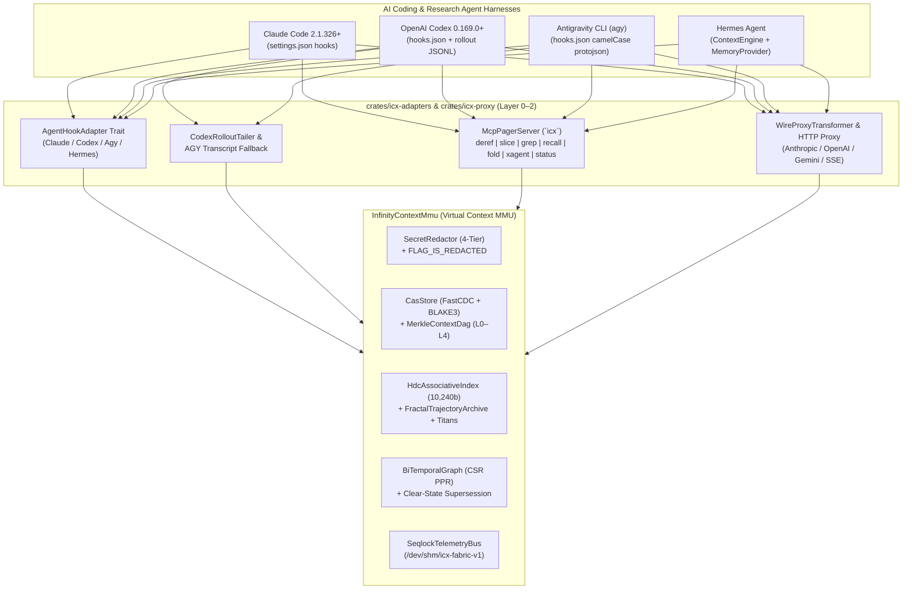

# Phase 4 (`v0.5.0`) Implementation Plan — Cross-Agent Low-Level Interception, Single-Tool MCP Pager & Cache-Epoch Wire Proxy

## Goal Description

Implement **Phase 4 (`v0.5.0`)** of **Infinity-Context (`icx`)** across all three sprints (`T-41-001` through `T-43-002`) in `crates/icx-adapters`, `crates/icx-proxy`, and `crates/icx-cli`:
1. **Sprint 4.1 (`T-41-001`..`T-41-002`):** Implement the normative `AgentHookAdapter` trait and `AdapterError` (`docs/interfaces.md` §4), upgrade `InfinityContextMmu` with clear-state functional supersession in `BiTemporalGraph`, workspace persistence (`load_workspace_dir` / `save_workspace_dir`), and redaction tracking (`is_artifact_redacted`), expand `ClaudeCodeAdapter` (`SessionStart` `ICX:LEGEND`, `PreToolUse`, `PostToolUse` `lines=1..L` + `updatedMCPToolOutput`, `SubagentStart` / `SubagentStop` Context-Folding), and expand `CodexAdapter` (`pre-tool-use`, `subagent-start`, `subagent-stop`, `session-end`, `updatedMCPToolOutput`, and `CodexRolloutTailer` for incremental `RolloutItemWire` JSONL ingestion).
2. **Sprint 4.2 (`T-42-001`..`T-42-002`):** Upgrade `AntigravityAdapter` (`PostInvocation` `force_continue`, `PreToolUse` `overwrite`, `PostToolUse` non-error filtering + `transcriptPath` JSONL fallback, and `Stop` `#icx:<hex>` epoch handle reporting) and implement the full `HermesAdapter` `ContextEngine` and `MemoryProvider` contract (`select_context`, `prune_tool_results_only`, `compress`, `on_turn_complete`, `on_pre_compress` v2, and CLI `--agent hermes` hook dispatch).
3. **Sprint 4.3 (`T-43-001`..`T-43-002`):** Harden `McpPagerServer` (in-band `FLAG_IS_REDACTED` exactness honesty metadata, structured 12-hex ambiguity recovery hints, bidirectional `op: "xagent"` publish/poll, `notifications/initialized` & `ping`, `< 180` token schema verification), expand `WireProxyTransformer` in `crates/icx-proxy` (Anthropic array content & `tool_result` block virtualization, Gemini `/v1beta/models/*` `transform_gemini_request`, inbound SSE inline `⟪!icx:deref(#icx:...)⟫` expansion, and safe `std::net::TcpListener` HTTP `127.0.0.1:49380` routing), cross-reference against [AHTL_v1_Complete_Technical_Specification_Volume.pdf](../../docs/ahtl/AHTL_v1_Complete_Technical_Specification_Volume.pdf) (strictly read-only oracle), close Codecov coverage gaps toward `100.00%`, update all project documentation (`README.md`, `CHANGELOG.md`, `to-dos/ROADMAP.md`, `docs/`, `GEMINI.md`), and persist durable knowledge via `ai-memory`.

---

## User Review Required

> [!IMPORTANT]
> **Permanent Architectural & Workflow Invariants Maintained Throughout Phase 4 (`v0.5.0`):**
> 1. **`std`-Based, 100% Zero-`unsafe` Code (`unsafe_code = "forbid"`):** All 8 workspace crates remain permanently `unsafe_code = "forbid"` through `v1.0.0` (`0` `unsafe` blocks anywhere in the repository). The local HTTP proxy (`icx proxy`) and rollout/transcript tailers use 100% safe `std::net::TcpListener` and `std::fs::File` / `BufReader` I/O.
> 2. **Read-Only `AHTL_v1_Complete_Technical_Specification_Volume.pdf` Oracle:** [AHTL_v1_Complete_Technical_Specification_Volume.pdf](../../docs/ahtl/AHTL_v1_Complete_Technical_Specification_Volume.pdf) will not be modified unless a genuine specification error is discovered; it serves strictly as the authoritative cross-reference oracle at the conclusion of Phase 4.
> 3. **Per-Sprint PRs, Multi-Round Bot Adjudication & `~100%` Codecov Coverage:** Each sprint (`4.1`, `4.2`, `4.3`) will be committed and pushed as its own PR, adjudicated across all review rounds (`OpenAI Codex` and `Antigravity PR Review`) until zero blocking/major/minor issues remain, and verified for `~100%` Codecov patch and module coverage before merging.

---

## Architecture & Interception Dataflow



---

## Proposed Changes

### Sprint 4.1 — `AgentHookAdapter` Trait, `InfinityContextMmu` Clear-State Supersession, `ClaudeCodeAdapter` & `CodexAdapter` (`T-41-001`..`T-41-002`)

#### [MODIFY] [lib.rs](../../crates/icx-adapters/src/lib.rs)
- Define `AdapterError` (`#[derive(Debug, thiserror::Error)]` covering `Json(#[from] serde_json::Error)`, `Icx(#[from] icx_core::IcxError)`, and `Io(String)`) and the normative `AgentHookAdapter` trait (`docs/interfaces.md` §4):
  ```rust
  pub trait AgentHookAdapter: Send + Sync {
      fn agent_kind(&self) -> AgentKind;
      fn handle_hook_event(
          &self,
          event_name: &str,
          stdin_json: &str,
          mmu: &mut InfinityContextMmu,
      ) -> Result<String, AdapterError>;
  }
  ```
- Re-export `AdapterError`, `AgentHookAdapter`, and `CodexRolloutTailer`.

#### [MODIFY] [mmu.rs](../../crates/icx-adapters/src/mmu.rs)
- Track `redacted_artifacts: BTreeSet<ArtifactId>` on `InfinityContextMmu` whenever `was_redacted` is `true` in `ingest_payload_with_exit_code`, and expose `pub fn is_artifact_redacted(&self, id: ArtifactId) -> bool`.
- Implement **Clear-State Functional Supersession** (`ref-docs/ahtl-exactness-review-and-analysis.md` §2.6 #2):
  - When `ingest_payload_with_exit_code` processes an event where `packet.clauses` contains `"pass"` and no `"fail"` clause (or `exit_code == Some(0)`), explicitly upsert `("fail", "0", true)` and `("status", "PASS", true)` on `self.graph` so stale failure edges for `subject` are deterministically invalidated.
  - Conversely, when `packet.clauses` contains `"fail"` or `exit_code.is_some_and(|c| c != 0)`, upsert `("status", "FAIL", true)`.
- Add `load_workspace_dir(&mut self, icx_dir: &Path) -> Result<(), IcxError>` and `save_workspace_dir(&self, icx_dir: &Path) -> Result<(), IcxError>` to load/save `cas_store.json`, `bitemporal_graph.json`, and `icx-fabric-v1.shm` coherently.

#### [MODIFY] [claude.rs](../../crates/icx-adapters/src/claude.rs)
- Implement `AgentHookAdapter` for `ClaudeCodeAdapter`.
- **`SessionStart`:** Prepend the canonical AHTL legend header `⟪ICX:LEGEND│Δ=code_mut│Ψ=tool_stub│Ω=invariant│Θ=xagent│Φ=folded_branch│↦=deref_via_icx_tool⟫` to `hookSpecificOutput.additionalContext` (`docs/agent-adapters-and-interception.md` §2.1 #1).
- **`PreToolUse`:** Return `{"hookSpecificOutput": {"hookEventName": "PreToolUse", "permissionDecision": "allow"}}` (`cross-agent-hook-and-wire-matrix.md` §2).
- **`PostToolUse`:** Include `lines=1..<total_lines>` in the `⟪ICX:STUB│#icx:<hex>│raw=<N>B→<M>B│lines=1..<L>⟫` header (`docs/agent-adapters-and-interception.md` §2.1 #3), and populate `updatedMCPToolOutput` alongside `updatedToolOutput` when `tool_name.starts_with("mcp__")`.
- **`SubagentStart` & `SubagentStop`:** On `SubagentStart`, open a sub-trajectory branch (`mmu.epochs.begin_branch(&mut mmu.dag, subagent_id)`) and return `hookSpecificOutput.additionalContext`; on `SubagentStop`, fold the active branch (`mmu.epochs.fold_branch`) and return `systemMessage` with the folded branch commit (`cross-agent-hook-and-wire-matrix.md` §2).

#### [MODIFY] [codex.rs](../../crates/icx-adapters/src/codex.rs)
- Implement `AgentHookAdapter` for `CodexAdapter`.
- Support `PreToolUse` / `pre-tool-use`, `SubagentStart` / `subagent-start`, `SubagentStop` / `subagent-stop`, and `SessionEnd` / `session-end` with strict `additionalProperties: false` schema fields (`continue`, `stopReason`, `suppressOutput`, `systemMessage`), and include `updatedMCPToolOutput` in `PostToolUse` when `tool_name.starts_with("mcp__")` and `res.was_virtualized` (`docs/agent-adapters-and-interception.md` §3.1 #2).
- Implement `CodexRolloutTailer` (`docs/agent-adapters-and-interception.md` §3.1 #4):
  - `ingest_rollout_jsonl_since(path: &Path, byte_offset: u64, mmu: &mut InfinityContextMmu) -> Result<(u64, usize), std::io::Error>`: Seeks to `byte_offset`, reads complete JSONL lines (`RolloutItemWire` items including `function_call_output`, `RetainedContext`, `Compacted`, `TurnContext`, and message items), ingests non-empty payloads into `mmu` under `AgentKind::Codex`, and returns `(new_byte_offset, ingested_count)`.

---

### Sprint 4.2 — `AntigravityAdapter` & `HermesAdapter` (`ContextEngine` & `MemoryProvider`) (`T-42-001`..`T-42-002`)

#### [MODIFY] [antigravity.rs](../../crates/icx-adapters/src/antigravity.rs)
- Implement `AgentHookAdapter` for `AntigravityAdapter`.
- **`PostToolUse` Error & Transcript Handling:**
  - Filter out non-error JSON values (`Value::Bool(false)`, empty strings `""`, empty arrays `[]`, empty objects `{}`) when extracting `"error"`.
  - When `resp_str` is empty and `"transcriptPath"` is provided in the hook JSON payload, read the trailing step from `transcriptPath` (if the file exists) and extract its `"content"` / `"output"` field (`docs/agent-adapters-and-interception.md` §4.1 #3).
- **`PreToolUse`:** When `payload.get("overwrite")` is supplied or `payload.get("boundOutput").and_then(Value::as_bool) == Some(true)`, include `"overwrite"` in the `{"decision": "allow", ...}` response (`docs/agent-adapters-and-interception.md` §4.1 #2).
- **`PostInvocation` / `post-invocation`:** Support `injectSteps` and `"terminationBehavior": "force_continue"` when `payload.get("forceContinue").and_then(Value::as_bool) == Some(true)` (`rea-binary-and-sqlite-forensics.md` §2.3 #3).
- **`Stop`:** Include the latest sealed epoch `#icx:<16-hex>` handle in the continuation `reason` (`⟪ICX:EPOCH_FOLDED│#icx:<hex>│Resume from sealed AHTL state⟫\n<tail>`) when an epoch is sealed (`docs/agent-adapters-and-interception.md` §4.1 #4).

#### [MODIFY] [hermes.rs](../../crates/icx-adapters/src/hermes.rs)
- Implement `AgentHookAdapter` for `HermesAdapter`.
- Expand `HermesAdapter` to cover all four `ContextEngine` methods and `MemoryProvider.on_pre_compress` (`docs/agent-adapters-and-interception.md` §5, `rea-binary-and-sqlite-forensics.md` §2.4):
  1. `select_context(request_messages, protect_first_n, protect_last_n, mmu) -> Vec<HermesMessage>`
  2. `prune_tool_results_only(messages, protect_last_n, mmu) -> (Vec<HermesMessage>, usize)`: Virtualizes bulky middle tool messages (`role == "tool"` and `content.len() >= mmu.tool_virtualize_threshold`) into `⟪ICX:STUB│#icx:<hex>│...⟫` AHTL stubs without mutating head/tail messages, returning `(pruned_messages, n_pruned)`.
  3. `compress(messages, focus_topic, mmu) -> Vec<HermesMessage>`: Ingests middle messages, triggers `mmu.epochs.maybe_rollover(&mut mmu.dag)`, and returns the compacted message vector with the Ephemeral Tail Slot queried against `focus_topic`.
  4. `on_turn_complete(messages, mmu) -> usize`: Post-turn indexing hook that ingests the latest turn messages into `mmu` and returns the number of messages indexed.
  5. `on_pre_compress(messages, mmu) -> String`: Implements `MemoryProvider.on_pre_compress` (`PRE_COMPRESS_CHECKPOINT_API_VERSION = 2`), ingesting unindexed messages and returning a deterministic `⟪ICX:HERMES_PRE_COMPRESS_V2│api_version=2│...⟫` AHTL checkpoint string.
  6. `handle_hook(event_name, stdin_json, mmu) -> Result<String, serde_json::Error>`: Dispatches `select_context`, `prune_tool_results_only`, `compress`, `on_turn_complete`, and `on_pre_compress` for `icx hook --agent hermes --event <EVENT>`.

---

### Sprint 4.3 — Single-Tool Polymorphic MCP Pager (`McpPagerServer`), Multi-Provider + SSE `WireProxyTransformer`, Local HTTP Proxy & Phase 4 (`v0.5.0`) Closeout (`T-43-001`..`T-43-002`)

#### [MODIFY] [mcp.rs](../../crates/icx-adapters/src/mcp.rs)
- **Schema Token Budget Helper (`T-43-001`):** Add `pub fn schema_token_estimate() -> usize` verifying the serialized `tool_schema()` is strictly `< 180` tokens (`docs/wire-protocol-and-shm-bus.md` §3).
- **In-Band Redaction Provenance & Ambiguity Hints (`ref-docs/ahtl-exactness-review-and-analysis.md` §2.6 #3):**
  - When `resolve_handle` fails with `IcxError::AmbiguousHandlePrefix(p)`, return a structured actionable error `ERR: ambiguous handle prefix ... (retry with full 64-bit #icx:<16-hex> handle)`.
  - When `args.get("provenance").and_then(Value::as_bool) == Some(true)` on `op: "deref"` or `op: "slice"` (or when querying `op: "status"`), include explicit exactness tier and `redacted=<true|false>` metadata (`mmu.is_artifact_redacted(aid)`).
- **Bidirectional `op: "xagent"` (`docs/wire-protocol-and-shm-bus.md` §3):**
  - When `q` is provided and non-empty in `op: "xagent"`, publish the message onto `mmu.bus` via `mmu.ingest_payload(AgentKind::GenericMcp, "xagent_broadcast", q, false)` and return the published `⟦Θ:...⟧` telepathy packet; when `q` is empty or omitted, poll the latest cross-agent telepathy frames from `mmu.bus`.
- **MCP Protocol Completeness:** Handle `notifications/initialized` and `ping` cleanly in `handle_jsonrpc`.

#### [MODIFY] [wire.rs](../../crates/icx-proxy/src/wire.rs)
- **Anthropic Content-Block Array Support (`transform_anthropic_messages`):**
  - Virtualize oversized middle-history `"text"` and `"tool_result"` content blocks inside `msg["content"]` arrays (in addition to string `msg["content"]`), and append the Ephemeral Tail Slot to the final message whether its `"content"` is a string or a content-block array.
- **Gemini `/v1beta/models/*` Request Transformer (`transform_gemini_request`):**
  - Transform Gemini `contents[].parts[].text` payloads (`docs/agent-adapters-and-interception.md` §6), virtualizing oversized middle turns under `AgentKind::AntigravityCli` while preserving `systemInstruction` and `protect_tail` recent turns, and appending the Ephemeral Tail Slot to the final user turn.
- **Inbound Streaming SSE Inline Dereference Expander (`expand_inline_deref_directives` & `transform_sse_chunk`):**
  - Scan assistant text deltas or SSE `data: {...}` lines for `⟪!icx:deref(#icx:<hex>)⟫` or `⟪!icx:deref(#icx:<hex>,L<start>-<end>)⟫` directives and expand them in-place from `mmu.deref_text` / `mmu.deref_lines` (`docs/agent-adapters-and-interception.md` §6 #2).
- **Safe `std::net::TcpListener` HTTP/1.1 Proxy Handler (`handle_http_request` & `serve_n_requests`):**
  - Implement a 100% safe `std::io::{BufRead, Write}` HTTP/1.1 request parser and response writer routing `POST /anthropic/v1/messages`, `POST /openai/v1/responses`, `POST /openai/v1/chat/completions`, `POST /gemini/v1beta/models/*`, and `GET /healthz`.

#### [MODIFY] [main.rs](../../crates/icx-cli/src/main.rs)
- Wire `AgentKind::Hermes => HermesAdapter::handle_hook(event_str, stdin_buf, &mut mmu)` in `execute_hook`, and support `--dir <PATH>` persistence on `icx hook` and `icx mcp-serve`.
- Support `--provider gemini` (and auto-detection of Gemini `"contents"` payloads) in `icx proxy-transform`, plus the `icx proxy [--bind <ADDR>] [--dir <PATH>] [--once]` subcommand (`docs/interfaces.md` §5).

#### [MODIFY] Workspace Manifest & Documentation (`Sprint 4.3 Closeout`)
- Bump `version = "0.5.0"` in [Cargo.toml](../../Cargo.toml).
- Update [README.md](../../README.md), [CHANGELOG.md](../../CHANGELOG.md), [ROADMAP.md](../../to-dos/ROADMAP.md), [GEMINI.md](../../GEMINI.md), [agent-adapters-and-interception.md](../../docs/agent-adapters-and-interception.md), [wire-protocol-and-shm-bus.md](../../docs/wire-protocol-and-shm-bus.md), [interfaces.md](../../docs/interfaces.md), and [08-v1-reference-implementation-blueprint.md](../../docs/ahtl/08-v1-reference-implementation-blueprint.md).

---

## Verification Plan

### Automated Quality & Coverage Gates (Executed Before Every Sprint PR & Final Merge)
```bash
# 1. Formatting and Zero-Warning Clippy Gate
cargo fmt --all -- --check
cargo clippy --workspace --all-targets -- -D warnings

# 2. Full Workspace Unit & Integration Tests
cargo test --workspace

# 3. Codecov Line Coverage Gate (>= 95% workspace floor, targeting 100.00% on all Phase 4 crates)
cargo llvm-cov --workspace --all-targets --lcov --output-path lcov.info --fail-under-lines 95

# 4. REUSE 3.3 Licensing & SPDX Gate
uvx reuse lint

# 5. End-to-End Release Benchmarks & Doctor Verification
cargo run --release -p icx-cli -- doctor
cargo run --release -p icx-cli -- benchmark
```

### AHTL v1 Specification & Forensic Cross-Reference Verification
- Cross-check all Phase 4 implementations against [AHTL_v1_Complete_Technical_Specification_Volume.pdf](../../docs/ahtl/AHTL_v1_Complete_Technical_Specification_Volume.pdf) (Chapters 01, 06, 07, 08), [rea-binary-and-sqlite-forensics.md](../../ref-docs/agent-internals/rea-binary-and-sqlite-forensics.md), [cross-agent-hook-and-wire-matrix.md](../../ref-docs/agent-internals/cross-agent-hook-and-wire-matrix.md), and [ahtl-exactness-review-and-analysis.md](../../ref-docs/ahtl-exactness-review-and-analysis.md).
